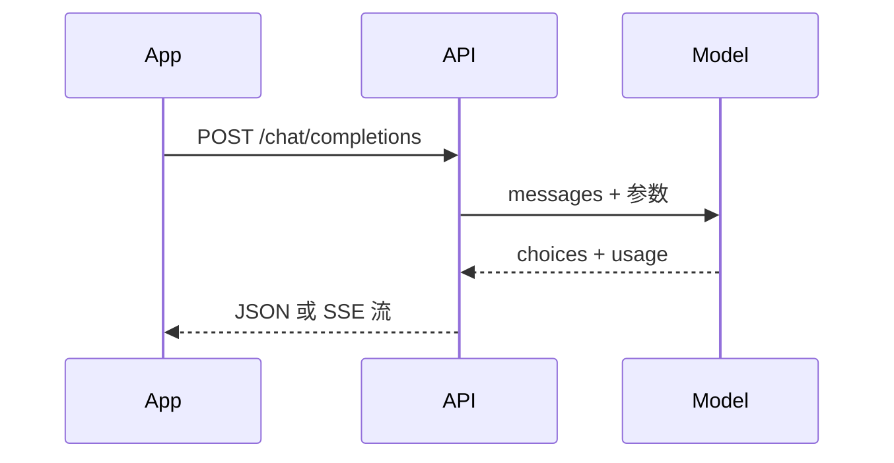
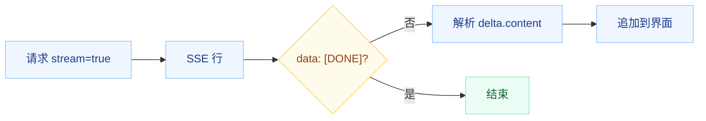
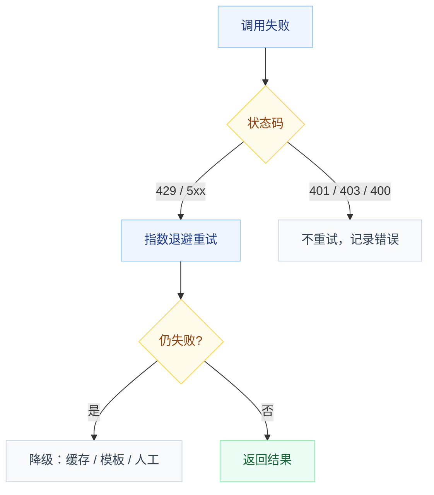

# 大模型基础与API

> 这篇从模型能力和边界讲起，经过 API 接入、流式与多轮、结构化输出与工具调用、成本和限流，最后落到生产接入与排障。
>
> 学完能完成一次兼容 API 调用、流式输出和基本的重试/降级。

## 一、模型能力与边界

大语言模型（Large Language Model，LLM）根据上下文预测下一个 token。它能生成、总结、改写、抽取和调用工具，但不保证事实正确，也不天然理解业务规则。

大模型的核心判断：输出是概率生成，同一个输入可能得到不同结果；模型只知道上下文里有的东西，没给它的数据可能被编造；上下文窗口、成本、延迟和限流共同决定能放多少、能问多快。

### 1.1 适用与不适用

| 适合 | 不适合 |
|---|---|
| 分类、抽取、改写、总结 | 精确计算、财务记账 |
| 问答、检索增强、客服辅助 | 高风险医疗/法律最终决策 |
| 生成草稿、代码补全 | 需要强一致性的状态流转 |
| 工具调用、流程编排 | 没有验收标准的开放式任务 |

> 边界：涉及金额、权限、合规和不可逆操作时，模型只能做建议，最终动作要由确定性代码或人确认。

## 二、API 接入最小闭环

大多数厂商提供 OpenAI 兼容接口：`POST {base_url}/chat/completions`，用 `messages` 传对话，用 `model` 选模型。

> 依赖：Python 3.11+；`python -m pip install requests`。Windows、macOS、Linux 的命令一致。

```bash
export OPENAI_BASE_URL="https://api.openai.com/v1"
export OPENAI_API_KEY="sk-..."
export OPENAI_MODEL="your-model-name"
```

```python
import os
import requests

# 兼容接口：base_url + /chat/completions
resp = requests.post(
    f"{os.environ['OPENAI_BASE_URL']}/chat/completions",
    headers={"Authorization": f"Bearer {os.environ['OPENAI_API_KEY']}"},
    json={
        "model": os.environ["OPENAI_MODEL"],
        "messages": [
            # system 放规则，user 放本次任务
            {"role": "system", "content": "回答简洁，只给结论和依据。"},
            {"role": "user", "content": "用简短的话解释什么是 RAG。"}
        ],
        "temperature": 0.2, # 抽取/分类用低温，创意用高温
    },
    timeout=30, # 必须设置，避免无限等待
)
resp.raise_for_status()
data = resp.json()
print(data["choices"][0]["message"]["content"])
print(data["usage"]) # usage 用于成本核算
```

预期响应（示例，字段以厂商为准）：

```json
{
  "id": "chatcmpl-xxx",
  "choices": [
    {
      "index": 0,
      "message": {"role": "assistant", "content": "RAG 是检索增强生成……"},
      "finish_reason": "stop"
    }
  ],
  "usage": {"prompt_tokens": 26, "completion_tokens": 58, "total_tokens": 84}
}
```

| 参数 | 作用 | 建议 |
|---|---|---|
| `model` | 模型 ID | 固定版本，不要用会漂移的别名 |
| `messages` | 对话上下文 | system 放规则，user 放任务 |
| `temperature` | 随机性 | 抽取/分类用 0–0.3，创意用 0.7+ |
| `max_tokens` | 输出上限 | 按业务限制，防止成本失控 |
| `timeout` | 客户端超时 | 必须设置，不要无限等待 |



> 边界：`base_url` 是否包含 `/v1` 取决于厂商；先看厂商文档，不要硬编码。

## 三、流式与多轮

### 3.1 流式

流式用 Server-Sent Events（SSE）逐块返回，首字延迟更低。

```python
import json
import requests

with requests.post(
    f"{os.environ['OPENAI_BASE_URL']}/chat/completions",
    headers={"Authorization": f"Bearer {os.environ['OPENAI_API_KEY']}"},
    json={
        "model": os.environ["OPENAI_MODEL"],
        "messages": [{"role": "user", "content": "写一个 3 行的 Java Hello World"}],
        "stream": True, # 开启 SSE 流式
    },
    stream=True,
    timeout=60,
) as resp:
    resp.raise_for_status()
    for raw in resp.iter_lines():
        if not raw:
            continue
        if raw.startswith(b"data: "):
            payload = raw[6:] # 去掉 "data: " 前缀
            if payload == b"[DONE]": # 流结束标记
                break
            delta = json.loads(payload)["choices"][0]["delta"]
            print(delta.get("content", ""), end="", flush=True) # 增量文本
```

> 边界：流式响应不是完整 JSON，不能直接 `resp.json()`；要按 SSE 行解析，并处理 `[DONE]` 和空行。



### 3.2 多轮对话

多轮就是把历史消息按顺序放回 `messages`：

```python
messages = [
    {"role": "system", "content": "你是企业报销助手，只回答报销规则。"},
    {"role": "user", "content": "发票抬头写错了怎么办？"},
    {"role": "assistant", "content": "需要联系开票方重开，或在系统中提交更正申请。"},
    {"role": "user", "content": "重开需要多久？"},
]
```

上下文管理策略：

| 策略 | 做法 | 适用 |
|---|---|---|
| 全量保留 | 所有消息都带上 | 短对话、强依赖历史 |
| 滑动窗口 | 只保留最近 N 轮 | 普通客服 |
| 摘要 | 把早期对话压缩成摘要 | 长对话 |
| 检索 | 只注入相关文档/记录 | RAG、知识库 |

> 边界：上下文越长，成本和延迟越高，模型也可能忽略中间信息。不要把整本手册塞进 prompt。

## 四、结构化输出与工具调用

### 4.1 结构化输出

需要稳定字段时，用 JSON Schema 约束输出，并在客户端校验。

```python
json={
    "model": os.environ["OPENAI_MODEL"],
    "messages": [
        {"role": "system", "content": "从文本中抽取工单信息，只输出 JSON。"},
        {"role": "user", "content": "打印机卡纸，办公室 3 楼，今天上午。"}
    ],
    "response_format": {
        "type": "json_schema",
        "json_schema": {
            "name": "ticket",
            "strict": True,
            "schema": {
                "type": "object",
                "properties": {
                    "category": {"type": "string"},
                    "location": {"type": "string"},
                    "urgency": {"type": "string", "enum": ["low", "medium", "high"]}
                },
                "required": ["category", "location", "urgency"],
                "additionalProperties": False
            }
        }
    }
}
```

> 边界：Schema 约束的是格式，不是事实。字段值仍要校验，例如 `location` 是否在允许的楼栋列表中。

### 4.2 工具调用

工具调用让模型输出“要调用哪个函数、参数是什么”，由应用执行并把结果回传。

```json
{
  "name": "query_order",
  "arguments": "{\"orderId\":\"SO-20261113-001\"}"
}
```

应用侧必须：

- 校验工具名和参数；
- 校验当前用户是否有权限；
- 对写操作做二次确认；
- 把工具结果作为新消息回传，不要让模型直接访问数据库。

> 边界：工具调用不是授权。模型可以“请求”调用，但不能绕过应用的权限和审计。

## 五、成本、限流与可靠性

### 5.1 Token 与成本

成本 ≈ 输入 token × 输入单价 + 输出 token × 输出单价。不同模型、不同厂商价格差异很大。

| 控制项 | 做法 |
|---|---|
| 输入 | 精简 system、裁剪历史、只注入相关片段 |
| 输出 | 设置 `max_tokens`，要求简洁格式 |
| 缓存 | 对稳定前缀/常见问题做缓存 |
| 路由 | 简单任务用小模型，复杂任务用大模型 |
| 预算 | 按用户/租户/接口设日限额 |

### 5.2 限流与重试

常见限流维度：RPM（每分钟请求数）、TPM（每分钟 token 数）、并发数。

```python
import random
import time
import requests

def call_with_retry(fn, max_retries=3):
    for attempt in range(max_retries):
        try:
            return fn()
        except requests.HTTPError as e:
            # 只对 429 和 5xx 重试；401/403/400 重试不会成功
            if e.response.status_code not in (429, 500, 502, 503, 504):
                raise
            if attempt == max_retries - 1:
                raise
            # 指数退避 + 随机抖动，避免同时重试打满
            delay = min(2 ** attempt + random.random(), 8)
            time.sleep(delay)
```

> 边界：不要对所有错误重试。401/403/400 重试不会成功；429 要尊重 `Retry-After`；写操作要保证幂等。



## 六、生产接入与排障

生产接入至少要有：

- 统一网关：鉴权、配额、路由、审计；
- 日志：请求 ID、模型、token、延迟、错误码，不记录敏感原文；
- 安全：提示注入防护、输出过滤、PII 脱敏、工具权限；
- 降级：超时/限流时返回缓存、模板或人工入口；
- 观测：成功率、P95 延迟、token 成本、用户反馈。

| 现象 | 最可能原因 | 第一条检查 |
|---|---|---|
| 401 | Key 缺失/错误/过期 | Header 是否为 `Bearer <key>` |
| 403 | 无权限/区域/模型未开通 | 厂商控制台的模型权限 |
| 404 | base_url 或路径错误 | 是否多了/少了 `/v1` |
| 429 | RPM/TPM 超限 | 响应头 `Retry-After`、当前配额 |
| 400 context_length_exceeded | 上下文超限 | 统计 token，裁剪历史 |
| 5xx / timeout | 厂商故障/网络 | 重试、降级、看状态页 |

> 边界：不要把 API Key 写进前端、日志或 Git；浏览器直连会暴露 Key，生产必须走服务端代理。

## 七、最佳实践案例

### 7.1 案例背景

客服工单需要从一段描述中抽取 `category`、`location`、`urgency`，写入工单系统。要求字段稳定、失败可重试、成本可控。

### 7.2 案例实操

```python
import json
import os
import time
import requests

# 结构化字段和枚举约束
SCHEMA = {
    "type": "object",
    "properties": {
        "category": {"type": "string"},
        "location": {"type": "string"},
        "urgency": {"type": "string", "enum": ["low", "medium", "high"]},
    },
    "required": ["category", "location", "urgency"],
    "additionalProperties": False,
}

def extract_ticket(text: str) -> dict:
    payload = {
        "model": os.environ["OPENAI_MODEL"],
        "messages": [
            {"role": "system", "content": "只输出 JSON，不要解释。"},
            {"role": "user", "content": text},
        ],
        "response_format": {
            "type": "json_schema",
            "json_schema": {"name": "ticket", "strict": True, "schema": SCHEMA},
        },
    }

    for attempt in range(3):
        resp = requests.post(
            f"{os.environ['OPENAI_BASE_URL']}/chat/completions",
            headers={"Authorization": f"Bearer {os.environ['OPENAI_API_KEY']}"},
            json=payload,
            timeout=30,
        )
        # 429 和 5xx 可重试，400/401/403 不重试
        if resp.status_code == 429 or 500 <= resp.status_code < 600:
            time.sleep(2 ** attempt)
            continue
        resp.raise_for_status()

        content = resp.json()["choices"][0]["message"]["content"].strip()
        # 去掉模型可能带上的 Markdown 代码围栏
        if content.startswith("`" * 3):
            content = content.strip("`")
            content = content[content.find("\n") + 1:]
        data = json.loads(content)
        # 业务校验：枚举和必填字段
        if data.get("urgency") not in {"low", "medium", "high"}:
            raise ValueError("invalid urgency")
        return data

    raise RuntimeError("retry exhausted")

if __name__ == "__main__":
    print(extract_ticket("打印机卡纸，办公室 3 楼，今天上午。"))
```


预期输出（示例）：

```json
{"category": "打印机", "location": "3 楼", "urgency": "high"}
```

上线先灰度 10% 工单；低置信度或校验失败转人工；日志只记录请求 ID、模型、token、延迟，不记录原文；按租户设日 token 限额。

### 7.3 案例结果

抽取成功率和人工修正率可比较，429 能自动退避，校验失败不会写脏数据。复盘：结构化输出只保证格式，不保证事实；客户端必须再校验枚举和业务规则。重试只对 429/5xx 有意义，写操作要幂等。
