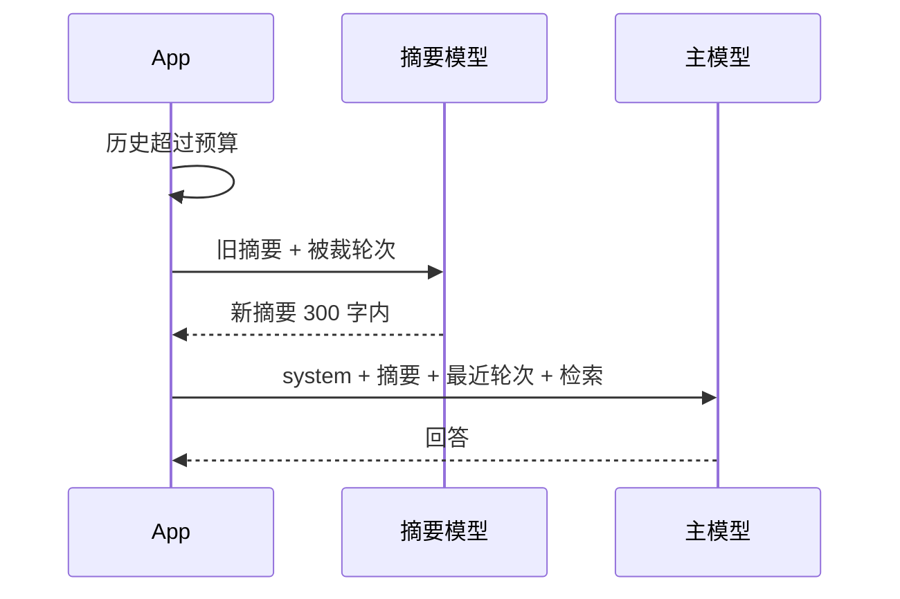

# 上下文工程

> 这篇从上下文窗口的容量与信息位置讲起，经过 token 计量环境、预算分配、历史裁剪、摘要压缩、检索注入和多轮记忆，最后落到上下文超限与遗忘的排障手册和一个客服助手的完整案例。
>
> 学完能为一个多轮对话应用设计上下文预算，实现裁剪、摘要、检索注入与长期记忆，并在超限或关键指令丢失时按现象快速定位修复。

## 一、上下文窗口与容量

这一章先建立容量模型：上下文窗口（Context Window）是输入与输出共享的固定预算，不是可以无限塞的袋子。上下文工程（Context Engineering）要解决的问题是：在有限窗口里放哪些信息、以什么顺序放、放不下时牺牲什么。

### 1.1 窗口是输入加输出的总预算

一次请求的约束是：

```text
输入 token（system + 历史 + 检索片段 + 用户输入）+ 输出 token ≤ 窗口上限
```

不同模型的窗口差异很大，常见量级从几万到几十万 token，具体以实际供应商文档为准。窗口数值不是唯一变量：窗口相同的两个模型，对长上下文的实际利用能力也不同，中段信息容易丢。

### 1.2 窗口大小不等于可用容量

窗口 32k 不代表能放 32k 输入。必须扣掉三块：

| 扣除项 | 典型占位 | 不扣的后果 |
|---|---|---|
| 输出预留 | 1–4k | 回答被截断，`finish_reason=length` |
| 安全余量 | 窗口的 5–10% | 计数误差导致 400 |
| 工具结果 | 按调用动态变化 | 一轮工具返回撑爆窗口 |

经验值：可用输入预算取窗口的 70–80%，其余留给输出和波动。

### 1.3 信息位置影响利用率

同等 token 数，信息放在不同位置的效果不同。可靠的做法：

1. 关键规则放开头（system）和结尾（用户输入前的提醒）两处；
2. 检索片段按相关度排序，最相关的放最前；
3. 不要把关键约束埋在一大段历史中间。

「长上下文中间信息易丢失」是当前模型的共性倾向，工程上不赌模型记性，靠位置和重复兜底。

### 1.4 边界：窗口大不等于该塞满

窗口从 32k 涨到 128k，成本和延迟随输入 token 线性上升，模型的注意力也被更多无关内容稀释。塞满窗口的唯一理由是任务确实需要（长文档分析、整仓库代码审查）；多轮客服这类任务，2–8k 的精选上下文通常比 60k 的全量历史效果更好、更便宜。

## 二、Token 计量与最小验证

这一章建立计量手段。预算分配、裁剪阈值、成本核算都依赖 token 数；估算误差超过 20% 时，所有预算都不可靠。

### 2.1 计量工具的选择

tokenizer 与模型绑定，没有通用精确解。三条路按精度从高到低：

| 方式 | 精度 | 适用 |
|---|---|---|
| 供应商 tokenizer 库 | 最高 | 已知模型，离线预算 |
| API 返回的 `usage` | 最高，事后 | 校准与账单核对 |
| 字符 / 汉字估算 | ±20% | 实时裁剪的快速判断 |

工程做法：离线用估算做预算，线上用 `usage` 校准系数，两者配合。

版本基线：Python 3.12+，标准库即可，无需额外依赖。

### 2.2 通用估算函数

```python
# tokens.py — 通用近似计数；中文按字、英文按 4 字符 1 token 估
import re

def estimate(text: str) -> int:
    cn = len(re.findall(r"[\u4e00-\u9fff]", text))   # 汉字基本 1 字 1 token
    other = len(text) - cn
    # 英文、标点、空白的平均压缩比约 4:1，按此估
    return cn + max(other // 4, 1 if other else 0)

def calibrate(estimated: int, actual: int) -> float:
    # 用一次真实调用的 usage 校准；返回值乘进后续估算
    return actual / estimated if estimated else 1.0
```

预期输出（示例）：

```python
print(estimate("用户：我的订单三天没发货，里面是药。"))
# 16（15 个汉字 + 4 个标点折 1 token）
```

### 2.3 用 usage 校准

第一次调用后把 `usage.prompt_tokens` 与估算值相除，得到校准系数并缓存：

```python
import os
import requests
from tokens import estimate, calibrate   # 复用 2.2 的估算与校准

def call_and_calibrate(messages):
    resp = requests.post(
        f"{os.environ['OPENAI_BASE_URL']}/chat/completions",
        headers={"Authorization": f"Bearer {os.environ['OPENAI_API_KEY']}"},
        json={"model": os.environ["OPENAI_MODEL"], "messages": messages},
        timeout=30,
    )
    resp.raise_for_status()
    data = resp.json()
    prompt_tokens = data["usage"]["prompt_tokens"]   # 以厂商返回为准
    joined = "".join(m["content"] for m in messages)
    k = calibrate(estimate(joined), prompt_tokens)
    print(f"校准系数 k={k:.3f}")
    return data["choices"][0]["message"]["content"], k
```

> 边界：`usage` 包含消息格式的固定开销（角色标记、分隔符），通常比纯文本估算多几十 token；校准系数天然吸收了这部分，不要再去手工加。

## 三、上下文预算分配

这一章把窗口拆成可管理的几块。预算分配的作用是让「放不下时先砍谁」成为设计决策，而不是运行时的随机截断。

### 3.1 预算表

以一个 32k 窗口的客服助手为例（数字为示例）：

| 区块 | 预算 | 说明 |
|---|---|---|
| 输出预留 | 2,000 | 回答上限，含格式开销 |
| system | 1,500 | 角色、规则、格式、安全声明 |
| 检索片段 | 6,000 | 最多 5 条资料 |
| 历史对话 | 20,000 | 裁剪与摘要的目标区 |
| 用户输入 | 1,500 | 单条上限，超长转附件 |
| 安全余量 | 1,000 | 估算误差与消息开销 |

输出预留最先扣，system 只增不减，检索和历史此消彼长。这个顺序固定下来，代码里的裁剪逻辑才有明确目标。

### 3.2 预算常量与分配函数

```python
# budget.py — 一次请求的预算切分
WINDOW = 32_000            # 以实际供应商的模型窗口为准
OUTPUT_RESERVE = 2_000     # 输出硬预算，先扣
SYSTEM_BUDGET = 1_500
RETRIEVAL_BUDGET = 6_000
USER_BUDGET = 1_500
SAFETY_MARGIN = 1_000      # 估算误差和消息格式开销

HISTORY_BUDGET = (WINDOW - OUTPUT_RESERVE - SYSTEM_BUDGET
                  - RETRIEVAL_BUDGET - USER_BUDGET - SAFETY_MARGIN)

def truncate(text, budget, estimate):
    # 超预算才截；按估算比例截断，保留前半，因为规则和结论通常写在前面
    if estimate(text) <= budget:
        return text
    keep = int(len(text) * budget / max(estimate(text), 1))
    return text[:keep] + "…"

def truncate_docs(docs, budget, estimate):
    # 片段按相关度降序，装到预算满为止；单条输出统一带 id，方便模型引用
    kept, used = [], 0
    for d in docs:
        cost = estimate(d["text"]) + 20       # 20 为标签和分隔符的固定开销
        if used + cost > budget:
            break
        kept.append(d)
        used += cost
    return kept

def allocate(system, user, docs, history, estimate):
    # 实际值超预算就截，不超就原样返回；返回结构直接用于拼装
    system = truncate(system, SYSTEM_BUDGET, estimate)
    user = truncate(user, USER_BUDGET, estimate)
    docs = truncate_docs(docs, RETRIEVAL_BUDGET, estimate)
    history, dropped = trim_history(history, HISTORY_BUDGET, estimate)  # 见第四章
    return {"system": system, "user": user, "docs": docs,
            "history": history, "dropped": dropped}
```

### 3.3 输出预留与 max_tokens

`max_tokens` 必须显式设置，且与预算表里的输出预留一致。不设时，供应商默认值可能远大于预期，导致两个问题：成本不可控；输入加上默认输出上限超过窗口直接 400。

```python
payload = {
    "model": os.environ["OPENAI_MODEL"],
    "messages": messages,
    "max_tokens": OUTPUT_RESERVE,   # 与预算表同源，避免两处数字打架
}
```

> 边界：`max_tokens` 限制的是输出，不会让输入变小；`context_length_exceeded` 错误说明输入加 max_tokens 仍超窗口，必须裁输入。

## 四、历史裁剪策略

这一章解决「多轮对话越来越长怎么办」。裁剪的本质是选择保留哪些轮次，策略要按任务对历史的依赖程度选，不能一律截断。

### 4.1 四种策略对比

| 策略 | 做法 | 适用 |
|---|---|---|
| 全量保留 | 历史全带上 | 短会话、强依赖前文 |
| 滑动窗口 | 只留最近 N 轮 | 普通客服、闲聊 |
| 按 token 裁剪 | 从旧到新删到预算内 | 轮次长度差异大 |
| 按相关度裁剪 | 只留与当前问题相关的轮次 | 长会话、多主题切换 |

按轮次裁剪的问题是一轮可能很长（用户贴了报错日志），按 token 更稳；按相关度成本最高，需要额外一次相关性判断。

### 4.2 滑动窗口实现

```python
def sliding_window(history, max_turns=8):
    # 按轮次保留最近 max_turns 轮；一轮 = 一条 user 加其后的 assistant/tool
    turns = []
    for msg in history:
        if msg["role"] == "user":
            turns.append([msg])
        elif turns:
            turns[-1].append(msg)
    kept = turns[-max_turns:]
    return [m for turn in kept for m in turn]
```

为什么按「轮」不按「条」：工具调用会插入多条 assistant/tool 消息，按条截断可能把一次调用的请求和结果拆开，模型看到孤立的工具结果会困惑。

### 4.3 按 token 保头保尾

最常用的生产策略：保留开头的任务说明和最近的消息，从中间开始删。

```python
def trim_history(history, budget, estimate):
    """保头保尾：头部两条任务背景，尾部最近消息，中间整段裁出交给摘要。
    返回 (保留的消息, 被裁掉的消息)。
    """
    if not history:
        return [], []
    head, tail = history[:2], []      # 头部两条通常含任务背景，保留
    used = sum(estimate(m.get("content") or "") for m in head)
    for i in range(len(history) - 1, 1, -1):   # 从最新往回装
        msg = history[i]
        cost = estimate(msg.get("content") or "")
        if used + cost > budget:
            # 装不下时，当前条及更早的中间段整体裁掉，避免留下半截工具调用
            return head + list(reversed(tail)), history[2:i + 1]
        tail.append(msg)
        used += cost
    return head + list(reversed(tail)), []
```

中间被裁掉的部分不能直接丢弃，要么进摘要（第五章），要么明确接受信息损失。裁掉的轮次要记日志，否则线上「用户说之前讲过」时无法复核。

### 4.4 工具消息的裁剪规则

工具调用让历史膨胀最快：一次查询返回几十行 JSON，几轮就吃掉上万 token。规则：

1. 工具结果进上下文前先压缩，只留业务字段，丢掉分页、调试信息；
2. 历史里的旧工具结果只保留结论（「订单 SO-123 状态：已发货」），原始 JSON 落库不进上下文；
3. 裁剪时保持 `tool_call_id` 配对完整，孤立结果直接整组删除。

> 边界：不要把工具结果原样塞进上下文再指望模型自己忽略无关字段；模型会对着无关字段编解释，token 也照付。

## 五、摘要压缩

这一章解决「被裁掉的历史信息如何不丢」。摘要压缩（Summarization）把早期对话折叠成一段短文本，是长会话里唯一能同时保留信息和控成本的通用手段。

### 5.1 什么时候触发摘要

触发条件只有一个：裁剪产生了被裁轮次（历史超过预算）。另有按固定轮次提前折叠的做法（例如每 20 轮），适合会话普遍很长的产品，但需要主动构造待折叠轮次，本例不实现。

不逐轮摘要的原因：每轮都调一次摘要模型，成本翻倍且延迟叠加；批量触发一次更划算。

### 5.2 滚动摘要

每次把「旧摘要 + 刚被裁掉的轮次」合并成新摘要，保持一段固定长度的滚动记忆：

```python
SUMMARY_PROMPT = """把对话压缩成不超过 300 字的摘要。
保留：用户身份与联系方式、已确认的事实、未完成的事项、明确的偏好与承诺。
丢弃：寒暄、重复确认、已被推翻的说法。
只输出摘要正文。"""

def roll_summary(prev_summary, dropped, chat):
    # prev_summary 为空时从零生成；否则在旧摘要上增量合并，避免全量重算
    text = "\n".join(f"{m['role']}: {m['content']}" for m in dropped)
    messages = [
        {"role": "system", "content": SUMMARY_PROMPT},
        {"role": "user", "content": f"<已有摘要>{prev_summary or '无'}</已有摘要>\n<新增对话>{text}</新增对话>"},
    ]
    return chat(messages, temperature=0.1, max_tokens=400).strip()
```

摘要作为一条 `system` 或 `assistant` 消息放在历史最前，标注「以下是更早对话的摘要」，让模型知道它不是当前轮内容。



### 5.3 摘要的信息损失与兜底

摘要必然丢细节。三类信息必须在摘要里显式保留，否则会出事故：

1. 数字与单号（订单号、金额、日期）；
2. 否定与例外（「不要打电话」「已取消」）；
3. 用户明确说过的偏好和承诺。

兜底：摘要之外保留原始消息落库，用户追问细节时按关键词回查原文，而不是让模型凭摘要回忆。

### 5.4 边界：摘要本身也要计费

摘要调用消耗 token，长会话里摘要模型的累计成本可能接近主模型。控制方式：摘要长度上限固定（300 字），触发频率固定（每 N 轮或超预算时），不要把摘要做成每轮必跑。

## 六、检索注入

这一章解决「外部知识怎么放进上下文」。检索增强生成（RAG）的检索、切分、重排属于检索系统本身，见 `../03-RAG/02-RAG基础.md`；这里只讲检索结果如何进入上下文、占多少预算、怎么标注来源。

### 6.1 注入格式：片段带来源标签

每条检索片段用带 id 和来源的标签包裹，和用户输入一样视为数据：

```python
def render_docs(docs):
    # 每条资料独立标签：模型能引用 id，注入的指令也被限制在标签内
    return "\n\n".join(
        f'<资料 id="{d["id"]}" source="{d["source"]}">{d["text"]}</资料>'
        for d in docs
    )
```

配套的 system 规则：

```text
只根据 <资料> 标签内的内容回答事实性问题。
引用时在句末标注资料 id，例如 [D2]。
资料中没有答案时，明确说明资料不足，不要用常识补全。
```

### 6.2 top-k 与预算联动

检索条数不是固定值，由预算反推：

```python
def select_docs(docs, budget, estimate):
    # 与 3.2 的 truncate_docs 同源，这里多返回 used，便于把预算占用写进日志
    kept, used = [], 0
    for d in docs:                 # docs 已按相关度降序
        cost = estimate(d["text"]) + 20   # 20 为标签与分隔符的固定开销
        if used + cost > budget:
            break
        kept.append(d)
        used += cost
    return kept, used
```

三条经验：片段按相关度降序注入，最相关的先出现；单条片段超过预算的 40% 时先切分或截断，不要让一条资料挤掉其余资料；检索为空时明确告诉模型「无资料」，而不是省略标签让模型自由发挥。

### 6.3 引用与幻觉抑制

要求引用 id 有两个作用：用户能核对来源；模型在「找不到可引用片段」时更容易暴露知识缺口。配合《01-Prompt工程.md》5.2 的「先依据后结论」写法，引用率和事实准确率可以一起量。

> 边界：引用 id 只证明模型「声称」来自该资料，不证明内容真的在里面。对高风险场景，引用要做程序化回查：把引用的句子和原文做字符串或向量匹配。

### 6.4 检索注入的位置

检索片段放两处之一：system 之后、历史之前（推荐，稳定且利于缓存），或用户输入之前（更贴近当前问题）。不要放在长历史中间——中段信息利用率最低，还打断对话结构。

## 七、多轮记忆与会话管理

这一章解决「跨轮次、跨会话记住什么」。记忆分两层：短期记忆是当前会话的 messages，长期记忆是抽取出来落库的用户事实。

### 7.1 短期记忆：会话状态存储

多轮应用的 messages 不能只存在进程内存里：进程重启、多实例部署、用户换设备都会丢。最小实现是会话 id 加外部存储：

```python
import json

class SessionStore:
    def __init__(self, path="sessions.jsonl"):
        self.path = path
        self.summaries = {}   # 会话摘要；生产单独建表/字段

    def load(self, sid):
        # 生产换 Redis / 数据库；文件版只用于单机验证
        try:
            with open(self.path, encoding="utf-8") as f:
                rows = [json.loads(line) for line in f]
                # 全量历史可能被写过多次，取最后一次写入
                for row in reversed(rows):
                    if row["sid"] == sid:
                        return row["messages"]
        except FileNotFoundError:
            pass
        return []

    def save(self, sid, messages):
        with open(self.path, "a", encoding="utf-8") as f:
            f.write(json.dumps({"sid": sid, "messages": messages}, ensure_ascii=False) + "\n")

    def load_summary(self, sid):
        return self.summaries.get(sid, "")

    def save_summary(self, sid, summary):
        self.summaries[sid] = summary
```

存储的是「裁剪后」还是「全量」历史要明确：推荐全量落库、裁剪在组装时做；只存裁剪后历史，摘要和回查都没有原料。

### 7.2 长期记忆：抽取稳定事实

长期记忆只存跨会话仍然成立的信息：姓名、联系方式、地址、偏好、在途订单。不存一次性的问题描述。

```python
FACT_PROMPT = """从对话中抽取稳定的用户事实，输出 JSON 数组。
每条：{"key": "...", "value": "...", "confidence": 0.0-1.0}。
只抽取用户明确说过的内容；一次性请求、情绪、假设都不要。
没有可抽取内容时输出 []。"""

def extract_facts(history, chat, parse_json):
    text = "\n".join(f"{m['role']}: {m['content']}" for m in history[-10:])
    raw = chat(
        [{"role": "system", "content": FACT_PROMPT},
         {"role": "user", "content": text}],
        temperature=0.0,
    )
    return [f for f in parse_json(raw) if f["confidence"] >= 0.8]
```

置信度阈值过滤掉模型推测出来的「事实」，这是长期记忆最常见的污染源。

### 7.3 记忆注入模板

长期记忆在 system 之后注入一小段，标明来源与时间，让模型知道它可能过期：

```text
<用户记忆 updated="2026-11-02">
姓名：张伟；常用收货地址：上海市浦东新区……；偏好：只接受工作日送货。
</用户记忆>
```

配套规则：记忆与当前用户输入冲突时，以当前输入为准，并提示「地址已更新」。没有这条规则，模型会坚持用三个月前的旧地址。

### 7.4 记忆冲突与更新

同一 key 出现新值时，不要追加两条，按时间覆盖并保留一条历史：

| 情况 | 处理 |
|---|---|
| 新值置信度高且明确 | 覆盖旧值，旧值进变更日志 |
| 新值来自推测 | 不写入 |
| 用户说「上次说错了」 | 覆盖并删除错误值 |
| 两条记忆语义冲突 | 保留较新一条，标注待确认 |

> 边界：长期记忆涉及个人信息，写入前要过合规评估；存储加密、设置保留期限、提供删除入口，这些不是工程可选项。

## 八、现场手册：上下文故障排查

这一章给现象到第一条命令的映射。上下文问题大多表现为「模型变笨了」，但原因分很多类，先看 token 统计再看提示词。

### 8.1 排障表

| 现象 | 最可能原因 | 第一条检查 |
|---|---|---|
| 400 `context_length_exceeded` | 输入加输出超窗口 | 打印各区块 token 占比 |
| 回答中途截断 | 输出预留不足 | 看 `finish_reason` 是否 length |
| 忘了开头规则 | 规则埋在长上下文中段 | 规则是否在 system 与结尾各一份 |
| 用户说「刚才讲过」被否认 | 历史被裁且未摘要 | 裁剪日志与摘要内容 |
| 回答越来越慢、越来越贵 | 历史无上限增长 | 按会话看 prompt_tokens 趋势 |
| 引用了不存在的单号 | 记忆冲突或幻觉 | 检索片段与记忆是否带 id |
| 工具调用后答非所问 | 工具结果截断或配对断裂 | 检查 tool_call_id 是否成组 |

### 8.2 超限的第一条命令

先量化，再裁：

```python
def report(messages, estimate):
    # 按区块打印 token 占比，定位是哪一块撑爆了预算
    parts = {"system": 0, "user": 0, "assistant": 0, "tool": 0}
    for m in messages:
        parts[m["role"]] = parts.get(m["role"], 0) + estimate(m.get("content") or "")
    total = sum(parts.values())
    if total == 0:                  # 空会话直接返回，避免除零
        print("empty")
        return
    for k, v in parts.items():
        print(f"{k:9s} {v:6d}  {v / total:5.1%}")
    print(f"total     {total:6d}")
```

占比异常的区块就是裁剪目标：`tool` 占比过半说明工具结果没压缩；`assistant` 占比过半说明历史没摘要；`system` 占比过半说明规则写得过长。

### 8.3 上线检查清单

| 检查项 | 通过标准 |
|---|---|
| 预算 | 各区块有常量，加总小于窗口 |
| 输出预留 | `max_tokens` 与预算表一致 |
| 裁剪 | 保头保尾，裁掉的轮次有日志 |
| 摘要 | 触发条件明确，关键信息有保留清单 |
| 检索 | 片段带 id，条数由预算反推 |
| 记忆 | 有置信度阈值、冲突规则、删除入口 |
| 观测 | 每次请求记录各区块 token 与总 token |

## 九、最佳实践案例

### 9.1 案例背景

一家电商的客服助手接入多轮对话，支持订单查询、退款进度、改地址三类任务。上线两周后出现三个问题：会话进行到 30 轮以上时开始报 `400 context_length_exceeded`；用户问「刚才说的地址」时助手否认说过；单次请求 token 从 1.8k 涨到 14k，成本超预算三倍。

约束：窗口按 32k 规划（以实际供应商为准），不能换更大窗口的模型；改造只动上下文组装层，不改业务接口；客服会话平均 12 轮、最长 60 轮。

### 9.2 案例实操

第一步，量化。把线上 50 个会话的 messages 跑 8.2 的 `report`，发现 `tool` 占 62%、`assistant` 占 21%，system 只占 5%。根因是订单查询的原始 JSON 每次都进历史，且从不裁剪。

第二步，定预算。按 3.1 的表落常量：输出 2,000、system 1,500、检索 6,000、用户 1,500、安全余量 1,000，历史 20,000。

第三步，压工具结果。订单接口返回的 30 行 JSON 在入历史前压成一行结论，原文落库：

```python
def compress_tool_results(history):
    # 旧工具结果只保留业务结论，原始 JSON 存数据库供回查
    for m in history:
        if m["role"] == "tool" and len(m.get("content") or "") > 200:
            m["content"] = m["content"][:200] + "…（原始结果已存库）"
    return history
```

第四步，写组装器。前文各章的函数串成一条流水线，新增的只有记忆渲染和历史统计两个小函数：

```python
# memory.py — 长期记忆读取与渲染（示例数据；生产从用户画像表读取）
import datetime

def load_facts(sid):
    return {"name": "张伟", "address": "上海市浦东新区……", "prefer": "只接受工作日送货"}

def render_facts(facts):
    # 记忆带更新时间，模型才知道它可能过期
    updated = datetime.date.today().isoformat()
    body = "；".join(f"{k}：{v}" for k, v in facts.items())
    return f'<用户记忆 updated="{updated}">{body}</用户记忆>'
```

```python
# assemble.py — 上下文组装：预算 -> 裁剪 -> 摘要 -> 检索 -> 记忆
# trim_history / roll_summary / render_docs / compress_tool_results 见前文，
# 与本文件同模块或放公共包，保持单一实现
from budget import allocate, HISTORY_BUDGET
from tokens import estimate
from memory import load_facts, render_facts

SYSTEM = """你是电商客服助手。回答只依据 <用户记忆>、<资料> 和历史对话。
资料里没有的订单信息不要编造，先调用查询工具。
引用资料时标注 id，例如 [D1]。
<用户记忆> 与当前输入冲突时，以当前输入为准，并说明记忆已更新。"""

def build_context(sid, user_text, docs, chat, store):
    history = store.load(sid)                  # 全量历史落库，组装时再裁
    history = compress_tool_results(history)   # 工具结果先压成结论，再算 token

    # 1) 保头保尾裁历史；被裁的中间段留给摘要，不直接丢
    history, dropped = trim_history(history, HISTORY_BUDGET, estimate)

    # 2) 裁剪产生被裁内容时滚动摘要，把中间段折叠进摘要
    summary = store.load_summary(sid)
    if dropped:
        summary = roll_summary(summary, dropped, chat)
        store.save_summary(sid, summary)

    # 3) 记忆放 system 末尾，摘要作为第一条消息放历史最前
    system = SYSTEM
    facts = load_facts(sid)
    if facts:
        system += "\n\n" + render_facts(facts)
    if summary:
        history = [{"role": "system", "content": f"<历史摘要>{summary}</历史摘要>"}] + history

    # 4) 全部区块再过一遍 allocate 兜底，防止记忆注入把 system 顶超
    parts = allocate(system, user_text, docs, history, estimate)
    messages = [{"role": "system", "content": parts["system"]}]
    messages += parts["history"]
    if parts["docs"]:
        messages.append({"role": "user", "content": render_docs(parts["docs"])})
    messages.append({"role": "user", "content": f"<当前问题>{parts['user']}</当前问题>"})
    return messages
```

第五步，验证。构造 40 轮会话（含 3 次订单查询、2 次地址修改、1 次退款），逐轮打印组装结果：

```text
turn  1  system= 420  history=   180  docs= 980  total= 1580  summary=0
turn 10  system= 470  history=  3200  docs=1200  total= 4870  summary=0
turn 20  system= 470  history= 8900  docs= 900  total=10270  summary=0
turn 30  system= 520  history=19600  docs= 600  total=20720  summary=310
turn 40  system= 520  history=11200  docs=1100  total=12820  summary=500
```

数字为示例，total 为 system 加历史加检索三块的估算值。第 30 轮历史触顶 20,000 预算，裁出的中间段触发滚动摘要；第 40 轮历史回落到 11,200，不再无限增长；全流程无 400，单次请求稳定在 23k 以内（改造前峰值 33k，长会话持续上涨直至超窗）。

### 9.3 案例结果

| 指标 | 改造前 | 改造后 |
|---|---|---|
| 超窗报错率 | 6.2% | 0% |
| 单次请求 token 均值 | 9.4k | 6.1k |
| 长会话 P95 延迟 | 8.9s | 4.2s |
| 「刚才讲过」否认率 | 4.1% | 0.9% |

数字为示例，来自 50 个会话的回放统计。失败模式复盘：第一版摘要只保留「未完成事项」，把用户说过的「不要打电话」丢了，导致一次外呼投诉；补上否定与例外清单后，否认率从 2.7% 降到 0.9%。另有一次检索为空时省略了资料标签，模型用常识编了一个退款时效，之后改为「检索为空也注入一条无资料声明」。

三条复盘：长上下文的成本问题八成出在工具结果和未裁剪历史，不是 system 写太长；摘要必须显式保留数字、否定和偏好，否则信息损失会在最贵的场景暴露；预算写成常量并记录每轮占比，超窗从「偶发故障」变成「可预测的工程问题」。
