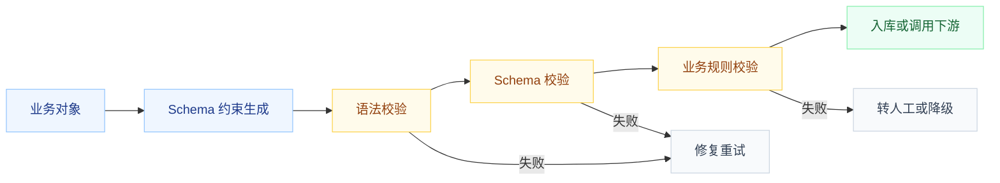

# 结构化输出

> 这篇从自由文本入库的失败讲起，经过三种约束层级、JSON Schema 的严格模式写法、解析与三层校验、修复式重试和流式边界，最后落到一条可观测的结构化输出管线与排障顺序。
>
> 学完能给一个业务对象写出可用的 JSON Schema，把模型输出稳定解析成类型安全的对象，并在校验失败时按错误类型重试、修复或降级。

## 一、结构化输出解决的问题

结构化输出（Structured Output）要解决的是「模型返回的文本能被程序直接消费」，它约束输出的形状，不约束内容的真假。

### 1.1 自由文本入库会在哪里坏掉

让模型「返回 JSON」并不等于拿到 JSON。同一段提示词，模型可能返回带解释的段落、带 Markdown 围栏的代码块、字段名拼错的对象，或者在字段值里塞一句自然语言。

```text
好的，我来帮您抽取：

{ "category": "打印机", "location": "3 楼", "urgency": "高" }

以上信息已按要求整理。
```

这段输出对人可读，对 `json.loads` 直接失败：第一个字符是「好」，不是 `{`。即使去掉前后说明，`urgency` 的值是「高」，而下游枚举只接受 `high`。

四类典型坏法：

| 坏法 | 表现 | 下游后果 |
|---|---|---|
| 前后包裹说明 | 正文里夹代码块 | 解析直接抛异常 |
| 字段名漂移 | `urgency` 写成 `priority` | 取值为空 |
| 类型漂移 | 数字写成字符串 | 入库或比较失败 |
| 取值越界 | 枚举外的新词 | 业务分支未覆盖 |

结论：只要能进入数据库、进入下游服务，就必须有格式约束加客户端校验，二者缺一不可。

### 1.2 三种约束层级

约束强度从弱到强分三层，成本也随之上升。

| 层级 | 做法 | 能保证 | 主要成本 |
|---|---|---|---|
| 提示词约定 | 要求「只输出 JSON」 | 无保证，只能提高概率 | 几乎为零 |
| JSON 模式 | `response_format` 设 `json_object` | 语法上是合法 JSON | 仍需自行校验字段 |
| Schema 约束 | 传 `json_schema` 并开严格模式 | 形状符合给定 Schema | 受 Schema 子集限制 |

严格模式（Strict Mode）是当前最稳的一层：把 JSON Schema 交给服务端，由解码阶段约束 token 选择，模型不再自由发挥字段名和类型。它仍然不是万能的，下一节说明边界。

先看三层的实际差别（片段，省略公共字段）：

```python
# 第一层：只靠提示词，失败率最高
messages = [
    {"role": "system", "content": "只输出 JSON，不要解释。"},
    {"role": "user", "content": "打印机卡纸，3 楼，今天上午。"},
]

# 第二层：语法有保证，字段无保证
payload = {..., "response_format": {"type": "json_object"}}

# 第三层：形状有保证，值仍需业务校验
payload = {
    ...,
    "response_format": {
        "type": "json_schema",
        "json_schema": {"name": "ticket", "strict": True, "schema": SCHEMA},
    },
}
```

三层可以叠加使用：提示词里仍然写清字段含义，`json_object` 仍保留作为兜底，严格模式负责形状。

### 1.3 Schema 保证什么、不保证什么

Schema 约束的是结构，不是语义。这一点决定了校验代码不能省。

| 保证 | 不保证 |
|---|---|
| 键名与层级正确 | 键值符合业务事实 |
| 类型正确（字符串就是字符串） | 字符串内容不是编造的 |
| 必填字段存在 | 必填字段的值非空 |
| 枚举值在列表内 | 枚举选择符合真实语义 |

一个典型反例：Schema 要求 `location` 是字符串，模型返回「火星基地」，格式完全合法。要拦住它，只能在客户端做业务校验，例如比对允许的楼栋白名单。

> 边界：结构化输出适合抽取、分类、表单填充、路由决策这类「形状固定」的任务。开放式写作、长报告、多轮推理过程不适合硬套 Schema，硬套只会让模型把内容塞进勉强能对上的字段。



这条链上，模型只负责第一步，后面四步都是确定性代码。

## 二、最小可运行闭环

先用一次请求跑通「给 Schema、拿 JSON、校验通过」的最小闭环，再谈工程化。

### 2.1 环境与依赖

依赖 Python 3.12 及以上。三端命令等价，只是激活虚拟环境的方式不同。

```bash
# macOS / Ubuntu
python3.12 -m venv .venv
source .venv/bin/activate
python -m pip install --upgrade pip
python -m pip install requests pydantic jsonschema
```

```powershell
# Windows PowerShell
py -3.12 -m venv .venv
.\.venv\Scripts\Activate.ps1
python -m pip install --upgrade pip
python -m pip install requests pydantic jsonschema
```

用 `uv` 更快，命令也更短：

```bash
uv venv --python 3.12
uv pip install requests pydantic jsonschema
```

版本基线：Python 3.12+、Pydantic 2.9+、jsonschema 4.23+，接口形态以 2026-11 各家官方文档为准。模型名统一用占位名，实际以供应商为准。

```bash
export OPENAI_BASE_URL="https://api.openai.com/v1"
export OPENAI_API_KEY="sk-..."
export OPENAI_MODEL="gpt-4.1-mini"   # 占位，换成供应商实际模型 ID
```

> 边界：`base_url` 是否带 `/v1` 由厂商决定；有的兼容网关把路径放在 `/compatible-mode/v1`。写死之前先用 `curl` 打一次。

### 2.2 第一次严格模式请求

下面的脚本是完整可运行的，包含 Schema、请求、断言三部分。

```python
import json
import os

import requests

# 严格模式的 Schema：所有字段都进 required，且关闭额外字段
SCHEMA = {
    "type": "object",
    "properties": {
        "category": {
            "type": "string",
            "description": "工单类别，取打印机、网络、门禁、其他之一",
        },
        "location": {"type": "string", "description": "报修位置，如 3 楼 302"},
        "urgency": {"type": "string", "enum": ["low", "medium", "high"]},
    },
    "required": ["category", "location", "urgency"],
    "additionalProperties": False,
}

resp = requests.post(
    f"{os.environ['OPENAI_BASE_URL']}/chat/completions",
    headers={"Authorization": f"Bearer {os.environ['OPENAI_API_KEY']}"},
    json={
        "model": os.environ["OPENAI_MODEL"],
        "messages": [
            # system 只放规则，字段含义写在 Schema 的 description 里，避免两处维护
            {"role": "system", "content": "从报修描述中抽取工单字段，不要补充未提及的信息。"},
            {"role": "user", "content": "打印机又卡纸了，3 楼 302，今天上午急着用。"},
        ],
        # 严格模式由服务端在解码阶段约束，比提示词可靠
        "response_format": {
            "type": "json_schema",
            "json_schema": {"name": "ticket", "strict": True, "schema": SCHEMA},
        },
        "temperature": 0,  # 抽取任务不需要随机性
    },
    timeout=30,
)
resp.raise_for_status()
content = resp.json()["choices"][0]["message"]["content"]
data = json.loads(content)  # 严格模式下这里应当从不失败
assert set(data) == {"category", "location", "urgency"}
print(json.dumps(data, ensure_ascii=False))
```

预期输出（示例，值取决于模型）：

```json
{"category": "打印机", "location": "3 楼 302", "urgency": "high"}
```

注意输出里没有换行和缩进，这是严格模式的正常形态：模型只填值，不负责排版。需要可读格式时在客户端 `json.dumps(..., indent=2)`，不要要求模型缩进。

### 2.3 供应商差异

各家对结构化输出的支持形态不同，迁移时先看三件事：字段叫什么、是否支持严格模式、Schema 支持到什么子集。

| 供应商形态 | 请求字段 | 严格模式 | 注意事项 |
|---|---|---|---|
| OpenAI 兼容 | `response_format.json_schema` | 支持 | 需 `strict: true` 且 Schema 合规 |
| 仅 JSON 模式 | `response_format.json_object` | 不支持 | 提示词必须出现 JSON 字样 |
| Gemini 系 | `responseSchema` | 部分支持 | 字段名与 OpenAPI 风格接近 |
| 自建推理服务 | 语法约束解码 | 视实现 | 常见 grammar 或 regex 约束 |

> 边界：不要假设「OpenAI 兼容」等于「行为一致」。兼容层通常只对齐路径和消息结构，严格模式的 Schema 子集、错误码、`finish_reason` 取值都可能有差异。接入前用同一份 Schema 跑 20 条样本，比对字段缺失率。

## 三、JSON Schema 的写法

Schema 从下游要用的数据倒推，不从数据库表直接抄。

### 3.1 从业务对象倒推字段

先回答三个问题：下游要读哪几个字段、每个字段的取值域是什么、缺字段时业务能不能继续。答案决定 `required`、`enum` 和可空策略。

```python
# 从消费方倒推：工单系统只读这四个字段
SCHEMA = {
    "type": "object",
    "properties": {
        "category": {"type": "string", "enum": ["printer", "network", "access", "other"]},
        "location": {"type": "string", "description": "楼栋加房间号，如 A302"},
        "urgency": {"type": "string", "enum": ["low", "medium", "high"]},
        "summary": {"type": "string", "description": "不超过 40 字的故障摘要"},
    },
    "required": ["category", "location", "urgency", "summary"],
    "additionalProperties": False,
}
```

字段数量控制在 12 个以内，嵌套不超过 3 层。超过这个规模，模型在长 Schema 上的字段错配率明显上升，应该拆成两次调用或先分类再抽取。

### 3.2 严格模式支持的子集

严格模式不是通用 JSON Schema 校验器。它只支持一个受限子集：不合规的 Schema 在请求阶段就报 400，而它不支持的约束关键字可能被直接忽略，所以客户端校验不能省。

| 特性 | 严格模式 | 处理方式 |
|---|---|---|
| `required` | 必须列全所有字段 | 全部字段都写进 required |
| `additionalProperties` | 必须为 `false` | 显式关闭 |
| `default` | 不支持 | 缺省值在客户端补 |
| `minLength` 等 | 部分实现拒绝，部分忽略 | 剥离后本地校验 |
| `oneOf` / `allOf` | 支持有限 | 改成扁平字段或 `anyOf` |
| 递归 `$ref` | 不支持 | 展平结构 |

最容易踩的一条是「可选字段」：JSON Schema 里不写进 `required` 就表示可选，但严格模式要求全量 `required`。正确做法不是删字段，而是把类型写成可空联合。

长度、数值范围、正则这类约束关键字（`minLength`、`maxLength`、`minimum`、`pattern`）不在严格模式的支持矩阵里：宽松的实现直接忽略，严格的实现返回 400。稳妥做法是发给模型前把它们从 Schema 里剥离，本地校验器保留——模型负责形状，代码负责边界。

```json
{
  "type": "object",
  "properties": {
    "room": {"type": ["string", "null"]},
    "urgency": {"type": "string", "enum": ["low", "medium", "high"]}
  },
  "required": ["room", "urgency"],
  "additionalProperties": false
}
```

这样模型必须返回 `room` 键，没有信息时填 `null`。下游拿到的是确定形状，不用写 `if "room" in data` 这种防御代码。

> 边界：`["string", "null"]` 这种联合写法在各家支持度不一。若供应商报 Schema 非法，退回 `{"type": "string"}` 并把「无信息填 unknown」写进 description，再在客户端把 `"unknown"` 归一成 `None`。

### 3.3 枚举、数组与嵌套对象

枚举是最值得投入的约束：它把开放生成变成有限选择，直接消灭「同义词漂移」。

```python
SCHEMA = {
    "type": "object",
    "properties": {
        "order_id": {"type": "string", "description": "形如 SO-20261113-001"},
        "channel": {"type": "string", "enum": ["web", "app", "phone", "store"]},
        "items": {
            "type": "array",
            # maxItems 是成本控制：模型不会无限续写，解析也不会爆内存
            "maxItems": 20,
            "items": {
                "type": "object",
                "properties": {
                    "sku": {"type": "string"},
                    "qty": {"type": "integer", "minimum": 1},
                },
                "required": ["sku", "qty"],
                "additionalProperties": False,
            },
        },
    },
    "required": ["order_id", "channel", "items"],
    "additionalProperties": False,
}
```

数组一定要给 `maxItems`。没有上限时，模型遇到模糊输入倾向于「多列几条」，既推高 token，也让下游分页逻辑失效。

嵌套对象只在语义确实成组时使用。三层以上时，先问是不是应该拆成两次请求：先抽订单头，再按 `order_id` 抽明细。

### 3.4 description 写判定标准

`description` 的职责是消除歧义，不是复述字段名。写「工单类别」没有信息量，写清边界才有。

```json
{
  "urgency": {
    "type": "string",
    "enum": ["low", "medium", "high"],
    "description": "high 表示影响多人或阻断业务；medium 表示单人受阻但有替代方案；low 表示不影响当前工作"
  }
}
```

判定标准要能被两个不同的人独立执行。如果写不出可执行的边界，说明这个字段还不该交给模型。

### 3.5 常见错误写法

| 错误写法 | 后果 | 改法 |
|---|---|---|
| 顶层是数组 | 部分实现直接拒绝 | 包一层 `{"items": [...]}` |
| 字段不写 `required` | 严格模式校验失败 | 全量 required 加可空类型 |
| 用 `default` 表达缺省 | 被忽略，值缺失 | 客户端补默认值 |
| 枚举值用中文长句 | 模型改写措辞 | 用短英文码，展示层翻译 |
| 数字金额用 `number` | 浮点误差 | 用整数分或字符串 |

金额字段单独强调：`0.1 + 0.2` 在浮点里不等于 `0.3`，金额一旦走浮点，对账迟早出错。Schema 用 `{"type": "integer", "description": "金额，单位分"}`，或者用字符串保留两位小数。

## 四、解析与三层校验

校验分三层，顺序不能反：先语法、再 Schema、最后业务。反过来的话，业务代码要处理各种畸形输入。

### 4.1 三层校验的职责

| 层 | 输入 | 失败含义 | 处理 |
|---|---|---|---|
| 语法 | 原始字符串 | 不是 JSON | 修复重试 |
| Schema | 解析后的对象 | 形状不符 | 修复重试 |
| 业务 | 已符合 Schema 的对象 | 值不合理 | 修正、转人工或拒绝 |

语法层用 `json.loads`，Schema 层用 `jsonschema` 或 Pydantic，业务层是自己写的规则。

```python
import json

from jsonschema import Draft202012Validator


def validate_ticket(raw: str, schema: dict) -> dict:
    try:
        data = json.loads(raw)
    except json.JSONDecodeError as exc:
        # 语法错误要带位置，修复提示才有用
        raise ValueError(f"invalid json at pos {exc.pos}: {exc.msg}") from exc

    errors = sorted(Draft202012Validator(schema).iter_errors(data), key=lambda e: e.path)
    if errors:
        # 只回传前三条，错误太多时模型反而抓不住重点
        detail = "; ".join(f"{list(e.path)}: {e.message}" for e in errors[:3])
        raise ValueError(f"schema mismatch: {detail}")

    if data["urgency"] not in {"low", "medium", "high"}:
        raise ValueError("urgency out of enum")
    return data
```

`iter_errors` 返回的错误顺序不稳定，按 `path` 排序后再截断，保证同样的输入得到同样的修复提示。

### 4.2 用 Pydantic 做单一来源

Schema 和校验器分两处维护，迟早漂移。用 Pydantic 模型同时产出两者：模型定义是唯一真相，`model_json_schema()` 生成给模型的 Schema，`model_validate()` 做本地校验。

```python
from typing import Literal

from pydantic import BaseModel, ConfigDict, Field


class Ticket(BaseModel):
    # extra="forbid" 对应 Schema 的 additionalProperties: false
    model_config = ConfigDict(extra="forbid")

    category: Literal["printer", "network", "access", "other"] = Field(
        description="工单类别"
    )
    location: str = Field(description="楼栋加房间号，如 A302", min_length=2)
    urgency: Literal["low", "medium", "high"] = Field(
        description="high 影响多人，medium 单人受阻，low 不影响当前工作"
    )
    summary: str = Field(description="不超过 40 字的故障摘要", max_length=40)


# 生成给模型用的 Schema；mode="validation" 会保留约束关键字
schema = Ticket.model_json_schema(mode="validation")
print(schema["required"])
```

预期输出：

```text
['category', 'location', 'urgency', 'summary']
```

`Literal` 会生成 `enum`，`Field(description=...)` 会生成 `description`，`extra="forbid"` 会生成 `additionalProperties: false`。这三项正好是严格模式最需要的。

`min_length`、`max_length` 生成的 `minLength`、`maxLength` 不在严格模式支持矩阵里。发给模型前先剥离，本地校验保留：

```python
STRIP_KEYS = {"minLength", "maxLength", "minimum", "maximum", "pattern", "exclusiveMinimum"}


def to_model_schema(pydantic_schema: dict) -> dict:
    # 递归去掉严格模式不支持的关键字，只影响发送的 Schema，不影响本地校验
    if isinstance(pydantic_schema, dict):
        return {
            k: to_model_schema(v)
            for k, v in pydantic_schema.items()
            if k not in STRIP_KEYS
        }
    if isinstance(pydantic_schema, list):
        return [to_model_schema(x) for x in pydantic_schema]
    return pydantic_schema
```

Pydantic 生成的 Schema 里会带 `title` 和 `$defs`。`title` 无害，`$defs` 在嵌套模型时出现，部分供应商不接受 `$ref`，需要用 `model_json_schema(ref_template="#/$defs/{model}")` 之后再展平，或把手写 Schema 作为交付物、Pydantic 只做校验。

### 4.3 把校验错误变成修复指令

校验失败后直接把原始错误抛给模型，模型看不懂 Python 堆栈。要转成「哪个字段、期望什么、实际是什么」的短句。

```python
from pydantic import ValidationError


def to_repair_hint(exc: ValidationError) -> str:
    parts = []
    for err in exc.errors()[:3]:
        loc = ".".join(str(x) for x in err["loc"]) or "<root>"
        # 只保留类型和期望值，不传整段堆栈
        parts.append(f"字段 {loc} 不合法：{err['msg']}，收到 {err.get('input')!r}")
    return "；".join(parts)
```

生成的修复提示形如：

```text
字段 urgency 不合法：Input should be 'low', 'medium' or 'high'，收到 '高'；字段 location 不合法：String should have at least 2 characters，收到 '3'
```

这条提示可以直接作为下一轮 user 消息，模型据此改正的概率远高于「请重新输出合法 JSON」。

### 4.4 数值、日期与空值的边界

三类字段最容易在「格式正确」之后仍然出错。

| 类型 | 推荐表示 | 原因 |
|---|---|---|
| 金额 | 整数分 | 避免浮点误差 |
| 日期 | `YYYY-MM-DD` 字符串 | 时区无关，易比较 |
| 时间戳 | ISO 8601 带时区 | 跨时区可排序 |
| 缺失值 | `null` | 与空字符串区分 |

空字符串和 `null` 语义不同：`""` 表示「用户填了但为空」，`null` 表示「没有这个信息」。Schema 里如果两者都允许，业务侧必须统一，否则统计口径会分裂。

日期不要用 `format: "date"` 就以为万事大吉。严格模式下 `format` 多数实现只做注解不做强校验，模型仍可能返回 `2026/11/13`。客户端用 `datetime.date.fromisoformat` 再验一次，失败就进修复流程。

## 五、失败模式与修复重试

结构化输出的失败要按类型分流，不能统一「再试一次」。类型判错，重试只会烧钱。

### 5.1 五类失败与判定依据

| 现象 | 判定依据 | 处理 |
|---|---|---|
| 输出被截断 | `finish_reason == "length"` | 提高上限或缩字段 |
| 前后带说明文字 | `json.loads` 抛错 | 修复重试 |
| 字段缺失或多出 | Schema 校验失败 | 修复重试 |
| 值越界 | 业务校验失败 | 修复或转人工 |
| 请求直接 400 | Schema 不合规 | 改代码，不重试 |

最后一类要特别区分：`invalid schema` 是开发期错误，重试一百次也是 400。上线前用固定样本把 Schema 跑通，能把这类错误挡在发布之前。

### 5.2 修复式重试

修复式重试（repair retry）不是原样重发，而是把「错误在哪」作为新消息回灌，让模型做局部修正。

```python
import json
import os

import requests


def chat(messages: list[dict], schema: dict, model: str) -> tuple[str, str]:
    resp = requests.post(
        f"{os.environ['OPENAI_BASE_URL']}/chat/completions",
        headers={"Authorization": f"Bearer {os.environ['OPENAI_API_KEY']}"},
        json={
            "model": model,
            "messages": messages,
            "response_format": {
                "type": "json_schema",
                "json_schema": {"name": "ticket", "strict": True, "schema": schema},
            },
            "temperature": 0,
            "max_tokens": 512,
        },
        timeout=30,
    )
    resp.raise_for_status()
    choice = resp.json()["choices"][0]
    return choice["message"]["content"], choice["finish_reason"]


def extract(text: str, schema: dict) -> dict:
    messages = [
        {"role": "system", "content": "从报修描述中抽取字段，不要编造未提及的信息。"},
        {"role": "user", "content": text},
    ]
    last_error = ""
    for round_no in range(3):  # 1 次生成 + 2 次修复，超过就转人工
        raw, finish = chat(messages, schema, os.environ["OPENAI_MODEL"])
        if finish == "length":
            raise RuntimeError("output truncated, raise max_tokens")

        try:
            return validate_ticket(raw, schema)
        except ValueError as exc:
            last_error = str(exc)
            # 把模型自己的输出放回 assistant，再给一条针对性修复指令
            messages = [
                *messages,
                {"role": "assistant", "content": raw},
                {
                    "role": "user",
                    "content": f"上面的输出不合法：{last_error}。只修正这些字段，重新输出完整 JSON。",
                },
            ]
    raise RuntimeError(f"repair budget exhausted: {last_error}")
```

把坏输出放进 `assistant` 消息有两个作用：模型能看到自己错在哪，避免重复同样的错误；协议上多数接口要求 user/assistant 交替，直接追加两条 user 会被拒。

修复轮次上限设为 2 次。经验上第一次修复能解决大部分枚举和类型问题，第二次解决嵌套与截断，第三次之后的收益接近于零，成本却照付。

### 5.3 传输重试与修复重试分开

两类重试要分开计数，否则一个 429 会把修复预算吃光。

```python
import random
import time

import requests


def post_with_backoff(url: str, **kwargs) -> requests.Response:
    for attempt in range(3):
        resp = requests.post(url, **kwargs)
        # 429 优先尊重服务端给的 Retry-After，没有才用指数退避
        if resp.status_code == 429:
            wait = float(resp.headers.get("Retry-After", 2 ** attempt))
            time.sleep(min(wait, 30))
            continue
        if 500 <= resp.status_code < 600:
            time.sleep(min(2 ** attempt + random.random(), 8))
            continue
        return resp
    raise RuntimeError("transport retry exhausted")
```

两条原则：只对 429 和 5xx 重试，400/401/403 重试不会成功；写操作必须幂等，否则重试会重复建单。

### 5.4 先校验后写入

写入顺序固定为「校验通过 → 开事务 → 写业务表 → 写原文与解析结果」。反过来会导致脏数据入库后无法回滚。

```python
# 解析结果和原文一起落库，便于复盘和重新抽取
record = {
    "request_id": request_id,          # 幂等键，重复请求直接返回旧结果
    "model": model_name,
    "schema_version": "ticket-v3",     # Schema 变更后能区分历史数据
    "raw_output": raw,
    "parsed": data,
    "finish_reason": finish,
}
```

`request_id` 用业务单号或客户端生成的 UUID。重试时先查这个键，命中就返回已有结果，避免同一条报修生成两张工单。

## 六、流式、截断与长列表

流式能降低首字延迟，但会让「解析」变复杂；长输出则首先要防截断。

### 6.1 流式下的 JSON 不完整

流式返回的是增量片段，任意时刻缓冲区里的内容都不是合法 JSON。累积逻辑如下（片段，`resp` 为 `stream=True` 的请求响应）。

```python
buffer = []
for line in resp.iter_lines():
    if not line or not line.startswith(b"data: "):
        continue
    payload = line[6:]
    if payload == b"[DONE]":
        break
    delta = json.loads(payload)["choices"][0]["delta"]
    # 只累积 content，不要每块都尝试解析
    buffer.append(delta.get("content", ""))

raw = "".join(buffer)   # 流结束后才是完整 JSON
data = json.loads(raw)
```

每块都 `json.loads` 必然失败，常见错误是把异常吞掉然后返回半截对象。正确做法只有两条：累积到结束再解析，或者用增量 JSON 解析器（如 `ijson`）按事件消费。增量解析适合超大对象，但业务校验仍要等收尾。

> 边界：流式加严格模式时，`finish_reason` 只在最后一个块里出现。忘记检查它会漏掉截断，日志里表现为「解析偶尔失败、重试就好」。

### 6.2 截断的识别与预算

截断的唯一可靠信号是 `finish_reason == "length"`，不是「JSON 解析失败」。后者可能是截断，也可能是模型夹了说明文字。

```python
if finish == "length":
    # 不要尝试修补半截 JSON，直接判定失败，由上层决定提高上限还是缩字段
    raise RuntimeError("truncated")
```

预算估算：字段数 × 平均长度 + 结构开销。工单抽取类通常 256–512 token 足够；带 20 条明细的订单要 1024 以上。`max_tokens` 设得太小会稳定截断，设得太大只影响上限不影响实际计费。

### 6.3 长列表分批抽取

单个请求抽 200 条明细，既容易截断，也容易在中段丢字段。做法是按输入切块，按业务键合并。

```python
def extract_in_batches(lines: list[str], batch_size: int = 20) -> list[dict]:
    results: dict[str, dict] = {}
    for i in range(0, len(lines), batch_size):
        chunk = lines[i : i + batch_size]
        # 每批独立请求，失败只影响这一批
        for item in extract_batch(chunk):
            # 用业务主键去重，防止切块边界重复
            results[item["sku"]] = item
    return list(results.values())
```

切块边界要落在完整记录上，不要在一条记录中间切。合并时按主键去重，不能按顺序拼接。

## 七、上线、观测与排障

结构化输出的质量要能被度量，否则「感觉还行」会在流量上来后失效。

### 7.1 上线前检查清单

| 检查项 | 通过标准 |
|---|---|
| Schema 合规 | 固定 20 条样本零 400 |
| 校验齐全 | 语法、Schema、业务三层都有 |
| 重试有界 | 修复 2 次、传输 3 次 |
| 降级可用 | 失败能进人工队列 |
| 原文留存 | 原始输出可回放 |

清单里最容易漏的是最后一项。没有原文，线上出现「字段值怪异」时无法判断是模型问题还是提示词问题。

### 7.2 四个核心指标

| 指标 | 定义 | 示例告警线 |
|---|---|---|
| 一次通过率 | 首次输出即通过三层校验 | 低于 95% |
| 修复成功率 | 修复轮内转为合法 | 低于 60% |
| 转人工率 | 预算耗尽进人工 | 高于 3% |
| 单均 token | 输入加输出 | 超基线 30% |

前两个指标反映提示词与 Schema 的质量，后两个反映成本和兜底压力。数字为示例，实际阈值按业务容错度定。

### 7.3 Schema 与提示词的版本化

Schema 一改，历史数据的含义就变了。每次变更保留版本号，并与解析结果一起落库。

```python
SCHEMA_VERSION = "ticket-v3"   # 加字段升 minor，改语义升 major

# 下游读取时按版本分支，不要假设所有行都是最新结构
if row["schema_version"].startswith("ticket-v2"):
    urgency = map_v2_urgency(row["parsed"]["urgency"])
```

提示词同理。把 system 提示词的哈希记进日志，能快速定位「某天开始通过率下降」是不是改提示词导致。

### 7.4 排障顺序

| 现象 | 最可能原因 | 第一条检查 |
|---|---|---|
| 全部 400 | Schema 用了不支持的关键字 | 去掉 `default`、`oneOf` 再试 |
| 偶发解析失败 | 混入说明文字或围栏 | 看原文前 50 字符 |
| 字段时有时无 | 未全量 required | 检查 `required` 列表 |
| 枚举值飘 | 提示词与 Schema 冲突 | 两处枚举是否一致 |
| 延迟翻倍 | 修复轮次变多 | 统计修复率与轮次分布 |

排障永远先看原文，再看 Schema，最后看提示词。跳过原文直接改提示词，通常会把一个问题换成另一个问题。

## 八、最佳实践案例

### 8.1 案例背景

一家面向写字楼的设施报修 SaaS，每天约 1.2 万条报修描述，来自小程序、电话转写和物业群。工单系统要读 `category`、`location`、`urgency`、`summary` 四个字段，分别用于派单、地图定位、优先级排序和列表展示。

改造前用「提示词要求返回 JSON」加正则清洗，首次可用率约 84%，主要问题是夹带说明文字、`urgency` 返回中文、位置字段缺失；脏数据会直接进派单表，人工每天修正约 1800 条。

目标与约束：

- 首次通过率不低于 97%，转人工率不高于 2%；
- 不允许写脏数据，校验失败必须先修复；
- 只用一个模型，单条 p95 延迟不超过 6 秒；
- 不新增基础设施，用现有 Python 服务接入。

### 8.2 案例实操

第一步，用 Pydantic 定义唯一真相，同时产出 Schema 和校验器。

```python
import json
import os
import time
import uuid
from typing import Literal

import requests
from pydantic import BaseModel, ConfigDict, Field, ValidationError

# 严格模式不支持的关键字，发给模型前剥离（本地校验仍保留）
STRIP_KEYS = {"minLength", "maxLength", "minimum", "maximum", "pattern"}


def to_model_schema(node):
    if isinstance(node, dict):
        return {k: to_model_schema(v) for k, v in node.items() if k not in STRIP_KEYS}
    if isinstance(node, list):
        return [to_model_schema(x) for x in node]
    return node


class Ticket(BaseModel):
    # 与 additionalProperties: false 对应，防止模型多塞字段
    model_config = ConfigDict(extra="forbid")

    category: Literal["printer", "network", "access", "other"] = Field(
        description="printer 打印机，network 网络，access 门禁，other 其他"
    )
    location: str = Field(description="楼栋加房间号，如 A302；没有则填 unknown")
    urgency: Literal["low", "medium", "high"] = Field(
        description="high 影响多人，medium 单人受阻，low 不影响当前工作"
    )
    summary: str = Field(description="不超过 40 字的故障摘要", max_length=40)


# 严格模式所需的 Schema 从模型生成后剥离不支持的约束，避免两处定义漂移
SCHEMA = to_model_schema(Ticket.model_json_schema())
SYSTEM = "从报修描述中抽取字段。只使用描述中出现的信息，不要推测。"


def chat(messages: list[dict], model: str) -> tuple[str, str, int]:
    resp = requests.post(
        f"{os.environ['OPENAI_BASE_URL']}/chat/completions",
        headers={"Authorization": f"Bearer {os.environ['OPENAI_API_KEY']}"},
        json={
            "model": model,
            "messages": messages,
            "response_format": {
                "type": "json_schema",
                "json_schema": {"name": "ticket", "strict": True, "schema": SCHEMA},
            },
            "temperature": 0,
            "max_tokens": 400,
        },
        timeout=15,
    )
    resp.raise_for_status()
    body = resp.json()
    choice = body["choices"][0]
    # 返回 usage 便于按请求累计成本
    return choice["message"]["content"], choice["finish_reason"], body["usage"]["total_tokens"]


def normalize(raw: str, finish: str) -> dict:
    if finish == "length":
        raise RuntimeError("truncated")
    data = json.loads(raw)
    ticket = Ticket.model_validate(data)
    # 业务规则：位置必须能匹配楼栋房间格式，unknown 放行
    if ticket.location != "unknown" and not any(c.isdigit() for c in ticket.location):
        raise ValueError("location 缺少房间号")
    return ticket.model_dump()
```

第二步，跑修复循环并累计指标。

```python
def extract(text: str, model: str, stats: dict) -> dict:
    messages = [
        {"role": "system", "content": SYSTEM},
        {"role": "user", "content": text},
    ]
    last_error = ""
    for round_no in range(3):
        raw, finish, tokens = chat(messages, model)
        stats["tokens"] += tokens
        if finish == "length":
            # 截断靠重试修不回来，直接进人工，避免烧预算
            stats["manual"] += 1
            raise RuntimeError("truncated")
        try:
            result = normalize(raw, finish)
            stats["first_pass" if round_no == 0 else "repaired"] += 1
            return result
        except (ValueError, ValidationError) as exc:
            last_error = str(exc)
            # 把错误与坏输出一起回灌，模型才能做局部修正
            messages = [
                *messages,
                {"role": "assistant", "content": raw},
                {"role": "user", "content": f"输出不合法：{last_error}。只修正相关字段，重新输出完整 JSON。"},
            ]
    stats["manual"] += 1
    raise RuntimeError(f"to manual review: {last_error}")


if __name__ == "__main__":
    samples = [
        "打印机又卡纸了，A302，今天上午急着用。",
        "三楼东侧门禁刷不开，好几个人进不去。",
        "会议室网络断了，B201，下午的会要用。",
    ]
    stats = {"first_pass": 0, "repaired": 0, "manual": 0, "tokens": 0}
    started = time.perf_counter()
    for text in samples:
        request_id = str(uuid.uuid4())   # 生产环境用业务单号做幂等键
        result = extract(text, os.environ["OPENAI_MODEL"], stats)
        print(json.dumps({"request_id": request_id, **result}, ensure_ascii=False))
    elapsed = time.perf_counter() - started
    # 三条样本谈 p95 没有意义，先看总耗时；生产环境按小时聚合再算分位
    print(json.dumps({"stats": stats, "elapsed_seconds": round(elapsed, 2)}, ensure_ascii=False))
```

预期输出（示例，值以实际模型为准）：

```jsonl
{"request_id": "0f2c...", "category": "printer", "location": "A302", "urgency": "high", "summary": "打印机卡纸"}
{"request_id": "7a91...", "category": "access", "location": "3 楼东侧", "urgency": "high", "summary": "门禁刷不开"}
{"request_id": "c4e8...", "category": "network", "location": "B201", "urgency": "medium", "summary": "会议室网络中断"}
{"stats": {"first_pass": 2, "repaired": 1, "manual": 0, "tokens": 1180}, "elapsed_seconds": 3.4}
```

第二行会进入修复：模型最初把 `location` 写成「三楼东侧」，没有房间号，业务校验拒绝；修复提示要求补成可定位的位置，模型改成「3 楼东侧」后通过。

第三步，接灰度和观测。新链路先接 10% 流量，按 `category` 分层抽样人工复核；日志记录 `request_id`、模型、token、轮次、`schema_version`，不记录完整原文超过 7 天。

### 8.3 案例结果

上线四周后的指标（示例，取自灰度期统计口径）：

| 指标 | 改造前 | 改造后 |
|---|---|---|
| 首次通过率 | 84% | 97.2% |
| 修复成功率 | 无此环节 | 71% |
| 转人工率 | 15% | 1.4% |
| 单条 p95 延迟 | 2.1s | 3.8s |

延迟上升是修复轮次带来的，但转人工量下降抵消了人力成本。单均 token 约 480，其中修复请求占 12%。

三个失败模式值得记录：

- 描述里同时报多个故障时，模型只抽第一个。修法是在 system 里明确「多故障按最严重的一条抽取」，并把另一条写进 `summary`。
- 电话转写把「三楼」写成「3 楼」，位置格式不统一。修法是在 description 里给出统一格式示例，并在客户端做归一化，不依赖模型。
- 截断集中出现在 `summary` 超长时。`maxLength` 不被严格模式强制，模型偶尔写 60 字，客户端拒绝后多花一轮。修法是把 40 字限制写进 description，发送前从 Schema 剥离 `maxLength`，并把 `max_tokens` 提到 400。

复盘：真正让通过率从 84% 到 97% 的不是严格模式本身，而是三件事一起做——用枚举消灭取值漂移、用全量 `required` 消灭字段缺失、用业务校验加修复循环兜住剩余错误。严格模式只解决了「形状」，业务规则必须由代码守。

