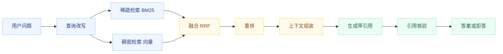
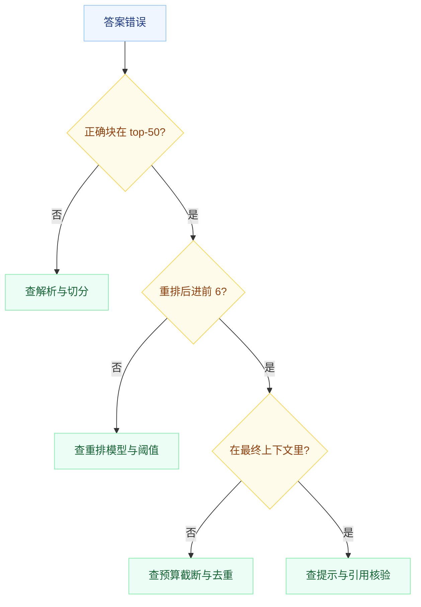

# RAG基础

> 这篇从 RAG 的适用边界讲起，经过文档解析、切分、混合检索、重排、上下文组装与引用，最后落到幻觉抑制、评估排障和一个完整的知识库交付案例。
>
> 学完能独立搭出一条可评测的检索增强问答链路，定位召回与引用问题，并把答案约束在给定资料内。

## 一、RAG 的适用边界与链路

RAG（Retrieval-Augmented Generation，检索增强生成）在生成前先从自有资料里检索相关片段，把片段作为上下文交给模型。它解决的是“模型不知道私有知识和最新事实”，不解决模型本身不会推理的问题。

### 1.1 它解决什么、不解决什么

| 适合 | 不适合 |
|---|---|
| 企业内部制度、产品手册问答 | 需要多步计算与严格账务 |
| 需要引用出处的客服辅助 | 没有资料、只能靠模型编的场景 |
| 知识频繁更新、无法重训模型 | 强实时交易状态查询 |
| 长文档中的定位与摘录 | 开放式创作、头脑风暴 |

判断标准只有一条：**答案是否存在于可检索的资料里**。资料里没有的，RAG 只会把“没有”包装成看似合理的句子；资料里有但检索不到，等于没有。

### 1.2 完整链路与失败点



链路上每一环都会独立掉点，且现象相似——都是“答得不对”。工程上必须把每环的输出落日志，否则只能靠猜：

- 解析：PDF 双栏串行、页眉页脚混入正文、表格变成乱序文字；
- 切分：块太大稀释语义，太小丢掉前提；
- 召回：专有名词被向量忽略，口语表述被 BM25 漏掉；
- 排序：相关块排在 20 名之外，进不了上下文；
- 组装：上下文超预算被截断，关键段落在中间被忽略；
- 生成：模型用了资料外的知识，或引用了不存在的编号。

### 1.3 三条硬边界

- 权限：检索必须带访问控制，不能先召回再在应用层删除，否则答案会泄漏无权内容；
- 时效：资料有生效日期时，检索要按日期过滤，旧版本不能与新版本同时进上下文；
- 冲突：两份资料说法不一致时，链路必须能暴露冲突，而不是让模型挑一个。

> 边界：RAG 不是“把文档塞进 prompt”。塞进去的是检索结果，检索结果的质量由解析、切分、索引和排序共同决定，这四步的工作量通常占整个项目的 70%。

## 二、环境准备与最小闭环

这一章装好依赖，用 6 段资料跑通“检索 → 组装 → 生成”的最小闭环，先确认链路通，再逐步替换每一环。

### 2.1 依赖与版本基线

| 组件 | 基线版本 | 用途 |
|---|---|---|
| Python | 3.12+ | 全链路脚本 |
| pypdf | 6.x | PDF 文本抽取 |
| python-docx | 1.2+ | Word 解析 |
| beautifulsoup4 | 4.13+ | HTML 解析 |
| numpy | 2.x | 向量计算 |
| sentence-transformers | 5.x | 本地重排模型 |

Embedding 与生成模型用兼容接口，模型名以供应商当前可用列表为准；本地重排用 `BAAI/bge-reranker-v2-m3` 一类模型，显存不足时改用供应商的 rerank 接口。

### 2.2 安装

```bash
python -m pip install --upgrade pip
python -m pip install requests numpy pypdf python-docx beautifulsoup4 lxml
# 需要本地重排时再装，体积较大
python -m pip install sentence-transformers
```

三端差异只在 Python 安装方式：

```bash
# Ubuntu 24.04
sudo apt install -y python3.12 python3.12-venv

# Rocky Linux 9
sudo dnf install -y python3.12 python3.12-pip

# macOS
brew install python@3.12

# Windows
winget install Python.Python.3.12
```

### 2.3 最小闭环

先用一个不依赖向量库的内存检索跑通全链路。分词用 ASCII 词 + 中文双字组合，避免额外装分词器。

```python
import math
import os
import re
import requests
from collections import Counter

DOCS = [
    {"id": "HR-01", "text": "费用报销在审批通过后 7 个工作日内到账。"},
    {"id": "HR-02", "text": "差旅住宿标准按城市等级分为三档，一线城市上限 600 元。"},
    {"id": "HR-03", "text": "发票抬头错误需要联系开票方重开，重开周期约 3 个工作日。"},
    {"id": "IT-01", "text": "VPN 拨号失败先检查账号是否过期，再确认客户端版本。"},
    {"id": "IT-02", "text": "办公电脑更换需提交资产申请，审批后 2 个工作日领取。"},
    {"id": "IT-03", "text": "打印机卡纸时先断电，再取出硒鼓后清理纸道。"},
]

def tokenize(text: str) -> list[str]:
    text = text.lower()
    tokens = re.findall(r"[a-z0-9_.\-]+", text)
    for run in re.findall(r"[\u4e00-\u9fff]+", text):
        tokens.extend(run)  # 单字兜底，保证单词查询也能命中
        tokens.extend(run[i:i + 2] for i in range(len(run) - 1))  # 双字组合近似分词
    return tokens

class BM25:
    def __init__(self, docs: list[dict], k1: float = 1.5, b: float = 0.75):
        self.docs = docs
        self.k1, self.b = k1, b
        self.tfs = [Counter(tokenize(d["text"])) for d in docs]
        self.lens = [sum(tf.values()) for tf in self.tfs]
        self.avg = sum(self.lens) / len(self.lens)
        df = Counter()
        for tf in self.tfs:
            df.update(tf.keys())
        n = len(docs)
        # 带平滑的 IDF，避免高频词权重为负
        self.idf = {t: math.log(1 + (n - c + 0.5) / (c + 0.5)) for t, c in df.items()}

    def search(self, query: str, top_k: int = 3) -> list[tuple[str, float]]:
        q = tokenize(query)
        scored = []
        for doc, tf, dl in zip(self.docs, self.tfs, self.lens):
            score = 0.0
            for t in q:
                if t not in tf:
                    continue
                f = tf[t]
                score += self.idf.get(t, 0.0) * f * (self.k1 + 1) / (
                    f + self.k1 * (1 - self.b + self.b * dl / self.avg))
            if score > 0:  # 零分文档不进候选，避免凑数结果干扰后续融合
                scored.append((doc["id"], score))
        return sorted(scored, key=lambda x: -x[1])[:top_k]

index = BM25(DOCS)
hits = index.search("报销多久能到账", top_k=3)
print([(doc_id, round(score, 4)) for doc_id, score in hits])
```

预期输出：

```text
[('HR-01', 9.4783), ('IT-01', 1.0182)]
```

第二名是噪声：双字组合把“到账”拆出的单字“账”命中了“账号”。这正是正式项目要换词典分词的原因，也是后面必须做混合检索与重排的原因。

拿到候选后组装上下文并调用模型：

```python
def build_context(hits: list[tuple[str, float]], docs: dict[str, str]) -> str:
    lines = []
    for i, (doc_id, _) in enumerate(hits, start=1):
        lines.append(f"[{i}] ({doc_id}) {docs[doc_id]}")
    return "\n".join(lines)

def answer(question: str, context: str) -> str:
    resp = requests.post(
        f"{os.environ['LLM_BASE_URL']}/chat/completions",
        headers={"Authorization": f"Bearer {os.environ['LLM_API_KEY']}"},
        json={
            "model": os.environ["LLM_MODEL"],
            "temperature": 0,
            "messages": [
                # 约束只依据资料，并强制标注编号，便于事后核验
                {"role": "system", "content":
                 "只依据资料回答，每句结论后用 [编号] 标注来源；资料不足时回答“资料中未提及”。"},
                {"role": "user", "content": f"资料：\n{context}\n\n问题：{question}"},
            ],
        },
        timeout=60,
    )
    resp.raise_for_status()
    return resp.json()["choices"][0]["message"]["content"]

if __name__ == "__main__":
    docs = {d["id"]: d["text"] for d in DOCS}
    print(answer("报销多久能到账", build_context(hits, docs)))
```

预期输出（示例）：

```text
费用报销在审批通过后 7 个工作日内到账。[1]
```

> 边界：没有 API Key 时先注释掉生成部分，只检查 `build_context` 的输出。检索错的时候，再好的模型也答不对；最小闭环的价值是先把检索单独验证。

## 三、文档解析

解析的目标不是“取出文字”，而是“保住结构”：标题层级、页码、表格行列、段落边界。结构一丢，后面的切分和引用都无从谈起。

### 3.1 统一块结构

所有格式先归一化成同一种块，后续切分和引用只认这个结构：

```python
from dataclasses import dataclass, field

@dataclass
class Block:
    doc_id: str
    page: int | None
    heading_path: list[str] = field(default_factory=list)
    kind: str = "text"          # text / table / list / code
    text: str = ""
    meta: dict = field(default_factory=dict)
```

这个结构里，`heading_path` 支撑“标题注入”，`page` 支撑引用回链，`kind` 支撑表格单独处理。少一个字段，后面就要靠猜。

### 3.2 PDF

PDF 没有段落概念，只有文字坐标。`pypdf` 能拿到按页文本，但双栏、页眉页脚、脚注需要额外处理。

```python
from pypdf import PdfReader

def parse_pdf(path: str, doc_id: str) -> list[Block]:
    reader = PdfReader(path)
    blocks: list[Block] = []
    for pno, page in enumerate(reader.pages, start=1):
        raw = page.extract_text() or ""
        # 去掉重复出现的页码行：整行只有数字和分隔符
        lines = [ln.strip() for ln in raw.splitlines()]
        lines = [ln for ln in lines if ln and not re.fullmatch(r"[-—\s]*\d+[-—\s]*", ln)]  # 去掉只含页码的行
        text = "\n".join(lines)
        if len(text) < 20:  # 少于 20 字多半是扫描页或封面，单独标记待 OCR
            blocks.append(Block(doc_id, pno, kind="empty", text=text, meta={"need_ocr": True}))
            continue
        blocks.append(Block(doc_id, pno, kind="text", text=text))
    return blocks
```

预期输出（示例）：

```text
[Block(doc_id='HR-01', page=1, kind='text', text='费用报销管理办法\n第一章 总则...'),
 Block(doc_id='HR-01', page=2, kind='empty', text='', meta={'need_ocr': True})]
```

### 3.3 Word、HTML 与 Markdown

Word 要分别取段落和表格，表格必须还原成行列；HTML 先删导航和脚本；Markdown 直接按标题切。

```python
from bs4 import BeautifulSoup
from docx import Document

def parse_docx(path: str, doc_id: str) -> list[Block]:
    doc = Document(path)
    blocks, heading = [], []
    for p in doc.paragraphs:
        if not p.text.strip():
            continue
        if p.style.name.startswith("Heading"):
            level = int(p.style.name.split()[-1]) if p.style.name.split()[-1].isdigit() else 1
            heading = heading[:level - 1] + [p.text.strip()]  # 维护标题栈，保留层级
            continue
        blocks.append(Block(doc_id, None, list(heading), "text", p.text.strip()))
    for t in doc.tables:
        rows = [" | ".join(c.text.strip() for c in row.cells) for row in t.rows]
        blocks.append(Block(doc_id, None, list(heading), "table", "\n".join(rows)))
    return blocks

def parse_html(html: str, doc_id: str) -> list[Block]:
    soup = BeautifulSoup(html, "lxml")
    for tag in soup(["script", "style", "nav", "footer", "header"]):
        tag.decompose()  # 导航和脚本会污染检索，先整体移除
    blocks, heading = [], []
    for el in soup.find_all(["h1", "h2", "h3", "p", "li", "table"]):
        if el.name in {"h1", "h2", "h3"}:
            level = int(el.name[1])
            heading = heading[:level - 1] + [el.get_text(strip=True)]
        elif el.name == "table":
            rows = [" | ".join(td.get_text(strip=True) for td in tr.find_all(["td", "th"]))
                    for tr in el.find_all("tr")]
            blocks.append(Block(doc_id, None, list(heading), "table", "\n".join(rows)))
        else:
            blocks.append(Block(doc_id, None, list(heading), "text", el.get_text(" ", strip=True)))
    return [b for b in blocks if len(b.text) >= 8]
```

### 3.4 表格与扫描件

表格不要当普通段落切。行列一旦拆散，金额、期限、等级这些最需要精确回答的内容就废了：

- 小表：整表转成 `列名: 值` 的文本块，保留表头；
- 大表：按行切，每块重复表头；
- 跨页表：按表头字段合并，页码记起始页；
- 扫描件：走 OCR（如 PaddleOCR、云 OCR），输出后仍按上面的块结构落盘。

> 边界：OCR 有字符错误，金额和编号类字段要做正则校验（金额必须匹配 `\d+(\.\d+)?`，编号必须符合业务格式），校验失败的块标 `meta["low_confidence"]=True`，检索时降权或不入库。

### 3.5 清洗

清洗只做四件事，做多了会误删正文：

```python
def clean(text: str) -> str:
    text = text.replace("\u3000", " ").replace("\xa0", " ")
    text = re.sub(r"[ \t]+", " ", text)
    text = re.sub(r"\n{3,}", "\n\n", text)
    text = re.sub(r"(?<=[\u4e00-\u9fff])\s+(?=[\u4e00-\u9fff])", "", text)  # 中文间空格多为排版残留
    return text.strip()
```

不要做的：去掉所有换行（标题与正文粘连）、统一全半角（型号 `ＡＢ-01` 与 `AB-01` 可能是不同物料）、删除疑似重复句（合同里重复条款往往有法律含义）。

## 四、切分策略

切分的唯一目标是让每一块既能独立回答一个问题，又不至于把多个主题混在一起。

### 4.1 先结构、后长度

按标题切是首选，长度只作为兜底。标题本身要注入块首，否则“第七条 报销标准”这种块离开章节就没有意义。

```python
def split_by_heading(blocks: list[Block], max_chars: int = 600) -> list[dict]:
    chunks = []
    for b in blocks:
        if b.kind in {"empty"}:
            continue
        prefix = " > ".join(b.heading_path)
        body = clean(b.text)
        for piece in pack(body, max_chars):
            chunks.append({
                "doc_id": b.doc_id,
                "page": b.page,
                "heading": prefix,
                "text": f"{prefix}\n{piece}" if prefix else piece,  # 标题进正文，单独成块也能被理解
            })
    return chunks

def pack(text: str, max_chars: int) -> list[str]:
    if len(text) <= max_chars:
        return [text]
    sentences = re.split(r"(?<=[。！？!?；;])", text)
    out, buf = [], ""
    for s in sentences:
        if len(buf) + len(s) > max_chars and buf:
            out.append(buf)
            buf = s
        else:
            buf += s
    if buf:
        out.append(buf)
    return out
```

### 4.2 参数怎么定

| 内容类型 | 块长（字符） | 重叠 | 说明 |
|---|---|---|---|
| 制度条款 | 400–600 | 0 | 按条切，条款自带边界 |
| 产品手册 | 300–500 | 50–80 | 步骤之间需要衔接 |
| 论文/报告 | 600–900 | 100 | 论证跨段，块要大 |
| 表格 | 整表或整行 | 表头重复 | 不按字符切 |
| 代码 | 按函数 | 0 | 保持可编译单元 |

字符数是近似值。中文 1 字约 1 token，英文 1 词约 1.3 token，用供应商的 tokenizer 精确计数更稳，但切分阶段用字符数已经够用。

> 边界：块长没有普适最优值。同一份资料跑 300/600/900 三档，用 50 条真实问题比 recall@10，选最高的那档；换模型或换文档类型要重测。

### 4.3 重叠不是越多越好

重叠解决“答案正好跨在切口上”，代价是索引膨胀和重复命中。重叠 10%–15% 足够；同一段被重复召回时，在组装阶段按 `doc_id + 首句` 去重。

### 4.4 父子块

小块利于检索，大块利于生成。做法是：用 200–300 字的小块建索引，命中后取它的父块（整节或 1200 字窗口）送进上下文。

```python
def attach_parent(chunks: list[dict], parent_size: int = 1200) -> list[dict]:
    out, buf, parent_id = [], [], 0
    for c in chunks:
        # 同一标题路径下的连续块合并为父块，跨节不合并，避免上下文串主题
        if buf and (len("".join(x["text"] for x in buf)) + len(c["text"]) > parent_size
                    or c["heading"] != buf[-1]["heading"]):
            for x in buf:
                x["parent_id"] = f"P{parent_id}"
            out.extend(buf)
            buf, parent_id = [], parent_id + 1
        buf.append(dict(c))
    for x in buf:
        x["parent_id"] = f"P{parent_id}"
    return out + buf
```

检索时拿小块算相似度，返回前把 `parent_id` 对应的全文替换进去。代价是上下文变长，要在组装阶段按预算截断。

## 五、混合检索

单一检索必然有盲区：BM25 强在精确词和编号，向量强在换一种说法。两者融合能把 recall@10 提高 10–20 个点，成本只是多一次查询。

### 5.1 稀疏检索

BM25 是稀疏检索的基线：按词频和逆文档频率打分，对“HR-2026-017”“A102 型号”这类字符串最可靠。

```python
def bm25_search(index: BM25, query: str, top_k: int = 50) -> list[str]:
    return [doc_id for doc_id, _ in index.search(query, top_k=top_k)]
```

中文要先分词。上面最小闭环用的是双字组合，效果够用但会有噪声；正式项目用 jieba 或企业自己的词典，并把业务词（产品名、部门名、型号）加入自定义词典。

### 5.2 稠密检索

稠密检索把查询和文档映射到同一向量空间，用余弦相似度召回。

```python
import numpy as np

def dense_search(qvec: np.ndarray, mat: np.ndarray, ids: list[str], top_k: int = 50) -> list[str]:
    # 向量已归一化，内积即余弦相似度
    scores = mat @ qvec
    order = np.argsort(-scores)[:top_k]
    return [ids[i] for i in order]
```

> 边界：稠密检索对否定和数字不敏感。“不含酒精”和“含酒精”在向量上可能非常接近，这类查询必须靠 BM25 或结构化过滤兜底。

### 5.3 RRF 融合

倒数排名融合（Reciprocal Rank Fusion，RRF）只使用名次，不使用分数，避免两路分数量纲不一致。

```python
def rrf(rank_lists: list[list[str]], k: int = 60, top_n: int = 30) -> list[str]:
    score: dict[str, float] = {}
    for lst in rank_lists:
        for rank, doc_id in enumerate(lst, start=1):
            # k 越大，头部优势越弱；60 是常用默认值，适合两路质量接近时
            score[doc_id] = score.get(doc_id, 0.0) + 1.0 / (k + rank)
    return sorted(score, key=score.get, reverse=True)[:top_n]
```

融合前两路各取 50 条，融合后取 30 条进重排。两路权重不等时，先给弱的一路降权（把它的 `1/(k+rank)` 乘 0.5），不要直接调 `k`。

### 5.4 元数据过滤与权限

过滤必须在检索时完成，不能在结果上删。做法是把权限条件编译进查询：

```python
def visible(doc: dict, user: dict) -> bool:
    if doc.get("confidential") and "hr" not in user["roles"]:
        return False
    return doc.get("dept") in user["depts"] or doc.get("dept") == "public"
```

在 pgvector 里是 `WHERE dept = ANY(%s)`，在 Qdrant 里是 payload filter。检索参数 `top_k` 要放大，因为过滤后可能不足；同时记录“过滤后不足”的比例，持续偏高说明索引分区不合理。

### 5.5 查询改写

用户提问常常缺主语、带口语、混多个问题。改写能显著提升召回，但会引入延迟和新的错误：

| 手法 | 做法 | 风险 |
|---|---|---|
| 补全 | 用对话历史补全指代 | 补错指代 |
| 多查询 | 生成 2–3 个同义问法分别检索 | 延迟翻倍 |
| 拆解 | 复合问题拆成子问题 | 子问题合并出错 |
| HyDE | 先生成假想答案再检索 | 生成内容带偏 |

> 边界：改写模型输出的查询要限长并过滤，防止把用户原文整段重写导致关键词丢失。多查询融合时用 RRF，不要简单拼接。

## 六、重排

重排用交叉编码器（Cross-Encoder）逐对打分，精度高于向量内积，代价是不能预计算索引，只能对小候选集做。

### 6.1 两阶段结构

| 阶段 | 模型 | 候选数 | 延迟 | 作用 |
|---|---|---|---|---|
| 召回 | BM25 + 双塔向量 | 50–200 | 10–30 ms | 保证相关块在集合内 |
| 重排 | Cross-Encoder | 20–50 | 50–300 ms | 把最相关的排到前面 |

双塔模型把查询和文档分别编码，无法建模词级交互；Cross-Encoder 把两者拼起来过一次模型，能识别“不包含”“除外”这类细粒度差异。

### 6.2 本地重排

```python
from sentence_transformers import CrossEncoder

reranker = CrossEncoder("BAAI/bge-reranker-v2-m3", max_length=512)

def rerank(query: str, candidates: list[dict], top_n: int = 6) -> list[dict]:
    pairs = [(query, c["text"]) for c in candidates]
    scores = reranker.predict(pairs, batch_size=16)  # 批量推理，单条循环会慢一个数量级
    for c, s in zip(candidates, scores):
        c["rerank_score"] = float(s)
    return sorted(candidates, key=lambda c: -c["rerank_score"])[:top_n]
```

预期输出（示例，分数为模型原始 logit）：

```text
[{'doc_id': 'HR-01', 'rerank_score': 6.82},
 {'doc_id': 'HR-03', 'rerank_score': -3.11},
 {'doc_id': 'HR-02', 'rerank_score': -5.47}]
```

### 6.3 阈值与拒答

重排分数可以直接用于拒答判断：最高分低于阈值，说明资料里很可能没有答案。

```python
def select(candidates: list[dict], threshold: float = 0.5) -> list[dict]:
    if not candidates or candidates[0]["rerank_score"] < threshold:
        return []  # 交给上层走拒答话术，不要让模型硬答
    return [c for c in candidates if c["rerank_score"] >= threshold]
```

阈值不能拍脑袋：在评测集上画“分数—正确率”曲线，取正确率开始陡降的位置。用 API 重排时分数范围与本地模型不同，阈值必须重新标定。

### 6.4 什么时候不用重排

- 候选只有 5–10 条且已经很准：收益小于 100 ms 的延迟；
- 极低延迟场景（语音助手首字 < 300 ms）：改用更小的重排模型或跳过；
- 纯编号/精确匹配查询：BM25 第一名已经正确，重排可能反而降权。

> 边界：重排只改变顺序，不增加候选。召回阶段没进前 50 的内容，重排再强也救不回来。优化顺序永远是先召回、后重排。

## 七、上下文组装与引用

组装决定了模型看到什么、按什么顺序看、能引用什么。它是最容易被忽略、又最容易修的一环。

### 7.1 上下文预算

先算预算再拼字符串：

```python
def est_tokens(text: str) -> int:
    cjk = len(re.findall(r"[\u4e00-\u9fff]", text))
    other = len(text) - cjk
    return cjk + other // 4  # 中文约 1 字 1 token，英文约 4 字符 1 token

def fit(chunks: list[dict], budget: int) -> list[dict]:
    used, out = 0, []
    for c in chunks:
        cost = est_tokens(c["text"]) + 20  # 预留编号与来源行的开销
        if used + cost > budget:
            break
        out.append(c)
        used += cost
    return out
```

预算 = 模型上下文上限 − 系统提示 − 对话历史 − 输出预留。输出预留按 `max_tokens` 算，不要假设模型会自己收尾。

### 7.2 顺序与去重

- 最相关的块放首尾，中间放次要块：长上下文存在“中间遗忘”，关键内容不要放正中间；
- 同一文档的相邻块合并，避免同一段话出现三次；
- 表格块与它的说明段落放在一起，否则模型会把表头配错；
- 按 `(doc_id, page)` 排序时，把排序权重让给相关度，页码只用于展示。

```python
def dedupe(chunks: list[dict]) -> list[dict]:
    seen, out = set(), []
    for c in chunks:
        key = (c["doc_id"], c["text"][:40])
        if key in seen:
            continue
        seen.add(key)
        out.append(c)
    return out
```

### 7.3 引用编号与回链

引用要能回到原文，不能只写“根据资料”。最小实现是编号 + 来源行：

```python
def render(chunks: list[dict]) -> str:
    lines = []
    for i, c in enumerate(chunks, start=1):
        loc = f"{c['doc_id']} 第 {c['page']} 页" if c.get("page") else c["doc_id"]
        lines.append(f"[{i}] 来源：{loc}｜{c['heading']}\n{c['text']}")
    return "\n\n".join(lines)
```

系统提示至少写死三条：只依据资料、每句结论标注编号、资料不足直接说未提及。编号必须与 `render` 的顺序完全一致，否则引用全错。完整规则见 8.2。

### 7.4 引用核验

模型会编造编号，也会把 A 来源的结论标成 B。生成后必须校验：

```python
CITE = re.compile(r"\[(\d+)\]")
CLAIM = re.compile(r"[^。！？]*[。！？](?:\s*\[\d+\])*|[^。！？]+")

def split_claims(text: str) -> list[str]:
    # 句末引用编号必须随句子走，否则核验对象会错位
    return [c.strip() for c in CLAIM.findall(text) if c.strip()]

def verify(answer: str, chunks: list[dict]) -> dict:
    cited = {int(n) for n in CITE.findall(answer)}
    bad_range = sorted(n for n in cited if not 1 <= n <= len(chunks))
    unsupported = []
    for sent in split_claims(answer):
        nums = [int(n) for n in CITE.findall(sent)]
        if not nums:
            continue
        valid = [n for n in nums if 1 <= n <= len(chunks)]
        if not valid:
            unsupported.append(sent)  # 只引了不存在的编号，等同于没有依据
            continue
        # 句子与所引块的重合度太低，视为“引了但没依据”
        st = set(tokenize(sent))
        best = max(len(st & set(tokenize(chunks[n - 1]["text"]))) / max(len(st), 1)
                   for n in valid)
        if best < 0.3:
            unsupported.append(sent)
    return {"bad_range": bad_range, "unsupported": unsupported}
```

预期输出（示例）：

```python
{"bad_range": [], "unsupported": ["报销可以加急处理。[2]"]}
```

> 边界：重合度阈值依赖分词质量，只适合做粗筛。真正要判“是否有依据”得用小型 NLI 模型或人工抽检，别把 0.3 当成法律标准。

## 八、幻觉抑制与拒答

幻觉不是一个问题，是三类：资料里没有却编、资料里有但引错、越权回答。三类要用不同手段。

### 8.1 三类幻觉与对策

| 类型 | 表现 | 主要手段 |
|---|---|---|
| 无据生成 | 资料没提，模型补常识 | 覆盖度阈值 + 拒答 |
| 错误引用 | 结论对，编号错 | 引用核验 + 回链 |
| 越权/过期 | 答了无权或旧版内容 | 检索期过滤 + 生效日期 |

### 8.2 生成约束

系统提示要写死行为，不要写“尽量”“最好”：

```text
你是企业制度问答助手。规则：
1. 只能使用给定资料，不得使用常识补充。
2. 每个结论句末尾标注 [编号]，编号必须来自资料。
3. 资料之间冲突时，列出冲突并说明各自出处，不要自行选择。
4. 资料未覆盖的问题，只回答：资料中未提及，建议联系对应部门。
5. 不做推测，不给出资料外的数字、日期和金额。
```

规则要少而硬。十条以上的提示会让模型顾此失彼，实测中第 3 条之后遵守率明显下降。

### 8.3 覆盖度判断

生成前先判断“资料是否覆盖问题”，比生成后再补救便宜：

```python
def coverage(question: str, chunks: list[dict]) -> float:
    q = set(tokenize(question))
    if not q:
        return 0.0
    best = max(len(q & set(tokenize(c["text"]))) / len(q) for c in chunks)
    return best
```

注意这是词面覆盖，同义表述会低估。生产上用重排分数 + 词面覆盖两个信号做与运算，任一不达标就降级为“建议人工”。

### 8.4 拒答不是失败

拒答率是产品指标，不是越低越好。内部制度问答的合理拒答率通常在 5%–15%（示例区间）：低于 5% 往往意味着在硬答，高于 20% 说明召回或解析有问题。

拒答话术要给出路，不要只说“不知道”：

```text
资料中未提及该问题。可尝试：
1. 换一种问法（如注明部门或制度名称）；
2. 联系人力资源部（分机 8021）确认。
```

### 8.5 冲突与时效

两份资料冲突时，正确做法是把冲突暴露给用户，而不是让模型选一个：

- 检索结果按 `effective_date` 过滤，只保留当前生效版本；
- 同一主题多版本同时命中时，标注版本日期，输出“2025 版规定 X，2026 版规定 Y”；
- 无法判断时输出冲突摘要并附两个来源，转人工。

> 边界：时效过滤依赖元数据准确。文档入库时必须抽取生效日期和版本号，抽不到就标 `unknown` 并进入人工复核队列，不要让 `unknown` 默认通过。

## 九、评估与排障

没有评测集的 RAG 只能靠感觉调参，改一处、坏一处。评测集是这条链路唯一可信的回归手段。

### 9.1 评测集怎么建

- 规模：100–300 条起步，覆盖每个部门和高频意图；
- 来源：真实提问日志 + 业务专家补充；
- 每条包含：问题、标准答案要点、必须命中的文档 ID、是否应拒答；
- 更新：每次线上 badcase 复盘后补 1–2 条，季度重审一次。

```python
GOLD = [
    {"q": "报销多久到账", "must_hit": ["HR-01"], "answer": "7 个工作日", "refuse": False},
    {"q": "年会抽奖规则", "must_hit": [], "answer": "", "refuse": True},
]

def recall_at_k(retrieved: list[str], must_hit: list[str], k: int = 10) -> float:
    if not must_hit:
        return 1.0
    top = set(retrieved[:k])
    return len(top & set(must_hit)) / len(must_hit)
```

### 9.2 四类指标

| 指标 | 计算方式 | 关注点 |
|---|---|---|
| recall@k | 命中块 / 应命中块 | 召回是否够 |
| MRR@10 | 首个命中名次倒数 | 排序是否准 |
| 引用支持率 | 通过核验的句子占比 | 引用是否可信 |
| 拒答准确率 | 应拒尽拒、不应拒不拒 | 边界是否稳 |

生成质量用人工抽检或模型评审（LLM-as-judge），每周抽 50 条，双人标注分歧样本。评审提示要给评分细则，否则分数不可比。

### 9.3 错误归因

出问题先定位是哪一环，不要直接改 prompt：

| 现象 | 最可能环节 | 第一条检查 |
|---|---|---|
| 检索结果里没有正确块 | 解析/切分/召回 | 打印该问题的 top-50 与真值块 |
| 正确块在第 30 名 | 排序 | 看重排前后名次变化 |
| 正确块进了上下文但答错 | 组装/生成 | 看最终 prompt 与模型原文 |
| 答案对但引用错 | 引用编号 | 核对 render 顺序与编号 |
| 该拒答却硬答 | 阈值/提示 | 看最高重排分与覆盖度 |
| 同一问题两次答案不同 | 温度/上下文顺序 | 固定 `temperature=0` 复现 |

### 9.4 排障顺序



把每一步的中间结果写进一条 trace（`question_id`、改写后查询、候选 ID 与分数、最终上下文、答案、核验结果），排障时按 trace 逐段核对，比读日志快得多。

> 边界：`temperature=0` 也不能保证完全可复现，厂商侧仍有批次差异。回归测试用“是否命中要点”判定，不要用字符串完全相等。

## 十、最佳实践案例

### 10.1 案例背景

一家汽车零部件厂的设备维修部门有 1.8 万页 PDF 维修手册，覆盖 60 种设备。维修工在产线旁用手机提问，需要给出步骤、参数和页码；答错会导致停机或安全事故，因此必须给出可核对的出处，资料没有的参数必须拒答。

原方案是纯向量检索 + 直接生成：recall@10 只有 0.61，型号类查询几乎全错，答案经常不带页码。约束：不能把手册传出内网，生成模型用内网部署的兼容接口，检索服务单机 32 GB 内存，P95 端到端延迟要低于 3 秒。

### 10.2 案例实操

第一步，解析。1.8 万页里有 2100 页是扫描件，先走 OCR，其余用 `pypdf`；表格单独成块并保留表头。

```python
def parse_manual(path: str, doc_id: str) -> list[Block]:
    blocks = parse_pdf(path, doc_id)
    fixed = []
    for b in blocks:
        if b.kind == "empty" and path.endswith(".pdf"):
            b.text = ocr_page(path, b.page)  # 扫描页补 OCR，失败则保留 need_ocr 标记
            b.kind = "text" if len(b.text) > 20 else "empty"
        fixed.append(b)
    return fixed
```

第二步，切分。按“设备型号 → 章节 → 步骤”三级标题切，块长 500 字，表格整表保留；每个块首注入标题路径和型号。

```python
chunks = split_by_heading(parse_manual("manual_A102.pdf", "A102"), max_chars=500)
for c in chunks:
    c["model"] = "A102"          # 型号进元数据，检索时可按设备过滤
    c["text"] = f"设备 {c['model']}｜{c['text']}"
```

第三步，混合检索。BM25 用 jieba 分词并加载 800 条设备术语词典，向量用 1024 维模型，两路各取 50 条后 RRF 融合。

```python
def retrieve(question: str, model: str, top_k: int = 30) -> list[dict]:
    qvec = normalize(embed([f"query: {question}"]))[0]
    lex = bm25_search(bm25, question, top_k=50)
    den = dense_search(qvec, vec_mat, chunk_ids, top_k=50)
    fused = rrf([lex, den], k=60, top_n=top_k)
    cands = [chunk_by_id[i] for i in fused if chunk_by_id[i]["model"] == model]
    return rerank(question, cands, top_n=6)  # 先按型号过滤，再重排，避免跨设备串答案
```

第四步，组装与核验。上下文按“重排分降序、首尾放高分”排，编号与来源行固定格式，生成后跑引用核验。

```python
REFUSAL = "资料中未提及该问题，请联系设备科确认（分机 8120）。"

def ask(question: str, model: str) -> dict:
    picked = select(retrieve(question, model), threshold=0.5)
    if not picked:
        return {"answer": REFUSAL, "refused": True, "sources": []}  # 拒答也返回稳定话术，不给前端留空洞
    ctx = render(picked)
    ans = answer(question, ctx)
    check = verify(ans, picked)
    return {
        "answer": ans,
        "refused": False,
        "sources": [{"doc_id": c["doc_id"], "page": c["page"]} for c in picked],
        "bad_range": check["bad_range"],
        "unsupported": check["unsupported"],
    }
```

第五步，评测。300 条真实提问（维修工提供），分型号查询、参数查询、故障现象描述三类，对比三个版本。

| 版本 | recall@10 | 引用准确率 | P95 延迟 |
|---|---|---|---|
| 纯向量 | 0.61 | 0.72 | 1.4 s |
| 混合检索 | 0.79 | 0.81 | 1.6 s |
| 混合 + 重排 + 型号过滤 | 0.89 | 0.96 | 2.3 s |

参数查询这一类提升最大：从 0.48 到 0.93，因为型号和参数单位靠 BM25 与表格块命中；故障现象描述类从 0.71 到 0.84，主要靠重排。

### 10.3 案例结果

上线三个月后的实测与复盘（数字为示例环境统计）：

- 端到端 P95 2.3 s，其中检索 180 ms、重排 340 ms、生成 1.6 s，生成仍是瓶颈；
- 引用准确率 0.96，抽检 200 条里 8 条编号错位，全部由“同文档相邻块合并后编号未重排”引起，修掉合并逻辑后降到 0.99；
- 拒答率 11%，其中资料确实未覆盖的占 8.4%，误拒 2.6%，集中在口语化描述“机器嗡嗡响”这类缺少术语的提问；
- recall@10 仍有 0.89，剩余缺口主要是跨页表格和 OCR 错字，已列入下一轮解析优化。

失败模式：

- 最初把型号只写进正文不写元数据，导致 A102 的问题召回 B205 的步骤；加型号过滤后此类错误清零。
- 表格按字符切后，“扭矩 45 N·m”被拆到两块，模型把 4 和 5 拼成 45 之外的值；改整表保留后消失。
- OCR 把“0”识别成“O”，参数查询失败；加入“数字字段必须匹配正则”的校验后，低置信块被降权，误答减少。
- 提示里曾写“尽量给出页码”，模型经常编造页码；改为“只使用资料中的页码，否则不写”并由 `render` 统一附来源后解决。

> 边界：案例里的召回与延迟是在特定手册、特定模型上测的，换设备类型或换模型都要重跑评测集。可直接复用的是“型号过滤 + 混合检索 + 重排 + 引用核验”的顺序，不是表里的具体数字。
