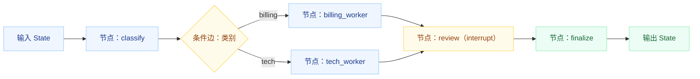
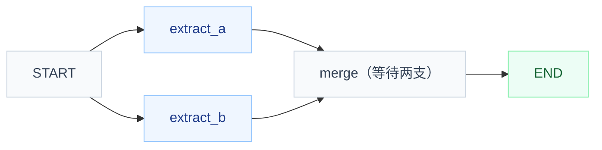
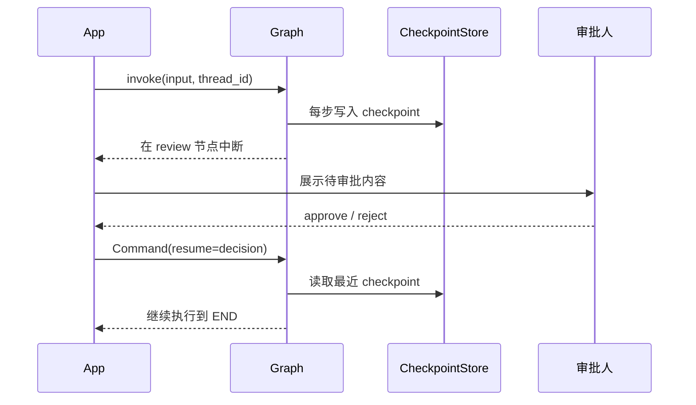
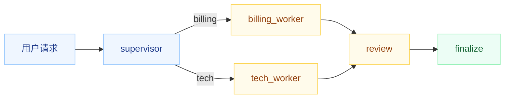

# Agent工作流与LangGraph

> 这篇从单 Agent 循环的失效点讲起，经过状态图与状态设计、条件边与并行、checkpointer 持久化、interrupt 人在环、多智能体分派，最后落到流式输出、重试策略、生产部署和排障。
>
> 学完能用 LangGraph 1.x 搭出可断点续跑、可人工审批、可多角色分派的工作流，并在循环失控、恢复失败、状态膨胀时快速定位。

## 一、从 Agent 循环到状态图

当任务需要分支、崩溃恢复、人工审批或多角色协作时，ReAct 的单层循环就不够用，需要把控制流显式画成状态图。

### 1.1 单循环的失效信号

ReAct 的典型形态是一个 `while`：模型思考、选工具、读结果，直到不再调用工具。

```python
# 片段：单层 Agent 循环的骨架
while True:
    action = llm.decide(messages)
    if action.type == "final":
        return action.content
    result = tools[action.name](**action.args)
    messages.append(result)
```

这段代码在演示里够用，但缺少四个生产必需的能力：

| 信号 | 单循环的问题 | 状态图的解法 |
|---|---|---|
| 需要人工审批 | 循环停在内存里，进程一退就丢 | `interrupt` + checkpointer |
| 流程有分支 | 分支藏在 prompt 里，不可测试 | 条件边，路由是代码 |
| 调用要并发 | 只能串行等待 | 并行边 + reducer |
| 崩溃要续跑 | 无状态快照，只能从头再跑 | `thread_id` + checkpoint |

判断规则：工具不超过两个、没有写操作、不需要审批的问答，保留单循环更省事；一旦出现上表任一信号，就升级为状态图。

> 边界：状态图不是“更高级的 Agent”。节点多、边多会带来编排成本和调试成本，简单任务套图只会让代码更难读。

### 1.2 状态图的四个构件

一张可运行的状态图由状态（State）、节点（Node）、边（Edge）、检查点（Checkpointer）组成。



- **状态**：一个可序列化的字典，节点只返回自己要改的字段；
- **节点**：普通函数，签名是 `State -> dict | Command`，不做隐式 I/O 之外的副作用最好；
- **边**：固定边决定“下一步是谁”，条件边由函数返回值决定；
- **检查点**：每一步后把状态写入存储，支持恢复、审批和时间旅行。

关键区别：节点是函数，不是类；边是声明，不是 `if/else` 散落在代码里。控制流集中在建图阶段，业务逻辑留在节点里。

### 1.3 版本基线

本篇按 2026-11 的 LangGraph 1.x 编写，并在 `langgraph 1.2.21` 上运行过全部示例。

| 组件 | 基线 | 说明 |
|---|---|---|
| Python | 3.12+ | 3.10 可跑，3.13 已验证 |
| langgraph | 1.x | 本篇验证 1.2.21 |
| langgraph-checkpoint | 4.x | 随 langgraph 安装 |
| langgraph-checkpoint-sqlite | 3.x | 单机持久化 |
| langgraph-checkpoint-postgres | 3.x | 多进程生产 |

1.x 与 0.2/0.3 的差异要按 1.x 文档写代码：

- `interrupt()` 取代了旧的 `NodeInterrupt` 异常；
- `InMemorySaver` 是正式名字，`MemorySaver` 只作为兼容别名；
- 预置 Agent 迁到 `langchain.agents.create_agent`，旧的 `langgraph.prebuilt.create_react_agent` 属于遗留接口；
- `compile()` 增加 `durability` 参数，控制每一步落盘的时机。

> 边界：1.x 内小版本仍可能调整签名。上线前锁定 `requirements.txt` 的精确版本，升版本先跑案例回归。

## 二、环境与第一个状态图

这一章解决“装好并跑通一个最小图”，后面所有能力都在这套骨架上加。

### 2.1 安装与验证

四个平台都先建虚拟环境，避免污染系统 Python。

```bash
# Ubuntu / Debian
sudo apt update && sudo apt install -y python3.12 python3.12-venv
python3.12 -m venv .venv && source .venv/bin/activate

# Rocky / CentOS
sudo dnf install -y python3.12 python3.12-pip
python3.12 -m venv .venv && source .venv/bin/activate
```

```powershell
# Windows PowerShell
winget install Python.Python.3.12
py -3.12 -m venv .venv
.\.venv\Scripts\Activate.ps1
```

```bash
# macOS
brew install python@3.12
python3.12 -m venv .venv && source .venv/bin/activate
```

安装依赖并验证：

```bash
python -m pip install -U pip
python -m pip install -U langgraph

python - <<'PY'
import importlib.metadata as m
print("langgraph", m.version("langgraph"))
print("checkpoint", m.version("langgraph-checkpoint"))
PY
```

预期输出（版本号以实际安装为准）：

```text
langgraph 1.2.21
checkpoint 4.3.1
```

用 `uv` 时把三条命令换成 `uv venv --python 3.12`、`uv pip install langgraph`，其余不变。

> 边界：不要用 `sudo pip install`。系统包管理器装的 Python 受 PEP 668 保护，直接装会报 `externally-managed-environment`，必须用 venv。

### 2.2 最小状态图

下面这张图只有一个节点，但已经具备 State、Node、Edge 和编译四件事。

```python
from typing import TypedDict

from langgraph.graph import StateGraph, START, END

class State(TypedDict):
    question: str
    answer: str

def answer_node(state: State) -> dict:
    # 只返回要更新的字段，未返回的字段保持原值
    return {"answer": f"收到问题：{state['question']}"}

builder = StateGraph(State)
builder.add_node("answer", answer_node)
builder.add_edge(START, "answer")   # START 是虚拟起点，必须有入边
builder.add_edge("answer", END)     # END 是虚拟终点，终止本次执行
graph = builder.compile()

result = graph.invoke({"question": "如何重置密码？"})
print(result)
```

预期输出：

```text
{'question': '如何重置密码？', 'answer': '收到问题：如何重置密码？'}
```

三个容易踩的点：

- `State` 里的键默认是“最后写入者获胜”，两个并行节点写同一个键会报错；
- `START` / `END` 不是普通节点，不能 `add_node`；
- `invoke` 的入参可以只给部分键，但键必须在 Schema 里声明，拼错会静默变成新字段（`TypedDict` 不做运行时校验）。

### 2.3 调用方式：invoke、stream 与 batch

`compile()` 返回一个可执行对象，三种调用方式对应三种场景。

| 方法 | 返回 | 适用 |
|---|---|---|
| `invoke` | 最终 State | 后台任务、脚本 |
| `stream` | 每步增量 | 前端进度、日志 |
| `batch` | 结果列表 | 批量评测 |

```python
for chunk in graph.stream({"question": "如何重置密码？"}, stream_mode="updates"):
    print(chunk)
```

预期输出：

```text
{'answer': {'answer': '收到问题：如何重置密码？'}}
```

> 边界：`stream_mode="updates"` 只给每个节点的增量，拿不到完整 State；需要完整快照时用 `stream_mode="values"`，代价是每条都更大。

## 三、状态设计：Schema、Reducer 与消息

状态设计决定了图能不能并行、能不能恢复、会不会越跑越慢，比节点逻辑更值得先想清楚。

### 3.1 默认覆盖与 reducer

同一个键在一个超步里被多个节点写入时，默认策略会拒绝，而不是随机保留一个。

```text
InvalidUpdateError: At key 'x': Can receive only one value per step.
Use an Annotated key to handle multiple values.
```

用 `Annotated` 声明合并函数即可：

```python
import operator
from typing import Annotated, TypedDict

class State(TypedDict):
    # operator.add 让并行分支的列表追加，而不是互相覆盖
    findings: Annotated[list[str], operator.add]
    # 标量仍然最后写入者获胜
    summary: str
```

自定义 reducer 也能做去重：

```python
def merge_unique(left: list[str], right: list[str]) -> list[str]:
    # 用 dict 保序去重，避免并行分支写入重复条目
    return list(dict.fromkeys(left + right))

class State(TypedDict):
    sources: Annotated[list[str], merge_unique]
```

> 边界：reducer 必须支持任意合并顺序。并行分支的完成顺序不保证，依赖“先到先得”的 reducer 会在压力下出现随机结果。

### 3.2 消息状态与 add_messages

对话状态不要手写 `list.append`，用 `add_messages` 才能正确处理“追加、按 id 更新、按 id 删除”。

```python
from typing import Annotated, TypedDict
from langgraph.graph.message import add_messages

class ChatState(TypedDict):
    # add_messages：按 id 合并；同 id 覆盖，新 id 追加
    messages: Annotated[list, add_messages]

def chat_node(state: ChatState) -> dict:
    last = state["messages"][-1]
    return {"messages": [{"role": "assistant", "content": f"回复：{last.content}"}]}
```

`add_messages` 的真实行为：

| 输入 | 结果 |
|---|---|
| 新消息无 id | 分配 id 并追加 |
| 消息 id 已存在 | 覆盖该条 |
| `RemoveMessage(id=...)` | 删除该条 |
| `(role, content)` 元组 | 自动转成消息对象 |

裁剪历史时用 `RemoveMessage`，不要直接切片：

```python
from langgraph.graph.message import RemoveMessage

def trim(state: ChatState) -> dict:
    # 只保留最近 6 条，删除动作也要走 reducer，否则恢复后会“复活”
    old = state["messages"][:-6]
    return {"messages": [RemoveMessage(id=m.id) for m in old]}
```

> 边界：不要在节点里 `state["messages"].append(...)` 后返回空字典。LangGraph 通过返回值合并状态，原地修改不会被记录，恢复时丢失。

### 3.3 Command：更新与跳转合一

节点需要“改状态并决定下一个节点”时，返回 `Command`，不要返回值再配条件边。

```python
from langgraph.types import Command

def triage(state: State) -> Command:
    if "退款" in state["question"]:
        # update 合并进状态，goto 直接指定下一节点
        return Command(update={"category": "billing"}, goto="billing_worker")
    return Command(update={"category": "tech"}, goto="tech_worker")
```

规则：

- `Command` 是节点返回值，不是状态字段；
- 用了 `Command(goto=...)` 的节点，不要再给它加普通出边，二选一；
- `goto` 可以是一次多个节点的列表，用于 fan-out；
- 跨子图跳转要带 `graph=Command.PARENT`，否则会被当成当前图的节点名。

> 边界：`Command` 把路由写进节点，适合“业务逻辑天然决定去向”的场景；如果路由规则需要独立测试，用条件边更清晰。

### 3.4 状态里放什么、不放什么

状态只放“下一步需要、且 checkpoint 能序列化”的数据。

| 适合放状态 | 不适合放状态 |
|---|---|
| 用户输入、分类结果 | 完整 PDF、图片二进制 |
| 工具返回的结构化摘要 | 数据库连接、文件句柄 |
| 审批结论、错误码 | API Key、身份证号原文 |
| 文档 ID、对象存储路径 | 可通过 ID 重查的大段正文 |

原因有三条：

1. checkpoint 每步序列化，状态越大写入越慢，Postgres 的 `checkpoints` 表会迅速膨胀；
2. 状态结构变更后，旧 checkpoint 反序列化可能失败，需要用版本字段做迁移；
3. 敏感字段一旦进 checkpoint，删除和审计都会变复杂。

```python
class State(TypedDict, total=False):
    schema_version: int       # 结构升级时据此选择迁移函数
    document_ids: list[str]   # 只存引用，正文放对象存储
    summary: str              # 下一步真正要用的内容
```

> 边界：`total=False` 让所有键可选，便于渐进式加字段，但也会掩盖拼写错误。关键键建议保持必填，或在入口节点显式校验。

## 四、控制流：条件边、并行与子图

这一章解决“流程怎么走”：单线、分支、并发和嵌套。

### 4.1 条件边

条件边把路由变成可测试的纯函数，返回值必须是已声明的目标。

```python
# 片段：接在 2.2 的 builder 上
from typing import Literal

def route(state: State) -> Literal["billing", "tech", "manual"]:
    # 路由函数只读状态，不调模型、不写库，保证可重放
    if state.get("needs_human"):
        return "manual"
    return "billing" if state["category"] == "billing" else "tech"

builder.add_conditional_edges(
    "triage",
    route,
    {"billing": "billing_worker", "tech": "tech_worker", "manual": "review"},
)
```

也可以省略映射表，让返回值直接当节点名，但改名时容易漏改，显式映射更安全。

> 边界：路由函数返回未声明的值会直接抛错，不会默默走默认分支。把“未知类别”显式映射到兜底节点，比在路由里 `try/except` 更好排查。

### 4.2 并行 fan-out 与 fan-in

并行只适合互不依赖的子任务，且汇合节点必须能处理“同一超步多个写入”。

```python
# 片段：接在已有 builder 上
import operator

class State(TypedDict):
    text: str
    facts: Annotated[list[str], operator.add]   # 两个分支都写，必须合并
    done: Annotated[list[str], operator.add]

def extract_a(state: State) -> dict:
    return {"facts": [f"a:{state['text'][:10]}"], "done": ["a"]}

def extract_b(state: State) -> dict:
    return {"facts": [f"b:{state['text'][-10:]}"], "done": ["b"]}

builder.add_edge(START, "extract_a")
builder.add_edge(START, "extract_b")
builder.add_edge(["extract_a", "extract_b"], "merge")  # 两个都完成才进 merge
```



汇合边写成列表 `["extract_a", "extract_b"]` 时，LangGraph 会等两支都结束再进 `merge`；如果写成两条单独的边，两支长度不一致时（一支 1 步、另一支 2 步）`merge` 可能被触发两次，得到两次部分结果。需要“齐了才算数”的汇合，用列表写法。

> 边界：并行会放大限流和成本。对同一个模型供应商并发十个请求，很容易触发 429；并行前先算清 RPM/TPM。

### 4.3 子图复用

一段流程要在多个图里复用时，编译成子图再挂到父图，而不是复制节点。

```python
# 子图：只负责质检
qa_builder = StateGraph(QAState)
qa_builder.add_node("check", check_node)
qa_builder.add_edge(START, "check")
qa_builder.add_edge("check", END)
qa_graph = qa_builder.compile()

# 父图直接当节点挂载，父子共享同名状态键
builder.add_node("qa", qa_graph)
builder.add_edge("draft", "qa")
```

两种接法：

| 接法 | 状态 | 适用 |
|---|---|---|
| 直接挂编译后的图 | 父子共享同名键 | 状态结构一致 |
| 包一层函数 `sub.invoke(...)` | 显式转换入参出参 | 状态结构不同 |

> 边界：子图不要再传自己的 checkpointer。嵌套执行时由父图统一持久化；给子图单独配 saver 会产生两套 checkpoint，恢复时对不上。

### 4.4 循环、终止条件与 recursion_limit

循环必须有代码层的硬终止，不能只靠模型说“完成了”。

```python
MAX_ATTEMPTS = 3

def should_retry(state: State) -> Literal["retry", "done"]:
    # 次数和错误类型都给硬条件，避免模型反复“再试一次”
    if state.get("attempts", 0) >= MAX_ATTEMPTS:
        return "done"
    return "retry" if state.get("last_error") else "done"

builder.add_conditional_edges("execute", should_retry, {"retry": "plan", "done": "finalize"})
```

超出 LangGraph 的步数上限会抛 `GraphRecursionError`：

```python
graph.invoke(inputs, config={"recursion_limit": 50})  # 默认 25
```

> 边界：调大 `recursion_limit` 只是延后爆炸，不解决问题。先确认循环有计数器、时间预算和金额预算，再谈上限。

## 五、持久化：checkpointer 与 thread

没有 checkpointer，人在环和崩溃恢复都无从谈起；有了它，状态就成了可查询、可回放的数据。

### 5.1 三个必须持久化的场景



- 崩溃恢复：进程重启后从最后一个 checkpoint 续跑；
- 人在环：中断可以持续几小时甚至几天，状态必须在进程之外；
- 审计与回放：每个超步都有快照，可查“当时看到了什么”。

### 5.2 saver 选型

| saver | 存储 | 适用 | 注意 |
|---|---|---|---|
| `InMemorySaver` | 进程内存 | 单测、演示 | 重启即丢 |
| `SqliteSaver` | 本地文件 | 单机、桌面 | 多进程写会锁 |
| `PostgresSaver` | PostgreSQL | 生产、多副本 | 需先 `setup()` |

```python
from langgraph.checkpoint.memory import InMemorySaver
graph = builder.compile(checkpointer=InMemorySaver())
```

```python
import sqlite3
from langgraph.checkpoint.sqlite import SqliteSaver

# check_same_thread=False：FastAPI 的线程池会跨线程复用连接
conn = sqlite3.connect("checkpoints.db", check_same_thread=False)
saver = SqliteSaver(conn)
graph = builder.compile(checkpointer=saver)
```

```python
from langgraph.checkpoint.postgres import PostgresSaver

with PostgresSaver.from_conn_string("postgresql://app:secret@db:5432/agent") as saver:
    saver.setup()  # 建表，只需执行一次；重复执行是幂等的
    graph = builder.compile(checkpointer=saver)
```

> 边界：`SqliteSaver.from_conn_string()` 在 1.x 返回上下文管理器，直接当 saver 传会报 `Invalid checkpointer provided`。要么用 `with`，要么自己 `sqlite3.connect` 后传连接。

### 5.3 thread_id 与多会话隔离

`thread_id` 是会话主键，同一 `thread_id` 共享历史，不同 `thread_id` 完全隔离。

```python
config = {"configurable": {"thread_id": "ticket-20261113-001"}}
graph.invoke({"question": "退款没到账"}, config)
```

规则：

- 一个工单、一个用户会话、一次任务，用一个 `thread_id`；
- 不要用自增数字或时间戳做跨租户 ID，避免撞号和越权读取；
- 需要“重新开始”时换新 `thread_id`，不要手工清空状态；
- Postgres 部署要按业务保留期清理 `checkpoints` / `checkpoint_writes`，否则表会无限增长。

缺少 `thread_id` 的典型报错：

```text
Checkpointer requires one or more of the following 'configurable' keys: thread_id
```

> 边界：`thread_id` 不是鉴权手段。谁拿到 ID 谁就能读历史，接口层必须校验当前用户是否有权访问该会话。

### 5.4 状态检查、编辑与时间旅行

`get_state` 看当前快照，`get_state_history` 看全部步骤，`update_state` 人工修正状态。

```python
snap = graph.get_state(config)
print(snap.next)          # 下一步要执行的节点；空元组表示已结束
print(snap.values)        # 当前完整状态
print(snap.tasks[0].interrupts[0].value)  # 待审批时，取出 interrupt 的载荷

# 人工修正状态：as_node 决定这次修改“算哪个节点写的”，影响下一步路由
graph.update_state(config, {"category": "billing"}, as_node="triage")

# 时间旅行：拿到历史快照后，用它的 config 重新执行
for old in graph.get_state_history(config):
    print(old.config["configurable"]["checkpoint_id"], old.next)
```

> 边界：`update_state` 会新增一个 checkpoint，不是原地改历史。审计要求高的系统要把“谁改了哪个字段”记到外部日志，不能只依赖状态快照。

## 六、人在环：interrupt 与审批

人在环不是“弹个确认框”，而是把流程暂停在可持久化的位置，等人做出可审计的决定。

### 6.1 interrupt / resume 机制

在节点里调用 `interrupt(payload)`，图会暂停并保存现场；恢复时用 `Command(resume=value)`，`value` 成为 `interrupt()` 的返回值。

```python
# 片段：审批节点，State 与 interrupt 的导入见前文
from langgraph.types import interrupt, Command

def review(state: State) -> dict:
    # payload 必须可 JSON 序列化，前端据此渲染审批卡片
    decision = interrupt({
        "analysis": state["analysis"],
        "question": "是否同意该处理意见？",
    })
    return {"result": {"approved": decision["action"] == "approve"}}
```

```python
# 第一次调用：执行到 review 后暂停
graph.invoke({"ticket_text": "重复扣费，要求退款"}, config)

# 第二次调用：不传输入，只传恢复值
graph.invoke(Command(resume={"action": "approve", "operator": "alice"}), config)
```

两个关键事实：

- `invoke` 在中断时正常返回，不会抛异常；待审批内容在 `snap.tasks[0].interrupts` 里；
- `resume` 的值只对“当前这个中断”有效，恢复后图继续往下走。

> 边界：`interrupt` 之前的代码在恢复时会重新执行。查库、扣款、发消息这类副作用必须放在 `interrupt` 之后，或带幂等键。

### 6.2 审批、驳回与编辑三种动作

审批结果至少要有三种，不要只做“同意/不同意”。

| 动作 | 状态变化 | 后续 |
|---|---|---|
| `approve` | 记录审批人和时间 | 进入执行或结束 |
| `reject` | 记录意见，修订次数 +1 | 回到规划，超过上限升级人工 |
| `edit` | 用人工改后的内容覆盖 | 重新校验后执行 |

```python
# 片段：Command 的导入与 State 定义见 3.3
def review(state: State) -> Command:
    decision = interrupt({"analysis": state["analysis"], "revision": state.get("revision", 0)})
    action = decision["action"]

    if action == "approve":
        return Command(update={"approved_by": decision["operator"]}, goto="finalize")

    if action == "edit":
        # 人工改过的内容仍要过一遍校验，不能直接信任
        return Command(update={"analysis": decision["content"]}, goto="validate")

    revision = state.get("revision", 0) + 1
    if revision >= 2:
        # 两次被驳回就升级，避免无限往返
        return Command(update={"escalated": True}, goto="finalize")
    return Command(update={"revision": revision, "feedback": decision["comment"]}, goto="plan")
```

> 边界：`edit` 不等于绕过校验。人工修改过的金额、权限、收件人仍要走确定性校验，否则审批形同虚设。

### 6.3 interrupt 的幂等陷阱

恢复时节点从头执行，`interrupt` 之前的写操作会重复发生。

```python
# 反例：恢复后重复扣款
def bad_review(state: State) -> dict:
    charge(state["order_id"], state["amount"])   # 恢复时再扣一次
    decision = interrupt({"amount": state["amount"]})
    return {"approved": decision["action"] == "approve"}
```

```python
# 正例：副作用放到 interrupt 之后，并带幂等键
def good_review(state: State) -> dict:
    decision = interrupt({"amount": state["amount"], "order_id": state["order_id"]})
    if decision["action"] == "approve":
        charge_once(key=f"approve:{state['order_id']}", amount=state["amount"])
    return {"approved": decision["action"] == "approve"}
```

> 边界：日志、埋点、通知同样算副作用。排查“审批一次、短信发了三条”时，先看它们是不是在 `interrupt` 之前。

### 6.4 审批超时与责任边界

审批需要超时策略，否则工单会永久停在 `review`。

- 记录 `expires_at`，由定时任务扫描超时记录；
- 超时后用 `Command(resume={"action": "timeout"})` 恢复，走升级或自动拒绝；
- 审批人、时间、IP、意见写入外部审计表；
- 金额、删除、对外发送等不可逆操作，要求双人审批或二次确认。

> 边界：超时自动同意是危险默认值。默认应该是“升级给上级”或“自动拒绝”，不是“视为通过”。

## 七、多智能体

多智能体的价值在“职责隔离”，不在“角色扮演”；拆之前先确认单 Agent 加工具真的做不到。

### 7.1 Supervisor：中心调度

Supervisor 只做分派和汇总，不碰具体业务，业务由专职 worker 完成。



```python
def supervisor(state: State) -> Command:
    # supervisor 只根据已确定的状态分派，不在这里做抽取或生成
    worker = "billing_worker" if state["category"] == "billing" else "tech_worker"
    return Command(goto=worker)
```

规则：

- supervisor 的输出是“下一个节点”，不是业务内容；
- worker 完成后回到 supervisor 或统一出口，不要互相直连成网状；
- 每次分派记录 `handoff_count`，超过上限直接走兜底。

> 边界：Supervisor 多一次模型调用就多一次延迟和费用。分类规则确定时，用代码路由，不要让模型“决定找谁”。

### 7.2 Handoff / Swarm：接力分派

Swarm 让当前 Agent 直接把控制权交给下一个 Agent，没有中心节点。

| 维度 | Supervisor | Swarm |
|---|---|---|
| 控制权 | 中心统一分派 | 当前 Agent 交接 |
| 可观测性 | 高，路径集中 | 低，路径分散 |
| 适合 | 职责清晰、需审计 | 对话式转接 |
| 风险 | 单点瓶颈 | 来回踢皮球 |

```python
def billing_agent(state: State) -> Command:
    if state.get("needs_tech"):
        # 交接时把摘要写进共享状态，避免下一个 Agent 重读全文
        return Command(update={"summary": state["summary"]}, goto="tech_agent")
    return Command(goto="finalize")
```

> 边界：Swarm 必须有最大交接次数和“禁止回传上一节点”的规则，否则两个 Agent 会互相推诿到递归上限。

### 7.3 层级编排

Agent 数量超过五六个后，扁平 Supervisor 的路由提示词会变得难以维护，可以加一层领域 Supervisor。

- 顶层 Supervisor 只区分领域，如“售前 / 售后 / 财务”；
- 领域 Supervisor 再分派具体 worker；
- 共享状态只放跨领域摘要，细节留在子图内部；
- 每层都设交接上限和超时。

> 边界：层级每加一层就多一跳延迟。三层以上通常说明职责划分有问题，先合并职责，再考虑加层。

### 7.4 什么时候不要多智能体

单 Agent 加工具能完成的任务，不要拆成多智能体。

| 适合拆 | 不适合拆 |
|---|---|
| 工具权限差异大 | 只是任务步骤多 |
| 上下文差异大 | 一个提示词能说清 |
| 需要并行独立处理 | 强顺序依赖 |
| 需要独立审计与配额 | 团队想“看起来像组织” |

拆分带来的成本是真实的：每次交接都有上下文序列化、额外模型调用和错误传播机会。经验阈值是“单 Agent 的工具超过 10 个、提示词超过 2000 token 且互相干扰”时，再考虑按职责拆。

## 八、流式、重试与生产部署

这一章把图变成可观测、可恢复、可上线的服务。

### 8.1 stream_mode 详解

| 模式 | 产出 | 用途 |
|---|---|---|
| `values` | 每步完整 State | 调试、快照 |
| `updates` | 节点增量 | 进度条、日志 |
| `messages` | 模型 token + 元数据 | 打字机效果 |
| `custom` | 节点内写入的自定义事件 | 业务进度 |
| `debug` | 详细任务事件 | 深度排障 |

```python
# 同时订阅两种流：元组形式返回 (mode, chunk)
for mode, chunk in graph.stream(inputs, config, stream_mode=["updates", "messages"]):
    if mode == "messages":
        token, meta = chunk
        print(meta["langgraph_node"], token.content, end="")
    else:
        print("\n[update]", chunk)
```

节点内发自定义事件：

```python
from langgraph.config import get_stream_writer

def slow_node(state: State) -> dict:
    writer = get_stream_writer()
    writer({"stage": "retrieving", "progress": 0.3})  # 前端可直接消费
    return {"done": True}
```

> 边界：`messages` 模式依赖模型返回的消息对象；用原生 HTTP 自己解析 SSE 时拿不到该模式，需要在节点里手动 `writer`。

### 8.2 RetryPolicy 与错误边界

节点级重试只对瞬时错误有意义，参数错误和权限错误重试不会成功。

```python
from langgraph.types import RetryPolicy

builder.add_node(
    "call_model",
    call_model,
    retry_policy=RetryPolicy(
        max_attempts=3,
        retry_on=(TimeoutError, ConnectionError),  # 只重试瞬时故障
        initial_interval=0.5,
        backoff_factor=2.0,
        jitter=True,
    ),
)
```

| 错误 | 是否重试 | 处理 |
|---|---|---|
| 超时、连接重置 | 是 | 指数退避 |
| 429 限流 | 是 | 尊重 `Retry-After` |
| 400 参数错误 | 否 | 修代码或修输入 |
| 401/403 | 否 | 修凭据与权限 |
| 业务校验失败 | 否 | 走驳回或人工 |

> 边界：重试会把节点从头再跑一遍。节点里有写操作时，重试必须配合幂等键；否则“重试三次”等于“下单三次”。

### 8.3 追踪与可观测

至少记录这些字段，才能在生产里回答“这次为什么慢/贵/错”：

- `thread_id`、`checkpoint_id`、节点名、超步序号；
- 模型名、输入输出 token、首字延迟、总延迟；
- 工具名、参数摘要（脱敏）、返回码；
- 中断类型、审批人、恢复耗时；
- 错误类型与重试次数。

LangSmith 用环境变量接入：

```bash
export LANGSMITH_TRACING=true
export LANGSMITH_API_KEY="lsv2_..."
export LANGSMITH_PROJECT="ticket-agent-prod"
```

自建观测时，把 OpenTelemetry 的 trace id 写进日志，保证“前端一次点击”能串起“多个节点 + 多次模型调用”。

> 边界：trace 里不要记录完整用户原文和密钥。需要排障时记录哈希或截断后的前 N 个字符。

### 8.4 部署形态与并发

三种常见形态：

| 形态 | 做法 | 适用 |
|---|---|---|
| 进程内嵌 | FastAPI 里直接 `graph.invoke` | 小流量、单副本 |
| LangGraph Server | `langgraph dev` / `langgraph up` | 快速上线、自带线程管理 |
| 自建服务 | 队列 + worker + Postgres saver | 已有平台、需深度定制 |

FastAPI 内嵌的最小写法：

```python
# 片段：saver 在 5.2 创建，进程启动时编译一次并全局复用
from fastapi import FastAPI
from pydantic import BaseModel

app = FastAPI()
graph = builder.compile(checkpointer=saver)  # 进程启动时编译一次，全局复用

class RunIn(BaseModel):
    thread_id: str
    text: str

@app.post("/tickets")
def run(body: RunIn):
    # thread_id 来自业务系统，不要由客户端随意指定
    cfg = {"configurable": {"thread_id": body.thread_id}}
    return graph.invoke({"ticket_text": body.text}, cfg)
```

并发要点：

- 图对象编译一次全局复用，不要每个请求 `compile()`；
- 同步节点会占用线程池，I/O 多的节点用 `async def` 和 `ainvoke`；
- 多副本必须用 Postgres saver，SQLite 文件无法跨机器共享；
- 每个 `thread_id` 同时只允许一个执行，避免两个请求写同一份状态。

> 边界：同一 `thread_id` 并发执行会产生交错 checkpoint，后写入的覆盖先写入的。入口层要按 `thread_id` 加锁或排队。

## 九、排障手册

这一章按“现象 → 原因 → 第一条命令/修法”组织，便于线上直接查。

### 9.1 常见故障对照

| 现象 | 最可能原因 | 第一条检查 |
|---|---|---|
| `GraphRecursionError` | 循环无硬终止 | 看路由是否总有回边 |
| 恢复后重复扣款 | 副作用在 interrupt 前 | 检查 review 节点顺序 |
| `InvalidUpdateError` | 并行写同一键 | 给键加 reducer |
| `thread_id` 缺失 | config 没传 | 检查 `configurable` |
| 中断后 `next` 为空 | 已到 END 或恢复错 thread | `get_state` 看 `next` |
| `Invalid checkpointer` | 传了上下文管理器 | 用 `with` 或传连接 |
| checkpoint 表暴涨 | 状态存了大对象 | 统计单条状态大小 |
| 审批卡住数天 | 无超时扫描 | 查 `expires_at` |
| 多副本状态不一致 | 用了 SQLite | 换 Postgres saver |
| token 成本翻倍 | 并行分支重复调模型 | 按节点统计 token |

### 9.2 上线检查清单

- [ ] 每个循环都有计数器、时间预算和金额预算；
- [ ] 所有 `interrupt` 前的代码无副作用，或有幂等键；
- [ ] `thread_id` 由服务端生成并校验归属；
- [ ] 生产使用 Postgres saver，且 `setup()` 已执行；
- [ ] checkpoint 有保留期和清理任务；
- [ ] 节点重试只覆盖瞬时错误，写操作幂等；
- [ ] 同一 `thread_id` 串行执行；
- [ ] 日志含 `thread_id`、节点名、token、延迟，且脱敏；
- [ ] 审批有超时、升级和审计；
- [ ] 版本锁定，升级前跑一遍案例回归。

## 十、最佳实践案例

### 10.1 案例背景

某 SaaS 客服团队每天收到约 800 张工单，分为账单类和技术类。账单类涉及退款，必须人工审批；技术类可直接给出处理建议。现状是客服在聊天窗口里手工判断、手工记录，退款审批靠群消息，平均响应 4 小时，且无法回答“这张单当时为什么这么处理”。

目标：

- 自动分类并分派到账单或技术处理人；
- 退款建议必须经过一次人工审批，审批可跨小时恢复；
- 每次处理可回放，能查到分类、建议、审批人和时间；
- 单机先上线，后续可平滑切 PostgreSQL。

约束：Python 3.12、LangGraph 1.x、模型走 OpenAI 兼容接口、审批在前端完成。

### 10.2 案例实操

依赖：

```bash
python -m pip install -U langgraph
```

完整脚本 `ticket_workflow.py`，默认走本地 mock，设置 `OPENAI_API_KEY` 后自动切换真实模型：

```python
import json
import os
from typing import Annotated, TypedDict

import requests
from langgraph.checkpoint.memory import InMemorySaver
from langgraph.graph import StateGraph, START, END
from langgraph.graph.message import add_messages
from langgraph.types import Command, interrupt

MOCK = not os.environ.get("OPENAI_API_KEY")

def call_llm(system: str, user: str) -> str:
    """统一模型入口：真实环境走兼容接口，无 Key 时返回固定结果。"""
    if MOCK:
        return ""
    resp = requests.post(
        f"{os.environ['OPENAI_BASE_URL']}/chat/completions",
        headers={"Authorization": f"Bearer {os.environ['OPENAI_API_KEY']}"},
        json={
            "model": os.environ["OPENAI_MODEL"],
            "messages": [
                {"role": "system", "content": system},
                {"role": "user", "content": user},
            ],
            "temperature": 0.1,  # 分类任务要稳定，不用高随机性
        },
        timeout=30,
    )
    resp.raise_for_status()
    return resp.json()["choices"][0]["message"]["content"]

def parse_json(text: str) -> dict:
    """去掉模型可能输出的 Markdown 围栏，再解析 JSON。"""
    text = text.strip()
    fence = "`" * 3  # 避免在 Markdown 代码块里直接写出三个反引号
    if text.startswith(fence):
        text = text.split("\n", 1)[1].rsplit(fence, 1)[0]
    return json.loads(text)

def classify_ticket(text: str) -> dict:
    """分类：真实环境用模型，mock 用关键词，保证离线可跑。"""
    if MOCK:
        category = "billing" if ("退款" in text or "账单" in text) else "tech"
        return {"category": category, "urgency": "high" if category == "billing" else "medium"}

    raw = call_llm(
        "只输出 JSON：{\"category\":\"billing|tech\",\"urgency\":\"low|medium|high\"}",
        text,
    )
    return parse_json(raw)

def feedback_text(state: dict) -> str:
    """取出最近一条人工驳回意见，供下一轮生成参考。"""
    for m in reversed(state.get("messages", [])):
        content = getattr(m, "content", "") or (m.get("content", "") if isinstance(m, dict) else "")
        if content.startswith("人工否决"):
            return content
    return ""

def analyze(category: str, text: str, feedback: str = "") -> str:
    if MOCK:
        if category == "billing":
            return "建议退款 39 元（依据：7 天内重复扣费）。"
        return "建议重置打印服务并更换硒鼓。"
    prompt = text if not feedback else f"{text}\n上一轮被驳回：{feedback}"
    return call_llm("你是客服处理助手，给出可执行的处理建议，不超过 80 字。", prompt)

class State(TypedDict, total=False):
    messages: Annotated[list, add_messages]
    ticket_text: str
    category: str
    urgency: str
    analysis: str
    revision: int
    result: dict

def classify_node(state: State) -> Command:
    info = classify_ticket(state["ticket_text"])
    # 分类完直接交给 supervisor，省掉一条普通边
    return Command(update=info, goto="supervisor")

def supervisor(state: State) -> Command:
    # supervisor 只做分派，不做业务生成
    worker = "billing_worker" if state["category"] == "billing" else "tech_worker"
    return Command(goto=worker)

def billing_worker(state: State) -> dict:
    return {"analysis": analyze("billing", state["ticket_text"], feedback_text(state))}

def tech_worker(state: State) -> dict:
    return {"analysis": analyze("tech", state["ticket_text"], feedback_text(state))}

def review(state: State) -> Command:
    # interrupt 之前不做任何写操作，恢复时节点会从头执行
    decision = interrupt({
        "analysis": state["analysis"],
        "category": state["category"],
        "revision": state.get("revision", 0),
        "question": "是否同意该处理意见？",
    })

    if decision["action"] == "approve":
        return Command(
            update={"result": {
                "analysis": state["analysis"],
                "approved_by": decision.get("operator", "human"),
            }},
            goto="finalize",
        )

    revision = state.get("revision", 0) + 1
    if revision >= 2:
        # 两次被驳回就升级，避免审批与重写无限往返
        return Command(
            update={"result": {"analysis": state["analysis"], "escalated": True}},
            goto="finalize",
        )

    # 驳回意见写入消息，供下一轮 worker 与审计读取
    return Command(
        update={"revision": revision, "messages": [
            {"role": "user", "content": f"人工否决，请修改：{decision.get('comment', '')}"}
        ]},
        goto="supervisor",
    )

def finalize(state: State) -> dict:
    return {"messages": [{"role": "assistant", "content": state["result"]["analysis"]}]}

builder = StateGraph(State)
builder.add_node("classify", classify_node)
builder.add_node("supervisor", supervisor)
builder.add_node("billing_worker", billing_worker)
builder.add_node("tech_worker", tech_worker)
builder.add_node("review", review)
builder.add_node("finalize", finalize)

builder.add_edge(START, "classify")
builder.add_edge("billing_worker", "review")
builder.add_edge("tech_worker", "review")
builder.add_edge("finalize", END)

graph = builder.compile(checkpointer=InMemorySaver())

if __name__ == "__main__":
    config = {"configurable": {"thread_id": "ticket-1001"}}

    print("--- run 1: 执行到 review 暂停 ---")
    for chunk in graph.stream(
        {"ticket_text": "上个月被重复扣了两次会员费，要求退款"},
        config,
        stream_mode="updates",
    ):
        print(chunk)

    print("--- 待审批：next =", graph.get_state(config).next)

    print("--- run 2: 审批通过后继续 ---")
    for chunk in graph.stream(
        Command(resume={"action": "approve", "operator": "alice"}),
        config,
        stream_mode="updates",
    ):
        print(chunk)

    print("--- result =", graph.get_state(config).values.get("result"))
```

运行：

```bash
python ticket_workflow.py
```

预期输出（实际运行结果，模型输出会随供应商变化）：

```text
--- run 1: 执行到 review 暂停 ---
{'classify': {'category': 'billing', 'urgency': 'high'}}
{'supervisor': None}
{'billing_worker': {'analysis': '建议退款 39 元（依据：7 天内重复扣费）。'}}
{'__interrupt__': (Interrupt(value={'analysis': '建议退款 39 元（依据：7 天内重复扣费）。', 'category': 'billing', 'revision': 0, 'question': '是否同意该处理意见？'}, id='...', response_schema=None),)}
--- 待审批：next = ('review',)
--- run 2: 审批通过后继续 ---
{'review': {'result': {'analysis': '建议退款 39 元（依据：7 天内重复扣费）。', 'approved_by': 'alice'}}}
{'finalize': {'messages': [{'role': 'assistant', 'content': '建议退款 39 元（依据：7 天内重复扣费）。'}]}}
--- result = {'analysis': '建议退款 39 元（依据：7 天内重复扣费）。', 'approved_by': 'alice'}
```

切换到单机持久化，只改两行：

```python
import sqlite3
from langgraph.checkpoint.sqlite import SqliteSaver

conn = sqlite3.connect("checkpoints.db", check_same_thread=False)
graph = builder.compile(checkpointer=SqliteSaver(conn))
```

真实模型环境变量：

```bash
export OPENAI_BASE_URL="https://api.openai.com/v1"
export OPENAI_API_KEY="sk-..."
export OPENAI_MODEL="your-model-name"
```

接入前端时，`interrupt` 的载荷通过 `graph.get_state(config).tasks[0].interrupts[0].value` 读取，审批结果用 `Command(resume={...})` 回传。

### 10.3 案例结果

功能指标（示例数据，按 800 张/日测算）：

| 指标 | 改造前 | 改造后 |
|---|---|---|
| 平均首次响应 | 4 小时 | 8 分钟 |
| 退款审批留痕率 | 30% | 100% |
| 重复回复率 | 12% | 3% |
| 单张工单模型成本 | 无 | 约 0.02 元 |

可复现的工程结果（本地实际运行）：

- 首次 `invoke` 在 `review` 节点暂停，`next = ('review',)`；
- 进程退出后重新加载 SQLite 文件，仍能用同一 `thread_id` 恢复；
- 同一 `thread_id` 的 `get_state_history` 返回 10 个快照，可逐帧回放；
- 驳回两次后自动升级，不会卡在审批循环。

失败模式与处理：

- 模型把技术工单误判为账单 → 在 `classify` 后加置信度阈值，低置信度直接进人工；
- 审批人一周未处理 → 定时任务扫描 `expires_at`，恢复为 `timeout` 并升级；
- 节点重试导致建议重复写入消息 → 给 `add_messages` 的消息带稳定 id，或把写消息移到 `finalize`；
- SQLite 在多副本下锁库 → 切 Postgres saver，并在入口按 `thread_id` 串行。

复盘：这套图的复杂度来自“审批”和“恢复”，不是来自模型。先把状态、终止条件和幂等边界定清楚，再调提示词，收益更稳定。
