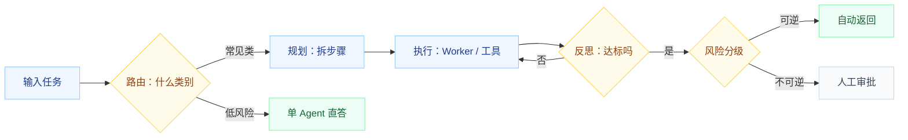
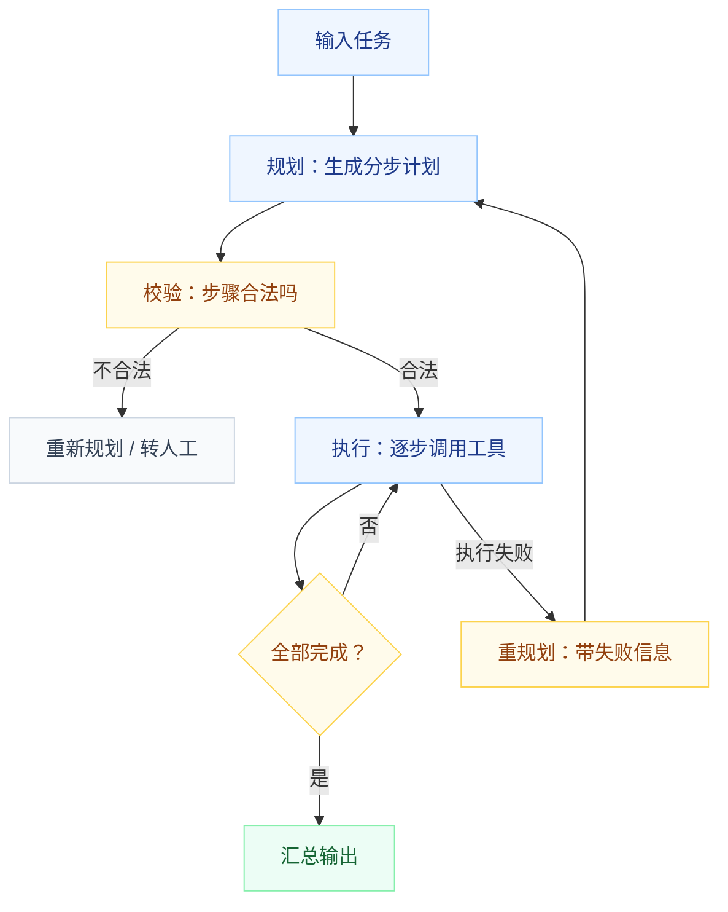
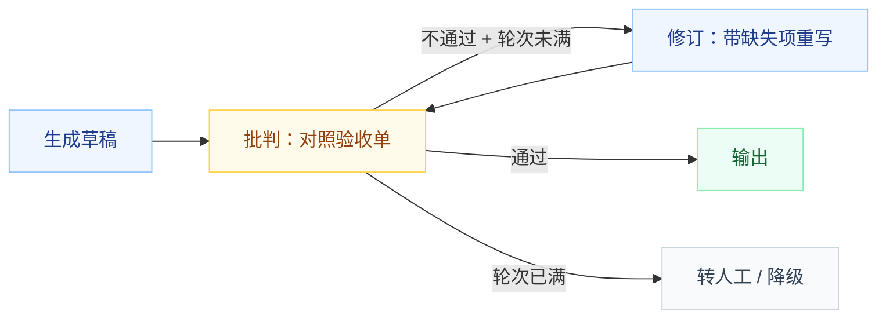
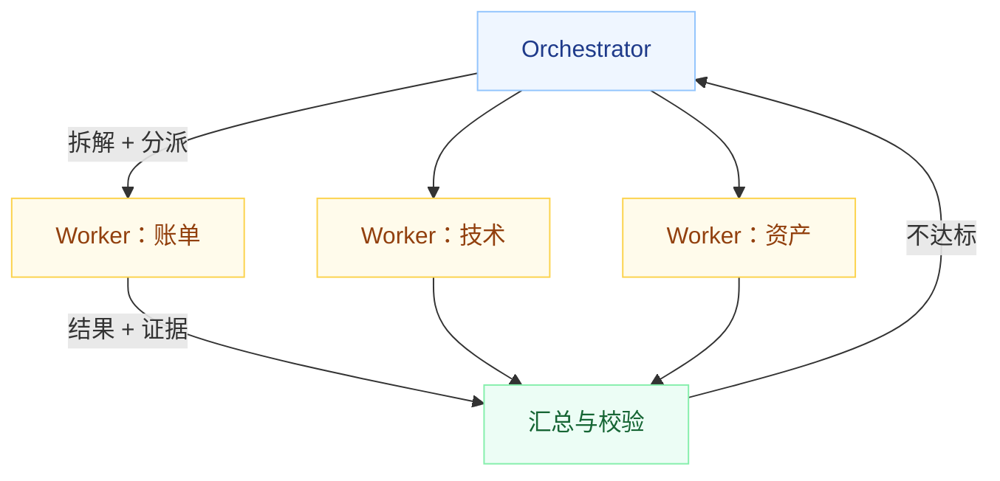

# 智能体架构模式

> 这篇从单 Agent 的能力上限讲起，经过路由、规划、反思、多智能体编排和人在环五种架构模式，最后落到职责划分、失败模式治理、选型决策表和一个可评测的完整案例。
>
> 学完能为一个业务任务选对智能体架构，写出可评估的路由与反思循环，并用指标控制成本、升级率和错误传播。

## 一、先判断需不需要架构模式

架构模式解决的是单 Agent 做不好的四类问题：任务异构、流程多步、产出要自查、权限有差异；先判断再选型，不要一上来就拆多智能体。

### 1.1 单 Agent 的三条上限

单 Agent = 一个模型 + 一组工具 + 一层循环。它在以下三条线上会先失效：

| 上限 | 表现 | 触发信号 |
|---|---|---|
| 工具数量 | 提示词里工具太多，选择准确率下降 | 工具超过 10 个 |
| 上下文冲突 | 不同任务的指令互相干扰 | 一份提示词超过 2000 token |
| 权限差异 | 只读任务和写操作共用一套权限 | 出现退款、删除、外发 |

判断顺序：先减少工具、拆分提示词、收敛权限；这些做完了仍有硬伤，再引入下面的模式。

> 边界：模式是有成本的。每加一层路由、一轮反思、一个 Agent，就多一份延迟、token 和出错面。简单任务套复杂架构，比复杂任务用简单架构更常见，也更浪费。

### 1.2 五种模式分别解决什么

这篇讲的五种模式不是互斥选项，而是一个组合谱系。

| 模式 | 解决的问题 | 典型信号 |
|---|---|---|
| 路由（Router） | 任务异构，处理方式不同 | 类别决定流程 |
| 规划（Planning） | 任务多步，有依赖 | 一句话拆多个动作 |
| 反思（Reflection） | 产出质量不稳定 | 有可检查的验收标准 |
| 编排（Orchestrator） | 职责与权限不同 | 上下文或工具隔离 |
| 人在环（HITL） | 高风险动作不可逆 | 涉及资金、删除、合规 |



五种模式可以叠在一个系统里：路由决定走哪条流程，规划拆步骤，Worker 执行，反思把关，人审不可逆动作。工程实现推荐直接用 [02-Agent工作流与LangGraph.md](./02-Agent工作流与LangGraph.md) 的状态图，这篇聚焦“每层怎么设计”。

### 1.3 选型的四个输入

本篇按 2026-11 的技术基线编写，代码以 Python 3.12 为默认版本（案例只依赖标准库，3.9 以上可运行），模型调用走 OpenAI 兼容接口。

| 输入 | 问题 |
|---|---|
| 任务确定性 | 输入能否映射到固定流程 |
| 步骤依赖 | 是单步、串行还是可并行 |
| 权限差异 | 只读与写操作是否要隔离 |
| 可逆性 | 出错能否撤销 |

四问的答案直接给出架构：

- 固定流程 + 单步 → 规则路由 + 单 Agent；
- 多步有依赖 → 规划模式；
- 有验收标准 → 加反思；
- 权限或上下文差异大 → 多智能体编排；
- 存在不可逆动作 → 必须加人在环。

## 二、路由模式（Router）

路由的价值是把“异构任务”变成“同构流水线”；路由错一步，后面全错，所以路由是五种模式里最值得先做评估的。

### 2.1 三种路由实现

| 实现 | 做法 | 适用 |
|---|---|---|
| 规则路由 | 关键词、正则、字段判断 | 类别词明确 |
| 语义路由 | 向量相似度匹配示例 | 表述多变 |
| 模型路由 | 结构化输出分类 | 类别多、有歧义 |

规则路由最便宜、最可测，能覆盖的先不交给模型：

```python
ROUTE_RULES = [
    ("account", ["密码", "账号", "登录", "解锁", "MFA", "权限"]),
    ("software", ["安装", "Office", "VPN", "软件", "许可", "客户端"]),
    ("hardware", ["打印机", "笔记本", "屏幕", "键盘", "硬盘", "电池"]),
]

def route(text: str) -> str:
    for name, words in ROUTE_RULES:
        if any(w in text for w in words):
            return name
    return "unknown"   # 兜底必须存在，宁转人工不硬猜
```

模型路由用结构化输出约束返回值，禁止自由文本（请求体片段）：

```python
{
    "model": MODEL,
    "messages": [
        {"role": "system", "content": "把工单分类为 account/software/hardware/unknown，只输出 JSON。"},
        {"role": "user", "content": text},
    ],
    "response_format": {
        "type": "json_schema",
        "json_schema": {
            "name": "route",
            "strict": True,
            "schema": {
                "type": "object",
                "properties": {
                    "category": {"type": "string",
                                 "enum": ["account", "software", "hardware", "unknown"]},
                },
                "required": ["category"],
                "additionalProperties": False,
            },
        },
    },
}
```

> 边界：模型路由的准确率不会是 100%。上线前用标注集测准确率，低于规则路由就退回规则；规则覆盖不了的类别（例：报销系统问题不含任何关键词）会掉进 `unknown`，必须靠人工兜底而不是静默走错流程。

### 2.2 置信度、兜底与多标签

路由必须回答三个问题：分到哪、多确定、不确定怎么办。

- 模型路由让模型同时输出置信度，低于阈值（示例：0.7）一律进 `unknown`；
- `unknown` 的处理成本要显式设计：转人工、追问澄清，或降级到通用 Agent；
- 一个任务确实横跨多类时（例：笔记本装不上 VPN），用多标签 + 主路由，主路由决定主流程，次标签作为上下文传下去。

```python
# 片段：llm_route 由模型结构化输出生成，返回 {"category": ..., "confidence": ...}
def route_with_fallback(text: str) -> str:
    result = llm_route(text)          # {"category": "...", "confidence": 0.9}
    if result["confidence"] < 0.7:
        return "unknown"              # 低置信度宁可人工，不给错流程
    return result["category"]
```

> 边界：置信度是模型自报的，不能当概率用。阈值要靠标注集调：画一条“准确率—人工率”曲线，选业务能接受的人工率对应的点。

### 2.3 路由错误的级联效应

路由错误是最贵的错误，因为它发生在最前面：

- 走错流程的工单，后面每一步都在“正确地做错事”；
- 反思环节检查的是“当前类别的验收单”，发现不了“类别本身错了”；
- 用户看到的是一个自信但无关的回复，投诉率上升。

治理手段：路由准确率作为一级指标日报；`unknown` 率突增说明输入分布漂移；抽样人工复核各类别前 20 条。

## 三、规划模式（Planning）

规划解决“一句话任务需要多个动作、且动作之间有依赖”的问题；计划是可检查的数据结构，不是模型输出里的一段话。

### 3.1 Plan-and-Execute 循环



规划的价值不只是拆步骤：计划先落地成结构，就能在人审、重试和评测里复用；边想边做的单循环做不到这些。

### 3.2 计划的表示与校验

计划用 JSON 表示，并在执行前做确定性校验，非法计划不进执行：

```python
PLAN_SCHEMA = {
    "type": "object",
    "properties": {
        "steps": {
            "type": "array",
            "items": {
                "type": "object",
                "properties": {
                    "id": {"type": "integer"},
                    "action": {"type": "string",
                               "enum": ["create_account", "install_software",
                                        "assign_device", "ask_human"]},
                    "args": {"type": "object"},
                    "depends_on": {"type": "array", "items": {"type": "integer"}},
                },
                "required": ["id", "action", "args", "depends_on"],
                "additionalProperties": False,
            },
        }
    },
    "required": ["steps"],
    "additionalProperties": False,
}

def validate_plan(plan: dict) -> list[str]:
    errors = []
    ids = [s["id"] for s in plan["steps"]]
    if len(ids) != len(set(ids)):
        errors.append("步骤 id 重复")          # 重复 id 会让依赖关系无法解析
    for s in plan["steps"]:
        for dep in s["depends_on"]:
            if dep not in ids:
                errors.append(f"步骤 {s['id']} 依赖不存在的 {dep}")
        if s["action"] not in PLAN_SCHEMA["properties"]["steps"]["items"]["properties"]["action"]["enum"]:
            errors.append(f"步骤 {s['id']} 使用未注册动作 {s['action']}")
    return errors
```

校验规则至少三条：动作必须在注册表里、依赖必须存在、不允许环。前两条防幻觉，第三条防死锁。

> 边界：计划粒度控制在 3–8 步。步数太多说明任务应该拆成多个工单；步数太少说明不需要规划模式，直接路由到单 Agent。

### 3.3 重规划与终止

执行失败后把失败信息带回规划，而不是原地无限重试：

```python
def replan(original: dict, failed_step: dict, error: str) -> dict:
    # 重规划的关键是把失败原因写进上下文，否则模型会生成同样的计划
    context = f"步骤 {failed_step['id']} 执行失败：{error}。请绕过或分解该步骤。"
    return plan_with_llm(original["goal"], context)

MAX_REPLANS = 2   # 重规划也要有硬上限
```

终止条件三选一必须存在：全部步骤成功、重规划次数到上限、时间或金额预算耗尽。到上限走人工，不静默继续。

### 3.4 边界：什么时候不要规划

- 探索型任务（例：排查慢查询）：每一步依赖上一步的观察，提前规划是空转，用 ReAct 循环更合适；
- 单步任务：规划本身比执行还贵，直接路由；
- 强确定性流程：步骤固定的话写成代码，不要让模型每天重新发明一样的计划。

> 边界：计划漂移是规划模式的隐形失败——执行到第三步时，第一步的前置条件已经被第二步改变了。长流程要在关键步骤后做“计划仍成立吗”的检查点。

## 四、反思模式（Reflection）

反思用一个独立的批判视角检查产出；它的前提是任务有可写的验收标准，没有标准的反思只是自我表扬。

### 4.1 生成-批判-修订循环



批判者有三种选择，成本与独立性依次上升：

| 批判者 | 做法 | 特点 |
|---|---|---|
| 自我批判 | 同一模型检查自己的输出 | 便宜，但偏好自己 |
| 独立模型 | 换一个模型当裁判 | 独立，但贵一倍 |
| 规则校验 | 确定性代码检查清单 | 最可靠，覆盖有限 |

实践顺序：能写成规则的先写成规则（例：必填字段、枚举、金额上限），规则覆盖不了再上模型批判。

### 4.2 验收单：批判的依据

批判的输入是验收单，不是“请你仔细检查”：

```python
# 片段：generate 为模型调用封装
CHECKLIST = {
    "hardware": ["资产编号", "报修", "备用机", "回访"],
    "software": ["版本", "安装", "验证"],
}

def critic(answer: str, kind: str) -> dict:
    # 批判输出结构化缺失项，修订才有明确目标
    missing = [m for m in CHECKLIST[kind] if m not in answer]
    return {"pass": not missing, "missing": missing}

def revise(answer: str, missing: list[str], kind: str) -> str:
    # 修订时把缺失项显式带上，而不是“请改进”
    prompt = f"以下回复缺少必要内容：{'、'.join(missing)}。请补全后重写。\n原回复：{answer}"
    return generate(prompt)
```

验收单从三个来源长出来：业务 SOP、历史人工修改记录、上线后的用户投诉。验收单应该是活文档，每次人工驳回都回头补一条。

### 4.3 停止条件与收益递减

反思的边际收益随轮次快速下降，必须设上限：

| 轮次 | 通过率（示例） | 增量 |
|---|---|---|
| 0（初稿） | 45% | - |
| 1 | 82% | +37 |
| 2 | 90% | +8 |
| 3 | 91% | +1 |

成本却是线性的：每一轮都是一次完整的生成调用。实践上限是 2 轮；第 3 轮 +1% 的通过率用转人工替代，更便宜也更稳。

```python
# 片段：generate / critic / revise 见 4.2
MAX_ROUNDS = 2

def reflect(task: str, kind: str) -> dict:
    answer = generate(task)
    result = critic(answer, kind)
    rounds = 0
    while not result["pass"] and rounds < MAX_ROUNDS:
        rounds += 1
        answer = revise(answer, result["missing"], kind)
        result = critic(answer, kind)
    # 轮次用尽仍不过，明确降级，不输出次品
    return {"answer": answer, "pass": result["pass"], "rounds": rounds}
```

> 边界：反思修不了路由错误。类别走错时，批判按错误类别的验收单检查，“不合格的草稿”反而可能“合格”。所以反思的通过率不能当业务正确率汇报，两者要分开统计（案例里会看到差距）。

### 4.4 反思的三种失效

| 失效 | 表现 | 对策 |
|---|---|---|
| 自我偏好 | 模型给自己放水 | 裁判换模型或换提示词 |
| 空转 | 修订没改到缺失项 | 修订提示必须带结构化缺失项 |
| 越改越差 | 后一轮推翻前一轮 | 保留各轮版本，按验收分选优 |

## 五、多智能体编排（Orchestrator）

编排解决“职责、上下文和权限需要隔离”的问题；多个 Agent 不是组织架构图，是隔离边界。

### 5.1 Orchestrator-Worker

编排者只做两件事：拆解任务、汇总结果；Worker 各自拥有独立工具和提示词。



可并行的部分并行跑（LangGraph 里是 fan-out + reducer）；汇总时编排者要校验 Worker 产出，不能默认照单全收。

### 5.2 Supervisor 与层级

- Supervisor：中心节点决定下一个执行者，路径集中、可审计；
- 层级（Hierarchical）：Agent 超过五六个后，按领域再分一层 Supervisor；
- 接力（Swarm/Handoff）：当前 Agent 直接交棒，路径分散，要防互相推诿。

三种拓扑的取舍与 LangGraph 实现在 [02-Agent工作流与LangGraph.md](./02-Agent工作流与LangGraph.md) 第七章展开，这里只给边界：需要审计选 Supervisor，对话式转接选 Swarm，超过六个 Agent 先考虑合并职责而不是加层。

### 5.3 职责划分的四个维度

| 维度 | 划分示例 | 收益 |
|---|---|---|
| 工具 | 账单 Agent 只有退款工具 | 提示词短，选择准 |
| 上下文 | 技术 Agent 只读技术文档 | 干扰少，成本低 |
| 权限 | 只读 Agent / 可写 Agent | 权限可审计 |
| 评测 | 各 Agent 独立评测集 | 上线有回归 |

按这四个维度切出来的边界，每个 Agent 都有清晰的验收指标；按“角色扮演”切出来的边界（例：一个“热情的 Agent”加一个“严谨的 Agent”）没有可评测的差异，属于伪拆分。

### 5.4 通信与共享状态

| 方式 | 做法 | 风险 |
|---|---|---|
| 消息传递 | Agent 间传完整消息 | token 爆炸 |
| 摘要交接 | 只传任务摘要和结论 | 信息丢失 |
| 共享黑板 | 读写共享状态字段 | 并发冲突 |

实践规则：交接内容 = 任务描述 + 已完成结论 + 下一步需要的字段，不传完整历史；共享状态里跨 Agent 的字段必须声明合并策略（参考 LangGraph 的 reducer）。

> 边界：每次交接都有信息损耗和额外模型调用。Worker 之间直接互调超过两跳，说明任务边界划错了，回到 5.3 重新划分。

## 六、人在环（Human-in-the-Loop）

人在环不是兜底的客套话，而是按风险分级设计的控制点；它决定哪些动作系统可以自主做、哪些必须停下等人。

### 6.1 三个介入点

| 介入点 | 审什么 | 适用 |
|---|---|---|
| 计划审批 | 计划是否合理、越权 | 高风险多步任务 |
| 工具审批 | 单个动作是否放行 | 不可逆操作 |
| 结果复核 | 产出是否可用 | 质量敏感场景 |

介入点越靠前，纠错成本越低：批一个错误计划损失几秒，追一笔错误退款损失几天。风险高的流程优先把人放在计划审批，而不是只放在最后复核。

### 6.2 风险分级

| 级别 | 动作示例 | 策略 |
|---|---|---|
| 只读 | 查订单、查文档 | 自主执行 |
| 可逆写 | 草拟回复、建草稿工单 | 自主 + 抽检 |
| 不可逆 | 退款、删除、外发 | 人工审批 |
| 高危 | 批量删除、对外群发 | 双人审批 |

分级规则要写成代码里的显式判断，不能靠提示词嘱咐：

```python
IRREVERSIBLE = {"refund", "delete_order", "send_external"}

def needs_approval(action: str, amount: float) -> bool:
    if action in IRREVERSIBLE:
        return True              # 不可逆动作一律审批，不看金额
    return amount > 100          # 可逆但大额，也要人看一眼
```

### 6.3 反馈回流

人工介入产生的数据是系统最贵的资产，必须回流：

- 驳回意见写入下轮修订的上下文（反思模式直接消费）；
- 人工改写后的结果进评测集，防下次回归；
- 高频驳回原因反向更新路由规则和验收单，减少同类驳回。

LangGraph 的实现是 `interrupt` / `Command(resume=...)`，机制的细节见 [02-Agent工作流与LangGraph.md](./02-Agent工作流与LangGraph.md) 第六章。

> 边界：审批通过率低于 60% 时，问题不在审批人，在系统：要么路由错了，要么验收单没覆盖真实标准。用数据修上游，不要给审批人加 KPI。

## 七、失败模式与治理

架构模式叠加后，失败模式也在叠加；治理的核心是让每类失败可观测、可隔离、可降级。

### 7.1 失败模式分类

| 失败模式 | 典型表现 | 第一道防线 |
|---|---|---|
| 路由错误 | 自信但无关的回复 | 路由准确率日报 |
| 计划幻觉 | 依赖不存在的步骤 | 计划确定性校验 |
| 反思空转 | 修订轮次用完没进展 | 结构化缺失项 |
| 编排死循环 | Worker 互相推诿 | 交接上限 |
| 工具误用 | 参数拼错、越权 | 参数校验 + 白名单 |
| 上下文污染 | 注入指令改写行为 | 输入隔离、工具结果标记 |
| 成本爆炸 | 并行分支重复调用 | 步数与金额预算 |

前六种都会表现为“系统还在跑，但产出不对”；只监控成功率发现不了它们，需要轨迹级观测。

### 7.2 错误传播与隔离

- 每个 Worker 的输出先过校验再进汇总，坏结果不进下游；
- 一个 Worker 失败不拖垮整批：并行扇出天然隔离，串行链路要显式 try/except 加降级；
- 降级路径预先设计好：缓存答案、模板回复、人工队列，三选一，不许报错给用户。

### 7.3 轨迹评估与指标

五种模式各有一个一级指标：

| 模式 | 一级指标 | 含义 |
|---|---|---|
| 路由 | 路由准确率 | 分对类的比例 |
| 规划 | 计划可执行率 | 校验通过的比例 |
| 反思 | 通过率 | 验收单达标比例 |
| 编排 | 业务正确率 | 端到端做对的比例 |
| 人在环 | 审批通过率 | 系统可信度的反向指标 |

评估靠标注集回归：每次改提示词、换模型、调阈值，先跑标注集再上线。标注集从真实工单抽样标注，规模从 50 条起步，覆盖每个类别。

### 7.4 预算与护栏

护栏是代码里的硬上限，不依赖模型自觉：

```python
GUARDRAILS = {
    "max_steps": 12,          # 单任务最多步数
    "max_reflect_rounds": 2,  # 单产出最多反思轮次
    "max_handoffs": 5,        # 单任务最多交接次数
    "max_cost_yuan": 0.5,     # 单任务金额预算
    "max_seconds": 60,        # 单任务时间预算
}
```

任一护栏触发即降级到人工，并把触发原因写入轨迹；护栏触发率是架构健康度的核心信号。

## 八、选型与组合

选型靠任务特征逐条匹配，组合靠固定分层；这一章给出可以直接对照的决策表、组合顺序和要避开的结构。

### 8.1 决策表

| 任务特征 | 推荐架构 |
|---|---|
| 单步、低风险 | 单 Agent + 规则路由 |
| 单步、有验收标准 | 单 Agent + 反思 |
| 多步、依赖固定 | 确定性代码流程，模型只做单步 |
| 多步、依赖动态 | 规划 + 执行 + 重规划 |
| 职责/权限差异大 | 多智能体编排 |
| 含不可逆动作 | 任意架构 + 人在环 |

从上往下匹配，命中即停；后面的模式只在命中前面模式后仍有缺口时叠加。

### 8.2 组合顺序

一个完整系统的分层是固定的：

```text
输入 → 路由 → [规划] → Worker 执行 → [反思] → 风险分级 → 输出/人工
```

- 路由永远在最前，它决定后面走哪条链；
- 规划只给多步任务加，单步跳过；
- 反思在产出之后、输出之前；
- 人在环按风险分级插在“输出前”，高危动作在工具调用前加一道。

工程落地时每一层对应 LangGraph 的一组节点和条件边，参考 [02-Agent工作流与LangGraph.md](./02-Agent工作流与LangGraph.md) 第四、六章。

### 8.3 反模式

| 反模式 | 现象 | 纠正 |
|---|---|---|
| 角色扮演式拆分 | Agent 名字不同、工具相同 | 按 5.3 四维度重划 |
| 万能 Supervisor | 什么请求都进编排 | 路由前置，常见类直连 |
| 无验收的反思 | “请自查并改进” | 写成结构化验收单 |
| 全量人工审批 | 审批疲劳，全部点同意 | 风险分级，只审不可逆 |
| 反思率当正确率 | 指标好看、投诉上升 | 分开统计两类指标 |

## 九、最佳实践案例

### 9.1 案例背景

某 300 人公司的 IT 服务台，每天约 60 个请求：账号类（重置、解锁、权限）、软件类（安装、许可）、硬件类（报修、领用）、无法归类的杂项。此前由两个 IT 专员人工分派和回复，平均响应 40 分钟，处理质量参差不齐：账号类回复常常漏掉“通知用户”，硬件类漏掉“备用机”。

目标：

- 请求自动分类并走对应处理链；
- 每类产出按验收单自查，最多两轮修订；
- 多步请求（入职、离职）自动拆成多个步骤；
- 账号、软件类自动完成，硬件类和无法归类请求升级人工；
- 全链路有指标，能回答“系统到底做对了多少”。

约束：Python 3.12 标准库即可运行（离线 mock）；接真实模型时走 OpenAI 兼容接口；不引入编排框架，模式层自己实现，便于看清结构。

### 9.2 案例实操

完整脚本 `it_desk_patterns.py`，五种模式各对应一个函数：`route` 是路由，`plan` 是规划，`reflect` 是反思，`execute` 是编排，`needs_human` 分级是人在环入口。

```python
"""IT 服务台：路由 + 规划 + 反思 + 编排，离线 mock 可跑。"""

PRICE_IN = 0.001 / 1000   # 元/token（示例价）
PRICE_OUT = 0.002 / 1000

# —— 路由：规则优先，关键词明确的不交给模型 ——
ROUTE_RULES = [
    ("account", ["密码", "账号", "登录", "解锁", "MFA", "权限"]),
    ("software", ["安装", "Office", "VPN", "软件", "许可", "客户端"]),
    ("hardware", ["打印机", "笔记本", "屏幕", "键盘", "硬盘", "电池"]),
]

def route(text: str) -> str:
    for name, words in ROUTE_RULES:
        if any(w in text for w in words):
            return name
    return "unknown"   # 兜底类别必须存在，宁升级不硬猜

# —— 规划：多步请求按分隔符拆分，每步独立路由 ——
def plan(text: str) -> list[dict]:
    parts = [p.strip() for p in text.replace("；", "、").split("、") if p.strip()]
    if len(parts) <= 1:
        return [{"step": text, "route": route(text)}]
    return [{"step": p, "route": route(p)} for p in parts]

# —— 反思：验收单来自各岗位 SOP ——
CHECKLIST = {
    "account": ["身份校验", "重置", "通知"],
    "software": ["版本", "安装", "验证"],
    "hardware": ["资产编号", "报修", "备用机", "回访"],
    "unknown": ["转人工", "补充信息"],
}

# mock 草稿：v0 有意不完整，模拟真实首稿质量
DRAFTS = {
    "account": ["先做身份校验，再重置账号，最后通知用户。"],
    "software": [
        "确认版本后安装软件。",                 # v0：缺“验证”
        "确认版本后安装软件，并验证可启动。",
    ],
    "hardware": [
        "登记资产编号，提交报修。",             # v0：缺“备用机、回访”
        "登记资产编号，提交报修。",             # v1：反思空转，没改对
        "登记资产编号，提交报修，必要时发放备用机，完成后回访。",
    ],
    "unknown": ["信息不足，转人工并请用户补充信息。"],
}

def worker(step: str, kind: str, revision: int = 0) -> str:
    drafts = DRAFTS[kind]
    return drafts[min(revision, len(drafts) - 1)]

def critic(answer: str, kind: str) -> dict:
    # 批判输出结构化缺失项，修订才有明确目标
    missing = [m for m in CHECKLIST[kind] if m not in answer]
    return {"pass": not missing, "missing": missing}

def reflect(step: str, kind: str, max_rounds: int = 2) -> dict:
    answer = worker(step, kind, 0)
    first = critic(answer, kind)
    rounds = 0
    while not critic(answer, kind)["pass"] and rounds < max_rounds:
        rounds += 1
        answer = worker(step, kind, rounds)
    final = critic(answer, kind)
    return {"answer": answer, "first_pass": first["pass"],
            "final_pass": final["pass"], "rounds": rounds}

# —— 编排：按计划执行全部步骤，按风险决定是否人工 ——
def execute(text: str) -> dict:
    steps = plan(text)
    results = [reflect(s["step"], s["route"]) for s in steps]
    # 硬件与未知类涉及资产与不可逆操作，一律人工复核
    needs_human = any(s["route"] in ("hardware", "unknown") for s in steps)
    return {
        "routes": [s["route"] for s in steps],
        "steps": len(steps),
        "first_pass": all(r["first_pass"] for r in results),
        "final_pass": all(r["final_pass"] for r in results),
        "rounds": sum(r["rounds"] for r in results),
        "needs_human": needs_human,
    }

# —— 评估：20 条标注工单，覆盖四类与两条多步链 ——
CASES = [
    ("密码忘了，手机也换了", "account"),
    ("账号被锁，需要解锁", "account"),
    ("新同事邮箱账号开通", "account"),
    ("共享盘权限申请", "account"),
    ("登录提示 MFA 失效", "account"),
    ("需要安装 Python 3.12", "software"),
    ("VPN 客户端装不上", "software"),
    ("Office 许可过期", "software"),
    ("设计软件需要装插件", "software"),
    ("笔记本连不上 VPN", "software"),
    ("报销系统打不开", "software"),
    ("打印机卡纸", "hardware"),
    ("笔记本电池鼓包", "hardware"),
    ("会议室屏幕闪烁", "hardware"),
    ("键盘进水", "hardware"),
    ("硬盘异响", "hardware"),
    ("新员工入职：开通账号、安装 Office、领用笔记本", "mixed"),
    ("离职交接：回收电脑、停用账号", "mixed"),
    ("帮忙看看这个报错", "unknown"),
    ("系统有问题", "unknown"),
]

def main() -> None:
    total = len(CASES)
    route_ok = first_ok = final_ok = biz_ok = human = 0
    total_steps = total_rounds = 0

    for text, expected in CASES:
        out = execute(text)
        if expected == "mixed":
            ok = out["steps"] >= 3 and "unknown" not in out["routes"]
        else:
            ok = out["routes"][0] == expected
        route_ok += ok
        biz_ok += ok and out["final_pass"]   # 业务正确 = 路由对且验收过
        first_ok += out["first_pass"]
        final_ok += out["final_pass"]
        human += out["needs_human"]
        total_steps += out["steps"]
        total_rounds += out["rounds"]

    calls = total_steps + total_rounds      # 生成与批判各算一次调用
    cost = calls * (800 * PRICE_IN + 200 * PRICE_OUT)

    print("路由准确率: %d/%d = %.1f%%" % (route_ok, total, route_ok / total * 100))
    print("一次通过率: %d/%d = %.1f%%" % (first_ok, total, first_ok / total * 100))
    print("反思后通过率: %d/%d = %.1f%%" % (final_ok, total, final_ok / total * 100))
    print("业务正确率: %d/%d = %.1f%%" % (biz_ok, total, biz_ok / total * 100))
    print("平均步数: %.2f" % (total_steps / total))
    print("平均反思轮次: %.2f" % (total_rounds / total))
    print("升级人工: %d/%d = %.1f%%" % (human, total, human / total * 100))
    print("估算成本: %.4f 元（%d 次调用）" % (cost, calls))

if __name__ == "__main__":
    main()
```

运行：

```bash
python3 it_desk_patterns.py
```

实测输出（mock 模式，换真实模型后数值会变）：

```text
路由准确率: 18/20 = 90.0%
一次通过率: 9/20 = 45.0%
反思后通过率: 20/20 = 100.0%
业务正确率: 18/20 = 90.0%
平均步数: 1.15
平均反思轮次: 0.90
升级人工: 10/20 = 50.0%
估算成本: 0.0492 元（41 次调用）
```

接真实模型时替换 `route` 与 `worker` 两个函数（片段）：`route` 换成结构化输出的模型分类并保留置信度兜底；`worker` 换成带验收单提示的生成调用。`CHECKLIST`、`reflect`、`execute`、评估集全部不动——这正是按模式分层的好处，换模型不换架构。

### 9.3 案例结果

从指标能读出四个结论：

| 指标 | 数值 | 解读 |
|---|---|---|
| 路由准确率 | 90% | 一条无关键词请求进 unknown，一条多步请求拆分不足 |
| 一次通过率 | 45% | 首稿普遍缺验收单项 |
| 反思后通过率 | 100% | 两轮内补全 |
| 业务正确率 | 90% | 被路由上限卡死 |

关键发现：

- 反思把通过率从 45% 拉到 100%（+55 个百分点），是全部模式里投入产出比最高的一层；
- 业务正确率停在 90%：两处路由或拆分失败（“报销系统打不开”进了 unknown；“离职交接”被标点拆成两步且“回收电脑”无关键词）在错误的验收单下仍然“合格”，证明反思修不了路由错误，两类指标必须分开统计；
- 硬件类的第二轮草稿刻意“空转”（v1 与 v0 相同），对应真实系统里“请改进”式提示的失效；解法是修订提示必须带结构化缺失项；
- 升级人工率 50% 超过预期，复盘后发现“会议室屏幕闪烁”这类低风险硬件请求被一刀切送审，应按“是否涉及资产变更”再分一级，预计可压到 30% 以下；
- 单请求估算成本 0.05 元（示例价），其中反思占约四成；把反思上限从 2 轮压到 1 轮可省两成，代价是放弃那 +8 个百分点的第二轮增量——按 4.3 的收益递减表取舍。

失败模式复盘：

- “报销系统打不开”不含任何路由关键词，静默进 unknown 才被发现；修复是在 unknown 队列加每日抽检，把新词回流进 ROUTE_RULES；
- “离职交接”按标点只拆出两步，且“回收电脑”不含硬件关键词；结论是按标点拆计划不可靠，生产上多步请求要按动作抽取或交给规划模式，拆分结果过 3.2 的确定性校验；
- 多步请求（入职、离职）每步独立反思，整体通过依赖“全部步骤通过”，评估按整单统计，不放大单步指标；
- 轨迹按“路由—计划—各步反思—升级决定”记录，20 条评估集作为每次改动的回归底线。

上线三个月后的方向：验收单按月从人工驳回记录里增补；路由规则和评测集同步更新；硬件分级细化后人工率下降再观察一轮。
