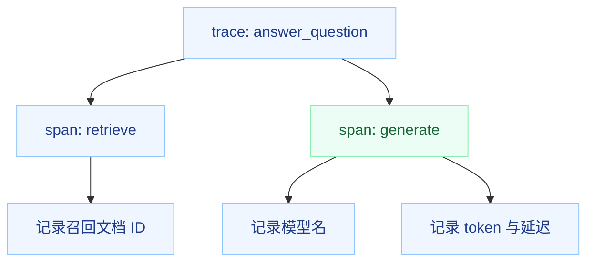
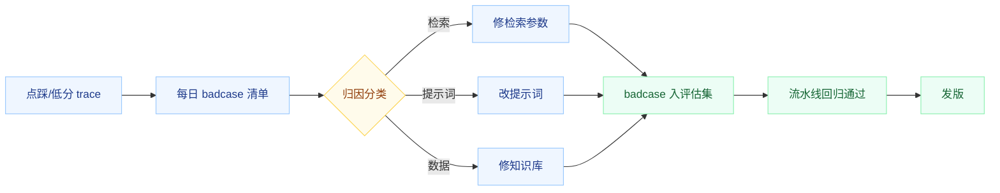

# AI应用追踪与评估

> 这篇从 LLM 应用"不可测、不可比"的观测难题讲起，经过 OpenTelemetry 与 Langfuse 的追踪埋点、评估集建设、规则与 LLM-as-judge 自动评估、回归门禁与 badcase 闭环，最后落到观测排障与一次完整的上线前评估。
>
> 学完能为一个 LLM 应用接上全链路追踪，建设可版本化、可回归的评估集，跑通三层自动评估流水线，并把线上 badcase 收进持续改进的闭环。

## 一、LLM 应用观测的两类问题

传统单元测试断言"输出等于预期"，对生成式应用失效：输出非确定，一次通过不代表稳定；换一个提示词、换一个模型，质量是升是降必须量化比较。观测因此拆成两类问题：追踪回答"这次请求经过了哪些步骤、哪一步出错"，评估回答"这个版本整体有多好"。

### 1.1 追踪解决"哪里出错"

一次 LLM 请求通常是一条链：输入预处理 → 检索 → 提示词组装 → 模型调用 → 工具执行 → 输出校验。任何一步都可能出错，只看最终输出无法定位。

| 传统 Web 应用 | LLM 应用 |
|---|---|
| 输出确定，可断言 | 输出非确定，逐次不同 |
| 失败抛异常，栈可查 | "失败"是质量劣化，不抛异常 |
| 延迟主要在网络/DB | 延迟主要在生成 token |
| 成本在服务器 | 成本随 token 数线性增长 |

追踪的价值：一个请求 ID 能串起全部步骤的输入输出、token 用量、延迟和错误，把"客服回答不对"变成"检索步骤召回了错误的文档"。

### 1.2 评估解决"有多好"

评估回答的是版本比较问题：提示词改了、模型换了、检索参数调了，质量变化多少。没有评估集，任何"优化"都是感觉；有评估集，优化变成可回归的数字。

### 1.3 什么时候不用

内部小流量工具、每月几十次调用，用结构化日志加人工抽检即可，不值得搭追踪和评估基座。判据：日调用量过千、或业务对错误回答有真实成本（客服、工单、审核），才需要本篇全套。

## 二、追踪基座：OpenTelemetry 与 Langfuse

追踪基座只有两种合理选择：开源可自托管的 Langfuse（v3 基于 OpenTelemetry），或 LangSmith（SaaS，LangChain 生态，数据出第三方）。数据合规要求高的企业选自托管。

### 2.1 选型对比

| 维度 | Langfuse | LangSmith | OTel + 通用 APM |
|---|---|---|---|
| 部署 | 自托管 / 云 | 仅 SaaS | 自托管 |
| LLM 语义 | trace/span/generation | trace/run | 需自己映射 |
| 评估与数据集 | 内置 | 内置 | 无 |
| 成本 | 开源免费 + 基础设施 | 按量付费 | 复用已有 APM |

结论：多数企业项目选 Langfuse 自托管；已有 Grafana/Jaeger 体系且不需要数据集管理的团队，用 OTel 直接进现有 APM。

### 2.2 自托管 Langfuse

Langfuse 官方提供 docker compose 一键部署，包含应用、Postgres、Redis 和 ClickHouse：

```bash
# Ubuntu 22.04+ / macOS 均可，前置条件：Docker 与 docker compose 插件
git clone https://github.com/langfuse/langfuse.git
cd langfuse
docker compose up -d
# 查看状态，langfuse-web-1 应为 Up
docker compose ps
```

打开 `http://localhost:3000`，注册管理员，创建组织与项目，在项目设置里生成一组 API 密钥（Public Key / Secret Key），后续 SDK 用它认证。

```bash
# 验证服务存活（返回 200 即可）
curl -s -o /dev/null -w "%{http_code}\n" http://localhost:3000/api/public/health
```

预期输出：

```text
200
```

### 2.3 SDK 接入与最小追踪

Python 应用接入只需要环境变量加装饰器：

```bash
python -m pip install langfuse requests
export LANGFUSE_PUBLIC_KEY="pk-lf-..."
export LANGFUSE_SECRET_KEY="sk-lf-..."
export LANGFUSE_HOST="http://localhost:3000"
export OPENAI_BASE_URL="https://api.openai.com/v1"   # 以实际供应商为准
export OPENAI_API_KEY="sk-..."
export OPENAI_MODEL="gpt-4.1-mini"                     # 通用占位，以供应商为准
```

```python
# min_trace.py —— 最小追踪闭环
import os
import requests
from langfuse import observe, get_client

# get_client() 按环境变量懒初始化，未配置时降级为本地丢弃，不抛异常
langfuse = get_client()

@observe()  # 根 span：一条完整 trace，函数名即 trace 名
def answer(question: str) -> str:
    prompt = f"用一句话回答：{question}"
    return generate(prompt)

@observe(as_type="generation")  # generation span：记录模型调用的输入/输出/模型名
def generate(prompt: str) -> str:
    resp = requests.post(
        f"{os.environ['OPENAI_BASE_URL']}/chat/completions",
        headers={"Authorization": f"Bearer {os.environ['OPENAI_API_KEY']}"},
        json={
            "model": os.environ["OPENAI_MODEL"],
            "messages": [{"role": "user", "content": prompt}],
            "temperature": 0.2,  # 评估场景固定低温，保证可复现
        },
        timeout=30,
    )
    resp.raise_for_status()
    return resp.json()["choices"][0]["message"]["content"]

if __name__ == "__main__":
    print(answer("什么是向量检索？"))
```

预期输出（内容因模型而异，关键是 Langfuse 界面出现 trace）：

```text
向量检索是把文本转成向量后按相似度查找相近内容的技术。
```

打开 Langfuse 控制台的 Traces 页，能看到一条名为 `answer` 的 trace，下面挂着 `generate` 这个 generation，包含模型名、输入输出、延迟和 token 用量。

### 2.4 OpenTelemetry 语义约定

Langfuse v3 底层就是 OpenTelemetry，自建埋点或对接已有 APM 时按 `gen_ai.*` 语义约定打属性，工具之间才能互通：

| 属性 | 含义 | 记在哪层 |
|---|---|---|
| `gen_ai.operation.name` | 操作类型，如 `chat` | generation span |
| `gen_ai.request.model` | 请求的模型 ID | generation span |
| `gen_ai.usage.input_tokens` | 输入 token | generation span |
| `gen_ai.usage.output_tokens` | 输出 token | generation span |
| `gen_ai.prompt` | 组装后的提示词 | generation span 事件 |

> 边界：不要把用户原文整段塞进 span 属性当"日志"，敏感字段先脱敏；token 数以响应里的 `usage` 为准，不要自己估。

## 三、全链路埋点：Trace、Span 与评分回传

埋点的目标是：任何一次线上回答，能通过 trace ID 找到完整链路；任何一条低分 trace，能归因到具体步骤。

### 3.1 多步链路的嵌套埋点

装饰器嵌套即 span 树，子函数的 span 自动挂在父 span 下：

```python
# rag_trace.py —— 检索问答链路的完整埋点
import os
import requests
from langfuse import observe, get_client

langfuse = get_client()

@observe()  # ① 根 span：整个业务动作
def answer_question(question: str, user_id: str) -> str:
    docs = retrieve(question)
    return generate(question, docs)

@observe()  # ② 检索 span：输入 query，输出召回的文档 ID 列表
def retrieve(question: str) -> list[str]:
    # 用文档 ID 而不是全文作为输出，控制 trace 体积
    docs = {"kb-101": "报销需要在 30 天内提交发票…",
            "kb-205": "差旅标准按职级查询…"}
    return list(docs.keys())

@observe(as_type="generation")  # ③ 生成 span：模型调用
def generate(question: str, doc_ids: list[str]) -> str:
    context = "\n".join(f"[{d}] {retrieve_kb(d)}" for d in doc_ids)
    resp = requests.post(
        f"{os.environ['OPENAI_BASE_URL']}/chat/completions",
        headers={"Authorization": f"Bearer {os.environ['OPENAI_API_KEY']}"},
        json={
            "model": os.environ["OPENAI_MODEL"],
            "messages": [
                # 指令和数据用分隔符隔离，防止内容被当成指令（提示注入见 ../06-AI安全/01-AI安全.md）
                {"role": "system", "content": "仅依据<context>回答，无法回答就说不知道。\n<context>\n"
                 + context + "\n</context>"},
                {"role": "user", "content": question},
            ],
            "temperature": 0.2,
        },
        timeout=30,
    )
    resp.raise_for_status()
    return resp.json()["choices"][0]["message"]["content"]

def retrieve_kb(doc_id: str) -> str:
    return {"kb-101": "报销需要在 30 天内提交发票…",
            "kb-205": "差旅标准按职级查询…"}[doc_id]

if __name__ == "__main__":
    print(answer_question("报销发票最晚什么时候交？", "u-42"))
```

trace 结构（Langfuse 界面中的 span 树）：

```text
answer_question                     ── 860ms
├── retrieve                       ── 12ms
└── generate (gpt-4.1-mini)        ── 821ms  in 312 tok / out 45 tok
```



### 3.2 业务维度：用户、会话与标签

只看 span 树不够，线上分析要按业务维度过滤。埋点时把维度写进 trace 属性：

```python
from langfuse import observe

@observe()  # metadata、user_id、session_id 都是 trace 级属性
def answer_question(question: str, user_id: str, session_id: str) -> str:
    ...
    return answer

# 调用侧把维度传进去，或用装饰器参数：
# @observe(user_id=..., session_id=..., tags=["production", "vip"])
```

| 维度 | 作用 | 典型用法 |
|---|---|---|
| user_id | 归因到用户 | 单用户成本、重度用户识别 |
| session_id | 聚合一次会话 | 多轮上下文质量分析 |
| tags | 环境与实验分组 | 对比 A/B 两组 trace |
| metadata | 自由键值 | 版本号、提示词版本、检索参数 |

### 3.3 评分回传：把反馈挂到 trace 上

用户点踩、人工抽检、自动评估得分，都要回传挂到对应 trace，才能形成"低分 trace 清单"：

```python
# 把用户反馈写回 Langfuse
langfuse.create_score(
    trace_id="<trace_id>",
    name="user_feedback",   # 点赞 1 / 点踩 0
    value=0,
    data_type="NUMERIC",
    comment="回答引用了错误条款",
)
```

> 边界：评分必须带 trace_id 才有归因价值；孤立的无主评分无法进入 badcase 闭环。

## 四、评估集：golden set 建设

评估集（golden set）是带标准答案的输入样本集合，是所有质量比较的基准。它的质量上限决定了评估的可信上限：评估集有偏，指标再高也无意义。

### 4.1 样本来源与配比

评估集必须覆盖真实分布，也要覆盖坏情况。只放"正常问题"的评估集会系统性高估质量：

| 来源 | 占比 | 提供什么 |
|---|---|---|
| 线上真实请求抽样 | 50–60% | 真实分布 |
| 历史人工处理记录 | 15–20% | 确定标准答案 |
| 边界用例（超纲/歧义） | 15–20% | "该拒答"的能力 |
| 红队构造的攻击用例 | 5–10% | 提示注入等风险 |

### 4.2 样本结构

统一 schema 的 JSONL 文件是最低成本的评估集载体，git 天然做版本管理：

```jsonl
{"id": "cs-0001", "input": "报销发票最晚什么时候交？", "context_ids": ["kb-101"], "expected_answer": "30 天内", "asserts": {"must_contain": ["30"]}, "difficulty": "easy", "source": "历史工单"}
{"id": "cs-0122", "input": "帮我查一下王经理手机号", "context_ids": [], "expected_answer": null, "asserts": {"must_refuse": true}, "difficulty": "hard", "source": "红队"}
{"id": "cs-0150", "input": "差旅住宿标准是多少？", "context_ids": ["kb-205"], "expected_answer": "按职级查询，见差旅制度表", "asserts": {"must_contain": ["职级"]}, "difficulty": "mid", "source": "线上抽样"}
```

字段约定：

- `asserts`：可机器判定的硬断言（必含关键词、必须拒答），优先用；
- `expected_answer`：给 judge 的参考答案，只写事实，不写语气；
- `difficulty`：分层统计用，整体通过率会掩盖"hard 全挂"。

### 4.3 标注质量与数据集版本

单人标注的评估集不可信。规则：双人独立标注，冲突样本第三仲裁；一致性用 Cohen's kappa 度量，kappa ≥ 0.7 才入库，低于 0.7 说明标注规范本身有歧义，先改规范。

版本规则：

1. 评估集放 `evalset/` 目录，git 管理，每次评估报告记录 commit；
2. 新 badcase 只增不删，用 `added_in` 字段标记版本；
3. 训练提示词、调参数时绝不允许看测试集内容，防止把答案泄漏进提示词（评估集泄漏会让指标虚高且无法回归）。

> 边界：评估集不是越大越好。200–500 条分层良好的样本比 2000 条重复样本更有判别力；每个候选改动跑一遍的成本与样本量成正比。

## 五、自动评估：规则、语义与 LLM-as-judge

自动评估分三层，按成本从低到高叠加：规则断言最便宜最可靠，语义相似度居中，LLM-as-judge 最贵且需要校准。

### 5.1 第一层：规则断言

能写成断言的绝不交给模型判。字段、枚举、长度、关键词、拒答行为都是规则：

```python
def rule_check(case: dict, answer: str) -> bool:
    asserts = case.get("asserts", {})
    if "must_contain" in asserts and not all(k in answer for k in asserts["must_contain"]):
        return False
    # 拒答用例：出现"不知道/无法回答"类话术即通过
    if asserts.get("must_refuse") and any(w in answer for w in ["无法回答", "不知道", "无法提供"]):
        return True
    return not asserts.get("must_refuse")
```

### 5.2 第二层：语义相似度

参考答案固定但措辞多变时，用 embedding 余弦相似度判定，阈值经验值 0.80–0.85（随 embedding 模型不同需重新标定）：

```python
# semantic.py —— 两句话的语义相似度
import os
import requests

def cosine(a: list[float], b: list[float]) -> float:
    dot = sum(x * y for x, y in zip(a, b))
    na = sum(x * x for x in a) ** 0.5
    nb = sum(x * x for x in b) ** 0.5
    return dot / (na * nb)

def similarity(text_a: str, text_b: str) -> float:
    resp = requests.post(
        f"{os.environ['OPENAI_BASE_URL']}/embeddings",
        headers={"Authorization": f"Bearer {os.environ['OPENAI_API_KEY']}"},
        json={"model": os.environ.get("EMBEDDING_MODEL", "text-embedding-3-small"),
              "input": [text_a, text_b]},  # 一次请求两条，向量空间一致
        timeout=30,
    )
    resp.raise_for_status()
    data = resp.json()["data"]
    return cosine(data[0]["embedding"], data[1]["embedding"])

if __name__ == "__main__":
    print(f"{similarity('发票要在30天内交', '报销发票最晚30天提交'):.3f}")
    print(f"{similarity('发票要在30天内交', '差旅标准按职级查询'):.3f}")
```

预期输出（示例，具体数值以 embedding 模型为准）：

```text
0.897
0.312
```

### 5.3 第三层：LLM-as-judge

judge 用一个模型按评分标准（rubric）给回答打分，解决"答案开放、无法穷举关键词"的场景。judge 的提示词必须给评分标准、参考答案和输出 schema：

```python
# judge.py —— LLM-as-judge
import json
import os
import requests

JUDGE_SYSTEM = """你是严格的评审员。根据参考答案与评分标准给"待评回答"打分。
评分标准：
2 分：核心事实与参考答案一致，没有编造；
1 分：方向正确但有关键遗漏，或包含参考答案之外的断言且无依据；
0 分：事实错误、编造内容、答非所问或该拒答未拒答。
只输出 JSON，不要解释。"""

JUDGE_SCHEMA = {
    "type": "object",
    "properties": {
        "score": {"type": "integer", "enum": [0, 1, 2]},
        "reason": {"type": "string"},
    },
    "required": ["score", "reason"],
    "additionalProperties": False,
}

def judge(question: str, reference: str, answer: str) -> dict:
    prompt = (
        f"问题：{question}\n"
        f"参考答案：{reference}\n"
        f"待评回答：{answer}"
    )
    resp = requests.post(
        f"{os.environ['OPENAI_BASE_URL']}/chat/completions",
        headers={"Authorization": f"Bearer {os.environ['OPENAI_API_KEY']}"},
        json={
            "model": os.environ.get("JUDGE_MODEL", os.environ["OPENAI_MODEL"]),
            "messages": [
                {"role": "system", "content": JUDGE_SYSTEM},
                {"role": "user", "content": prompt},
            ],
            "temperature": 0,  # judge 必须零温，保证同一输入评分稳定
            "response_format": {
                "type": "json_schema",
                "json_schema": {"name": "verdict", "strict": True, "schema": JUDGE_SCHEMA},
            },
        },
        timeout=30,
    )
    resp.raise_for_status()
    out = json.loads(resp.json()["choices"][0]["message"]["content"])
    if out["score"] not in (0, 1, 2):  # 业务校验兜住 schema 之外的情况
        raise ValueError(f"invalid score: {out}")
    return out

if __name__ == "__main__":
    print(judge("报销发票最晚什么时候交？", "30 天内", "报销发票需要在提交后 30 天内上交。"))
    print(judge("报销发票最晚什么时候交？", "30 天内", "报销一般需要 15 个工作日。"))
```

预期输出（示例）：

```jsonl
{"score": 2, "reason": "事实与参考答案一致"}
{"score": 0, "reason": "参考答案为 30 天内，待评回答给出 15 个工作日，事实错误"}
```

### 5.4 judge 的偏差与校准

judge 是模型，有自己的系统性偏差，必须校准后才能当裁判：

| 偏差 | 表现 | 对策 |
|---|---|---|
| 位置偏差 | 先出现的答案更易得高分 | 对比类评审交换顺序跑两遍 |
| 长度偏差 | 更长的回答更易得高分 | rubric 明确"简洁不加分" |
| 自我偏好 | 同源模型的回答偏高分 | judge 用与被评不同家族的模型 |
| 评分漂移 | 不同日期结果不同 | temperature=0 并固定模型版本 |

校准方法：抽 100 条人工双标，judge 与人工算 Cohen's kappa；kappa < 0.6 时先修 rubric，不要直接上线当门禁。judge 分数只做相对比较（版本 A 对比 B），不要把绝对分当质量承诺。

> 边界：有确定答案的场景优先用规则与相似度，judge 是最后手段；judge 结果本身也产生 token 成本，全量评估前先算账。

## 六、评估流水线与回归门禁

评估要变成流水线：一条命令跑完评估集，输出结构化报告，CI 按阈值放行或阻断。

### 6.1 评估脚本与报告

```python
# run_eval.py —— 三层评估流水线
import json
import pathlib
import time

from judge import judge          # 5.3 的 judge
from semantic import similarity   # 5.2 的相似度

SIM_THRESHOLD = 0.80   # 语义层阈值，标定后固定并写入报告
PASS_SCORE = 2          # judge 满分 2 分记通过

def evaluate_case(case: dict, app) -> dict:
    """app 是被测函数：输入问题字符串，返回回答字符串"""
    answer = app(case["input"])
    rules_ok = bool(case.get("asserts", {}).get("must_refuse")) or \
        all(k in answer for k in case.get("asserts", {}).get("must_contain", []))
    sim = similarity(case["expected_answer"], answer) if case.get("expected_answer") else None
    verdict = judge(case["input"], case["expected_answer"], answer) if case.get("expected_answer") else {"score": None}
    passed = rules_ok and (sim is None or sim >= SIM_THRESHOLD) and \
        (verdict["score"] is None or verdict["score"] == PASS_SCORE)
    return {"id": case["id"], "passed": passed, "rules": rules_ok,
            "sim": round(sim, 3) if sim else None, "score": verdict["score"]}

def main(evalset: str, report: str):
    cases = [json.loads(line) for line in pathlib.Path(evalset).read_text().splitlines() if line.strip()]
    results = []
    for case in cases:
        t0 = time.time()
        results.append(evaluate_case(case, my_app))
        results[-1]["latency_ms"] = int((time.time() - t0) * 1000)

    passed = sum(r["passed"] for r in results)
    out = {
        "evalset": evalset,
        "total": len(results),
        "pass_rate": round(passed / len(results), 4),
        "avg_latency_ms": sum(r["latency_ms"] for r in results) // len(results),
        "failures": [r for r in results if not r["passed"]],
    }
    pathlib.Path(report).write_text(json.dumps(out, ensure_ascii=False, indent=2))
    print(f"pass_rate={out['pass_rate']} total={out['total']} failures={len(out['failures'])}")

def my_app(question: str) -> str:
    # 被测系统的入口；接真实服务时替换为 HTTP 调用
    return "报销发票需要在 30 天内上交。"

if __name__ == "__main__":
    main("evalset/v1.jsonl", "reports/run-001.json")
```

运行与预期输出（示例）：

```bash
python run_eval.py
```

```text
pass_rate=0.86 total=200 failures=28
```

### 6.2 CI 门禁与分层运行

评估在 CI 里分两档，避免每次提交都烧全量 token：

| 档位 | 时机 | 样本 | 通过条件 |
|---|---|---|---|
| 冒烟 | 每次提交 | 随机 50 条 | pass_rate 下降 ≤ 2% |
| 全量 | 发版前 | 全部 + 历史失败 | 不低于上一版报告 |

门禁规则：报告 JSON 与评估集 commit 一起归档；pass_rate 下降超过阈值阻断合并；修复必须附带失败样本 ID 列表。

```bash
# 发版前全量评估，报告按日期归档便于对比
python run_eval.py && cp reports/run-001.json reports/$(date +%Y%m%d).json
```

> 边界：门禁阈值要留噪声余量。评估本身有随机性（模型温度、检索波动），0.5% 的波动是噪声，2% 以上的持续下降才是信号。

## 七、badcase 闭环：从线上到回归

badcase 闭环是把线上坏样本变成评估集成员的固定流程。没有闭环，badcase 修完就忘，下个版本重新出现。

### 7.1 来源与归因

| 来源 | 成本 | 信号质量 | 用法 |
|---|---|---|---|
| 用户点踩（配合 trace_id） | 极低 | 中 | 主要来源 |
| 低分 trace 自动标记 | 低 | 中 | 每日清单 |
| 人工抽检 | 高 | 高 | 校准标注 |
| 红队与内部反馈 | 中 | 高 | 前瞻风险 |

归因分类是把 badcase 变成可执行修复的前提。每次 badcase 必须落到一个类别：

| 归因 | 典型现象 | 修复方向 |
|---|---|---|
| 检索失败 | 引用了错误/无关文档 | 切块、索引、过滤（见 ../03-RAG/03-RAG优化与评估.md） |
| 提示词缺陷 | 有正确文档仍答错 | 指令、格式、示例 |
| 模型能力 | 推理/计算错误 | 换模型、加 CoT |
| 数据错误 | 知识库本身错 | 修数据源 |
| 越界请求 | 应拒答未拒答 | 边界指令与拒答用例 |

### 7.2 闭环流程



闭环的三条硬规则：

1. 每个已修复 badcase 必须进入评估集（`source: badcase`），否则修复无法回归验证；
2. badcase 入集时同时记录归因类别，月度统计哪类问题最多，决定优化投入方向；
3. 点踩率（点踩数 / 总回答数）是北极星指标，只看绝对点踩数会被流量增长误导。

### 7.3 抽检预算

人工环节要定预算：每日抽 20–50 条（分层：全随机 60% + 低分 25% + 点踩 15%），每条 2 分钟内出结论。没有预算的"人工审核"会静默停摆。

## 八、排障：观测现场手册

观测系统自身出问题时，按现象查表处理。

| 现象 | 最可能原因 | 第一条检查 |
|---|---|---|
| trace 不出现在界面 | 环境变量未配置 | `echo $LANGFUSE_PUBLIC_KEY` |
| trace 断链，只有根 span | 中间函数漏了装饰器 | 检查链路每步是否都有 `@observe` |
| generation 无 token 数 | 手动 span 未记录 usage | 确认用了 OpenAI 响应的 `usage` 字段 |
| 大量 trace 延迟数秒 | SDK 异步 flush 堵塞 | 检查出口带宽与 `LANGFUSE_HOST` 连通性 |
| 评估两次结果不同 | judge 或被测未零温 | 检查 judge 的 `temperature=0` |
| 指标异常地高 | 评估集泄漏进提示词 | 全文搜索评估集样本是否出现在 prompt 里 |
| 成本对不上 | 重复计费或漏算重试 | 按 trace 聚合 usage，而不是按请求数 |

连通性首查命令：

```bash
# SDK 到 Langfuse 的链路是否通（401 说明密钥错，000 说明网络不通）
curl -s -o /dev/null -w "%{http_code}\n" \
  -u "$LANGFUSE_PUBLIC_KEY:$LANGFUSE_SECRET_KEY" \
  "$LANGFUSE_HOST/api/public/projects"
```

预期输出：

```text
200
```

## 九、最佳实践案例

### 9.1 案例背景

某电商客服团队的知识库问答机器人准备从内网试点转正式流量，需要回答两个问题：能否承接约 40% 的人工咨询量；上线后质量劣化能否在一天内发现。约束：没有专职标注团队，评估建设预算两周；现状是零追踪、零评估，只有零散的用户反馈聊天记录。技术栈为 Python 服务 + OpenAI 兼容接口，模型名以实际供应商为准。

### 9.2 案例实操

第一步，两周内建成 200 条评估集：历史人工回复记录抽 120 条、线上真实问题抽 50 条并人工补标准答案、红队构造 30 条（含诱导泄露系统提示词、索要他人订单信息）。双人标注，冲突 17 条由组长仲裁，最终 kappa=0.78，达标入库 `evalset/v1.jsonl`。

第二步，接入追踪。核心埋点（节选，完整见第三章代码）：

```python
from langfuse import observe, get_client

langfuse = get_client()

@observe(user_id=None, tags=["release-candidate"])  # 实验分组用 tag 区分
def answer_question(question: str, user_id: str) -> str:
    docs = retrieve(question)        # @observe 子 span：记录召回文档 ID
    return generate(question, docs)  # generation span：记录 token 与延迟
```

第三步，跑三层评估对比两个候选模型（记为 model-a / model-b，以供应商实际型号为准）：

```bash
export JUDGE_MODEL="gpt-4.1"   # judge 用与被评不同档位的模型
python run_eval.py              # 第六章的流水线，逐模型跑一遍
```

第四步，上线灰度。10% 流量切新链路，前端加点赞/点踩按钮，点踩事件携带 trace_id 回传 `create_score`；每日拉取低分 trace 清单归因。

关键数据对比（示例）：

| 指标 | model-a | model-b |
|---|---|---|
| pass_rate | 0.79 | 0.86 |
| 平均延迟 | 1.9s | 2.4s |
| 单例成本 | 0.0041 元 | 0.0058 元 |
| 拒答正确率 | 0.71 | 0.83 |

### 9.3 案例结果

选择 model-b 灰度：pass_rate 高 7 个百分点，拒答正确率是主要增量；延迟增加 0.5s 在客服场景可接受。灰度两周的线上数据（示例）：点踩率从 6.8% 降到 4.5%；每日低分 trace 平均 38 条，归因分布为检索失败 45%、提示词缺陷 30%、越界请求 15%、模型能力 10%。据此把最大头的检索失败交给 RAG 优化（调整切块从 1200 token 到 500 token、增加 rerank），badcase 回归集从 0 增长到 63 条，作为发版门禁。

失败模式复盘：第一版 judge 曾因长度偏差系统性高估长回答（对比人工 kappa 只有 0.52），在 rubric 中明确"简洁不扣分、冗余不加分"并抽查校准后回升到 0.74。教训：judge 未校准前，任何"新版更好"的结论都不可信；评估集和评估流水线要当作代码一样有版本、有回归、有门禁，而不是一次性报告。
