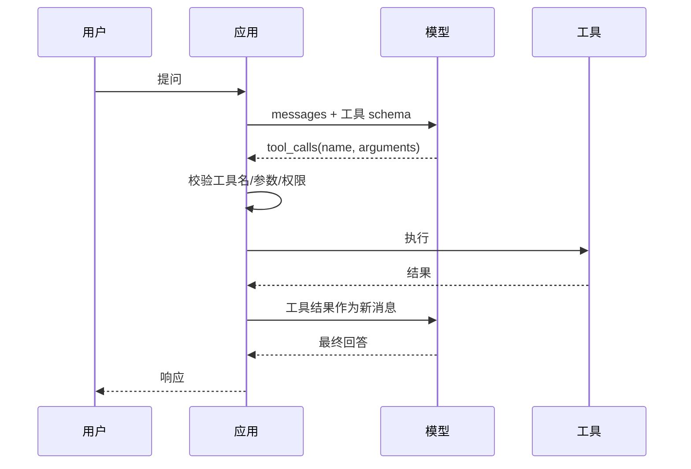

# SpringAI应用开发

> 这篇从 Spring AI 在 Java 技术栈里承担的抽象层讲起，经过环境与最小闭环、ChatClient 与 Advisor 链、对话记忆、RAG 检索增强、工具调用与 MCP、OpenTelemetry 可观测，最后落到上线排障与一个带记忆和检索的智能工单助手。
>
> 学完能在 Spring Boot 3.5 上用 Spring AI 搭出一个带会话记忆、知识库检索、工具调用和链路追踪的 LLM 后端服务，并按现场手册定位常见故障。

## 一、Spring AI 的抽象与边界

Spring AI 解决的是"把模型能力接进 Spring 应用"这一层问题：它把不同厂商的对话、嵌入、向量库、工具调用收敛成统一接口，让业务代码不绑定具体供应商。

### 1.1 它统一了什么

| 抽象 | 接口 | 屏蔽的差异 |
|---|---|---|
| 对话 | `ChatModel` | OpenAI / Azure / 通义 / Ollama 协议 |
| 嵌入 | `EmbeddingModel` | 向量维度与调用格式 |
| 向量库 | `VectorStore` | PgVector / Redis / Milvus / ES |
| 工具 | `ToolCallback` | 函数描述与参数 schema |
| 外部工具 | `McpSyncClient` | MCP 传输与发现 |

业务里只注入 `ChatModel`、`VectorStore` 这类接口；换供应商只改依赖和配置，不改调用代码。这是它相对直接写 HTTP 客户端的核心价值。

### 1.2 它不做什么

Spring AI 不是编排框架：多智能体协作、复杂分支工作流、人工审批节点，它没有内建。这类需求要么用 LangGraph4j 这类图编排库，要么在 Spring 里用状态机自己写。它也不管前端会话、限流计费、内容审核，这些属于应用工程层（见 [AI 应用工程](../07-AI工程/01-AI应用工程.md)）。

判断标准：单轮或多轮问答、带检索、带少量工具调用，用 Spring AI 足够；需要"多个 Agent 相互调用、循环、回退"的流程，不要硬塞进 Advisor。

### 1.3 版本基线

本篇基线为 2026-11-13：

| 组件 | 版本 | 说明 |
|---|---|---|
| Java | 21 LTS | Spring Boot 3.5 最低 17，21 为推荐 |
| Spring Boot | 3.5.x | 3.5 是当前主线维护版本 |
| Spring AI | 1.1.x | 1.0 GA 之后稳定线，API 以当前稳定版为准 |
| Maven | 3.9+ | Gradle 亦可 |

Spring AI 1.0 起 `ChatClient`、`@Tool`、`ChatMemory` 等 API 已经定型，1.1 在此基础上补了 MCP 服务端注解等能力。网上 0.8/1.0-M 版本的写法大量不兼容，照抄会编译失败。

## 二、环境与最小闭环

先跑通一次真实模型调用，再谈记忆和检索。最小闭环的验收标准：启动日志出现回答文本，说明依赖、配置、网络三段都通。

### 2.1 Maven 依赖

```xml
<!-- pom.xml 关键片段 -->
<properties>
  <java.version>21</java.version>
  <spring-ai.version>1.1.4</spring-ai.version> <!-- 以 Maven Central 当前稳定版为准 -->
</properties>

<dependencyManagement>
  <dependencies>
    <dependency>
      <groupId>org.springframework.ai</groupId>
      <artifactId>spring-ai-bom</artifactId>
      <version>${spring-ai.version}</version>
      <type>pom</type>
      <scope>import</scope> <!-- BOM 统一版本，避免各 starter 版本打架 -->
    </dependency>
  </dependencies>
</dependencyManagement>

<dependencies>
  <dependency>
    <groupId>org.springframework.boot</groupId>
    <artifactId>spring-boot-starter-web</artifactId>
  </dependency>
  <!-- 1.0 起 starter 命名带 model：spring-ai-starter-model-<vendor> -->
  <dependency>
    <groupId>org.springframework.ai</groupId>
    <artifactId>spring-ai-starter-model-openai</artifactId>
  </dependency>
</dependencies>
```

### 2.2 配置

```yaml
# application.yml
spring:
  ai:
    openai:
      api-key: ${OPENAI_API_KEY}                       # 只从环境变量读，禁止写死进仓库
      base-url: ${OPENAI_BASE_URL:https://api.openai.com}
      chat:
        options:
          model: gpt-4.1-mini                           # 通用占位，以供应商为准
          temperature: 0.2                              # 业务问答低温，减少漂移
```

```bash
export OPENAI_API_KEY="sk-..."            # Windows PowerShell 用 $env:OPENAI_API_KEY="..."
export OPENAI_BASE_URL="https://api.openai.com"
```

> 边界：`base-url` 是否要带 `/v1` 取决于供应商与 Spring AI 版本；多数兼容厂商要配到 `https://host/v1`，配错的表现是 404。先用 curl 验证供应商地址，再填进配置。

### 2.3 第一个 ChatClient

```java
// DemoApplication.java —— 启动即验证一次调用
@SpringBootApplication
public class DemoApplication implements CommandLineRunner {

    private final ChatClient chatClient;

    // ChatClient.Builder 由 starter 自动装配，注入后即可定制
    public DemoApplication(ChatClient.Builder builder) {
        this.chatClient = builder
                .defaultSystem("你是企业知识库助手，回答简洁，结论在前。")
                .build();
    }

    @Override
    public void run(String... args) {
        String answer = chatClient.prompt()
                .user("用两句话解释什么是向量检索")
                .call()                                  // 同步阻塞调用
                .content();                              // 取纯文本
        System.out.println(answer);
    }

    public static void main(String[] args) {
        SpringApplication.run(DemoApplication.class, args);
    }
}
```

预期输出（内容因模型而异）：

```text
向量检索把文本编码成向量，再按向量距离找相近内容。
它适合语义匹配，不依赖关键词完全一致。
```

### 2.4 流式输出

```java
// 流式返回 Flux<String>，WebFlux 环境可直接映射为 SSE
Flux<String> stream = chatClient.prompt()
        .user("列出向量检索的三个优点")
        .stream()          // 开启流式，首 token 延迟显著降低
        .content();
stream.doOnNext(System.out::print).blockLast();  // 演示用；Web 层不要 block
```

预期输出（连续打印，无换行）：

```text
1. 语义匹配 2. 支持模糊查询 3. 可跨语言检索
```

> 边界：流式下不能再用 `.call()`，也不能假设整段文本一次到齐；服务端要按块转发，客户端要处理 `[DONE]` 与断流重连。

## 三、ChatClient、提示词与结构化输出

ChatClient 是 Spring AI 的入口：把系统提示、用户输入、顾问链、工具、输出解析串成一次调用。

### 3.1 请求结构与 Advisor 链

一次 `chatClient.prompt()` 的组成：

```text
system 指令 + 用户消息 + 历史消息(记忆) + 检索上下文(RAG) + 工具定义
        ↓ Advisor 按顺序改写请求/响应
        ↓ ChatModel 调用供应商
        ↓ 输出解析（文本 / 结构化对象）
```

Advisor 是拦截器：`MessageChatMemoryAdvisor` 负责补历史，`QuestionAnswerAdvisor` 负责注入检索结果，自定义 Advisor 可做日志、脱敏、限流。顺序决定行为，记忆必须在检索之后、模型调用之前。


### 3.2 系统提示与模板

系统提示承载角色、边界、输出格式；用户消息只放本次任务。两者不要混写，否则提示注入的成功率显著上升。

```java
// 用占位符拼模板，比字符串相加更可控
String answer = chatClient.prompt()
        .system(s -> s.text("""
                你是{role}，只回答{topic}相关问题。
                不确定时回答"无法确认"，不要编造。
                """)
                .param("role", "报销助手")
                .param("topic", "差旅与报销"))
        .user("住宿标准是多少？")
        .call()
        .content();
```

### 3.3 结构化输出

需要稳定字段时用 `.entity()`，Spring AI 会自动生成 JSON Schema 约束并反序列化：

```java
// 嵌套 record 即输出的数据契约
public record Ticket(String category, String location, String urgency) {}

Ticket ticket = chatClient.prompt()
        .system("从工单描述中抽取字段。urgency 只能是 low/medium/high。")
        .user("打印机卡纸，办公室 3 楼，今天上午，很急")
        .call()
        .entity(Ticket.class);   // 自动加格式约束并解析
System.out.println(ticket);
```

预期输出：

```text
Ticket[category=打印机, location=3 楼, urgency=high]
```

> 边界：`.entity()` 只保证结构，不保证事实。`location` 是否在允许的楼栋列表、`urgency` 是否越界，业务侧仍要校验；模型返回的枚举值可能不符合预期，解析失败要重试或转人工。

## 四、对话记忆：ChatMemory

记忆解决多轮上下文，本质是把历史消息按会话取回并拼进请求。它不解决知识问题，知识靠检索。

### 4.1 窗口记忆与 Advisor

```java
@Configuration
class MemoryConfig {

    @Bean
    ChatMemory chatMemory() {
        return MessageWindowChatMemory.builder()
                .maxMessages(20)   // 滑动窗口：只留最近 20 条，控制 token 与延迟
                .build();
    }
}
```

```java
// 把记忆 Advisor 挂到 ChatClient 上
ChatClient chatClient = ChatClient.builder(chatModel)
        .defaultAdvisors(MessageChatMemoryAdvisor.builder(chatMemory).build())
        .defaultSystem("你是报销助手")
        .build();

String reply = chatClient.prompt()
        .user("我叫王工，上周提交的差旅报销到哪一步了？")
        // conversationId 决定取哪段历史，必须按用户/会话隔离
        .advisors(a -> a.param(ChatMemory.CONVERSATION_ID, "user-42-session-7"))
        .call()
        .content();
```

### 4.2 JDBC 持久化与会话隔离

内存记忆重启即丢，多实例部署必须落库：

```xml
<dependency>
  <groupId>org.springframework.ai</groupId>
  <artifactId>spring-ai-starter-model-chat-memory-repository-jdbc</artifactId>
</dependency>
```

```yaml
spring:
  ai:
    chat:
      memory:
        repository:
          jdbc:
            initialize-schema: always   # 首次启动建表，生产改为 never 并由迁移脚本管理
```

建表脚本在 starter 的 `org/springframework/ai/chat/memory/repository/jdbc/schema-postgresql.sql`，Postgres 需先执行一次。

| 策略 | 行为 | 适用 |
|---|---|---|
| 窗口 | 保留最近 N 条 | 普通客服、单次任务 |
| 摘要 | 早期消息压缩成摘要 | 长会话 |
| 检索式 | 按相关性取历史 | 跨天长期助手 |
| 不记忆 | 每次独立 | 无状态抽取 |

> 边界：`conversationId` 从请求体或登录态取，绝不能由模型生成或从用户文本里解析，否则会出现跨用户串话。记忆里存的内容同样会进入提示词，敏感信息要么不入库，要么加密。

### 4.3 记忆不是知识库

窗口记忆只保留最近若干轮，问"上个月的政策"必然答不出。长期事实要放进检索库或业务数据库，通过工具查询，不要指望对话历史。

## 五、RAG：向量库与检索增强

RAG 让模型基于企业文档回答。Spring AI 提供三件套：`EmbeddingModel` 把文本转向量，`VectorStore` 存取向量，Advisor 在调用前注入检索结果。

### 5.1 依赖与向量库配置

```xml
<dependency>
  <groupId>org.springframework.ai</groupId>
  <artifactId>spring-ai-starter-vector-store-pgvector</artifactId>
</dependency>
```

```yaml
spring:
  ai:
    vectorstore:
      pgvector:
        initialize-schema: true        # 开发期自动建表建索引
        index-type: HNSW              # 图索引，查询快，写入稍慢
        distance-type: COSINE_DISTANCE
        dimensions: 1536              # 必须与 embedding 模型输出维度一致
  datasource:
    url: jdbc:postgresql://localhost:5432/ai
    username: ai
    password: ${DB_PASSWORD}
```

```sql
-- 一次性：启用扩展（需超级用户）
CREATE EXTENSION IF NOT EXISTS vector;
```

> 边界：维度配错会在写入时报错或静默截断；换 embedding 模型等于换向量空间，旧库必须重建，不能混用。

### 5.2 文档灌库

```java
// IngestService.java —— 离线灌库，按文档 ID 覆盖更新
@Service
class IngestService {
    private final VectorStore vectorStore;

    IngestService(VectorStore vectorStore) { this.vectorStore = vectorStore; }

    void ingest(Resource file) {
        // Tika 读取 PDF/Word/HTML，统一成 Document
        var docs = new TikaDocumentReader(file).get();
        // 切块：太大召回不准，太小丢上下文；800 token 块 + 200 重叠是通用起点
        var splitter = new TokenTextSplitter(800, 200, 5, 10000, true);
        var chunks = splitter.apply(docs);
        // 先删后写，避免同一文档重复入库导致召回重复
        chunks.forEach(c -> c.getMetadata().put("source", file.getFilename()));
        vectorStore.add(chunks);
    }
}
```

### 5.3 检索 Advisor

```java
// 简单的问答注入：检索 topK 片段拼进上下文
var qaAdvisor = QuestionAnswerAdvisor.builder(vectorStore)
        .searchRequest(SearchRequest.builder()
                .topK(5)                  // 召回条数，过多会稀释指令
                .similarityThreshold(0.70) // 低于阈值不注入，避免答非所问
                .build())
        .build();

ChatClient chatClient = ChatClient.builder(chatModel)
        .defaultAdvisors(qaAdvisor)
        .defaultSystem("只依据检索内容回答，并标注来源文档名")
        .build();
```

复杂场景（查询改写、多路召回、重排）用 `RetrievalAugmentationAdvisor` 组合模块：

```java
// 组装式检索：改写 → 召回 → 重排，每一步可替换
var advisor = RetrievalAugmentationAdvisor.builder()
        .queryTransformers(RewriteQueryTransformer.builder()
                .chatClientBuilder(chatClientBuilder).build())
        .documentRetriever(VectorStoreDocumentRetriever.builder()
                .vectorStore(vectorStore).topK(8).build())
        .build();
```

### 5.4 RAG 的边界

检索质量决定回答质量：切块不合理、元数据缺失、文档过期，都会表现为"模型胡说"。上线前用评估集量化检索命中率与回答正确率（方法见 [AI 应用追踪与评估](../04-Agent/04-AI应用追踪与评估.md)），不要凭感觉调 `topK`。

## 六、工具调用与 MCP

工具让模型"请求执行"业务动作，执行权和权限始终在应用侧，模型只负责选工具、填参数。

### 6.1 @Tool 方法

```java
// OrderTools.java —— 工具即普通 Bean 方法
@Component
class OrderTools {

    private final OrderRepository repo;

    OrderTools(OrderRepository repo) { this.repo = repo; }

    @Tool(description = "按订单号查询订单状态，仅能查当前用户的订单")
    public String queryOrder(
            @ToolParam(description = "订单号，格式 SO-yyyyMMdd-序号") String orderId,
            @ToolParam(description = "用户 ID，由服务端注入，禁止从对话文本获取") String userId) {
        // 权限在工具内部校验：模型给的参数一律不可信
        return repo.findByOrderIdAndUserId(orderId, userId)
                .map(Order::status)
                .orElse("无此订单或无权查看");
    }
}
```

```java
String reply = chatClient.prompt()
        .user("帮我查订单 SO-20261113-001 到哪了")
        .tools(new OrderTools(repo))   // 注册工具，schema 自动生成
        .call()
        .content();
```

### 6.2 调用链与权限



三条硬规则：

1. 工具白名单：只注册当前场景需要的工具，不要全量注册；
2. 身份注入：`userId`、`tenantId` 由服务端从登录态填，不接受模型传值；
3. 写操作二次确认：退款、改单、发消息这类不可逆动作，先返回"待确认"再由人点击。

> 边界：工具描述也是提示词的一部分，描述里不要写内部地址、密钥、表结构细节；恶意文档可以通过工具返回内容影响后续推理，工具输出要当作不可信数据。

### 6.3 MCP 客户端

MCP（Model Context Protocol）把外部工具做成独立进程或远程服务，Spring AI 作为客户端接入：

```xml
<dependency>
  <groupId>org.springframework.ai</groupId>
  <artifactId>spring-ai-starter-mcp-client</artifactId>
</dependency>
```

```yaml
spring:
  ai:
    mcp:
      client:
        enabled: true
        name: ai-service
        version: 1.0.0
        stdio:
          connections:
            filesystem:
              command: npx
              args: ["-y", "@modelcontextprotocol/server-filesystem", "./data"]
```

```java
// 把 MCP 发现的工具转成 ChatClient 可用的 ToolCallback
@Bean
ToolCallbackProvider mcpTools(McpSyncClient client) {
    return new McpToolCallbackProvider(client);   // 具体构造以当前稳定版为准
}

// 使用
chatClient.prompt()
        .user("读取 data/ 下的报价单并汇总")
        .toolCallbacks(mcpTools.getToolCallbacks())
        .call()
        .content();
```

> 边界：MCP 服务是外部进程，等同于引入第三方代码。只接可信来源，固定版本，限制其文件与网络权限；工具描述与返回内容同样可能被注入。

## 七、可观测：Micrometer 与 OpenTelemetry

Spring AI 内建 Micrometer Observation，模型调用、工具调用、向量检索都会产生 span；接上 OTLP 导出即可进现有追踪系统。

### 7.1 依赖与配置

```xml
<dependency>
  <groupId>org.springframework.boot</groupId>
  <artifactId>spring-boot-starter-actuator</artifactId>
</dependency>
<dependency>
  <groupId>io.micrometer</groupId>
  <artifactId>micrometer-registry-otlp</artifactId>
</dependency>
<dependency>
  <groupId>io.micrometer</groupId>
  <artifactId>micrometer-tracing-bridge-otel</artifactId>
</dependency>
<dependency>
  <groupId>io.opentelemetry</groupId>
  <artifactId>opentelemetry-exporter-otlp</artifactId>
</dependency>
```

```yaml
management:
  tracing:
    sampling:
      probability: 1.0            # 生产按流量调到 0.1 左右
  otlp:
    tracing:
      endpoint: http://localhost:4318/v1/traces
  observations:
    key-values:
      service: ai-service
spring:
  ai:
    chat:
      observations:
        log-prompt: false         # 生产关闭：提示词含用户原文
        log-completion: false
```

### 7.2 能看到什么

| span | 关键属性 | 用途 |
|---|---|---|
| `spring.ai.chat.client` | 模型名、会话 ID | 定位一次对话 |
| `gen_ai.chat` | 输入/输出 token | 成本核算 |
| `spring.ai.tool` | 工具名、耗时、成败 | 工具故障定位 |
| `spring.ai.vectorstore` | topK、命中数 | 检索质量 |

```bash
# 验证 OTLP 端点可达（collector 未起时返回 000）
curl -s -o /dev/null -w "%{http_code}\n" http://localhost:4318/v1/traces
```

预期输出（collector 已启动）：

```text
200
```

### 7.3 关联业务 trace

默认 span 只覆盖模型调用，业务层要自己开 span 才能串起全链路：

```java
// 用 ObservationRegistry 在业务入口开 span，子调用自动挂载
Observation obs = Observation.createNotStarted("ticket.answer", registry)
        .lowCardinalityKeyValue("tenant", tenantId)
        .start();
try (var scope = obs.openScope()) {
    return assistant.answer(question);   // 内部 ChatClient 调用成为子 span
} finally {
    obs.stop();
}
```

> 边界：不要把用户手机号、订单号原文写进 span 属性或 tag，会造成高基数与隐私泄漏；用哈希或内部 ID 代替。

## 八、上线与排障

上线前把超时、并发、流式、降级四件事定死，故障时按现象查表。

### 8.1 超时与并发

```yaml
spring:
  ai:
    openai:
      chat:
        options:
          max-tokens: 800        # 输出上限，防止单次成本失控
      # 连接/读取超时按供应商 P95 设定，别用默认无限等待
```

```java
// Web 层用 SSE 转发流式结果，客户端断开时取消上游请求
@GetMapping(value = "/chat/stream", produces = MediaType.TEXT_EVENT_STREAM_VALUE)
Flux<ServerSentEvent<String>> stream(@RequestParam String q) {
    return chatClient.prompt().user(q).stream().content()
            .map(chunk -> ServerSentEvent.builder(chunk).build())
            .timeout(Duration.ofSeconds(60))
            .onErrorResume(e -> Flux.just(ServerSentEvent.builder("[ERROR]").build()));
}
```

### 8.2 现象与第一条检查

| 现象 | 最可能原因 | 第一条检查 |
|---|---|---|
| 启动报找不到 ChatModel Bean | 缺 starter 或 key 为空 | 依赖树 + `OPENAI_API_KEY` |
| 404 | base-url 少了或多 `/v1` | curl 供应商地址 |
| 401/403 | Key 错、模型未开通 | 控制台模型权限 |
| 429 | RPM/TPM 超限 | 响应头 `Retry-After` |
| 回答不带记忆 | Advisor 未注册或 conversationId 为空 | 检查 `.advisors(...)` |
| 检索永远为空 | 维度不一致或未灌库 | `SELECT count(*) FROM vector_store` |
| 工具从不被调用 | 描述不清或未注册 | 打开 `log-prompt` 看 schema |
| 流式卡住 | 网关缓冲或超时未设 | Nginx `proxy_buffering off` |

### 8.3 上线检查清单

- 密钥来自环境变量或密钥管理服务，仓库无明文；
- `max-tokens`、超时、单用户日配额已配置；
- 记忆的 `conversationId` 与登录态绑定，做过越权测试；
- 工具全部有权限校验与审计日志，写操作有人工确认；
- 提示词与补全日志在生产关闭，trace 属性已脱敏；
- 有降级路径：模型故障时返回缓存答案或转人工；
- 评估集跑过一遍，通过率与延迟指标有基线。

## 九、最佳实践案例

### 9.1 案例背景

某 SaaS 厂商要把内部工单系统升级为智能助手：客服输入问题，助手基于产品手册回答，能查订单状态，能记住同一会话上下文。约束：Java 21 + Spring Boot 3.5 技术栈，模型必须可切换供应商，需接入现有 OpenTelemetry 追踪，数据不出内网。现状是客服平均处理一单 6 分钟，手册检索靠关键词，命中率低。

### 9.2 案例实操

第一步，依赖与配置（关键项）：

```xml
<dependency>
  <groupId>org.springframework.ai</groupId>
  <artifactId>spring-ai-starter-model-openai</artifactId>
</dependency>
<dependency>
  <groupId>org.springframework.ai</groupId>
  <artifactId>spring-ai-starter-vector-store-pgvector</artifactId>
</dependency>
<dependency>
  <groupId>org.springframework.ai</groupId>
  <artifactId>spring-ai-starter-model-chat-memory-repository-jdbc</artifactId>
</dependency>
<dependency>
  <groupId>org.springframework.ai</groupId>
  <artifactId>spring-ai-starter-mcp-client</artifactId>
</dependency>
<dependency>
  <groupId>io.micrometer</groupId>
  <artifactId>micrometer-tracing-bridge-otel</artifactId>
</dependency>
```

```yaml
spring:
  ai:
    openai:
      api-key: ${OPENAI_API_KEY}
      base-url: ${OPENAI_BASE_URL}
      chat:
        options:
          model: gpt-4.1-mini        # 以供应商为准
          temperature: 0.2
          max-tokens: 800
    vectorstore:
      pgvector:
        dimensions: 1536
        index-type: HNSW
    chat:
      memory:
        repository:
          jdbc:
            initialize-schema: always
management:
  otlp:
    tracing:
      endpoint: http://otel-collector:4318/v1/traces
  tracing:
    sampling:
      probability: 0.2
```

第二步，装配 ChatClient：记忆 + 检索 + 工具 + 系统提示。

```java
@Configuration
class AssistantConfig {

    @Bean
    ChatClient assistantChatClient(ChatModel model, ChatMemory memory,
                                   VectorStore vectorStore, OrderTools orderTools) {
        return ChatClient.builder(model)
                .defaultSystem("""
                        你是产品客服助手。只依据检索到的<context>回答。
                        涉及订单时调用 queryOrder 工具，不要猜测。
                        无法确认时回答“需要人工核实”。
                        """)
                .defaultAdvisors(
                        MessageChatMemoryAdvisor.builder(memory).build(),  // 先补历史
                        QuestionAnswerAdvisor.builder(vectorStore)
                                .searchRequest(SearchRequest.builder().topK(5).similarityThreshold(0.7).build())
                                .build())                                     // 再注入检索
                .build();
    }
}
```

第三步，对外接口：

```java
@RestController
@RequestMapping("/api/assistant")
class AssistantController {

    private final ChatClient chatClient;

    AssistantController(ChatClient assistantChatClient) {
        this.chatClient = assistantChatClient;
    }

    record AskRequest(String question, String conversationId) {}

    @PostMapping("/ask")
    Map<String, String> ask(@RequestBody AskRequest req, Principal principal) {
        String answer = chatClient.prompt()
                .user(req.question())
                // 会话 ID 由服务端拼装，杜绝跨用户串话
                .advisors(a -> a.param(ChatMemory.CONVERSATION_ID,
                        principal.getName() + "-" + req.conversationId()))
                .tools(new OrderTools(orderRepository, principal.getName()))
                .call()
                .content();
        return Map.of("answer", answer);
    }
}
```

第四步，灌入库并验证。把 320 页产品手册转成 PDF 放入 `data/manual.pdf`，调用 `IngestService.ingest()`；`SELECT count(*) FROM vector_store` 应得到约 1800 条切块。启动服务后调用：

```bash
curl -s -X POST http://localhost:8080/api/assistant/ask \
  -H "Content-Type: application/json" \
  -d '{"question":"订单 SO-20261113-001 到哪了？保修多久？","conversationId":"s1"}' \
  | python3 -m json.tool
```

预期输出（示例）：

```json
{
  "answer": "订单 SO-20261113-001 当前状态为已发货。整机保修 12 个月，主要部件 24 个月（来源：售后服务手册 3.2 节）。"
}
```

第五步，检查追踪。打开追踪系统按 `service=ai-service` 过滤，应看到一条 `ticket.answer` 根 span，下挂 `spring.ai.chat.client`、`spring.ai.vectorstore`、`spring.ai.tool` 三个子 span；工具 span 的 `tool.name=queryOrder`，耗时约 20ms。

### 9.3 案例结果

灰度 30% 客服账号两周后（示例数据）：单均处理时长从 6.1 分钟降到 3.4 分钟；检索命中率（回答引用了正确手册章节的比例）从 0.52 升到 0.81；工具调用成功率 99.2%，失败集中在订单号格式错误，已在工具描述中补格式示例。成本方面，单次问答平均 1450 输入 token、180 输出 token，按供应商单价折算约为纯人工成本的 4%。

失败模式与复盘：上线首日出现一次跨会话串话，原因是前端把 `conversationId` 交给模型生成；改为服务端用登录名拼装后消失。另有一次 429 导致连续失败，因为未设 `max-tokens` 且历史无窗口限制；补上限流与窗口记忆后稳定。结论：Spring AI 把接入成本降到很低，但权限、会话隔离、配额这些边界必须由业务代码兜住，框架不会替你做。
