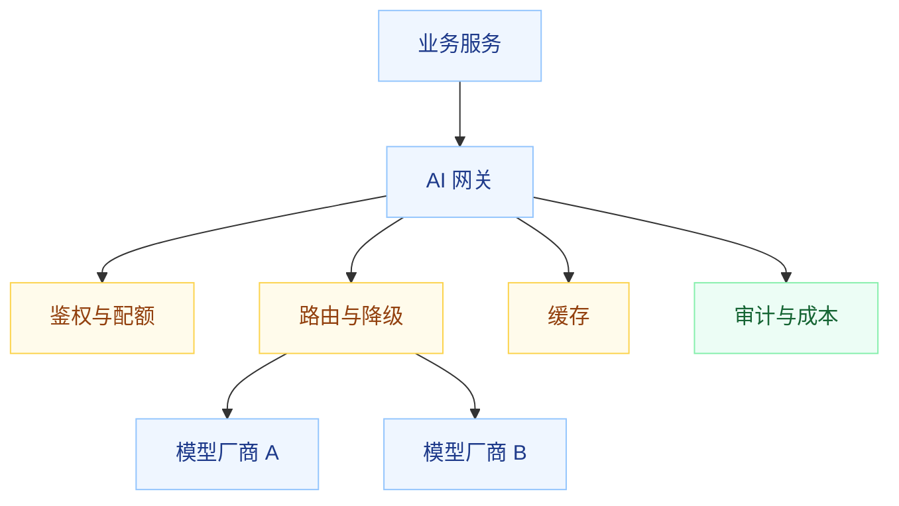

# AI应用工程

> 这篇从 LLM 应用从演示到生产的工程差距讲起，经过统一网关、模型路由与降级、配额限流、精确与语义缓存、流式与稳定性、成本观测与预算告警，最后落到灰度上线、回滚排障与一个可运行的迷你 AI 网关。
>
> 学完能为 LLM 应用搭出带路由、配额、缓存和成本核算的接入层，设计灰度发布与回滚方案，并在故障时按现场手册恢复。

## 一、从演示到生产的工程差距

演示代码直接调厂商 API 就能跑；生产代码要回答六个问题：谁来调（鉴权）、调哪个模型（路由）、超了怎么办（配额与降级）、重复问题怎么办（缓存）、断了怎么办（流式与重试）、花了多少钱（成本核算）。这六个问题合起来就是 AI 应用工程（LLMOps 的核心部分）。

### 1.1 直连厂商的生产风险

| 问题 | 直连的后果 | 工程手段 |
|---|---|---|
| 密钥分发到各服务 | 泄露面大、轮换困难 | 网关统一持钥 |
| 模型选择散落各处 | 换模型要改 N 处 | 集中路由 |
| 无配额 | 一个循环调用烧穿预算 | 租户/接口配额 |
| 无缓存 | 重复问题重复付费 | 精确 + 语义缓存 |
| 无审计 | 出了问题无法回答"谁干的" | 全量调用日志 |
| 单厂商故障 | 服务全停 | 多厂商降级链 |

### 1.2 架构分层

所有能力集中在一层接入网关，业务服务不直接接触供应商：



落地方式两种：自研薄网关（本章的 FastAPI 示例，约几百行，够用且可控），或采用现成方案（LiteLLM Proxy、Kong AI Gateway 等，以当前企业内标准为准）。选型判据：路由策略是否需要深度定制、审计合规要求、团队维护能力。

### 1.3 版本与基线

本篇基线 2026-11-13：Python 3.11+、FastAPI 0.115+、Redis 7.x、OpenTelemetry SDK 1.x；模型名均为通用占位（如 `gpt-4.1-mini`），以实际供应商为准。

## 二、统一网关：接入层基线

网关先做三件事：统一持钥、统一鉴权、统一审计。这三件做完，业务侧只面对一个内部地址。

### 2.1 最小网关

```python
# gateway.py —— 最小可用 AI 网关（逐步在后续章节扩展）
import os
import time
import uuid

import requests
from fastapi import FastAPI, HTTPException, Request
from pydantic import BaseModel

app = FastAPI()

# 密钥只在网关进程内存在，业务服务永远拿不到
PROVIDERS = {
    "primary": {
        "base_url": os.environ["PROVIDER_A_BASE_URL"],
        "api_key": os.environ["PROVIDER_A_API_KEY"],
        "model": os.environ.get("PROVIDER_A_MODEL", "gpt-4.1-mini"),
    },
}

class ChatBody(BaseModel):
    messages: list[dict]
    stream: bool = False
    max_tokens: int | None = None

@app.post("/v1/chat/completions")
def chat_completions(body: ChatBody, request: Request):
    # 网关自身先鉴权：业务服务带内部令牌，末端的最终用户身份由透传头携带
    if request.headers.get("X-Internal-Token") != os.environ["GATEWAY_TOKEN"]:
        raise HTTPException(status_code=401, detail="unauthorized")

    provider = PROVIDERS["primary"]
    trace_id = request.headers.get("X-Trace-Id", str(uuid.uuid4()))  # 全链路关联用

    started = time.time()
    resp = requests.post(
        f"{provider['base_url']}/chat/completions",
        headers={"Authorization": f"Bearer {provider['api_key']}"},
        json={
            "model": provider["model"],
            "messages": body.messages,
            "stream": False,            # 网关首版先做非流式，第六章再补 SSE
            "max_tokens": body.max_tokens or 800,  # 未传也强制上限，防成本失控
        },
        timeout=30,
    )
    if resp.status_code == 429:
        # 透传限流而不是无限重试：让调用方退避，网关不做隐式重试
        raise HTTPException(status_code=429, detail="provider rate limited")
    resp.raise_for_status()
    data = resp.json()

    # 审计日志：只记 ID 与用量，不记原文（脱敏原则见 06-AI安全）
    usage = data.get("usage", {})
    print(f"trace={trace_id} model={provider['model']} "
          f"latency={time.time()-started:.2f}s "
          f"in={usage.get('prompt_tokens')} out={usage.get('completion_tokens')}")
    return data
```

```bash
python -m pip install fastapi "uvicorn[standard]" requests pydantic redis
uvicorn gateway:app --port 8090 &
curl -s http://localhost:8090/v1/chat/completions \
  -H "Content-Type: application/json" \
  -H "X-Internal-Token: $GATEWAY_TOKEN" \
  -H "X-Trace-Id: demo-001" \
  -d '{"messages":[{"role":"user","content":"用一句话解释什么是语义缓存"}]}' \
  | python3 -m json.tool | head -30
```

预期输出（示例，字段以供应商为准）：

```json
{
  "id": "chatcmpl-xxx",
  "choices": [
    {
      "index": 0,
      "message": {"role": "assistant", "content": "语义缓存按问题含义而非字面匹配复用回答。"},
      "finish_reason": "stop"
    }
  ],
  "usage": {"prompt_tokens": 24, "completion_tokens": 17, "total_tokens": 41}
}
```

> 边界：网关日志不要落用户原文；需要排障时靠 trace_id 去业务侧按需取，且取数本身要留审计。

### 2.2 健康与依赖检查

```python
@app.get("/healthz")
def healthz():
    # 存活检查不依赖外部，就绪检查才探依赖
    return {"status": "ok"}

@app.get("/readyz")
def readyz():
    checks = {}
    for name, p in PROVIDERS.items():
        try:
            # 用最便宜的调用探活：列模型接口，失败不阻断就绪但要在结果里暴露
            r = requests.get(f"{p['base_url']}/models",
                             headers={"Authorization": f"Bearer {p['api_key']}"},
                             timeout=5)
            checks[name] = "ok" if r.status_code == 200 else f"http {r.status_code}"
        except requests.RequestException as e:
            checks[name] = f"error: {type(e).__name__}"
    return {"status": "ok" if all(v == "ok" for v in checks.values()) else "degraded",
            "providers": checks}
```

## 三、模型路由与降级

路由解决"这次请求该用哪个模型"。原则：按任务分层，小任务不烧大模型；按可用性降级，主路径故障自动切换备用路径。

### 3.1 任务分层路由表

| 任务 | 模型档位 | 理由 |
|---|---|---|
| 分类、抽取、改写 | 轻量档 | 输出短、模式固定 |
| 知识问答、RAG | 标准档 | 需要指令遵循与引用 |
| 复杂推理、代码 | 高级档 | 能力差异真实存在 |
| 向量、嵌入 | 嵌入模型 | 与对话模型无关 |

路由实现为一张表加一个函数，规则可测试、可灰度：

```python
ROUTE_TABLE = {
    "classify": "light",
    "extract": "light",
    "chat": "standard",
    "reasoning": "heavy",
}

MODELS = {
    "light":   {"provider": "primary", "model": "gpt-4.1-mini", "max_tokens": 300},
    "standard": {"provider": "primary", "model": "gpt-4.1", "max_tokens": 800},
    "heavy":   {"provider": "primary", "model": "gpt-4.1", "max_tokens": 2000},
}

def route(task: str) -> dict:
    # 未知任务默认走标准档：宁可多花一点成本，不要落到轻量档答错
    return MODELS[ROUTE_TABLE.get(task, "standard")]
```

### 3.2 降级链

降级链在主模型失败时自动切换，但要防止"降级打挂备胎"：

```python
FALLBACK_CHAIN = [
    {"provider": "primary", "model": "gpt-4.1"},
    {"provider": "backup",  "model": "claude-sonnet-4-5"},  # 占位，以供应商为准
]

def call_with_fallback(payload: dict) -> dict:
    last_error = None
    for target in FALLBACK_CHAIN:
        try:
            return provider_call(target, payload, timeout=30)  # 每级独立超时
        except (requests.Timeout, requests.HTTPError) as e:
            last_error = e
            continue   # 只对超时与 5xx 降级；401/400 属于配置错误，降级没用
    raise RuntimeError(f"all providers failed: {last_error}")
```

三条规则：

1. 降级只处理超时与 5xx/429，鉴权与参数错误立即报错；
2. 每级降级设独立超时预算，总预算封顶（如 60s），不能层层累加；
3. 降级发生要打告警指标，降级率是核心健康信号，静默降级等于故障被掩盖。

### 3.3 A/B 与新模型评估

新模型先在评估集上离线对比（方法见 [AI 应用追踪与评估](../04-Agent/04-AI应用追踪与评估.md)），再按流量百分比灰度。路由层支持按用户哈希分桶：

```python
def pick_bucket(user_id: str, total: int = 100) -> int:
    # 哈希分桶保证同一用户始终进同一组，体验一致且可对比
    return int(hashlib.sha256(user_id.encode()).hexdigest(), 16) % total

def route_for(user_id: str, task: str) -> dict:
    if task == "chat" and pick_bucket(user_id) < 5:   # 5% 流量进实验组
        return MODELS["chat_v2"]
    return route(task)
```

## 四、配额与限流

配额回答"总共能花多少"，限流回答"当前能打多快"。两者都必须在网关层做，业务侧自觉不可信。

### 4.1 三层控制

| 层 | 维度 | 目的 | 典型值 |
|---|---|---|---|
| 接口限流 | RPM/并发 | 保护下游与自身 | 600 RPM |
| 租户配额 | 日 token / 日调用 | 控预算 | 500 万 token/日 |
| 用户配额 | 日调用 | 防滥用 | 200 次/日 |

### 4.2 Redis 计数器实现

```python
# quota.py —— 固定窗口配额与限流
import redis

r = redis.Redis(host="localhost", port=6379, decode_responses=True)

def check_and_incr(key: str, limit: int, window_seconds: int) -> tuple[bool, int]:
    """原子自增并在首次设置过期；返回（是否放行，当前计数）"""
    pipe = r.pipeline()
    pipe.incr(key)
    pipe.ttl(key)
    count, ttl = pipe.execute()
    if ttl == -1:                     # 首次写入没有 TTL，立即补上
        r.expire(key, window_seconds)
    return (int(count) <= limit), int(count)

def allow_request(tenant_id: str, user_id: str, tokens_estimate: int) -> dict:
    rpm_ok, rpm = check_and_incr(f"rl:{tenant_id}:rpm:{minute_key()}", 600, 60)
    tenant_ok, tcount = check_and_incr(f"q:{tenant_id}:day:{day_key()}", 5_000_000, 86400)
    user_ok, ucount = check_and_incr(f"q:{tenant_id}:user:{user_id}:{day_key()}", 200, 86400)
    allowed = rpm_ok and tenant_ok and user_ok
    return {"allowed": allowed, "rpm": rpm, "tenant_day_tokens": tcount,
            "user_day_calls": ucount,
            "reason": None if allowed else reject_reason(rpm_ok, tenant_ok, user_ok)}

import datetime

def minute_key() -> str:
    return datetime.datetime.utcnow().strftime("%Y%m%d%H%M")

def day_key() -> str:
    return datetime.datetime.utcnow().strftime("%Y%m%d")

def reject_reason(rpm_ok, tenant_ok, user_ok) -> str:
    # 优先报最具体的限额，方便用户自助
    if not user_ok:
        return "user_daily_limit"
    if not tenant_ok:
        return "tenant_daily_limit"
    return "rate_limit"
```

```python
# 集成进网关：在调用厂商之前
quota = allow_request(tenant_id, user_id, estimate_tokens(body))
if not quota["allowed"]:
    raise HTTPException(status_code=429, detail=quota["reason"],
                        headers={"Retry-After": "60"})
```

预期输出（第 601 次请求，示例）：

```json
{"allowed": false, "rpm": 601, "tenant_day_tokens": 3215000, "user_day_calls": 47,
 "reason": "rate_limit"}
```

> 边界：固定窗口在整点边界有双倍突发问题，要求平滑的场合用滑动窗口或令牌桶；token 配额按请求前估算扣、响应后按实际 `usage` 修正，两者差值要监控。

## 五、缓存：精确与语义

缓存是成本优化的第一杠杆：命中一次省一次调用。两层结构——精确缓存处理完全相同的请求，语义缓存处理"意思相同"的请求。

### 5.1 精确缓存

```python
import hashlib
import json

EXACT_TTL = 3600   # 答案可能随时间变化，缓存必须带 TTL

def exact_cache_key(body: dict) -> str:
    # 排除 stream 等传输字段，只由语义内容决定
    semantic = {"messages": body["messages"],
                "model_hint": body.get("task"),
                "max_tokens": body.get("max_tokens")}
    return "ex:" + hashlib.sha256(json.dumps(semantic, sort_keys=True,
                                             ensure_ascii=False).encode()).hexdigest()

def chat_cached(body: dict):
    key = exact_cache_key(body)
    cached = r.get(key)
    if cached:
        return json.loads(cached), True       # 命中：直接返回，不碰厂商
    data = call_upstream(body)
    r.setex(key, EXACT_TTL, json.dumps(data))  # 未命中：写回带 TTL
    return data, False
```

### 5.2 语义缓存

语义缓存用问题向量找"足够像"的历史问题。阈值是核心参数：过低返回错误答案，过高命中率归零，经验起点 0.92–0.95，必须用评估集标定：

```python
# semantic_cache.py —— 问题向量近邻查找
import os
import requests

SEM_THRESHOLD = 0.94   # 阈值须按 embedding 模型实测标定
SEM_TTL = 86400

def embed(text: str) -> list[float]:
    resp = requests.post(
        f"{os.environ['EMBED_BASE_URL']}/embeddings",
        headers={"Authorization": f"Bearer {os.environ['EMBED_API_KEY']}"},
        json={"model": os.environ.get("EMBED_MODEL", "text-embedding-3-small"),
              "input": text},
        timeout=15,
    )
    resp.raise_for_status()
    return resp.json()["data"][0]["embedding"]

def semantic_lookup(question: str) -> tuple[dict | None, float]:
    q = embed(question)
    best, best_sim = None, 0.0
    for key in r.scan_iter(match="sem:*", count=100):
        vec, answer = json.loads(r.get(key))
        sim = cosine(q, vec)
        if sim > best_sim:
            best, best_sim = {"answer": answer}, sim
    return (best, best_sim) if best_sim >= SEM_THRESHOLD else (None, best_sim)

def cosine(a, b):
    dot = sum(x * y for x, y in zip(a, b))
    return dot / (sum(x*x for x in a) ** 0.5 * sum(x*x for x in b) ** 0.5)

def semantic_chat(question: str) -> dict:
    hit, sim = semantic_lookup(question)
    if hit:
        print(f"cache_hit sim={sim:.3f}")      # 命中日志用于调阈值
        return hit
    answer = call_upstream({"messages": [{"role": "user", "content": question}]})
    r.setex(f"sem:{hashlib.sha256(question.encode()).hexdigest()[:16]}",
            SEM_TTL, json.dumps([embed(question), answer]))
    return answer
```

预期输出（第二次问相近问题，示例）：

```text
cache_hit sim=0.971
```

### 5.3 什么不能缓存

| 内容 | 能否缓存 | 原因 |
|---|---|---|
| 政策类 FAQ | 能 | 答案稳定 |
| 实时数据问答 | 不能 | 需要当下事实 |
| 含用户上下文的回答 | 不能 | 个性化，命中率低且可能串数据 |
| 跨租户共用缓存键 | 禁止 | 数据隔离，防泄露 |

> 边界：语义缓存必须按租户分命名空间（键里带 `tenant_id`），否则 A 租户的问题可能命中 B 租户的回答，属于数据泄露事故，不是性能问题。

## 六、流式与稳定性

流式（SSE）把首字延迟从"等全文"降到"等第一块"，同时带来新问题：网关不能缓存流、不能预知 usage、断流要可恢复。

### 6.1 网关转发流式

```python
import json
from fastapi.responses import StreamingResponse

@app.post("/v1/chat/stream")
def chat_stream(body: ChatBody, request: Request):
    quota = allow_request(request.headers["X-Tenant-Id"],
                          request.headers["X-User-Id"], 0)
    if not quota["allowed"]:
        raise HTTPException(status_code=429, detail=quota["reason"])

    provider = PROVIDERS["primary"]
    upstream = requests.post(
        f"{provider['base_url']}/chat/completions",
        headers={"Authorization": f"Bearer {provider['api_key']}"},
        json={"model": provider["model"], "messages": body.messages,
              "stream": True},
        stream=True,               # requests 侧也开流式
        timeout=(5, 60),           # 连接 5s、读 60s：读超时必须大于生成时长
    )
    upstream.raise_for_status()

    def relay():
        usage = None
        for raw in upstream.iter_lines():
            if not raw or not raw.startswith(b"data: "):
                continue
            payload = raw[6:]
            if payload == b"[DONE]":
                break
            chunk = json.loads(payload)
            # 流式下 usage 在最后一块（stream_options 开启时才有），没有就按块数估算
            if chunk.get("usage"):
                usage = chunk["usage"]
            yield f"data: {payload.decode()}\n\n"   # SSE 块之间要空行
        yield "data: [DONE]\n\n"
        print(f"trace=stream usage={usage}")       # 成本核算在流结束后落账

    # Nginx/网关链路上必须关闭缓冲，否则前端仍要等全文
    return StreamingResponse(relay(), media_type="text/event-stream",
                            headers={"Cache-Control": "no-cache",
                                     "X-Accel-Buffering": "no"})
```

### 6.2 稳定性规则

1. 重试只对幂等读请求做；写操作（已产生业务动作的请求）重试必须带幂等键；
2. 客户端断连时取消上游请求（FastAPI 用 `request.is_disconnected()` 或依赖框架取消），否则白烧 token；
3. 断流后客户端带 `Last-Event-ID` 重连续传，或整体重发并复用精确缓存；
4. 流式响应不做网关级语义缓存，只能对非流式路径缓存（内容完整性不可知）。

> 边界：所有转发链路上的中间件（Nginx、CDN、业务网关）都可能缓冲 SSE。上线前用 `curl -N` 验证逐块到达，"看起来很慢但日志很快"的第一嫌疑就是中间层缓冲。

## 七、成本观测与预算告警

成本核算的第一原则：以响应中的 `usage` 为准，不用字符数估算。第二原则：每一笔都能归因到租户和用户。

### 7.1 计价表与落账

```python
# cost.py —— token 到金额的核算
PRICE_TABLE = {   # 单价：元 / 千 token，示例数字，以供应商报价为准
    "gpt-4.1-mini": {"in": 0.0035, "out": 0.014},
    "gpt-4.1": {"in": 0.02, "out": 0.08},
}

def cost_of(model: str, usage: dict) -> float:
    price = PRICE_TABLE[model]
    # 严格用响应里的 usage；缺失时记 0 并打告警，而不是估一个数污染账目
    in_tok = usage.get("prompt_tokens", 0)
    out_tok = usage.get("completion_tokens", 0)
    return in_tok / 1000 * price["in"] + out_tok / 1000 * price["out"]

def settle(trace_id: str, tenant_id: str, model: str, usage: dict):
    yuan = cost_of(model, usage)
    # 按 8 小时分桶落账，聚合用；明细靠审计日志
    r.hincrbyfloat(f"cost:{tenant_id}:{day_key()}", model, yuan)
    print(f"trace={trace_id} tenant={tenant_id} model={model} cost={yuan:.5f}")
```

预期输出（示例）：

```text
trace=demo-001 tenant=acme model=gpt-4.1-mini cost=0.00123
```

### 7.2 OpenTelemetry 指标

成本和延迟进 OTel 指标，接现有监控告警，不另建系统：

```python
# metrics.py —— OTel 计量
from opentelemetry import metrics
from opentelemetry.sdk.metrics import MeterProvider
from opentelemetry.sdk.metrics.export import PeriodicExportingMetricReader, ConsoleMetricExporter
# 生产替换为 OTLPMetricExporter 导出到 collector

metrics.set_meter_provider(
    MeterProvider(metric_readers=[PeriodicExportingMetricReader(ConsoleMetricExporter())])
)
meter = metrics.get_meter("ai.gateway")

cost_counter = meter.create_counter("ai.gateway.cost", unit="CNY")
latency_hist = meter.create_histogram("ai.gateway.latency", unit="ms")
quota_counter = meter.create_counter("ai.gateway.quota_rejected")

def record_call(tenant_id: str, model: str, yuan: float, latency_ms: int):
    # 租户作为属性，报表可按租户下钻；不要把用户 ID 放属性（高基数）
    attrs = {"tenant": tenant_id, "model": model}
    cost_counter.add(yuan, attrs)
    latency_hist.record(latency_ms, attrs)
```

### 7.3 预算告警

```python
# alert.py —— 日预算检查，可由定时任务每小时跑一次
BUDGET = {"acme": 500.0}   # 元/日，示例

def check_budget(tenant_id: str):
    spent = sum(float(v) for v in r.hvals(f"cost:{tenant_id}:{day_key()}"))
    ratio = spent / BUDGET[tenant_id]
    if ratio >= 0.8:
        print(f"ALERT tenant={tenant_id} spent={spent:.2f} ratio={ratio:.1%}")
    return ratio
```

预期输出（示例）：

```text
ALERT tenant=acme spent=437.60 ratio=87.5%
```

预算阶梯：80% 告警、95% 限制新会话、100% 只读模式（仍答缓存与 FAQ）。直接一刀切到 100% 停服的用户体验最差。

## 八、上线与灰度

AI 功能的上线不是"部署完成"，而是"灰度观察通过"。可回滚性要求：模型、提示词、路由参数都是配置，不是代码。

### 8.1 灰度计划

| 阶段 | 流量 | 时长 | 通过条件 |
|---|---|---|---|
| 内部 | 员工账号 | 3 天 | 无 P0 缺陷 |
| 灰度 1 | 5% | 3 天 | 点踩率不升 2pp |
| 灰度 2 | 25% | 3 天 | 成本符合预测 |
| 全量 | 100% | 持续 | SLO 稳定 |

### 8.2 金丝雀指标与回滚触发

金丝雀期间只盯五个信号，超过阈值立即回滚：

| 指标 | 回滚阈值（示例） |
|---|---|
| 请求成功率 | < 99% |
| P95 延迟 | > 基线 1.5 倍 |
| 点踩率 | > 基线 +2pp |
| 单租户日成本 | > 预测 1.5 倍 |
| 降级率 | > 5% |

回滚动作按影响面排序：先切路由（秒级），再回滚提示词版本（分钟级），最后回滚服务（小时级）。前提是三者全部有版本号并能一键切换。

### 8.3 SLO 与排障现场手册

SLO 示例：可用性 99.5%（含降级路径）、P95 首字延迟 2s、语义缓存命中率 ≥ 30%。

| 现象 | 最可能原因 | 第一条检查 |
|---|---|---|
| 全站 401 | 网关令牌轮换未同步 | `curl /readyz` 与网关配置 |
| 全站 429 | 上游限流或配额误配 | 网关 429 明细分租户统计 |
| P95 延迟突增 | 中间层缓冲 SSE | `curl -N` 分块时间戳 |
| 成本突增 | 循环调用/重试风暴 | 按模型分组的调用量图 |
| 命中率归零 | 缓存键变更/Redis 故障 | `redis-cli info keyspace` |
| 回答质量下降 | 上游模型被悄悄替换 | 校验响应里的 model 字段 |

第一条命令：

```bash
# 30 秒内拉出各状态码分布，确认是上游还是自身
tail -n 3000 access.log | awk '{print $9}' | sort | uniq -c
```

## 九、最佳实践案例

### 9.1 案例背景

某工具类 SaaS 的 AI 助手功能直连单一供应商上线三个月，问题集中爆发：月成本从预算 4 万元涨到 11 万元；两次厂商故障导致功能全停 40 分钟以上；没有租户级计量，无法向大客户出账。目标：三个月内成本回落到 6 万元以内、单一厂商故障不再影响可用性、按租户出月账。约束：业务侧只有两名后端，不能引入重量级平台。

### 9.2 案例实操

第一步，按第二、四、七章扩展 `gateway.py`，上线统一网关：业务服务改指向 `http://ai-gateway:8090/v1`，供应商密钥从业务代码全部回收。

第二步，路由降级（第三章）：分类、抽取类请求路由到轻量档（占请求量 62%），问答保持标准档；接入第二供应商作为降级链，每级 30s 独立超时。

第三步，配额与缓存（第四、五章）：租户日 token 配额 500 万、单用户 200 次/天；FAQ 类请求走精确 + 语义缓存，语义阈值用 300 条线上样本标定为 0.94（初值 0.92 时错误命中 1.1%，不可接受）。

第四步，成本落账（第七章）：每次调用按 `usage` 记账到 `cost:{tenant}:{yyyymmdd}`，OTel 指标进现有 Prometheus，80% 预算告警到值班群。

第五步，灰度（第八章）：5% → 25% → 100%，每阶段三天，盯五个金丝雀指标。

验证命令：

```bash
# 命中语义缓存（第二次问相近问题）
curl -s -N http://localhost:8090/v1/chat/stream \
  -H "Content-Type: application/json" \
  -H "X-Internal-Token: $GATEWAY_TOKEN" \
  -H "X-Tenant-Id: acme" -H "X-User-Id: u-42" \
  -d '{"messages":[{"role":"user","content":"你们支持开发票吗怎么开"}]}' | head -4
```

预期输出（示例）：

```text
data: {"id":"chatcmpl-x","choices":[{"index":0,"delta":{"role":"assistant"}}]}

data: {"id":"chatcmpl-x","choices":[{"index":0,"delta":{"content":"支持。"}}]}

data: [DONE]

```

### 9.3 案例结果

三个月后的结果（示例）：月成本从 11.4 万元降到 5.7 万元——路由分层贡献约 40%（轻量档单价是标准档的 1/6，占请求 62%），缓存贡献约 15%（FAQ 命中率 34%），降本没有牺牲问答质量，评估集通过率 0.84 持平；第二次厂商故障时降级链 90 秒内完成切换，当次降级率 11.2%，用户侧只表现为首字延迟变长；租户月账首次能精确到 0.01 元级，两个大客户按账单转了年度合同。

失败模式复盘：上线第二周出现过一次缓存串数据风险——语义缓存键最初没带租户 ID，压测时 A 租户问题命中了 B 租户答案，幸好在灰度阶段发现，键改为 `sem:{tenant}:{hash}` 后复测通过。另一次是限流误配（`ttl == -1` 分支缺失导致窗口计数永久累积），表现为某租户整点后全部 429，用 `redis-cli ttl` 复查每个键才定位。教训：网关的每个能力（配额、缓存、降级）都要有自己的故障演练和对应的 Redis 键巡检；成本优化先做路由分层和缓存这两个"不动模型质量"的手段，再去谈换模型。
