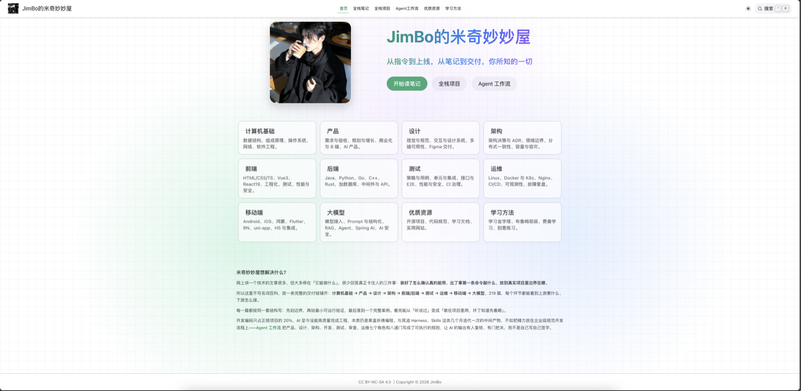
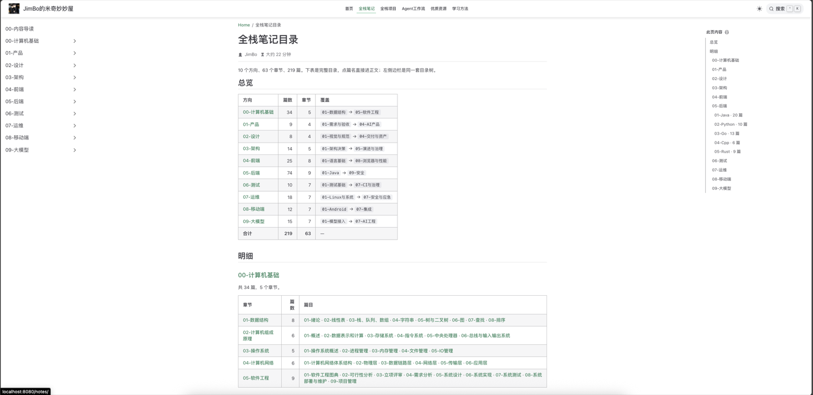
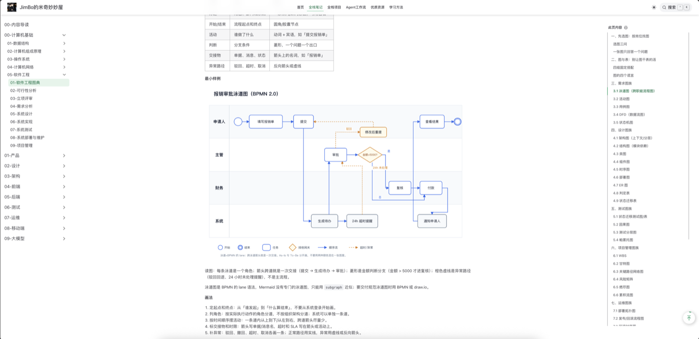
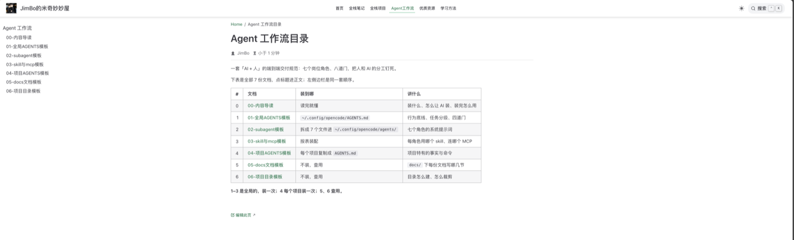
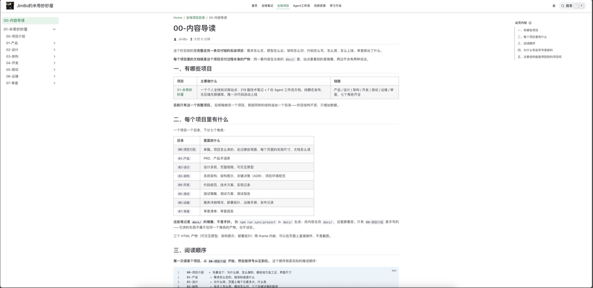

# 米奇妙妙屋 · 这个项目是怎么来的

**一个个人全栈知识库站点。219 篇技术笔记 + 7 份 Agent 工作流文档，纯静态发布，无后端、无数据库。**

从「一堆散在本地仓库、打不开也发不出去的 Markdown」，到「能按方向逐层浏览、能全文检索、手机能读、推一次代码就自动上线」——`v1.0.0` 已经在 Cloudflare Pages 上运行。

这一篇讲三件事：为什么这么做、中间返工过什么、后面七个目录的文档该怎么读。**它是整个项目的入口，也是唯一不在 `docs/` 里的文档**——因为「怎么讲给读者听」不属于任何一个角色的产物。

## 一、这个项目要做成什么

一句话：**把三个独立仓库的 Markdown 变成一个能按方向逐层浏览的静态站**。

| 目标 | 判据 |
| --- | --- |
| 五个栏目都能访问，且都有实质内容或明确结构 | 5 个栏目，0 个空白页 |
| 笔记能按「方向 → 章节 → 篇」三层往下钻 | 一层不缺，路径不断 |
| 首页能让人一眼看懂这是什么站 | 标题 + 一句定位 + 方向入口 |
| 站点不像模板默认样式 | 有自定义配色与首页视觉 |
| 手机能读 | 320px 起不横向滚动 |

前三条能机器验，第四条是设计约束（写进了页面规格），第五条靠窄窗口实测。**五条在测试报告里逐条对过，全过。**

## 二、先定的五个栏目

顺序按「读 → 用 → 怎么读」排，不是并列的五个列表：

| 栏目 | 解决什么 | 为什么是它 |
| --- | --- | --- |
| **全栈笔记** | 知识本体：十个方向的技术笔记 | 站点主体，占九成篇幅 |
| **全栈项目** | 从需求到上线的完整实战 | 只读笔记不会做项目 |
| **Agent工作流** | 一人 + 多个 AI 的交付规范 | 开发方式变了，流程得写下来 |
| **优质资源** | 外部文档、工具、开源项目 | 别人的东西不抄进笔记，但要找得到 |
| **学习方法** | 学习金字塔、布鲁姆层级这类认知模型 | 决定怎么读，不是读什么 |

**五个栏目有先后关系。** 先按方向读懂机制，再跟着项目做一遍，用工作流约束 AI 的输出，靠学习方法决定读的顺序，外部资源作补充。首页正文把这层关系写清楚了。

**你现在正在读的这一组，就是「全栈项目」的第一个项目。** 栏目本身也是用它自己的产物填起来的——这不是巧合，是「有完整项目才填」这条规则的第一个实例。

## 三、为什么选 theme-hope

这个站要的是**知识库**，不是博客：左侧要目录树、右侧要本页目录、顶部要全文搜索、还要深浅色切换。自研主题意味着这四套东西全部重写。

参考对象是 [vuepress-theme-hope 官方文档](https://theme-hope.vuejs.press/zh/)。它已经提供文档型布局、左侧目录树、右侧本页目录、全文搜索、深浅色切换、SEO 与 RSS——正好是知识库要的东西。

**判断依据**：自研能拿到的额外控制权，抵不上重写四套基础能力的代价。完整取舍记在 `03-架构/07-ADR重要决策/ADR2-主题选型`，那里有四个备选与否决理由。

## 四、一个最关键的决定：内容不进站点仓库

最初想把笔记直接放 `blog/src/notes/` 里写。放弃的原因：

| 直接写在站点里 | 拉出来独立仓库 |
| --- | --- |
| 笔记与站点配置混在一个仓库，改样式会碰到内容历史 | 内容与展示彻底分开 |
| 笔记量上来后仓库被图片撑大，克隆变慢 | 两份仓库各自独立增长 |
| 想在 Obsidian 里读，要面对一堆 VuePress 配置 | 源库是纯 Markdown，任何编辑器能开 |
| 手机改一篇笔记要跑一遍构建 | 源库改了 push 就行 |

所以定成「源库 + 发布端」两个角色，用脚本单向同步：

```text
../fullstack-notes/      ──npm run sync──▶  blog/src/notes/
../fullstack-workflow/   ──npm run sync──▶  blog/src/workflow/
                                          └▶  docs/99-模板文档/
```

**代价**：站点内容不能直接改，改完必须跑一次同步；线上构建不能带 `sync`（Cloudflare 环境里没有那些本地路径），所以同步产物要跟代码一起提交。

**收益**：内容仓库能独立增长到几百 MB 而不拖累站点。这一条的完整取舍在 `ADR1-内容源与站点分离`。

## 五、同步不是复制

源库有三种写法会让 Vue 编译失败，必须在同步这一步修掉：

| 源库写法 | 为什么会挂 | 同步时怎么处理 |
| --- | --- | --- |
| 路径里有 `C++` | VuePress 把 `+` 转义成 `_`，产物目录变 `04-C__`，链接全 404 | 目录与文件名改成 `Cpp` |
| 行内代码里写 `${{ github.sha }}` | Vue 把 `{{ }}` 当插值，抛 TypeError，整页只剩开头几句 | 包 `<span v-pre>` 让 Vue 跳过 |
| 标题写成 `# 01-软件工程图典` | 页面标题显示成「01-软件工程图典」 | 去掉两位数字前缀 |

**三种都是实测出来的，不是预设的。** 第二条最隐蔽：页面还在、路径正确、正文没了，只有翻构建日志才看得到 TypeError。

同步脚本还多做一件事：**扫全站跨篇链接与图片引用**，断链或缺图直接退出码非 0。这一步让「内容有问题」在同步阶段就暴露，不用等到构建或上线。

## 六、从零到上线：九个阶段

### 6.1 站点先跑起来（10-27 ~ 10-29）

装 VuePress 2 rc.31 + theme-hope rc.110，写 `config.ts` 与 `theme.ts`，首页做极光背景 + 渐变标题 + 玻璃卡片，放进去 9 个方向共 177 篇旧笔记。

**先做的判断**：先把骨架跑通——导航、侧栏、首页视觉，这三样决定站点的基本形态；内容与文档按角色顺序接入。

### 6.2 内容源升级（11-22）

两个独立仓库各自定稿：`fullstack-notes`（219 篇 / 10 方向 / 63 章节）、`fullstack-workflow`（v1.1.0 / 7 份文档）。

站点原有的 177 篇是这两套内容的 v1.0 快照，与新库重叠度很低：**157 篇有后继版本、20 篇新库没有、24 篇文件级完全相同**。

**关键决定：整体换血，不合并。** 合并要逐篇判断哪份更新，20 篇的差异还得人工取舍——不如整库替换，旧内容留在 Git 历史里。

### 6.3 写同步器（最花时间的一段）

219 个文件手工搬一次可以，搬第二次就会错。而且源库那三种写法会让构建失败，手工修必然漏。

三种坑的发现顺序：

| 顺序 | 坑 | 怎么发现的 |
| --- | --- | --- |
| 1 | 路径里的 `C++` 构建后变 `04-C__` | `/notes/` 目录页那条链接点进去 404 |
| 2 | 行内代码里的 `${{ }}` 让整页内容残缺 | 构建日志有 TypeError，页面只剩开头几句 |
| 3 | 标题带 `01-` 编号 | 侧边栏与页面标题不一致 |

### 6.4 目录页从列表改表格

第一版是缩进列表（`- 00-计算机基础 · 34 篇` → 子项），问题是想找某一篇得逐级点，看不到篇名。

改成表格：总览表（10 行 + 合计）+ 每方向一张明细表（章节 / 篇数 / 篇目）。`05-后端` 是三层结构（语言 → 分类 → 篇），单独按语言分小节。最终是 15 张表，全部由脚本扫盘生成——**加一篇笔记不用改任何配置**。

### 6.5 原型图返工三次

| 版本 | 做法 | 结果 |
| --- | --- | --- |
| v1 | 手写 HTML，令牌从构建产物摘 | 能跑，但与真实站点不像 |
| v2 | 写 brief 交给 OpenDesign | 9 处不符：Hero 顺序反了、卡片 3 列（应 4 列）、头像 220（应 290）、卡片标题 17px（应 20.8） |
| v3 | 找到根因后重跑 | 结构性问题全部修正，四屏可切、桌面/手机宽度可切 |

根因见第七节。**原型是可交互的 HTML，不是截图**，在 `02-设计/02-原型图` 里直接能点。

### 6.6 七类产物落进 `docs/`

七类产物按角色落进 `docs/`：产品、设计、架构、开发、测试、运维、审查。每一份都在它该交的环节写完，通过后就进入下一个环节——顺序是产品定需求、设计出原型、架构定结构、开发写方案再实现、测试出报告、审查挑问题、运维准备上线。

`docs/` 下这七个目录，同时就是本站「全栈项目」栏目里 01–07 那七个目录的来源——**站内看到的是镜像，不是另一份手抄。**

### 6.7 审查与收尾

CR1 找出两条 P1：

| # | 问题 | 修法 |
| --- | --- | --- |
| 1 | 旧 `docs/deploy.md`、`docs/writing.md` 没删且仍被引用，内容已漂移（353 页 vs 365 页） | 删旧文件，三处引用改指新文档 |
| 2 | TD 的「实施顺序」只列步骤，没写每步产出物 | 补「做完能看到什么」一列，8 步扩到 9 步逐条填 |

修完复审通过，测试 23 条用例全过，随后以 `v1.0.0` 发布。

### 6.8 三条关键选型写成 ADR

架构阶段还有一步：三个影响后续所有决定的选型——内容源分离、主题选型、不做数据库——各写成一份 ADR，放在 `03-架构/07-ADR重要决策/` 下。

每份四段：Context（不这么干会出什么事）、Decision（可执行的决定）、Consequences（好与坏，坏处必须写）、Alternatives（放弃过的选项与否决理由）。**至少两个备选、至少一条明确的坏处**，少一条这份 ADR 就不成立。

三份分别是 `ADR1-内容源与站点分离`、`ADR2-主题选型`、`ADR3-不用数据库`，在 `03-架构` 目录下可读。

### 6.9 把项目本身镜像进站点

最后一个阶段：写 `blog/scripts/sync-project.mjs`，把 `docs/` 的 23 篇产物生成成站内笔记，3 个 HTML 产物（原型、架构图、部署拓扑）拷到 `public/project-assets/` 用 iframe 内嵌。

**这一步把「全栈项目」栏目填上真内容，而且内容只有一个源。** 改 `docs/` 再跑一次 `npm run sync:project`，站内跟着变；两边不会出现两种说法。

## 七、最值钱的那段弯路：我以为视口是 1440

这是整个项目里最值得记的一条，因为它直接影响了原型图。

| 项 | 值 |
| --- | --- |
| 我以为的视口宽度 | 1440px |
| 浏览器面板实际宽度 | **1277px** |
| 后果 | CSS 里 `@media (width>=1440px)` **从未触发** |

真实站点的卡片列数靠这条媒体查询在 ≥1440 时才从 3 列切成 4 列。所以：

```text
第一次量：resize desktop 后，面板短暂到 1440 → 量到 4 列 274px（真值）
后几次量：面板回落到 1277        → 量到 3 列 367px（错值）
```

我把错值写进了 brief，OpenDesign 照着错值画，于是原型也变成 3 列。

**教训：量之前先确认视口。** 这一条写进了页面规格的验收记录里，也写进了 `CR1` 的可复跑证据。

## 八、界面走查

设计文档里的数值是从产物量出来的，不是估的。这一节把每个页面的**实测尺寸**写下来，配合截图能直接对照。

截图放 `assets/` 下，用 `` 引用。**`assets/` 不会被 `sync:project` 重建**（脚本只重建七个角色目录），所以图不会被覆盖。

### 8.1 首页

**这个页面要看什么**：标题渐变（绿→蓝→紫）、极光背景、1440 宽下 12 张卡片排成 4 列、右侧三个胶囊按钮。



| 项 | 实测值（1440 视口） |
| --- | --- |
| 导航栏高 | 60px |
| Hero 容器 | 1240 × 322，`padding-inline: 40px` |
| 头像 | 290 × 290，水平位置 x = 249 |
| 文字块 | 宽 543，水平位置 x = 656 |
| 卡片容器 | 1160 宽，水平位置 x = 140 |
| 单卡 | 274 宽、117 高、`margin: 8px` |
| 卡片标题 / 描述 | 20.8px / 700、16px / 500 |
| 主按钮 | 高 50、字号 19.2、圆角 32 |

### 8.2 全栈笔记目录页

**这个页面要看什么**：15 张表；总览表 10 行 + 合计；`05-后端` 按语言分节的三层结构。



| 项 | 值 |
| --- | --- |
| 表格数 | 15 |
| 总览表行数 | 10 个方向 + 1 行合计 |
| 三层方向 | `05-后端`：语言 → 分类 → 篇 |
| 正文列宽 | 784px |

### 8.3 笔记正文页

**这个页面要看什么**：左侧目录树、右侧本页目录、文首引用块的流程头每项独立成段、代码块与表格的排版。



| 项 | 值 |
| --- | --- |
| 左侧目录 | 按磁盘目录递归，三层封顶 |
| 右侧目录 | 取本页 H2 / H3 |
| 文首流程头 | 6 项各自成段，不挤成一段 |
| 代码块 | 带语言标签与复制按钮 |

### 8.4 Agent 工作流目录页

**这个页面要看什么**：7 行 4 列表格、侧栏 7 项顺序固定（`00-内容导读` 在最前）。



### 8.5 本站「全栈项目」栏目

**这个页面要看什么**：三层侧栏（栏目 → 项目 → 七个角色 → 篇）；三个可交互产物的 iframe 内嵌；文首流程头分行。



| 项 | 值 |
| --- | --- |
| 侧栏层数 | 4 层：`00-内容导读` / 项目 / 角色 / 篇 |
| 内嵌产物 | 原型 900px、架构图 760px、部署拓扑 760px |
| 文档来源 | `docs/` 镜像，23 篇 |

### 8.6 手机宽度

**这个页面要看什么**：≤720px 时侧栏与右侧目录隐藏、卡片单列、正文不横向滚动。


| 项 | 值 |
| --- | --- |
| 断点 | 720px |
| 侧栏 / 右目录 | 该断点以下隐藏 |
| 首页卡片 | 单列 |
| 横向滚动 | 320px 起不出现 |

## 九、流程状态与文档怎么读

### 9.1 文首那几行是什么

后面七个角色目录里的每份链上产物，文首都有几行流程信息：

| 行 | 含义 | 本项目的值 |
| --- | --- | --- |
| `审查` | 有没有经过独立审查 | PRD 属中任务，按规范不单独审；架构与 TD 经 `CR2` 第 1 轮通过，代码与文档经 `CR1` 第 1 轮通过 |
| `放行` | 人有没有说「可以往下走」 | `已放行 · JimBo · 2026-11-22` |
| `问询` | 提过几轮问题、有没有没答的 | PRD1 是 3 轮，全部有回答，0 代答 |

**它们是流程留下的痕迹，不是完成度标签。** 一份产物可能写着「审查：不适用」（比如测试方案按规范只过人），但它照样是完整的、生效的。

### 9.2 为什么有些序号是缺的

站内笔记的**文件名序号与 `docs/` 完全一致**，所以你会看到跳号：

```text
01-产品/   03-PRD…  04-产品术语表      ← 缺 01、02
03-架构/   01… 02… 04… 07-ADR重要决策   ← 缺 03、05、06
```

**跳号不是漏生成，是这些产物对本项目结构上不存在。** 工作流模板按「有后端、有数据库、有外部系统」的项目设计，序号是固定的；而这个站是纯静态发布端。下表一次说清：

| 角色 | 缺失的序号 | 模板里是什么 | 本项目为什么不需要 |
| --- | --- | --- | --- |
| 01-产品 | `01-BRD商业需求` | 要投入多少、回报多少、什么时候该停 | 个人站点，没有商业投入与回报，停止条件写不出来 |
| 01-产品 | `02-MRD市场需求` | 谁有这个问题、为什么不用现成的 | 无外部市场，读者是自己 |
| 03-架构 | `03-状态机/` | 每个带 `status` 列的实体一张图 | 无带状态列的实体：没有订单、没有工单、没有用户 |
| 03-架构 | `05-数据库设计` | 表结构、枚举、不变量、迁移回滚 | 无数据库。内容源是三个 Git 仓库的 Markdown |
| 03-架构 | `06-ER图/` | 一张 8–12 表的关系图 | 同上，无表可画 |

**整份 `docs/` 是完整的，不是残缺的。** 每一处缺号都在上表有一行理由，`docs/README.md` 第五节还有一份同样的清单。

### 9.3 模板里两处不产出的位置

`deploy/` 与 `test/` 这两层目录不存在，替代方案写在运维与测试文档里：

| 模板位置 | 本项目的替代 |
| --- | --- |
| `deploy/docker/`、`deploy/k8s/`、`deploy/scripts/` | 部署完全托管在 Cloudflare Pages，仓库里只有 `blog/wrangler.jsonc` 一个备用配置 |
| `deploy/env/` | 无密钥、无数据库密码，唯一变量 `NODE_VERSION=22` 在 Cloudflare 后台配 |
| `test/vitest/`、`test/playwright/` 等四层 | 没有函数、组件、接口可测；验证是 `npm run build` + 链接扫描 + 结构断言，两层覆盖到底 |

### 9.4 哪些内容不在本项目里

三件事明确不属于这个项目的范围，各有归属：

| 项 | 归属 |
| --- | --- |
| 笔记正文的技术正确性 | 内容源仓库。站点只负责搬运与渲染 |
| `09-大模型`、`08-移动端` 的补篇 | 内容侧分批补，不影响站点结构 |
| 学习方法 8 篇正文 | 下一期的内容计划（PRD2） |

## 十、结论

**这不是「我会用 VuePress」，是「我能把一个东西从需求推到上线，并且每一步都留下能被人复核的证据」。**

可复核的证据就是后面七个目录：

| 证据 | 在哪 |
| --- | --- |
| 需求与验收标准 | `01-产品/03-PRD1-全栈笔记站` |
| 页面每个元素的实测尺寸 | `02-设计/03-页面规格` |
| 可交互原型 | `02-设计/02-原型图`（iframe 内嵌） |
| 结构与部署 | `03-架构/01-系统架构` + `02-架构图示` |
| 三个关键选型的取舍 | `03-架构/07-ADR重要决策` |
| 怎么实现的、踩过什么坑 | `04-开发/02-技术方案` + `03-实现记录` |
| 23 条用例逐条结果 | `05-测试/03-测试报告` |
| 怎么上线、怎么回滚 | `06-运维/03-运维手册` + `04-发布记录` |
| 审查挑出了什么、怎么修的 | `07-审查/02-审查报告` |

### 建议的阅读顺序

```text
00 项目介绍（本文）  ← 先知道来龙去脉与弯路
01-产品              ← 需求怎么定的
02-设计              ← 长什么样（含可交互原型）
03-架构              ← 技术上怎么搭（含架构图与三份 ADR）
04-开发              ← 怎么实现的（含同步器的三个修补）
05-测试              ← 怎么证明做对了
06-运维              ← 怎么上线、怎么回滚
07-审查              ← 被挑出了什么问题
```
