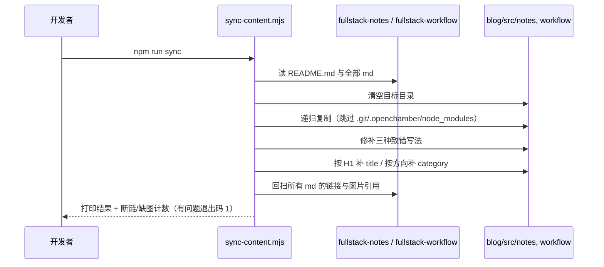
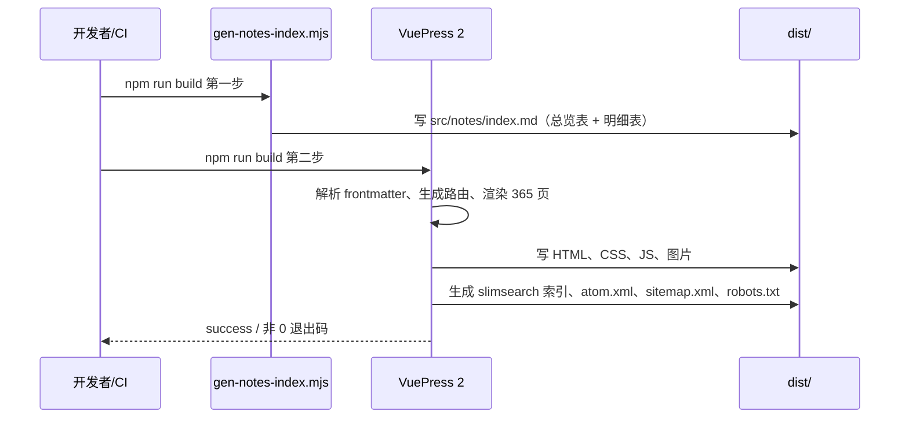
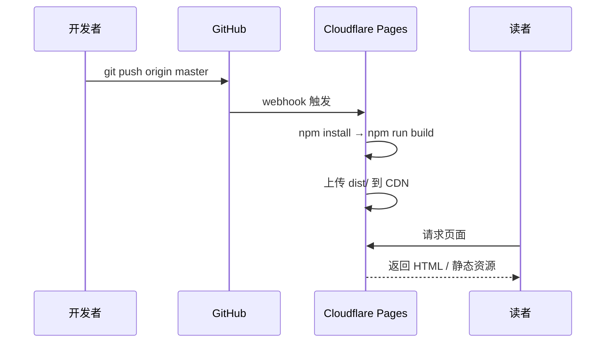

> **系统架构** · v1.0.0（**链版本**）· 2026-11-22
>
> **审查**：已通过（CR2，第 1 轮）
>
> **放行**：已放行 · JimBo · 2026-11-22
>
> **上游**：PRD1 全栈笔记站 v1.0.0、页面规格 v1.0.0
>
> **下游**：TD1 v1.0.0

# 系统架构

> 图上不来的一律在这里用文字说清。

## 一、定位与质量目标

一句话：**把三个独立仓库的 Markdown 变成一个能按方向逐层浏览的静态站**，浏览器直读，没有服务端。

| # | 质量目标 | 数字 | 怎么验证 |
|---|---|---|---|
| 1 | 构建成功率 | 100%，连续 3 次退出码 0 | `npm run build`，实测 3 次全 0 |
| 2 | 构建耗时 | ≤ 60 秒 | 实测 35–40 秒（365 页） |
| 3 | 站内死链 | 0 | 构建后扫全部 href，实测 5,518 条中 missing 0 |
| 4 | 同步可重跑 | 一条命令，幂等 | `npm run sync` 连跑两次结果一致 |
| 5 | 单页体积 | 最大文件 ≤ 25 MiB | 实测最大 6.7 MB（`slimsearch.worker.js`） |
| 6 | 产物文件数 | ≤ 20,000 | 实测 1,841，占上限 9.2% |

## 二、架构总览

四层，单向依赖，没有回环：

| 层 | 负责 | 不负责 |
|---|---|---|
| **内容源**（仓库外） | 写 Markdown、管图片、跑 Git。三个独立仓库 | 不管站点怎么渲染 |
| **同步**（`blog/scripts/`） | 复制、改名、修补、补 frontmatter、校验 | 不创作内容，不改语义 |
| **渲染**（VuePress + theme-hope） | Markdown → HTML、侧栏、搜索索引、RSS、sitemap | 不管内容从哪来 |
| **发布**（Cloudflare Pages） | 拉仓库、跑构建、分发 CDN | 不跑 sync（线上没有源库） |

**逻辑架构与系统上下文见 `02-架构图示_v1.0.0.html`**（Archify `architecture` 类型生成，单文件自包含，四校验全过）。

**图不是手画的。** 源 JSON 在 `docs/99-tmp/架构-站点/architecture.json`，改图改那份再跑 `finalize`。

## 三、模块清单

| # | 模块 | 职责 | 对外接口 | 代码位置 |
|---|---|---|---|---|
| 1 | 内容同步器 | 从两个源库复制并修补 219 篇笔记 + 7 份工作流文档 | `npm run sync` | `blog/scripts/sync-content.mjs`（385 行） |
| 2 | 目录页生成器 | 扫盘生成 `/notes/index.md`，输出总览表 + 每方向明细表 | `npm run gen:notes` | `blog/scripts/gen-notes-index.mjs`（184 行） |
| 3 | 站点配置 | 语言、标题、描述、首屏浅色脚本、Vite 打包参数 | 被 VuePress 读取 | `blog/src/.vuepress/config.ts` |
| 4 | 主题配置 | 域名、作者、深浅色、插件（搜索 / RSS / sitemap / SEO） | 被 VuePress 读取 | `blog/src/.vuepress/theme.ts` |
| 5 | 导航 | 六项顶部导航 | 导出 `navbar` | `blog/src/.vuepress/navbar.ts` |
| 6 | 侧边栏 | 按磁盘递归生成，支持三层 | 导出 `sidebar` | `blog/src/.vuepress/sidebar.ts` |
| 7 | 样式 | 极光背景 / 渐变标题 / 玻璃卡片 / 文档页布局 | 被主题注入 | `blog/src/.vuepress/styles/{index,palette}.scss` |
| 8 | 首页 | Hero + 12 张卡片 + 正文四段 | `/` | `blog/src/index.md` |
| 9 | 静态资源 | 头像、favicon、logo，以及项目栏目的三个内嵌产物 | `/avatar.png`、`/project-assets/*.html` | `blog/src/.vuepress/public/` |
| 10 | 项目文档同步器 | 把 `docs/` 的链上产物镜像成站内笔记，生成内嵌 iframe 页 | `npm run sync:project` | `blog/scripts/sync-project.mjs`（394 行） |

**所有源码都落在 10 个模块里，没有清单外文件。** 内容目录（`notes/`、`workflow/`、`methods/`、`projects/`、`resources/`）与 `docs/` 下的产物是数据不是代码。

**这张表是代码视角，`02-架构图示` 是运行与部署视角。** 图里画的是「谁在什么时候被调用、产物落到哪」，所以同步与生成把两个源库、构建器、`dist/`、CDN、读者连成一条链；表里按文件拆得更细（两个同步器、目录页生成器、四个配置、样式、首页、静态资源）。两张的节点数不必相等，对不上时才说明有一方漏了东西。

## 四、核心流程

### 4.1 同步：源库 → 站点

**失败分支**

| 步 | 失败条件 | 返回 | 副作用 |
|---|---|---|---|
| 读源库 | 源目录不存在 | 抛 ENOENT，退出码 1 | 目标目录已清空，站点内容为空 |
| 复制 | 磁盘满 | 抛 ENOSPC | 目标目录半成品 |
| 校验 | 有断链或缺图 | 打印清单，退出码 1 | 内容已写入，构建前必须修 |

| 项 | 内容 |
|---|---|
| 事务边界 | 无。先 `rmSync` 再写，中途失败留半成品 |
| 失败点 | 源目录缺失、磁盘写入、校验不过 |
| 幂等 | 是。同一源库连跑两次，产物字节一致 |

### 4.2 构建：Markdown → 静态站

**失败分支**

| 步 | 失败条件 | 返回 | 副作用 |
|---|---|---|---|
| 目录页生成 | `src/notes` 不存在 | ENOENT | 构建中止 |
| Vue 编译 | 正文有裸 `${{ }}` 或裸 `<tag>` | `Element is missing end tag` / TypeError | 构建中止，整页内容残缺 |
| 搜索索引 | 两页映射到同一路径 | `SlimSearch: duplicate ID` | 构建中止 |

| 项 | 内容 |
|---|---|
| 事务边界 | 无。`dist/` 整体重建 |
| 失败点 | 三种写法、路径冲突 |
| 幂等 | 是。清空重建结果一致（时间戳与哈希除外） |

### 4.3 发布：推 master → CDN

**失败分支**

| 步 | 失败条件 | 返回 | 副作用 |
|---|---|---|---|
| 构建 | 超时 / 依赖装不上 | 标记失败，线上保持上一版 | 无 |
| 构建 | Vue 编译错 | 同上 | 同上 |
| 发布 | 单文件超 25 MiB | 该文件上传失败 | 页面缺资源 |

| 项 | 内容 |
|---|---|
| 事务边界 | **原子**。构建失败则整个部署不生效 |
| 失败点 | 依赖、构建、体积 |
| 幂等 | 是。同一 commit 重复触发结果一致 |

## 五、状态机

**没有带 `status` 列的实体。** 纯静态发布，无订单、无工单、无用户。

内容同步有「进行中 / 完成 / 失败」三阶段，但它是脚本执行状态不是持久化实体，用流程图表达（§4.1），不适用状态机图。

**所以 `03-状态机/` 不建。** 这条写在这里，让后来的人知道「少一个目录」是判断结果，不是遗漏。

**关键选型的记录在 `07-ADR重要决策/`**，三份：`ADR1` 内容源与站点分离、`ADR2` 主题选型、`ADR3` 不用数据库。每条都写 Context / Decision / Consequences / Alternatives，包含放弃过的选项与否决理由。

## 六、非功能设计

| 项 | 做法 | 依据 |
|---|---|---|
| 性能 | 静态 HTML 直出，无运行时渲染；图片懒加载；搜索索引预生成 | 文档型站点，首屏即可读 |
| 检索 | slimsearch 纯前端索引，无需后端 | 219 篇全文，索引 6.7 MB |
| 缓存 | CDN 托管，`max-age=0, must-revalidate`，静态资源靠哈希失效 | Cloudflare 默认 |
| 可用性 | 托管服务，无自建服务器 | 个人站点，无 SLA |
| 容量 | 1,841 文件 / 235 MB；上限 20,000 / 25 MiB 单文件 | 约 10.9 倍余量 |
| 降级 | 不做。JS 未加载时正文仍可读（HTML 直出），搜索、折叠、Mermaid 不可用 | 渐进增强 |
| 备份 | 三个仓库各有 Git 历史；Cloudflare 保留历史部署可回滚 | — |

**已知瓶颈**：`00-计算机基础` 的 909 张截图共 130 MB，占产物一半以上。首屏不加载，但构建时扫描会变慢。

## 七、风险与技术债

| 问题 | 影响 | 计划 |
|---|---|---|
| 图片未压缩 | 产物 235 MB，克隆仓库 162 MB | WebP 化可减 50–70%，未排期 |
| 无测试框架 | 回归靠 `npm run build` + 链接扫描 | 静态输出，加 vitest 收益低 |
| 同步无事务 | 中途失败留半成品 | 幂等可重跑，可接受 |
| 三种写法靠脚本兜底 | 新写法超出已知三种会挂 | 校验只覆盖链接与图片 |
| 版本号硬编码在文档名 | 升版要整批改名 | 工作流要求，接受 |
| 首页入场动画在 dev 下不总是收尾 | 标题/副标题在 dev 下可能不可见 | 线上正常；改主题源码会在升级时冲突 |

最后更新：2026-11-22
