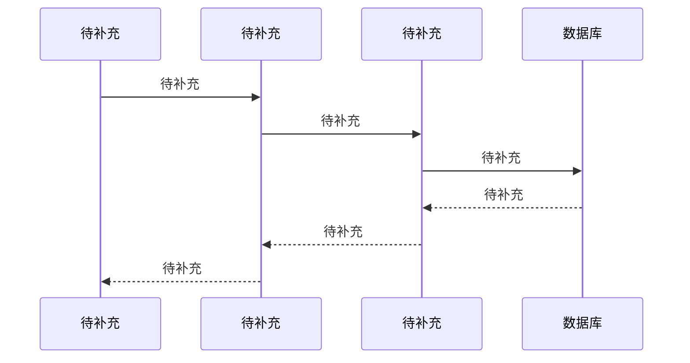

# docs 文档模板

`docs/` 下每类文档的模板。**照抄结构，内容换成自己的。**

- `待补充` 是必须填的占位，`<...>` 是命名占位。
- 表头和「完成检查」是硬要求；表里给几行只是示意，按实际增减。
- **不用 frontmatter。** 编号、版本、日期、状态一律写文首引用块前三行；能被文件名和目录表达的（类型、归属）不再重复。

---

## 一、docs/README.md

**回答**：现在有哪些需求在做、卡在哪、下一步该谁动。

```markdown
# 项目文档

## 一、在途需求

**整条链共用一个版本号，写进每份链上产物的文件名。这一行是全项目唯一的版本登记处。**

| 链 | 需求短名 | 当前版本 | PRD | 页面规格 | 架构 | 数据库设计 | TD | TR | CR | 审了几轮 | 状态 | 卡在谁 | 最近更新 |
|---|---|---|---|---|---|---|---|---|---|---|---|---|---|
| PRD<N> | 待补充 | vX.Y.Z | vX.Y.Z | vX.Y.Z | vX.Y.Z | vX.Y.Z | vX.Y.Z | vX.Y.Z | vX.Y.Z | 0/2 | 待评估 | 待补充 | 待补充 |

**同一行的版本必须全部相同。** 有一格不一样，说明有一份没跟着升。

**项目级文档（BRD、术语表、设计系统、环境规范、代码规范、测试策略、服务详细情况、运维手册、发布记录、审查清单）不带版本，靠 `git log` 追历史，文首写「最后更新」。它们不参与这张表。**

**审查报告填「链 vX.Y.Z」**，和这里对不上就是审错对象了。

## 二、状态定义

**状态名带「待确认」的，都在等人过门。** 人没过，流程就停在那儿。

| 状态 | 含义 | 下一环节 | 卡在 |
|---|---|---|---|
| 待评估 | 需求单已进，还没定要不要做 | 产品 | 人定级 |
| 待产品审查 | PRD 写完，等**CR1**（大任务才有这一档） | 人 | 审查 |
| 待产品确认 | 审查已通过，等人过**门 1** | 设计（有 UI）/ 架构（无 UI） | 人 |
| 待设计确认 | 原型写完，等人过**门 2** | 架构 | 人 |
| 待架构与方案审查 | 架构与 TD 写完，等**CR2** | 人 | 审查 |
| 待架构确认 | 审查已通过，等人过**门 3** | 全栈开发 | 人 |
| 待方案确认 | 同上，等人过**门 4** | 全栈开发写代码 | 人 |
| 开发中 | 代码在写，或写完自测 | 测试 | — |
| 待测试方案确认 | TP 写完，等人过**门 5** | 测试执行 | 人 |
| 待测试 | 测试执行中 | 审查 | — |
| 待代码审查 | 测试裁决为通过 / 有条件通过，等**CR3** | 人验收 | 审查 |
| 待审查 | 审查已通过 | 人验收 | 审查 |
| 待运维确认 | 运维三件写完，等人过**门 6** | 人验收 | 人 |
| 待验收 | 审查通过，等人过**门 7** | 运维发布 | 人 |
| 待上线 | 发布前检查完成，等人过**门 8** | 推送部署 | 人 |
| 已发布 | 已上线 | 归档 | — |
| 已阻塞 | 缺人、缺信息、缺环境 | 人介入 | 人 |

## 三、近期发布

| 版本 | 发布日期 | 包含需求 | 回滚点 |
|---|---|---|---|
| vX.Y.Z | 待补充 | 待补充 | 待补充 |

## 四、待补清单

- [ ] 待补充：缺什么、谁在等、卡不卡上线
```

**只写三块**：在途、近期发布、待补。多写的必然过期。

**状态定义八种固定**，不按项目改——改了就和角色定义、审查结论对不上。

**完成检查**

- [ ] 每行状态都在上表九种内
- [ ] 「卡在谁」填的是具体人，不是「开发」
- [ ] 已发布的需求已从在途移走，产物已搬进 `99-归档/发布/`
- [ ] 待补清单每项都有人认领

---

## 二、01-产品/

### 2.1 01-BRD商业需求.md（**项目级，不带版本**）

**回答**：这东西为什么要存在、什么情况下该停。

```markdown
# 商业需求

> **放行**：待确认 | 已放行 · <放行人> · <日期>

## 一、要解决什么

待补充：谁在什么场景下遇到什么问题，现在怎么凑合，代价是多少。

## 二、为什么现在做

- 待补充：什么变了，导致现在必须做
- 待补充：不做的话损失多少（钱、时间、机会）

## 三、成功长什么样

| 指标 | 现在 | 目标 | 怎么测 |
|---|---|---|---|
| 待补充 | 待补充 | 待补充 | 待补充 |

## 四、停止条件

满足任一条就停：

- 待补充：可观测的条件
- 待补充：可观测的条件

## 五、谁投了什么

| 投入 | 说明 |
|---|---|
| 人力 | 待补充 |
| 资金 | 待补充 |

最后更新：<YYYY-MM-DD>
```

**停止条件是必填项。** 没有它，就无法回答「还要不要继续投」。

**成功指标必须有基线值。** 只写目标值，等于不知道要改多少。

**完成检查**

- [ ] 有停止条件，且是可观测的
- [ ] 成功指标有基线值和目标值
- [ ] 没有写具体功能（那是 PRD 的事）

### 2.2 02-MRD市场需求.md（**项目级，不带版本**）

**回答**：谁需要、现在怎么解决、为什么不用现成的。

```markdown
# 市场需求

> **放行**：待确认 | 已放行 · <放行人> · <日期>

## 一、谁有这个问题

- **待补充（角色）**：人数、场景、现在卡在哪
- **待补充（角色）**：同上

## 二、现在怎么解决

| 现有方案 | 好在哪 | 差在哪 |
|---|---|---|
| 待补充 | 待补充 | 待补充 |

## 三、为什么不用现成的

**核心判断：待补充（用户会为这个差异改变行为吗？）**

待补充：给出具体场景或数字，说明现有方案为什么解决不了。

**如果只是要待补充，现成方案够用，我们不该做这个产品。**

## 四、会不会有人买单

- 决策链：待补充
- 替代成本：待补充
- 付费意愿：待补充

最后更新：<YYYY-MM-DD>
```

**判断标准只有一条**：用户会为这个差异**改变行为**吗。答案模糊，就不是市场需求。

**完成检查**

- [ ] 写清了现在用什么替代
- [ ] 「为什么不用现成的」给出了具体场景或数字
- [ ] 没有罗列功能清单

### 2.3 03-PRD产品需求/PRD\<N\>_\<短名\>_vX.Y.Z_\<YYYYMMDD\>.md

**回答**：这一版做什么、系统按什么规则运行、怎么算做完。

```markdown
> **PRD<N>** · PRD · vX.Y.Z（**链版本**）· <YYYY-MM-DD>
> **审查**：待审查 | 已通过（CR<N>，第 <N> 轮）| 有条件通过（未决 P2 <N> 条）| 退回修改
> **放行**：待确认 | 已放行 · <放行人> · <日期> | 已放行（代答 K 项，人未复核）| 未采信：零问询
> **问询**：轮次 N / 未回答 M / 代答 K
> **上游**：待补充
> **下游**：待补充

**「审查」和「放行」是两道，顺序不能反。**

| 行 | 谁填 | 什么时候 |
|---|---|---|
| `审查` | 审查角色（写 CR1） | PRD 写完先审，**大任务必审** |
| `放行` | 人 | 审查裁决为「通过 / 有条件通过」之后才轮到人 |

**审查没过（退回修改 / 退回重写）时，`放行` 行保持 `待确认`，人不看这份 PRD。** 人不必替审查挑错别字和漏字段。

**中任务可以省掉 `审查` 这一行，只留 `放行`。** 范围小、下游只有一层，PRD 缺陷放大概率低。

**「问询」这一行是必填的，它决定放行行能写成什么。**

| 问询那一行的值 | 放行行只能写成 |
|---|---|
| 轮次 ≥ 1，未回答 0 | `已放行 · <放行人> · <日期>` |
| 轮次 ≥ 1，未回答 > 0，代答有授权 | `已放行（代答 K 项，人未复核）· <放行人> · <日期>` |
| **轮次 0** | `未采信：零问询`，且不许进设计 / 架构 / 开发 |

**N / M / K 从哪数**：第八节「开放问题」的条数 + 7.1「假设」的条数。N 是向人提问的轮次（一轮可含多问），M 是提了人没答的，K 是编排者代答的。

**零问询的 PRD 一律是草稿。** 这条不是要求「问得好」，是要求「有没有问过」。这次测试中产品 16 分钟产出 473 行 PRD、全程零提问，因为编排者派 prompt 时把范围基线写成了「已确认需求」——所以这条卡的是**发出指令的人**，不只是产品。

# 待补充

## 一、背景与目标

待补充：承接哪条 BRD/MRD 指标，本版做到哪一步。

## 二、范围

待补充：从哪开始、到哪结束，一句话说清。

## 三、非目标（本期不做）

| 不做的事 | 为什么 | 什么时候可能做 |
|---|---|---|
| 待补充 | 待补充 | 待补充 |

## 四、用户故事

> 作为 <角色>，我想要 <做什么>，以便 <得到什么价值>。

| 编号 | 用户故事 |
|---|---|
| US-1 | 作为待补充，我想要待补充，以便待补充 |
| US-2 | 同上 |

## 五、业务规则

### 5.1 规则清单

| 编号 | 规则 |
|---|---|
| R-01 | 待补充 |

### 5.2 状态流转

| 从 | 到 | 谁触发 | 条件 |
|---|---|---|---|
| 待补充 | 待补充 | 待补充 | 待补充 |

### 5.3 字段规则

| 字段 | 必填 | 长度 | 格式 | 唯一 |
|---|---|---|---|---|
| 待补充 | 是 | 待补充 | 待补充 | 否 |

## 六、验收标准

每条一个场景，必须能指向一段验证。

- [ ] AC-01 待补充 — auto:`<测试文件路径>:<行号>`
- [ ] AC-02 待补充 — manual:`<谁验、怎么验>`
- [ ] AC-03 待补充 — 未验证（写原因）

**三种状态标记**：`[x]` 已验证并附证据、`[ ]` 未验证（必须写原因或验证方式）、`draft:` 有草案未跑。

## 七、依赖与约束

| 类型 | 内容 |
|---|---|
| 外部系统 | 待补充 |
| 数据 | 待补充 |
| 时间 | 待补充 |
| 合规 | 待补充 |

## 八、开放问题

| 问题 | 找谁定 | 什么时候要定 |
|---|---|---|
| 待补充 | 待补充 | 待补充 |

## 九、变更历史

| 版本 | 日期 | 改了什么 | 依据 |
|---|---|---|---|
| v1.0.0 | <YYYY-MM-DD> | 初版 | PRD<N> |
```

**AC 编号 `AC-NN` 两位起，全局不复用。** 后面 TP、TR、CR 都按这个号引用。

**非目标必须写。** 写不出「不做什么」，说明范围还没想清。

**完成检查**

- [ ] 每条 AC 都带证据位置，或写清未验证的原因
- [ ] 非目标表至少有一条
- [ ] 状态流转覆盖了驳回、撤回、终态
- [ ] 字段规则有长度和格式
- [ ] 开放问题都有人和时间

### 2.4 04-产品术语表.md（**项目级，不带版本**）

**回答**：一个概念只允许一个叫法。

```markdown
# 产品术语表

> **放行**：待确认 | 已放行 · <放行人> · <日期>

| 术语 | 定义 | 不是什么 | 代码里的名字 |
|---|---|---|---|
| 待补充 | 待补充 | 待补充 | `待补充` |

最后更新：<YYYY-MM-DD>
```

**「不是什么」这一列最有用**：它挡住最常见的一类误解——两个近义术语混用，最后状态机写错。

**完成检查**

- [ ] 术语与界面用词一致
- [ ] 没有两个术语指同一个东西
- [ ] 代码里的名字已填

---

## 三、02-设计/

### 3.1 01-设计系统.md（**项目级，不带版本**）

**回答**：本项目用的哪一套设计系统、关键令牌是什么。**这是登记表，不是定义表**——令牌由 OpenDesign 生成，这里只记录与摘录。

````markdown
# 设计系统

> **放行**：待确认 | 已放行 · <放行人> · <日期>
> **最后更新**：<YYYY-MM-DD>

> 本项目使用 OpenDesign 的设计系统，令牌不手工维护，只做摘录。

## 一、用的哪一套

| 项 | 值 |
|---|---|
| 设计系统 ID | 待补充（如 `default`、`linear-app`、`stripe`） |
| 名称 | 待补充 |
| 为什么选它 | 待补充：行业接近 / 气质对 / 人指定 |
| 有没有定制 | 待补充：无，或改了哪些 |

## 二、关键令牌（从它的 DESIGN.md 摘）

**只摘开发要用的那几行，不要抄全表。**

| 令牌 | 值 | 用在哪 |
|---|---|---|
| 背景 | 待补充 | 页面底色 |
| 前景 | 待补充 | 正文 |
| 主色 | 待补充 | 主操作 |
| 辅助色 | 待补充 | 次要信息 |
| 危险色 | 待补充 | 错误、删除 |
| 正文字体 | 待补充 | — |
| 标题字体 | 待补充 | — |
| 正文行高 | 待补充 | — |
| 卡片圆角 | 待补充 | — |
| 按钮圆角 | 待补充 | — |

## 三、与通用的偏差

待补充：如果本项目改过令牌，或加了 OpenDesign 那套里没有的东西，写这里。没有就写「无」。

## 四、换设计系统时

改这一节，重新生成原型，页面规格跟着更新。**不要在旧产物上打补丁——重新生成比修补便宜。**
````

**为什么是登记表而不是定义表**：令牌由 OpenDesign 生成，我们手工再维护一份必然与产物脱节。**产物是事实，文档是索引。**

**完成检查**

- [ ] 写清了用的哪一套、为什么
- [ ] 摘的关键令牌与产物一致（抽查 3 个）
- [ ] 没有把 OpenDesign 的完整令牌表抄进来
- [ ] 没有写具体页面布局（那是页面规格的事）

### 3.2 02-原型图/

**原型的「放行」跟随 `03-页面规格.md` 的门 2**，目录内不单设放行行。

**这是目录，不是单文件。** 由 OpenDesign 生成，整目录拷进来，不手写、不逐个改。

```text
docs/02-设计/02-原型图/
├─ index.html          # ← 原型应用本身（OpenDesign 固定导出名，不要改）
├─ assets/             # 图片等资源，必须一起拷
│  └─ menu/*.jpg
└─ .file-versions/     # 版本快照与 prompt 原文
   └─ <hash>/manifest.json
```

**`index.html` 是 OpenDesign 的固定入口名，不是我们起的名。** 证据在 `.file-versions/index.html.artifact.json` 里：`"entry": "index.html"`。**不要改成 `原型图.html`**——改了之后 `manifest.json` 的 `fileName` 与它对不上，后续 `get_file` 与版本回滚都会找不到文件。

**多端时**（桌面 + 移动各一套）按端分目录，根 `index.html` 变成手写导航页。目录形态与判定规则见 `06-项目目录模板.md` 的 5.2.2，这里不重复。

**`assets/` 与 `.file-versions/` 缺一样都不算完整交付**：前者缺了图全断，后者缺了追溯不了是哪版。

| 验收项 | 通过标准 |
|---|---|
| 页面数 | 与 PRD 页面清单完全一致，不多不少 |
| 每页四态 | 正常 / 空 / 加载 / 错误，缺一不可 |
| 交互 | 主流程能一路点通，无死链 |
| 宽度 | 与 brief 约定的一致 |
| 图片 | 全部在 `assets/` 下，路径能解析 |
| 令牌 | 没有硬编码色值（OpenDesign 自检会修一轮，仍漏的要指出） |

本项目的页面清单与四态：

| 屏标识 | 页面 | 正常 | 空 | 加载 | 错误 |
|---|---|---|---|---|---|
| `data-screen="待补充"` | 待补充 | 待补充 | 待补充 | 待补充 | 待补充 |
| `data-screen="待补充"` | 待补充 | 待补充 | 待补充 | 待补充 | 待补充 |

**屏标识用 OpenDesign 的 `data-screen="xxx"`，不是 `id="p-NN"`。** 页面规格按同一套标识对齐。

**四态缺一不可**：空和错误最常被漏，也最容易在真实使用时暴露。缺了就在 brief 里单独要求它补一次，**不要自己上手改 HTML**。

**始终一份，每次在原处更新。** 换设计系统或大改时重新生成，不在旧文件上打补丁。

### 3.3 03-页面规格\<短名\>_vX.Y.Z_\<YYYYMMDD\>.md（**链上，带版本**）

**回答**：原型上每个页面实际长什么样。**这是从产物反推的记录，不是设计依据**——设计在 OpenDesign 里定，这里只写结果。

一份文件覆盖全部页面，按**屏标识**分节。屏标识用产物里的 `data-screen="xxx"`，不是自己编 `p-NN`。

````markdown
# 页面规格

> **放行**：待确认 | 已放行 · <放行人> · <日期>
> **最后更新**：<YYYY-MM-DD>

> 全部数值引用 `01-设计系统.md` 的令牌名，不重复写值。
> 尺寸从产物实测（浏览器里量），不是估算。

## 一、全局

| 项 | 规格 |
|---|---|
| 最小支持宽度 | 待补充 |
| 页面最大内容宽 | 待补充 |
| 顶部导航 | 待补充 |
| 内容区上边距 | 待补充 |
| 页面标题区 | 待补充 |

## 二、待补充（屏标识）

**屏标识**：`data-screen="待补充"`
**产物位置**：`02-原型图/index.html`

### 2.1 布局

| 区域 | 位置 | 尺寸 | 说明 |
|---|---|---|---|
| 待补充 | 待补充 | 待补充 | 待补充 |

### 2.2 表格列

| 列 | 宽 | 对齐 | 内容 | 空值显示 |
|---|---|---|---|---|
| 待补充 | 待补充 | 待补充 | 待补充 | — |

**排序**：待补充。**分页**：待补充。

### 2.3 状态

| 状态 | 表现 |
|---|---|
| 正常 | 待补充 |
| 空 | 待补充 |
| 加载 | 待补充 |
| 错误 | 待补充 |

### 2.4 交互

| 触发 | 行为 |
|---|---|
| 待补充 | 待补充 |

## 三、待补充（屏标识）

（同上一节的结构）

## 四、待补充（屏标识）

（同上一节的结构。**每加一个页面，编号顺延一节**，写满产物里的全部 `data-screen`）
````

**每个页面四节固定**：布局、状态、交互，有表格的加「表格列」。

**完成检查**

- [ ] 每个页面都有屏标识，与产物里的 `data-screen` 一致
- [ ] 所有尺寸、颜色引用令牌名，没有直接写十六进制
- [ ] 每个页面四种状态都写了具体表现，不是「同上」
- [ ] 每个字段都有校验时机和错误文案原文
- [ ] 没有新增设计系统里不存在的令牌（要加先改设计系统）

---

## 四、03-架构/

### 4.1 01-系统架构\<短名\>_vX.Y.Z_\<YYYYMMDD\>.md（**链上，带版本**）

**回答**：为了实现这个原型，技术上怎么搭。**这张文档只放文字、模块清单和流程时序图**；架构总览与系统上下文在 `02-架构图示.html`（见 4.2），状态机在 `03-状态机/`（见 4.3）。

> 模板外层用四个反引号，因为里面含 mermaid 代码块。复制到项目时改成三个反引号。

````markdown
# 系统架构

> **审查**：待审查 | 已通过（CR<N>，第 <N> 轮）| 退回修改
> **放行**：待确认 | 已放行 · <放行人> · <日期>
> **最后更新**：<YYYY-MM-DD>

## 一、定位与质量目标

待补充：一句话说清这套系统解决什么。

| # | 质量目标 | 数字 | 怎么验证 |
|---|---|---|---|
| 1 | 待补充 | 待补充 | 待补充 |
| 2 | 待补充 | 待补充 | 待补充 |
| 3 | 待补充 | 待补充 | 待补充 |

## 二、架构总览

待补充：分几层，一句话说清每层职责。

**逻辑架构图与系统上下文图都在 `02-架构图示.html`**，这里只写分层说明。

## 三、模块清单

| # | 模块 | 职责 | 对外接口 | 代码位置 |
|---|---|---|---|---|
| 1 | 待补充 | 待补充 | 待补充 | `src/待补充` |

**所有源码都要能落到某个模块里。** 落不进去，说明模块划分有漏洞。

## 四、核心流程

待补充：几条关键链路，每条**一张只画正常路径的时序图** + **一张失败分支表**。

### 4.1 待补充



**失败分支**

| 步 | 失败条件 | 返回 | 副作用 |
|---|---|---|---|
| 待补充 | 待补充 | 待补充 | 待补充 |

| 项 | 内容 |
|---|---|
| 事务边界 | 待补充 |
| 失败点 | 待补充 |
| 幂等 | 待补充 |

## 五、状态机

**图在 `03-状态机/1-<实体>_vX.Y.Z.html`（每个实体一张，文件名带序号与版本），这里只写文字定义。**

**每个有 `status` 列的实体各写一张表**，不许只写订单：

| 实体 | 状态数 | 终态 | 图文件 |
|---|---|---|---|
| 待补充 | 待补充 | 待补充 | `03-状态机/1-<实体>_vX.Y.Z.html` |

**这张表是状态机图的唯一导航。** 有哪几张、编号顺序是什么，全在这里；不建 `03-状态机/index.html`。

**合法迁移**（每个实体一张，逐条写「从 → 到，什么条件」）：

| 实体 | 从 | 到 | 条件 | 谁触发 |
|---|---|---|---|---|
| 待补充 | 待补充 | 待补充 | 待补充 | 待补充 |

**非法迁移**：一律抛错，不静默忽略。

**终态**：待补充（列出全部，且确认无出边）。

## 六、非功能设计

| 项 | 做法 |
|---|---|
| 性能 | 待补充 |
| 熔断与重试 | 待补充 |
| 降级 | 待补充 |
| 容量 | 待补充 |

## 七、风险与技术债

| 问题 | 影响 | 计划 |
|---|---|---|
| 待补充 | 待补充 | 待补充 |

最后更新：<YYYY-MM-DD>
````

**这张文档只留一种图：`sequenceDiagram`（调用顺序）。** 架构与上下文见图 4.2，状态机见图 4.3，ER 图见图 4.6。

**一张图回答一个问题：时序图只画正常路径，失败放表。** 把失败分支套进 `alt` 会让正常路径也读不清——这次实测 6.1 有 3 个 `alt`、6.4 有 6 个 `alt` + 1 个 `else`，读的人既看不出主流程也数不清失败有几种。

**只有一种例外**：分支本身改变了后续步骤的顺序（例如「仅退款」整条链路不同）。那种情况**拆成两张独立时序图**，不要用 `alt` 套在正常路径里。

**完成检查**

- [ ] 质量目标三条，都带数字和验证方式
- [ ] 模块清单的**内部模块数**与 `02-架构图示.html` 的非 `external` 节点数一致
- [ ] 每个模块有代码位置，没有源码落在清单外
- [ ] 每条核心流程一张时序图，**图里没有 `alt` / `else` / `opt`**，只有正常路径
- [ ] 每条流程紧跟一张「失败分支」表，列：步 / 失败条件 / 返回 / 副作用
- [ ] 每张时序图下面有三行：事务边界、失败点、幂等
- [ ] 状态机有文字定义（合法迁移逐条、非法组合、终态），**且每个有状态列的实体各自出图**
- [ ] 状态机表的「图文件」列填了带序号的文件名，且路径真实存在
- [ ] 非功能写了降级策略，不是只写目标

### 4.2 02-架构图示_vX.Y.Z.html（**链上，带版本**）

**这份图的「放行」跟随 `01-系统架构.md` 的门 3**，html 自身不单设放行行。

**由 Archify 生成，单个自包含 HTML，`architecture` 类型。**

**这张图同时讲两件事**：内部模块怎么分层、外部系统怎么连。外部系统用 `external` 类型，放在边界框外。

| 要求 | 说明 |
|---|---|
| 节点数 | **8–12 个**，超过就拆图 |
| 画布宽 | ≤ 1240px（宽高比 ≥ 1.55 时可到 1790px） |
| 节点类型 | 只能选：`frontend` `backend` `database` `cloud` `security` `messagebus` `external` |
| 边界 | `region` 或 `security-group`，必须表达真实隔离，不能只是把节点框起来 |
| 连线语义 | `emphasis` 主路径、`security` 策略/权限、`dashed` 异步、`default` 普通依赖 |
| 卡片 | 补充读者会问的问题，**不替代拓扑** |
| 交叉 | `visualReviewRecommendation` 信号为 0，或已按 hints 修过 |

**超过 12 节点时拆成目录，按「总览 + 域」分：**

```text
docs/03-架构/02-架构图示/
├─ 1-总览_v1.3.html      ← 只画分层与外部系统边界，不点具体模块
├─ 2-<域>_v1.3.html      ← 一个域一张，画该域模块与依赖
└─ 3-<域>_v1.3.html
```

**为什么按「总览 + 域」拆**：架构图有两类读者——新人先看总览（分层、边界、外部系统），改某个模块的人只看该域。1–12 节点时一张够；超了之后混在一起谁也读不清。

**不建 `index.html` 导航页。** 各域有哪几张，写在 `01-系统架构.md` 的模块清单里（每个域标明看哪张图），那里会被审查。

**产物清单**：`02-架构图示.html`（≤12 节点）或 `02-架构图示/`（>12 节点）。收据（`.finalize.json` / `.browser-check.json` / `.delivery.json` / `.finalize-summary.json`）全部进 `docs/99-tmp/架构-<任务>/receipts/`，用 `--out-dir` 指定。

**源 JSON 存 `docs/99-tmp/架构-<任务>/architecture.json`**，返工重跑用。

**文字版是事实源，图文不一致时以文字为准，图跟着改。**

**完成检查**

- [ ] 内部模块与 `01-系统架构.md` 的模块清单一一对应
- [ ] 外部系统用 `external` 且画在边界外
- [ ] 主路径能一眼看出（`emphasis` 连线）
- [ ] 边界表达真实隔离（区域 / 安全组），不是装饰框
- [ ] `finalize` 四校验全过
- [ ] `visualReviewRecommendation` 无未修交叉
- [ ] 单文件，浏览器能打开

### 4.3 03-状态机/ —— 每个有状态列的实体一张（文件名 `1-<实体>_vX.Y.Z.html`）

**这些图的「放行」跟随 `01-系统架构.md` 的门 3**，html 自身不单设放行行。

**由 Archify 生成，`lifecycle` 类型。**

**每个有状态的实体一张图，不合并。** 订单、发货单、售后单、退款单是四个实体，套在一张图里主路径会互相遮挡（渲染器按单一 `mainPath` 排布）。

```text
03-状态机/
├─ 1-订单_v1.3.html
├─ 2-发货单_v1.3.html
├─ 3-售后单_v1.3.html
└─ 4-退款单_v1.3.html
```

**和架构图示是两个文件，不能合成一个**——两者的 schema 完全不同（`components` vs `states`），一次 `finalize` 只能出一种。

| 字段 | 要求 |
|---|---|
| `mainPath` | 主流程的状态顺序，单独列出来；渲染器靠它排位置 |
| `states[].type` | 只能取：`start` `active` `waiting` `decision` `success` `failure` `neutral` `external` |
| `transitions` | 每条写 `from` / `to` / `label`；可恢复的失败要有真实回退迁移 |
| 终态 | 必须标出，且不再有出边 |

**产物清单**：每个实体一个 `.html` + `.finalize.json` + `.browser-check.json`，收据进 `docs/99-tmp/架构-<任务>/receipts/`

**源 JSON 存 `docs/99-tmp/架构-<任务>/lifecycle-<实体>.json`。**

**`01-系统架构.md` 第五节写文字定义（合法迁移表、非法组合、终态），这里出图。**

**完成检查**

- [ ] 每个有 `status` 列的实体都有一张状态机图，**不是只有订单**
- [ ] 所有状态都在，含终态
- [ ] `mainPath` 与主流程一致
- [ ] 终态没有出边
- [ ] 可恢复的失败有回退迁移
- [ ] 每个图文件 `finalize` 四校验全过

### 4.4 04-项目环境规范.md（**项目级，不带版本**）

**回答**：三套环境（本地开发、测试、生产）分别怎么配，差异只允许出现在一张表里。

**判断标准**：新人照着能跑起本地，运维照着能对上测试与生产；除了差异表，三套必须一致。

````markdown
# 项目环境规范

> **放行**：待确认 | 已放行 · <放行人> · <日期>
> **最后更新**：<YYYY-MM-DD>

## 一、工具版本

**版本精确到小版本号。** 写「Node 22」不够——22.11 与 22.13 在某些依赖解析上有差异。

| 工具 | 版本 | 怎么验证 | 为什么锁这个版本 |
|---|---|---|---|
| 待补充 | 待补充 | `待补充` | 待补充 |

**版本清单必须落成文件，不靠口头约定：**

| 文件 | 作用 |
|---|---|
| `.nvmrc` | Node 版本 |
| `package.json` 的 `engines` | Node 与包管理器下限 |
| `packageManager` 字段 | 包管理器精确版本 |
| `docker-compose.dev.yml` | 各依赖镜像 tag |

**禁止 `latest` 或浮动 tag。** 镜像写 `postgres:16.4`，不写 `postgres:16`。

## 二、端口与服务

### 2.1 本地端口

**一个端口一件事，全项目统一。**

| 服务 | 端口 | 地址 | 说明 |
|---|---|---|---|
| 前端 dev server | 待补充 | 待补充 | 待补充 |
| 后端 API | 待补充 | 待补充 | 待补充 |
| 数据库 | 待补充 | 待补充 | Docker 映射 |

**端口冲突改自己的启动参数，不改这份表。** 改表会让所有人的本地环境不一致。

### 2.2 三套环境的服务地址

| 服务 | 本地 | 测试 | 生产 |
|---|---|---|---|
| 前端 | 待补充 | 待补充 | 待补充 |
| 后端 | 待补充 | 待补充 | 待补充 |
| 数据库 | 待补充 | 待补充 | 待补充 |

## 三、三套环境总览

| 项 | 本地开发 | 测试环境 | 生产环境 |
|---|---|---|---|
| 谁用 | 待补充 | 待补充 | 待补充 |
| 机器 | 待补充 | 待补充 | 待补充 |
| 谁维护 | 待补充 | 待补充 | 待补充 |
| 怎么访问 | 待补充 | 待补充 | 待补充 |
| 数据 | 待补充 | 待补充 | 待补充 |
| 域名 | 待补充 | 待补充 | 待补充 |
| 部署方式 | 待补充 | 待补充 | 待补充 |
| 回滚 | 待补充 | 待补充 | 待补充 |

## 四、变量清单

**变量名与含义的唯一出处是 `docs/06-运维/01-服务详细情况.md` 的「变量清单」。** 这里只写本地怎么填。

| 变量 | 本地值 | 说明 |
|---|---|---|
| 待补充 | 待补充 | 待补充 |

**本地值可以写死在这里，因为它们是公开的。** 真实凭证只在服务器上，`deploy/env/` 整目录不入库。

## 五、环境差异

**差异只允许出现在这张表里。表里没有的项，三套环境必须一致。**

| 项 | 本地开发 | 测试环境 | 生产环境 |
|---|---|---|---|
| 依赖版本 | 待补充 | 待补充 | 待补充 |
| 外部服务 | 待补充 | 待补充 | 待补充 |
| 定时任务 | 待补充 | 待补充 | 待补充 |
| 日志级别 | 待补充 | 待补充 | 待补充 |
| 数据量 | 待补充 | 待补充 | 待补充 |
| 外部访问 | 待补充 | 待补充 | 待补充 |
| 备份 | 待补充 | 待补充 | 待补充 |

## 六、本地依赖启动

**外部依赖用 Docker 起，不要求每个人本机装数据库。**

```yaml
# deploy/docker/docker-compose.dev.yml
services:
  待补充:
    image: 待补充
    ports: ["待补充:待补充"]
    environment:
      待补充: 待补充
volumes:
  待补充:
```

**启动顺序**：待补充。后端启动时检查数据库连接，连不上直接退出并打印连接串。

## 七、代码风格工具

**工具配置即规范，不写进文档正文。**

| 工具 | 管什么 | 配置文件 |
|---|---|---|
| Prettier | 缩进、引号、换行 | `.prettierrc` |
| ESLint | 语法、潜在 bug、import 顺序 | `eslint.config.js` |
| TypeScript | 类型严格度 | `tsconfig.json` 的 `strict: true` |
| commitlint | 提交信息格式 | `commitlint.config.js` |
| lint-staged | 提交前检查 | `package.json` |

**不抄缩进几个空格。** 抄一份必然和配置文件漂移。

## 八、常见问题

| 现象 | 原因 | 怎么修 |
|---|---|---|
| 待补充 | 待补充 | 待补充 |

最后更新：<YYYY-MM-DD>
````

**三套环境都要写，不能只写本地。** 只写本地，测试和生产就靠口口相传。

**差异只有一张表。** 表外的项（语言版本、变量名、目录结构）三个环境必须一致，否则本地能跑、生产跑不起来。

**完成检查**

- [ ] 每个工具精确到小版本号，且有验证命令
- [ ] 版本锁在配置文件里，不是只写在文档
- [ ] 本地端口表覆盖所有服务，标了冲突处理
- [ ] 三套环境的服务地址都有
- [ ] 三套环境总览写了谁用、谁维护、怎么访问、怎么回滚
- [ ] 环境差异只有一张表
- [ ] 变量清单指向「服务详细情况」，不重复维护
- [ ] 外部依赖能用一条命令拉起

### 4.5 05-数据库设计\<短名\>_vX.Y.Z_\<YYYYMMDD\>.md（**链上，带版本**）

**回答**：这个库存什么、表怎么设计、什么规则数据库管不了、怎么改才安全。

````markdown
# 数据库设计

> **审查**：待审查 | 已通过（CR<N>，第 <N> 轮）| 退回修改
> **放行**：待确认 | 已放行 · <放行人> · <日期>
> **最后更新**：<YYYY-MM-DD>

## 一、概览

| 项 | 内容 |
|---|---|
| 数据库 | 待补充，版本待补充 |
| 负责模块 | 待补充 |
| 负责人 | 待补充（schema 变更需其批准） |
| 迁移工具 | 待补充，迁移文件在 `待补充` |

**结构从迁移文件生成，不手写。** 本文只写「从迁移文件读不出来的东西」：含义、不变量、保留策略、改动风险。

## 二、表结构图

**ER 图在 `06-ER图*.html`，由 Archify 生成，含全部物理字段。** 这里只写表和字段的**含义**。

**一张图最多 12 张表，超过必须拆成多个文件，并归到 `06-ER图/` 目录：** `06-ER图/1-<域>.html`、`06-ER图/2-<域>.html`。**恒为目录，不建 `index.html`。**

### 2.1 图缺口清单

**`schema` 里的每张表，要么出现在某张 ER 图里，要么在这张清单里写明为什么没画、在文字哪一节能查到。** 两个都不是 → 产物不合格。

**这张表就是 ER 图的唯一导航**——有哪几张图、哪张图画了什么，全在这里。不建 `06-ER图/index.html`。

| 表 | 状态 | 在哪个图文件 | 原因 | 文字在哪一节 |
|---|---|---|---|---|
| 待补充 | 已画 / 未画 | `06-ER图/1-<域>.html` | 待补充 | 待补充 |

**怎么核对**：从 `schema` 抽表名，与各图 JSON 的 entity `id` 做差集；差集必须为空，或差集里每个表都在上表里。

## 三、表清单

| 表 | 一行代表什么 | 当前行数 | 年增长 | 会不会删 |
|---|---|---|---|---|
| 待补充 | 待补充 | 待补充 | 待补充 | 待补充 |

## 四、字段与枚举含义

### 4.1 待补充（表名）

| 字段 | 类型 | 约束 | 默认 | 说明 |
|---|---|---|---|---|
| 待补充 | 待补充 | 待补充 | 待补充 | 待补充 |

**枚举值必须列全含义**，不写「见状态机」：

| 值 | 含义 | 谁能改到它 |
|---|---|---|
| 待补充 | 待补充 | 待补充 |

## 五、索引

**每个索引都要能说出服务于哪条查询。** 说不出就不要建。

| 索引 | 字段 | 服务的查询 | 为什么这样排 |
|---|---|---|---|
| 待补充 | 待补充 | 待补充 | 待补充 |

**冗余索引检查**：待补充。
**数量上限**：单表索引 ≤ 5。加到第 6 个要先说明理由。

## 六、不变量

**数据库约束表达不了的规则。** 不写，改代码的人不知道这些必须成立。

| # | 不变量 | 谁在保证 | 违反会怎样 |
|---|---|---|---|
| 1 | 待补充 | 待补充 | 待补充 |

## 七、数据分类与保留

| 表 / 字段 | 是不是个人信息 | 保留期 | 到期怎么处理 |
|---|---|---|---|
| 待补充 | 待补充 | 待补充 | 待补充 |

**软删还是硬删**：待补充。
**删除请求怎么处理**：待补充。

## 八、迁移与回滚

**每个迁移必须写清五段：改什么、影响多少行、锁多久、兼容窗口、怎么退。**

| 阶段 | 内容 | 影响行数 | 预计锁 | 耗时 |
|---|---|---|---|---|
| 待补充 | 待补充 | 待补充 | 待补充 | 待补充 |

**兼容窗口**：

| 迁移 | 旧代码能读新表吗 | 新代码能读旧数据吗 | 窗口多久 |
|---|---|---|---|
| 待补充 | 待补充 | 待补充 | 待补充 |

**回滚**：

| 迁移 | 回滚命令 | 回滚后数据 |
|---|---|---|
| 待补充 | 具体 SQL | 待补充 |

**回滚触发条件**：待补充：写成数字，例如 5xx 占比、P95 耗时。

**回滚前必须验证 down 迁移能跑通。** 只在测试库跑一次 up 不算验证。

## 九、容量与增长

| 表 | 当前 | 12 个月后 | 36 个月后 | 什么时候要动 |
|---|---|---|---|---|
| 待补充 | 待补充 | 待补充 | 待补充 | 待补充 |

**大表改动方案**：待补充：超过多少行后 ALTER 会锁表，改为怎样的五步走。

最后更新：<YYYY-MM-DD>
````

**结构和含义分开写。** 字段类型在迁移文件里，枚举含义、单位、时区只在本文里。

**不变量这一节最容易被跳过，也最贵。** 数据库约束管不到的规则，不写下来，改代码的人一定违反。

**迁移五段缺一不可**：改什么、影响多少行、锁多久、兼容窗口、怎么退。

**完成检查**

- [ ] 每张表写了「一行代表什么」
- [ ] 所有枚举值都列了含义，不是「见状态机」
- [ ] 金额、时间的单位与时区写清了
- [ ] 每个索引能说出服务于哪条查询
- [ ] 不变量至少 5 条，且写了「谁在保证」
- [ ] 数据分类标了哪些是个人信息，保留期与删除方式写了
- [ ] 迁移写了影响行数、锁、兼容窗口
- [ ] 回滚命令是具体 SQL，不是「可回滚」
- [ ] 大表写了什么时候该分区或分表

### 4.6 06-ER图/ —— 一张 8–12 表（文件名 `<N>-<域>_vX.Y.Z.html`）

**这些图的「放行」跟随 `01-系统架构.md` 的门 3**，html 自身不单设放行行。

**由 Archify 生成，table-first，显示每一个物理字段。** 不是「挑几个重要字段画一画」。

| 要求 | 说明 |
|---|---|
| 字段 | **全部物理列**，一个不漏 |
| 类型 | SQL 类型照实写（`bigserial`、`varchar(32)`、`timestamptz`） |
| 主外键 | `key` 取 `pk` / `fk` / `uk`；联表列写 `["pk","fk"]` |
| 外键指向 | 每个 `fk` 列都要 `references`，**且用 entity 的 `id` 不是表名**：`"user.id"` ✅ / `"users.id"` ❌ |
| 域分组 | 按功能域打 `tag`，且**同一张表必须同时写 `row` / `col`** |
| 空值 | 可空列标出来 |

**`references` 写错是最高频失败**：`label` 是全复数表名（`users`），`id` 是单数（`user`），`references` 只认 `id`。写错报 `layout/constraint | references unknown entity`。

**`row` / `col` 是硬要求，不是可选项。** 打了 `tag` 的表没有网格坐标就没法算色块范围，渲染器直接报 `erd/domain-not-drawn`。一个域的成员只能排成**一行、一列或实心矩形块**，不能 L 形或斜线。

**多域时一个域占一列最好读**——横向铺开会被缩放，纵向拉长反而保证完整。

```bash
node ~/.agents/skills/archify/bin/archify.mjs finalize erd \
  candidate.json 06-ER图/1-<域>.html --quality standard --json \
  --out-dir docs/99-tmp/架构-<任务>/receipts/
```

**超过 8 张表或 50 个字段时，第一遍用 `--quality standard`。** 只有布局仍然读得清时才升 `showcase`——别一上来追高，也不无限重试。

**产物清单**：每张图一个 `.html`；收据（`.finalize.json` / `.browser-check.json` / `.delivery.json` / `.finalize-summary.json`）全部进 `docs/99-tmp/架构-<任务>/receipts/`

**源 JSON 存 `docs/99-tmp/架构-<任务>/erd.json`。**

### 4.6.1 一次只画 8–12 张表：超出必须拆成多个图文件

**Archify 的硬约束：一次 `finalize` 只出一个 `<svg>`，8–12 个 entity 是单屏可读上限。** 22 张表塞一张里，字号会掉到读不清。

**正确处理是拆，不是「只画主干」。**

```text
06-ER图/
├─ 1-账号与商品_v1.3.html    （user / spu / sku / sku_spec / warehouse / stock / stock_ledger）
├─ 2-订单与发货_v1.3.html    （order / order_line / order_alloc / shipment / shipment_line / import_log）
└─ 3-售后与审计_v1.3.html    （after_sale / after_sale_alloc / refund / audit_log / session / doc_*）
```

**每个图文件都单独 `finalize`，收据进 `docs/99-tmp/架构-<任务>/receipts/`。**

**覆盖面对账（必做，不靠印象）**：

```bash
# 1. 从 schema 抽表名（先截出建表子句，再取表名；兼容 "order" 这种带引号的写法）
grep -Eo 'CREATE TABLE( IF NOT EXISTS)? *"?[a-zA-Z_][a-zA-Z0-9_]*"?' src/backend/db/schema.sql \
  | sed -E 's/CREATE TABLE( IF NOT EXISTS)? *"?([a-zA-Z_][a-zA-Z0-9_]*)"?/\2/' \
  | sort > /tmp/tables-schema.txt

# 2. 从各图 json 抽 entity id
python3 -c '
import glob, json
ids = set()
for f in glob.glob("docs/99-tmp/架构-<任务>/erd-*.json"):
    d = json.load(open(f, encoding="utf-8"))
    for e in d.get("entities", []):
        ids.add(e.get("id") or e.get("name"))
for i in sorted(ids):
    print(i)
' > /tmp/tables-erd.txt

# 3. 差集必须为空，或差集里每个表都在「图缺口清单」
comm -23 /tmp/tables-schema.txt /tmp/tables-erd.txt
```

**这条命令有两个坑，这次实测都踩到了：**

1. 用 `sed -E 's/.*"(.*)"|.* ([a-z_]+) \(.*/\1\2/'` 这种双分支替换，POSIX 的最左最长匹配会让 `order` 抽成 `order (`——表名多带了括弧，后面对不上。**抽表名要先 `grep -o` 截出建表子句再取名字**，不要靠一个巨大的替换正则。
2. `CREATE TABLE IF NOT EXISTS "order"` 这种带引号的表名必须单独处理，否则引号会留在名字里。

**差集非空且没写缺口清单 → 产物不合格。** 缺口清单写在 `05-数据库设计.md` 开头，每条写清：缺哪张表、为什么没画、在文字哪一节能查到。

**完成检查**

- [ ] 每张表的每个物理字段都在
- [ ] 主外键标全，外键有指向
- [ ] 每个带 `tag` 的表都有 `row` / `col`
- [ ] 域分组排成矩形块，不是 L 形
- [ ] **`schema.sql` 的表名与图上 entity 名的差集为空**，或差集里每张表都写进「图缺口清单」
- [ ] 单张图不超过 12 个 entity；超过时已拆成多个文件
- [ ] **「图缺口清单」每一行都填了「在哪个图文件」**，且路径真实存在
- [ ] 每个图文件 `finalize` 四校验全过；收据在 `99-tmp/.../receipts/`
- [ ] 目录里没有 `index.html` 导航页

### 4.7 07-ADR重要决策/ADR\<N\>_\<短名\>_vX.Y.Z_\<YYYYMMDD\>.md

**回答**：为什么当时这么选、放弃过什么、代价是什么。

四段，很短，不写实现日志。

```markdown
> **ADR<N>** · ADR · vX.Y.Z（**链版本**）· <YYYY-MM-DD>
> **放行**：待确认 | 已放行 · <放行人> · <日期>
> **ADR 状态**：accepted | proposed | superseded · <决定人> · <日期>

# 待补充

## 一、Context 背景

待补充：不这么干会出什么事。写具体现象，不写「为了提升质量」这种话。

## 二、Decision 决定

1. 待补充：可执行、可验证的一条。
2. 待补充
3. 待补充

## 三、Consequences 代价

- 好：待补充
- 好：待补充
- 坏：待补充（**必须有**）
- 坏：待补充

## 四、Alternatives 放弃过的选项

| 选项 | 做法 | 为什么不选 |
|---|---|---|
| A | 待补充 | 待补充 |
| B | **选中** | — |
| C | 待补充 | 待补充 |
```

**四段缺一不可**：Context / Decision / Consequences / Alternatives。

| 段 | 硬要求 |
|---|---|
| Context | 写清「不这么干会出什么事」，不是泛泛描述背景 |
| Decision | 编号列出，每条可执行、可验证 |
| Consequences | **至少一条坏处**，没有坏处的方案是没想清楚 |
| Alternatives | **至少两个**，且每个都写了为什么不选 |

**ADR 不写实现细节、不贴代码、不写测试结果。** 那些在 TD、实现记录和测试报告里。ADR 只回答「当时为什么这么定」。

**编号全局递增、永不复用。** `ADR7` 永远是那一条决策，即使被废弃。

**完成检查**

- [ ] Context 写了「不这么干会出什么事」
- [ ] Decision 是编号列表，每条可验证
- [ ] Consequences 至少一条坏处
- [ ] Alternatives 至少两个，都写了为什么不选
- [ ] 没有贴代码、没有写测试结果、没有实现步骤
- [ ] 文首状态为 `accepted` / `proposed` / `superseded` 之一

---

## 五、04-开发/

### 5.1 01-代码规范.md（**项目级，不带版本**）

**这份不设门**——它是长期约定，不是某条需求的产物。改了就改了，靠 `git log` 追。

**回答**：这个项目怎么写代码、怎么提交、怎么分分支。新人照着能写出与团队一致的代码。

````markdown
# 代码规范

> **最后更新**：<YYYY-MM-DD>

## 一、仓库与目录

按功能模块分，前后端同名对齐：

```text
src/
├─ frontend/modules/待补充/
├─ backend/modules/待补充/
└─ backend/modules/待补充/
```

| 层 | 负责 | 不负责 |
|---|---|---|
| route | 鉴权、参数校验、调 service | 业务判断 |
| service | 业务规则、事务边界 | 拼 SQL、读 req |
| repo | 数据访问、查询构造 | 业务规则 |

**模块边界**：跨模块只能调对方的 service，不许直接读对方的表。违反就是架构禁令。

**什么进仓库，由 `.gitignore` 决定**，不另写清单。

## 二、Git 初始化与身份

**新机器第一次提交前，必须配这三项：**

```bash
git config --global user.name  "待补充"
git config --global user.email "待补充"
git config --global init.defaultBranch dev
```

| 项 | 要求 | 为什么 |
|---|---|---|
| `user.name` | **真实姓名** | 出问题能追到人 |
| `user.email` | **公司邮箱** | 不用私人邮箱，避免离职后失联 |
| 机器人身份 | **禁止** | `ai-bot@company.com` 这类身份等于无法追责 |

**AI 用当前开发者身份提交。** 责任归让 AI 干活的人，不另造一个机器人账号。

**克隆时必须带 `-b dev`。**

```bash
git clone -b dev <仓库地址>
git branch --show-current   # 必须是 dev
```

**进入任何仓库后先确认分支。** AI 每次开工前跑一次 `git branch --show-current`，不是 `dev` 就先切过去再动手。

## 三、分支模型

三个长期分支，三类短命分支。

| 分支 | 用途 | AI 能直接推 | 谁合并进来 | 部署到 |
|---|---|---|---|---|
| `dev` | 集成；**所有人从这里开始** | ✅ | AI 或人 | —（不跑流水线） |
| `test` | 测试环境，受保护 | ❌ | **只有人** | 测试环境 |
| `prod` | 生产环境，受保护 | ❌ | **只有人** | 生产环境 |
| `feat/<PRD号>-<短名>` | 新功能 | ✅ | — | — |
| `fix/<PRD号>-<短名>` | 该 PRD 实现中的缺陷 | ✅ | — | — |
| `hotfix/<短名>` | 线上故障，来不及走 PRD | ⚠️ 只推 `hotfix/*` | **只有人**合进 `prod` | 生产环境 |

**`fix` 与 `hotfix` 的区别**：

| 项 | `fix/PRD<N>-<短名>` | `hotfix/<短名>` |
|---|---|---|
| 起因 | 该 PRD 的验收没过 | 线上已经在报错 |
| 从哪拉 | `dev` | `prod` |
| 有 PRD 吗 | 有 | **没有**；事后补一份 |
| 合到哪 | `dev` → `test` → `prod` | `prod`，再往回合 `test`、`dev` |

**核心约束：AI 到 `dev` 为止。** `test` 与 `prod` 只有人能合并——既是纪律，也是保护分支的技术限制。

**`hotfix` 必须往回合。** 只合 `prod` 不回 `dev`，下次从 `dev` 发布就会把修复冲掉。

### 3.1 各分支推什么

| 分支 | 推什么 | 为什么 |
|---|---|---|
| `dev` | **整个项目全部内容**（含 `99-归档/` 的历史版本） | 开发本地仓库，**信息必须对等**——别人拉一次就能看到完整历史和所有旧版本，不用回聊天记录里找 |
| `test` | 当前版本 + 当次需要的产物，**不含 `99-归档/`** | 测试环境只跑当前这套；带冗余会拖慢流水线、干扰定位 |
| `prod` | 运行所需内容 + 当次发布快照 | 生产环境最小化，减少误操作面 |

**`99-归档/` 只在 `dev` 上。** 归档是给人和 AI 查历史用的，不是给流水线用的。`test` / `prod` 没有归档不代表归档丢了——它在 `dev` 上完整保留。

**`dev` 是唯一真相源。** 想知道「上一版架构长什么样」，去 `dev`；`test` / `prod` 只有当前版。

**命名规则**：

```text
feat/PRD1-待补充     ✅ PRD 号 + 短名
fix/PRD12-待补充     ✅
hotfix/待补充        ✅ 故障现象，不用 PRD 号
worktree-abc123     ❌ 看不出在做什么
tmp                 ❌ 无信息
feat/待补充（中文）   ❌ 中文、大写都不行
hotfix/PRD13-fix    ❌ hotfix 挂 PRD 号，说明该走 fix
```

**分支纪律**：

- 一个分支只做一件事。
- 存活时间几天内。超过一周说明拆得不够小。
- 同时存在的分支 **不超过 10 个**。
- 合进 `dev` 后立即删除。

**一次改动的完整路径**：

```text
git branch --show-current        # 先确认在 dev
git switch dev && git pull
git switch -c feat/PRD1-待补充
  实现 → 本地跑验证 → git commit
git push origin feat/PRD1-待补充
  合入 dev（AI 可以）
  人合 dev → test          测试角色出 TR
  人合 test → prod         运维出发布记录
```

**`hotfix` 的完整路径**：

```text
git switch prod && git pull
git switch -c hotfix/待补充
  最小修复 → 跑验证 → git commit
git push origin hotfix/待补充
  人开 MR 合 prod            ← 先止血，合完立刻部署
  人合 prod → test           ← 让测试环境与生产一致
  人合 prod → dev            ← 必须回，否则下次发布会冲掉修复
  事后补一份 PRD + 实现记录
```

## 四、提交信息

只写两件事：**完成了什么、动了哪些模块**。

```text
feat(PRD1): 订单审核与库存锁定

改动模块：order、stock、audit
TD：TD1_电商运管平台_v1.1.0
```

type ∈ feat / fix / hotfix / refactor / test / docs / chore。

**动了 `src/` 或 `test/` 的提交必须带 `TD：<编号>` 一行。** 只改文档（`docs/`）的提交不需要。

**这条是硬约束，不是建议。** 提交前自查三件事：

| 检查 | 不通过怎么办 |
|---|---|
| 该 TD 文件存在 | 先写 TD，再提交代码 |
| TD 的「放行」行是 `已放行` | 先走门 4，再提交代码 |
| `git log` 里 TD 首次出现**早于** `src/` 首次出现 | **不许后补 TD 再提交**——补了也是在骗校验点 |

**`hotfix` 例外**：线上故障允许先修再补文档，但提交信息必须写 `TD：事后补`，且 24 小时内补上并单独提交一次 `docs: 补 TD<N>`。

**为什么这条必须存在**：这次测试中代码首个提交在 03:47，TD1 在 04:39——**代码先于 TD 52 分钟**，TD 文件自己在开头写着「本文件是已实现后归纳的方案，不是开工前凭空设计」，「放行」行却填了「已放行」。**只要 TD 能后补，门 4 就永远能绕。**

## 五、命名

| 东西 | 怎么写 | 例子 |
|---|---|---|
| 变量、函数、参数 | lowerCamelCase | 待补充 |
| 类、接口、类型、组件 | UpperCamelCase | 待补充 |
| 常量、枚举值、错误码 | CONSTANT_CASE | 待补充 |
| 前端文件 | 组件 Upper，工具 lower | 待补充 |
| 后端文件 | kebab-case | 待补充 |
| 数据库表、字段 | snake_case | 待补充 |

**缩写当成一个词。** `loadHttpUrl`，不是 `loadHTTPURL`。
**不加类型前缀。** `Contract`，不是 `IContract`。
**布尔用 is / has / can 开头。**
**禁止拼音，禁止词中间删字母。** 用 `message` 不用 `msg`。

最后更新：<YYYY-MM-DD>
````

**五节缺一不可**：目录、Git 身份、分支、提交信息、命名。

**Git 身份用真人，不用机器人。** 责任可追溯，这是唯一理由。

**完成检查**

- [ ] 目录结构与实际代码一致，模块边界写了「不许跨模块读表」
- [ ] Git 身份三条初始化命令齐全，写明谁是责任人
- [ ] 克隆命令写了 `-b dev`，且写明「先确认当前分支」
- [ ] 分支模型标了「AI 能推到哪一级」，命名规则带正反例
- [ ] `hotfix` 写了往回合 `test` / `dev` 这一步
- [ ] 提交信息只写「完成了什么 + 动了哪些模块」
- [ ] 命名表覆盖变量、类、常量、文件、数据库字段

### 5.2 02-技术方案/TD\<N\>_\<方案短名\>_\<需求短名\>_vX.Y.Z_\<YYYYMMDD\>.md

**回答**：这个需求在代码里怎么落地。输入是 PRD 加架构约束，输出是实现方案。

````markdown
> **TD<N>** · 技术方案 · vX.Y.Z（**链版本**）· <YYYY-MM-DD>
> **审查**：待审查 | 已通过（CR<N>，第 <N> 轮）| 退回修改
> **放行**：待确认 | 已放行 · <放行人> · <日期>
> **上游**：待补充
> **下游**：待补充

# 待补充

## 一、业务怎么建模

**先把状态和数据想清楚，再写代码。**

### 1.1 状态

待补充：有几个状态、存在哪几个字段、为什么这么分。

| 字段 | 存什么 | 谁改 |
|---|---|---|
| 待补充 | 待补充 | 待补充 |

**合法迁移**（非法组合在状态机层拒绝）：

| 从 | 到 | 触发 |
|---|---|---|
| 待补充 | 待补充 | 待补充 |

### 1.2 数据

| 表 | 存什么 | 关键决定 |
|---|---|---|
| 待补充 | 待补充 | 待补充 |

**关键决定要写理由。** 例如「存提交时快照，不读主表当前值」，理由一句话说清，否则后面会被改回去。

## 二、接口契约

前端照这个写，不用问后端。

### 2.1 `待补充（方法与路径）`

```json
// 请求
{
  "待补充": "待补充"
}

// 200
{ "待补充": "待补充" }

// 4xx
{ "code": "待补充", "message": "待补充" }
```

| 校验 | 失败返回 |
|---|---|
| 待补充 | `待补充` |

**业务判断留在后端。** 前端不复制阈值、不自己算下一步。

## 三、关键逻辑

**这几条是最容易做错的，写清实现方式，不留解释空间。**

| 问题 | 怎么做 | 为什么不能换个做法 |
|---|---|---|
| 待补充 | 待补充 | 待补充 |

## 四、数据改动

| 项 | 内容 |
|---|---|
| 结构变更 | 待补充 |
| 历史数据 | 待补充：多少行、有没有异常、具体数字 |
| 回填脚本 | 待补充：分批多少、能不能重复执行 |
| 回滚 | 待补充 |

**数据改动前的校验 SQL**：

```sql
待补充
```

预期结果：待补充。不符就停。

## 五、实施顺序

**顺序错了会返工。** 每一步做完能跑出一个可验证的结果。

| # | 做什么 | 做完能验证什么 | 依赖 |
|---|---|---|---|
| 1 | 待补充 | 待补充 | — |
| 2 | 待补充 | 待补充 | 1 |

## 六、已知的坑

| 坑 | 什么时候会踩 | 打算怎么处理 |
|---|---|---|
| 待补充 | 待补充 | 待补充 |

**回滚触发条件**：待补充：写成数字。
````

**完成检查**

- [ ] 状态迁移画全了，终态和非法组合都写了
- [ ] 每个关键字段的设计理由写了
- [ ] 接口有请求、响应、错误码三样，不是只有路径
- [ ] 关键逻辑每条都写了「为什么不能换个做法」
- [ ] 历史数据查过：多少行、有没有异常、具体数字
- [ ] 回填脚本可重复执行，有回填前的校验 SQL
- [ ] 实施顺序标了依赖
- [ ] 回滚触发条件是数字
- [ ] 开工前文首「放行」行已填 `已放行`（门 4）

### 5.3 03-实现记录/TD\<N\>_\<方案短名\>_\<需求短名\>_实现记录_vX.Y.Z_\<YYYYMMDD\>.md

**回答**：实际改了什么、怎么实现的、和方案差在哪。

````markdown
> **TD<N>** · 实现记录 · vX.Y.Z（**链版本**）· <YYYY-MM-DD>
> **放行**：待确认 | 已放行 · <放行人> · <日期>

> **上游**：待补充
> **下游**：待补充

# 待补充

## 一、改动清单

每项一句话说清做了什么。

```text
起点 <SHA>（分支首提交）  终点 <SHA>（写完时的 HEAD）
git diff --stat <SHA>..<SHA>
 待补充 files changed, 待补充 insertions(+), 待补充 deletions(-)
```

**记两端 SHA，不记 `dev..分支名`。** 分支合掉就失效，SHA 永远能重算出当时的 diff。

| 改动 | 文件 | 做了什么 |
|---|---|---|
| 待补充 | 待补充 | 待补充 |

## 二、关键实现

**凡是「想了一下才决定」的地方都记下来。**

| 位置 | 怎么实现的 | 为什么这么写 |
|---|---|---|
| 待补充 | 待补充 | 待补充 |

## 三、与方案的差异

**方案说 X，实际做了 Y。没有就整节写「无」。**

| 方案说 | 实际做了 | 为什么 | 上报了吗 |
|---|---|---|---|
| 待补充 | 待补充 | 待补充 | 待补充 |

**方案文档不动。** 要改方案就升版重写，偏差记在这里。

## 四、验证

**必须附真实输出。写「测试通过」等于没写。**

```text
环境：待补充
命令：待补充

输出：
  待补充（原文粘贴）
```

| 跑了 | 结果 |
|---|---|
| 待补充 | 待补充 |
| 待补充 | **未跑**，原因 |

## 五、遗留

| 项 | 类型 | 谁处理 | 去向 | 卡不卡上线 |
|---|---|---|---|---|
| 待补充 | 待补充 | 待补充 | `README.md` 待补清单或 PRD 编号 | 待补充 |

**「去向」只填两种：`README.md` 待补清单，或一个 PRD 编号。** 两条路都没走的遗留等于没有下文。
````

**完成检查**

- [ ] 改动清单每项说了做了什么
- [ ] 记了区间两端的 SHA，附 `git diff --stat` 的真实数字
- [ ] 关键实现每条都说了「为什么这么写」
- [ ] 差异有原因和上报情况
- [ ] 验证是有数字的输出，不是「测试通过」
- [ ] 明确写了哪些没跑
- [ ] 遗留每条都有去向

---

## 六、05-测试/

### 6.1 01-测试策略.md（**项目级，不带版本**）

**这份不设门**——同上，长期约定。真正的门在 `02-测试方案/TP`（门 5）。

**回答**：这个项目长期怎么测。项目级，一份，不随需求改。

````markdown
# 测试策略

> **最后更新**：<YYYY-MM-DD>

## 一、测什么、不测什么

| 覆盖 | 说明 |
|---|---|
| 待补充 | 待补充 |

| 不测 | 原因 | 风险谁承担 |
|---|---|---|
| 待补充 | 待补充 | 待补充 |

**每条排除都要写「风险谁承担」。** 只写「不测」不写风险归属，出问题时没人认。

## 二、分层与归属

| 层 | 工具 | 抓什么 | 谁写 | 耗时上限 |
|---|---|---|---|---|
| 单元 | 待补充 | 待补充 | 全栈开发，随代码一起 | 待补充 |
| 组件 | 待补充 | 待补充 | 全栈开发 | 待补充 |
| 接口集成 | 待补充 | 待补充 | 测试角色 | 待补充 |
| e2e | 待补充 | 待补充 | 测试角色 | 待补充 |
| 压测 | 待补充 | 待补充 | 测试角色，按需 | 按需 |

**单元和组件归开发写，`test/` 归测试角色。** 两边都写会让同一段逻辑有两个作者。

**开发写的测试不追覆盖率，追「错误路径有没有被想到」。**

## 三、风险分级

| 区域 | 风险 | 判断依据 | 测到什么程度 |
|---|---|---|---|
| 待补充 | 待补充 | 待补充 | 待补充 |

**判断依据只有三种**：涉及钱、涉及权限、错了难恢复。三者占一个就是高。

**高风险区域必须有自动化用例。** 只人工点一遍不算——下次改代码时没人会记得再点一遍。

## 四、出口标准

| 条件 | 要求 |
|---|---|
| AC 覆盖 | 100%；未覆盖必须写原因 + 人工验证方式 + 谁验的 |
| 高风险区域 | 每条分支都有自动化用例 |
| 失败用例 | 0 |
| flaky | 0；不稳定的一律修或删，不许重跑三次当通过 |
| 未关闭缺陷 | 无 P0 / P1；P2 需人确认接受 |

## 五、回归范围

| 改动类型 | 跑什么 |
|---|---|
| 只改前端样式 / 文案 | 待补充 |
| 改后端某模块的 service | 待补充 |
| 改状态机 / 金额判断 | **全量** |
| 改数据库 schema | **全量** + 迁移回滚演练 |
| 改权限 | 全量接口集成 |
| 升级依赖 | 全量 |

**改状态机、schema、权限，一律全量。** 这三处的共同点是「一处改错，影响面说不清」。

## 六、环境与数据

| 项 | 做法 |
|---|---|
| 数据库 | 待补充 |
| 种子数据 | 待补充 |
| 外部系统 | 待补充 |
| 时间 | 不真的等，改时间戳或注入时钟 |
| 清理 | 用例自己清自己造的数据 |

**测试数据必须能自己造。** 靠「手工先在后台建一条」，别人跑同一个用例就会失败。

## 七、缺陷分级

**定义来自 `07-审查/01-审查清单.md`，两边必须同一套。**

| 级别 | 定义 | 卡不卡上线 | 谁修 |
|---|---|---|---|
| P0 | 广泛灾难性影响：数据丢失、越权、全站不可用 | **必卡** | 全栈开发 |
| P1 | 高概率生产缺陷、安全问题、数据损坏 | **必卡** | 全栈开发 |
| P2 | 有明确触发条件的中等风险 | 人确认后可上线 | 全栈开发 |
| P3 | 低风险但可行动：体验、文案、样式 | 不卡 | 下个需求 |

**测试只定级别，不定优先级。** 先修哪个由人排。

最后更新：<YYYY-MM-DD>
````

**完成检查**

- [ ] 范围里每条排除都有风险归属
- [ ] 每层标了谁写
- [ ] 风险分级有判断依据，不是凭感觉
- [ ] 高风险区域要求了自动化用例
- [ ] 出口标准能说不通过
- [ ] 回归范围按改动类型分，能直接执行
- [ ] 缺陷分级与审查报告一致
- [ ] 没有重复项目环境规范里的工具版本

### 6.2 02-测试方案/TP\<N\>_\<方案短名\>_\<需求短名\>_vX.Y.Z_\<YYYYMMDD\>.md

**回答**：这次测哪些行为、用什么用例、预期是什么、哪些只能人工验。

````markdown
> **TP<N>** · 测试方案 · vX.Y.Z（**链版本**）· <YYYY-MM-DD>
> **放行**：待确认 | 已放行 · <放行人> · <日期>
> **上游**：待补充
> **下游**：待补充

# 待补充

## 一、测什么

| AC | 要验证的行为 | 边界 |
|---|---|---|
| AC-01 | 待补充 | 待补充 |
| AC-02 | 待补充 | 待补充 |

**边界列不写具体值，用例就会只测正常路径。** 每个带数值的 AC 都要写清测哪几个点。

## 二、用例清单

**写预期结果，不写用例代码。**

| # | 用例 | 类型 | 预期结果 | 优先级 |
|---|---|---|---|---|
| 1 | 待补充 | 集成 | 待补充 | P1 |
| 2 | 待补充 | 单元 | 待补充 | P2 |

**优先级只分 P1 / P2**：

| 优先级 | 含义 | 时间不够时 |
|---|---|---|
| P1 | 高风险区域（涉及钱、权限、难恢复） | **必测** |
| P2 | 正常路径与次要分支 | 可延后，写进报告 |

**P1 用例必须自动化。**

## 三、人工验证

| 项 | 谁验 | 怎么验 | 通过标准 |
|---|---|---|---|
| 待补充 | 待补充 | 待补充 | 待补充 |

**人工验证也要写通过标准。** 「看着没问题」不是标准。

## 四、数据怎么造

| 需要的数据 | 怎么造 | 怎么清 |
|---|---|---|
| 待补充 | 待补充 | 待补充 |

**造数据的代码也要提交。**

## 五、环境

| 项 | 要求 |
|---|---|
| 被测版本 | commit 待补充 |
| 服务 | 待补充 |
| 特殊配置 | 待补充 |

**只写本次特有的配置。** 端口、工具版本这些在 `04-项目环境规范.md`。

## 六、本次不测什么

| 不测 | 原因 | 风险谁承担 |
|---|---|---|
| 待补充 | 待补充 | 待补充 |

**只写这次需求的排除项。** 项目级的长期排除在测试策略里。

## 七、停测条件

**碰到下面任一条，停下来报，不要继续跑完剩下的。**

| 条件 | 为什么停 |
|---|---|
| 发现 P0 | 版本要重出，后面的用例全白跑 |
| 构建起不来，或迁移失败 | 环境问题，继续测没有意义 |
| 发现某条 AC 的实现与 PRD 明显不符 | 方向可能错了 |
| 超过 3 条 P1 用例失败 | 不是单个 bug，是整体没做完 |

**停了不等于这次通过。** 要写进报告：停在哪条、为什么、已跑的部分还能不能用。
````

**完成检查**

- [ ] 每条 AC 都有对应用例，或写进「不测什么」
- [ ] 带数值的 AC 都列了边界值
- [ ] 每条用例写了预期结果，不是只有用例名
- [ ] 用例标了 P1 / P2，P1 都能自动化
- [ ] 人工验证写了谁验、怎么验、通过标准
- [ ] 造数据的代码有对应文件
- [ ] 环境只写本次特有的配置
- [ ] 停测条件写成了可判断的条件

### 6.3 03-测试报告/TR\<N\>_\<方案短名\>_\<需求短名\>_vX.Y.Z_\<YYYYMMDD\>.md

**回答**：TP 里每条用例实际跑成了什么样、能不能上线。

````markdown
> **TR<N>** · 测试报告 · vX.Y.Z（**链版本**）· <YYYY-MM-DD>
> **放行**：待确认 | 已放行 · <放行人> · <日期>
> **上游**：待补充
> **下游**：待补充

# 待补充

## 一、被测对象

| 项 | 值 |
|---|---|
| PRD / TD 版本 | 待补充 |
| commit | `<SHA>` |
| 环境 | 待补充 |
| 执行时间 | 待补充 |

**commit 必须写。** 只写版本号，修完 bug 重跑时分不清测的是哪一份代码。

## 二、执行摘要

```text
命令：待补充
输出：待补充（原文粘贴）
耗时：待补充
```

| 项 | 数 |
|---|---|
| TP 用例总数 | 待补充 |
| 通过 | 待补充 |
| 失败 | 待补充 |
| 未跑 | 待补充 |
| 缺陷 | 待补充 |

**摘要里的数必须和第三节逐条对得上。**

## 三、用例结果

**按 TP 的用例编号逐条回报。**

| # | 用例 | 优先级 | 结果 | 证据 / 现象 |
|---|---|---|---|---|
| 1 | 待补充 | P1 | 待补充 | 待补充 |

## 四、缺陷

| 编号 | 级别 | 描述 | 对应用例 | 状态 |
|---|---|---|---|---|
| #待补充 | 待补充 | 待补充 | 待补充 | 待补充 |

**P0 / P1 缺陷一律不允许出现在「已接受」状态。**

**缺陷要标对应用例编号。** 不标就不知道是哪条路径出的问题。

## 五、与 TP 的偏差

| 类型 | TP 说 | 实际 | 为什么 | 影响什么 |
|---|---|---|---|---|
| 待补充 | 待补充 | 待补充 | 待补充 | 待补充 |

**四类偏差**：没跑、测法变了、用例变了、环境变了。没有就整节写「无」。

**「影响什么」必须写。** 只写「没跑」等于把风险判断权扔给读报告的人。

## 六、裁决

**待补充：通过 / 有条件通过 / 不通过**

| 项 | 依据 |
|---|---|
| 核心链路 | 待补充 |
| 边界 | 待补充 |
| 缺陷 | 待补充 |
| 未跑 | 待补充 |

**最可能出问题的地方**：

| 地方 | 为什么 | 上线后怎么盯 |
|---|---|---|
| 待补充 | 待补充 | 待补充 |

**「可以发布」说的是现在，这张表说的是上线后第一天该看什么。**

## 七、复审

| 项 | 内容 |
|---|---|
| 修复后是否重跑 | 待补充 |
| 谁确认 | 待补充 |
| 结论是否变化 | 待补充 |
````

**裁决三档**：

| 裁决 | 条件 | 下游 |
|---|---|---|
| 通过 | P1 全通，无 P0 / P1 缺陷，无影响逻辑的未跑项 | 进审查 |
| 有条件通过 | P1 全通，但有 P2 缺陷待人确认，或 P2 未跑 | 进审查，附条件 |
| 不通过 | 有 P1 失败，或有 P0 / P1 缺陷，或中途停测 | 回全栈开发 |

**完成检查**

- [ ] 写了 commit SHA，不是只有版本号
- [ ] 执行摘要的数与用例表逐条对得上
- [ ] 用例编号与 TP 一一对应
- [ ] 每条用例有证据或具体现象
- [ ] 缺陷标了对应用例编号
- [ ] 「与 TP 的偏差」覆盖四类
- [ ] 每条偏差写了「影响什么」
- [ ] 裁决与用例结果、缺陷级别一致
- [ ] 裁决里写了「上线后最可能出问题的地方」
- [ ] 有复审时写了重跑结论

---

## 七、06-运维/

### 7.1 01-服务详细情况.md（**项目级，不带版本**）

**回答**：这套东西跑在哪些机器上、部署物在哪、依赖什么、出事找谁。**写测试与生产两套环境的真实情况，要细到能照着登机器、能找到文件、能判断故障。**

````markdown
# 服务详细情况

> **放行**：待确认 | 已放行 · <放行人> · <日期>
> **最后更新**：<YYYY-MM-DD>

## 一、服务清单

**一个项目里有几个服务，这张表就有几行。** 单体应用只有一行；前后端分离 + 定时任务就是三行。**没有服务清单，下面的分环境表格就无从挂起。**

| 服务 | 一句话 | 停摆后果 | 谁半夜叫人 | 依赖谁 | 被谁依赖 |
|---|---|---|---|---|---|
| 待补充 | 待补充 | 待补充 | 待补充 | 待补充 | 待补充 |

**「停摆后果」决定出事时该不该半夜叫人。** 只读服务挂了可以等天亮；下单链路挂了不能等。

**「依赖谁 / 被谁依赖」两列不能空。** 它决定故障时的排查顺序：先查被依赖的那个，再查报错的这个。

### 1.1 负责人与升级路径

| 角色 | 主责 | 备份 | 联系方式 | 管什么 |
|---|---|---|---|---|
| 业务 | 待补充 | 待补充 | 待补充 | 待补充 |
| 技术 | 待补充 | 待补充 | 待补充 | 待补充 |
| 运维 | 待补充 | 待补充 | 待补充 | 待补充 |
| 外部依赖 | 待补充 | — | 待补充 | 待补充 |
| 云账号 | 待补充 | 待补充 | — | 续费、配额 |

**升级顺序**：待补充。

**「备份」这一列不能空。** 主责请假、离职、手机丢了，都必须有人能接。

## 二、测试环境服务情况

### 2.1 服务器

**一台机器一行；同一台机器跑多个服务，在「跑哪些服务」列里写全。**

| 机器名 | 云厂商 / 区域 | 实例 | 内网 IP | 公网 IP | 操作系统 | 跑哪些服务 | 登录方式 | 谁有权限 |
|---|---|---|---|---|---|---|---|---|
| 待补充 | 待补充 | 待补充 | 待补充 | 待补充 | 待补充 | 待补充 | 待补充 | 待补充 |

### 2.2 部署拓扑

**图在 `02-部署拓扑.html`（Archify 生成，测试与生产在同一文件里）。**

这里只写拓扑的**文字要点**：

| 项 | 说明 |
|---|---|
| 入口 | 待补充：域名 / SLB / 直连 |
| 应用层 | 待补充：几台、什么规格 |
| 数据层 | 待补充：托管还是自建 |
| 出网路径 | 待补充：NAT / 直连 |
| 与生产的关键差异 | 待补充 |

### 2.3 依赖与失效影响

| 依赖 | 方向 | 连接方式 | 挂了会怎样 | 能不能降级 |
|---|---|---|---|---|
| 待补充 | 出站 / 入站 | 待补充 | 待补充 | 待补充 |

**「方向」决定排查路径**：出站挂了是我们依赖别人，要联系对方；入站挂了是别人调不通我们，要查自己的入口。

### 2.4 数据与中间件

| 组件 | 规格 | 地址 | 备份 |
|---|---|---|---|
| 待补充 | 待补充 | 待补充 | 待补充 |

**托管服务与自建服务分开标。** 不写清，登机器查服务会发现查无此服务。

### 2.5 部署物在哪

**一个服务一行。** 这是「照着能登机器找到文件」的那一节，服务列漏了就找不到。

| 物 | 位置 | 怎么更新 | 保留多久 |
|---|---|---|---|
| 应用镜像 | 待补充 | 待补充 | 待补充 |
| 部署配置 | 待补充 | 待补充 | 待补充 |
| 环境变量 | 待补充 | 手工编辑 + 重启 | 待补充 |
| 应用日志 | 待补充 | logrotate | 待补充 |
| TLS 证书 | 待补充 | 待补充 | 待补充 |
| 源码仓库 | 待补充 | — | — |

**这一节是最容易缺的。** 缺了它，运维接手第一件事就是满机器找文件。

### 2.6 网络与端口

**一个服务一行，端口不重复。** 同一端口被两个服务占用时要写明谁实际在用。

| 位置 | 端口 | 用途 | 谁能访问 |
|---|---|---|---|
| 待补充 | 待补充 | 待补充 | 待补充 |

### 2.7 配置基线

| 项 | 正常值 | 在哪看 | 异常怎么判 |
|---|---|---|---|
| 应用实例数 | 待补充 | 待补充 | 待补充 |
| 内存占用 | 待补充 | 待补充 | 待补充 |
| 磁盘使用 | 待补充 | 待补充 | 待补充 |
| 数据库连接数 | 待补充 | 待补充 | 待补充 |
| 镜像 tag | 与分支最新提交一致 | 待补充 | 不一致说明自动部署失败 |
| 定时任务间隔 | 待补充 | 待补充 | 停了会漏执行 |

**「异常怎么判」比「正常值」更有用。**

### 2.8 变量清单

**每个变量写明「属于哪个服务」。** 同名变量在不同服务里含义可能不同，不写归属就会配错。

| 变量 | 测试值或说明 |
|---|---|
| 待补充 | 待补充 |

**变量清单的唯一出处就是这里。** 真实值只在服务器上，这里写有哪些、指向哪里、默认值多少。

## 三、生产环境服务情况

**结构与第二节完全一致，八个小节一个不少**，只是值不同：

| 小节 | 生产环境要写什么 |
|---|---|
| 3.1 服务器 | 实例数、规格、内网/公网 IP、登录方式、谁有权限 |
| 3.2 部署拓扑 | **同上，指向 `02-部署拓扑.html`**；只写与测试的差异 |
| 3.3 依赖与失效影响 | 挂了会怎样、能不能降级 |
| 3.4 数据与中间件 | 规格、地址、备份策略 |
| 3.5 部署物在哪 | 镜像、配置、变量、日志、证书的位置与保留期 |
| 3.6 网络与端口 | 对外开哪些、谁能访问 |
| 3.7 配置基线 | 正常值、在哪看、异常怎么判 |
| 3.8 变量清单 | 有哪些、指向哪里、不写值 |

**必须写清与测试环境的差异**：实例数、公网入口、负载均衡、备份策略、登录方式。

最后更新：<YYYY-MM-DD>
````

**完成检查**

- [ ] 服务介绍里写了对外承诺、停摆后果、负责人与升级顺序
- [ ] 测试与生产各有一整套：服务器、拓扑要点、依赖、数据、部署物、网络、基线、变量
- [ ] 两套环境的差异能一眼看出
- [ ] 依赖表写清方向，且能看出「哪个依赖挂了会怎样」
- [ ] 托管服务与自建服务分开标了
- [ ] 部署物写清了位置、更新方式、保留策略
- [ ] 镜像 tag 能与 commit 对上
- [ ] 每条基线写了「异常怎么判」
- [ ] 不写真实密钥
- [ ] 负责人有备份，升级顺序写明

### 7.2 02-部署拓扑.html（**项目级，不带版本**）

**这份图的「放行」跟随 `01-服务详细情况.md` 的门 6**，html 自身不单设放行行。

**由 Archify 生成，单个自包含 HTML。测试与生产各占一个区域块，放同一张图里。**

用 `architecture` 类型 + **`engineering_profile: "deployment-ownership"`**：

```json
"meta": { "engineering_profile": "deployment-ownership" }
```

| 必须标出 | 说明 |
|---|---|
| 区域 | 每个环境一个 `region` boundary，label 写清云与 region |
| **私网** | **每个环境一个 `security-group`**，包住应用实例与数据库 |
| 工作负载归属 | 节点上的 `tag` 写谁维护 |
| 有状态服务 | 数据库、Redis 单独建节点 |
| 跨边界机制 | 连线 label 写协议 + 端口 + 路径 |

**两条硬规则，不满足直接报错：**

| 报错 | 规则 | 正确写法 |
|---|---|---|
| `engineering/deployment-private-state` | **每个 `database` 节点必须落在某个 `security-group` 里**；只放 `region` 不算 | 每个环境建一个私网安全组，包住应用 + 数据库 |
| `engineering/deployment-crossing-mechanism` | **跨边界的连线 label 必须写机制** | `HTTP 8080 轮询` ✅ / `轮询` ❌；`TCP 5432` ✅ / `SQL` ❌ |

**所以一张图通常是 4 个边界**：2 个 `region`（测试、生产）+ 2 个 `security-group`（各自私网）。

**它遇到没声明归属的节点会 fail closed**，不会瞎猜——所以归属必须写全。

**两套环境放一张图的代价**：节点数接近翻倍。**实测 10 个节点（3 测试 + 4 生产 + 3 外部）排得下**。超过 14 个节点时拆成目录，**按环境分**：

```text
docs/06-运维/02-部署拓扑/
├─ 1-测试.html
└─ 2-生产.html
```

**拆的依据固定是环境，不按服务**——拓扑回答的是「东西在哪台机器、跨什么边界」，环境是第一维度。不建 `index.html` 导航页；两张图各讲什么，写在 `01-服务详细情况.md` §2.2 的拓扑要点表里。

```bash
node ~/.agents/skills/archify/bin/archify.mjs finalize architecture \
  candidate.json 02-部署拓扑.html --quality showcase --json
```

**产物清单**：`02-部署拓扑.html`（业务目录下只放这一个 html）；收据全部进 `docs/99-tmp/运维-<任务>/receipts/`，用 `--out-dir` 指定。

**源 JSON 存 `docs/99-tmp/运维-<任务>/topology.json`。**

**完成检查**

- [ ] 测试与生产两套都在
- [ ] 每个节点都有归属（`tag` 写谁维护）
- [ ] 每个环境一个 `region` + 一个 `security-group`
- [ ] **每个 `database` 节点都在某个 `security-group` 里**
- [ ] **每条跨边界连线都写了机制（协议 + 端口）**
- [ ] 有状态服务单独建节点
- [ ] `finalize` 四校验全过
- [ ] 与 `01-服务详细情况.md` 的表格对得上（实例数、IP）

### 7.3 03-运维手册.md（**项目级，不带版本**）

**回答**：要动手时照着做。每一步有命令、有预期结果、有出问题怎么办。

````markdown
# 运维手册

> **放行**：待确认 | 已放行 · <放行人> · <日期>
> **最后更新**：<YYYY-MM-DD>

## 一、动手前必读

| 项 | 规矩 |
|---|---|
| 生产操作 | 一律先在测试环境走一遍 |
| 变更窗口 | 待补充 |
| 谁批准 | 待补充 |
| 操作留痕 | 待补充 |
| 回滚准备 | 动手前确认回滚方式；没有回滚方式的不许动 |
| 高危操作 | 待补充：是否要求两人在场 |

## 二、查看

**排查先看，不要一上来就重启。**

### 2.1 应用状态

```bash
待补充：查容器状态、健康检查
```

### 2.2 日志

```bash
待补充：实时错误、按业务 ID 查链路、错误计数
```

### 2.3 数据库

```sql
-- 连接数
待补充

-- 慢查询
待补充

-- 积压量
待补充
```

### 2.4 定时任务

```bash
待补充：上次执行时间
```

## 三、启停

**顺序是有依赖的：被依赖的先起、后停。** 单服务项目只有一个命令；多服务时按下表逐行执行。

### 3.1 启动顺序

| 序 | 服务 | 启动命令 | 健康检查 | 起不来先看哪 |
|---|---|---|---|---|
| 1 | 待补充（被依赖的） | 待补充 | 待补充 | 待补充 |
| 2 | 待补充 | 待补充 | 待补充 | 待补充 |

**`序`不能乱填。** 数据库没起就起应用，应用会一直重连，日志里全是超时——看起来像应用的问题，实际是顺序的问题。

### 3.2 停止顺序

| 序 | 服务 | 停止命令 | 等待条件 |
|---|---|---|---|
| 1 | 待补充 | 待补充 | 待补充 |

**先摘流量再停。** 直接停会让正在处理的请求失败。

**倒序停**：启动是 1→2，停止就是 2→1。

### 3.3 重启

**多台逐一重启，不要同时。**

```bash
待补充
```

## 四、改

### 4.1 改配置（环境变量）

| 步骤 | 做什么 |
|---|---|
| 1 | 备份现有配置 |
| 2 | 改 |
| 3 | 多台内容必须一致，`diff` 确认 |
| 4 | 滚动重启 |

**多台配置不一致是最隐蔽的故障。** 用户刷新两次落到不同机器，行为不一样。

### 4.2 改配置（要重启才生效的）

| 变量 | 要不要重启 |
|---|---|
| 待补充 | 待补充 |

**改了不重启不会报错，只是不生效——比报错更难查。**

### 4.3 发版

```bash
待补充
```

| 检查 | 预期 |
|---|---|
| 镜像 tag | 待补充 |
| 健康检查 | 待补充 |
| 版本接口 | 待补充 |
| 错误率 | 待补充 |

### 4.4 扩容

| 触发条件 | 扩什么 |
|---|---|
| 待补充 | 待补充 |

## 五、新增

| 场景 | 步骤要点 | 验证 |
|---|---|---|
| 新增应用实例 | 待补充 | 待补充 |
| 新增环境变量 | 先改示例 → 改测试 → 改生产 → 更新文档 | 四处都要做 |
| 新增定时任务 | 待补充 | 待补充 |
| 新增依赖服务 | 写进服务详细情况的依赖表 → 技术方案写降级 → 测试接 → 生产接 | 待补充 |

**只改服务器不改文档，下一个人接手时不知道有这个变量。**

## 六、删除

**删除是不可逆的。动手前问三个问题：**

1. 这个数据有备份吗？备份验证过能恢复吗？
2. 删了之后有谁的功能会挂？
3. 出事怎么退？退不了的话，能不能先停用不删？

| 场景 | 能不能删 | 怎么做 |
|---|---|---|
| 待补充 | 待补充 | 待补充 |

**永远不要在没备份的情况下直接 `DELETE`。**

```bash
待补充：删前导出
```

## 七、备份与恢复

### 7.1 备份现状

| 数据 | 方式 | 频率 | 保留 |
|---|---|---|---|
| 待补充 | 待补充 | 待补充 | 待补充 |

### 7.2 恢复演练

**每季度一次。备份没恢复过，等于没有备份。**

| 步骤 | 做什么 | 验证 |
|---|---|---|
| 1 | 待补充 | 待补充 |
| 2 | 记录耗时 | 上次：待补充 |
| 3 | 核对数据 | 待补充 |
| 4 | 随机抽几条 | 待补充 |
| 5 | 销毁临时实例 | 不留垃圾 |

## 八、回滚

| 项 | 内容 |
|---|---|
| 触发条件 | 待补充：写成数字 |
| 应用回滚 | 待补充 |
| 数据库 | 待补充 |
| 回滚后验证 | 待补充 |

**回滚比排查快。** 先回滚止损，再从容查根因。

## 九、故障处理

**顺序：止损 → 定位 → 修复。不是先找根因。**

| 现象 | 先判断 | 再检查 | 动作 |
|---|---|---|---|
| 待补充 | 待补充 | 待补充 | 待补充 |

### 9.1 升级路径

| 情况 | 找谁 | 时限 |
|---|---|---|
| 待补充 | 待补充 | 待补充 |

**「我先看看」超过约定时间就叫人。**

## 十、交接

| 项 | 内容 |
|---|---|
| 账号与权限 | 待补充 |
| 未完成的事 | 待补充 |
| 只有我知道的事 | 待补充 |

**「只有我知道的事」这一栏最值钱。** 交接时写不出来的，下次出事就是坑。

最后更新：<YYYY-MM-DD>
````

**完成检查**

- [ ] 每类操作（查看 / 启停 / 改 / 新增 / 删除 / 备份 / 回滚 / 故障）都有
- [ ] 每条命令能直接复制执行，不是「检查一下服务」
- [ ] 每个操作有预期结果，能判断做没做对
- [ ] 危险操作写了「先备份」或「先摘流量」
- [ ] 删除类操作写清「能不能删」，不能删的说明原因
- [ ] 恢复演练有记录，且写了耗时
- [ ] 回滚触发条件是数字
- [ ] 升级路径有时限
- [ ] 交接清单覆盖了「只有我知道的事」

### 7.4 04-发布记录.md（**项目级，不带版本**）

**回答**：线上现在跑的是哪个版本、谁在什么时候发的、发的什么、结果如何。

```markdown
# 发布记录

> **放行**：待确认 | 已放行 · <放行人> · <日期>
> **最后更新**：<YYYY-MM-DD>

**只追加，不改历史。** 发错了就补一行，不覆盖上一行。

| 版本 | 发布时间 | 发布人 | 包含 | 结果 | 回滚到 | 备注 |
|---|---|---|---|---|---|---|
| vX.Y.Z | 待补充 | 待补充 | 待补充 | 成功 / 回滚 / 部分成功 | 待补充 | 待补充 |

最后更新：<YYYY-MM-DD>
```

**七列的含义**：版本与 tag 一致；发布时间写实际开始时间；发布人写具体的人；「包含」写 PRD 编号或具体问题；结果只能是成功 / 回滚 / 部分成功；「回滚到」只回滚时填；备注写异常与后续动作。

**这一份只记事实，不记过程。** 发布步骤在 `03-运维手册.md`，验证证据在 `TR<N>`。

**完成检查**

- [ ] 每次发布都追加了一行，没有覆盖旧行
- [ ] 发布时间写的是实际时间，不是计划时间
- [ ] 发布人是具体的人，不是角色名
- [ ] 「包含」能对应到 PRD 编号或具体问题
- [ ] 回滚的写了回滚到哪一版和原因

---

## 八、07-审查/

### 8.1 01-审查清单.md（**项目级，不带版本**）

**回答**：审什么、按什么依据、怎么定级、什么情况不给过。

````markdown
# 审查清单

> **放行**：待确认 | 已放行 · <放行人> · <日期>
> **最后更新**：<YYYY-MM-DD>

## 一、审什么

**按对象分两套。先判断这次审的是什么，再往下看。**

### 1.1 审代码

| # | 维度 | 通过标准 | 判据来源 |
|---|---|---|---|
| 1 | 设计 | 改动落在该落的层；跨模块只调 service；没有为了「以后可能用」而抽象 | TD「业务怎么建模」 |
| 2 | 需求覆盖 | 每条 AC 能指到具体代码位置；没有实现不该实现的东西 | PRD |
| 3 | 功能正确 | 异常路径有处理；并发有考虑；错误码与前端文案对得上 | TD「关键逻辑」 |
| 4 | 复杂度 | 函数能一眼看懂在做什么；没有提前抽象；没有复制粘贴 | 代码本身 |
| 5 | 测试 | 新增行为有测试；测试在代码坏时真的会失败；修 bug 有回归用例 | TR + 代码 |

**三项不审**：

| 不审 | 谁管 |
|---|---|
| 命名、格式、缩进 | lint + formatter（`01-代码规范.md`） |
| 注释是否够 | 代码自解释；解释「为什么」的注释在 TD 里 |
| 性能压测结论 | 测试角色（TR） |

**「测试是否真的会失败」比「有没有测试」重要。**

### 1.2 审产物

**产物 = PRD、架构文档、技术方案。**

| # | 维度 | 通过标准 |
|---|---|---|
| 1 | **可测性** | 每条 AC 能直接写成测试用例；指标有基线和目标；边界值写清 |
| 2 | **完整性** | 覆盖上游要求；异常、非目标、终态都想到了 |
| 3 | **一致性** | 与上下游不冲突；术语统一；编号可追溯 |
| 4 | **可执行性** | 下游读完能直接干活，不用回来问 |

**唯一标准是第 4 条：下游能不能不回来问。** 前三条是在判断这件事。

**产物不审**：

| 不审 | 为什么 |
|---|---|
| 文笔、措辞 | 只要意思是准的，读起来舒不舒服是次要的 |
| 章节顺序 | 模板定了顺序，顺序不对是模板的问题 |
| 有没有配图 | 图是加分项，不是通过条件 |

## 二、按什么审

**审代码看这些：**

| 依据 | 看什么 | 缺了会怎样 |
|---|---|---|
| PRD | 每条 AC 有没有对应实现；有没有实现 AC 之外的东西 | 需求覆盖不全，或做了没人要的功能 |
| TD | 改动有没有超出「业务怎么建模」和「关键逻辑」定的范围 | 方案和代码各走各的 |
| 数据库设计 | 结构改动是否与「不变量」冲突 | 违反业务规则，但数据库拦不住 |
| ADR | 有没有推翻已定决策 | 同一个问题反复讨论 |
| 代码规范 | 模块边界、分层 | 边界腐化 |

**审产物看这些：**

| 被审对象 | 拿什么对照 |
|---|---|
| PRD | 上游 BRD / MRD 的指标；术语表 |
| 架构与 TD | 架构对 PRD 的范围与质量目标；TD 对每条 AC；两份互相对照——数据模型是否支撑接口契约、模块边界是否装得下方案 |

**不拿 TD 当圣经。** TD 写错时按代码改 TD，不按 TD 改代码——但要在 CR 里写明「TD 需要升版」。

**审产物同理：不拿 PRD 当圣经。** PRD 本身有缺陷时，标 P1 退回产品，不在架构或 TD 里绕过去补。

## 三、必检项

**每条能判「通过 / 不通过」，不能判「部分通过」。**

### 3.1 审代码：七条

| # | 检查 | 怎么查 |
|---|---|---|
| 1 | 每条 AC 都能指到代码 | 打开 PRD，逐条在 diff 里找 |
| 2 | 改动没超出 TD 定的范围 | 对比 TD 的「业务怎么建模」 |
| 3 | diff 里没有无关改动 | `git diff --stat` 看文件列表 |
| 4 | 鉴权在服务端 | 找接口入口，看权限校验在哪一层 |
| 5 | 金额用整数分；时间用 UTC | 搜金额与时间字段 |
| 6 | 新增查询有索引；迁移能回滚 | 看迁移文件 + `EXPLAIN` |
| 7 | 没有硬编码密钥、调试输出、注释掉的代码 | 搜密钥关键字、`console.log`、`debugger` |

**第 3 条最容易漏。** 顺手重构会让 diff 从 200 行变 2000 行。

### 3.2 审产物：四条

| # | 检查 | 怎么查 |
|---|---|---|
| 1 | 每条 AC / 每条规则都有边界 | 逐条问「等于、小于、大于各是什么」 |
| 2 | 下游读一遍能直接干活 | 假装自己是下游，列出还需要问的问题；有问题就不过 |
| 3 | 与上游对得上 | 拿上游产物逐条对照，看有没有漏要求 |
| 4 | 编号与术语可追溯 | 反查每个引用能不能找到目标 |

**第 2 条是核心。** 其它三条都能靠检查表过，只有这条要真的换位读一遍。

## 四、分级

**同一级别，代码和产物的含义不同。按被审对象看对应那一列。**

| 级别 | 阻断 | 代码上是什么 | 产物上是什么 |
|---|---|---|---|
| P0 | ✅ 必须修 | 数据丢失、越权、全站不可用、金额算错 | AC 不可测、状态机漏终态——**整条下游链要返工** |
| P1 | ✅ 必须修 | 并发下重复插入、异常没处理导致卡死 | 缺边界值、接口缺错误码——**下游返工一轮** |
| P2 | ❌ 记录跟踪 | 边界条件下报错、错误提示不准确 | 术语不一致、开放问题没人认——**会造成误解但不阻塞** |
| P3 | ❌ 记录 | 命名不一致、多余的判断 | 措辞、格式 |

**P0 / P1 的区别在「概率」，不在「后果」。**

**产物上的 P0 比代码上的 P0 更贵。** 代码的 P0 修一处；产物的 P0 会让所有引用它的东西一起改。

**分级只按影响判，不按修改难度判。** 「改起来很麻烦」不是降级的理由。

**与测试报告用同一套定义。**

## 五、结论四档

| 结论 | 条件 | 下游 |
|---|---|---|
| 通过 | 无 P0 / P1 | 进验收 |
| 有条件通过 | 无 P0 / P1，但有 P2 未修，且有人认领、有时点 | 进验收，**剩余 P2 由人确认后才能上线** |
| 退回修改 | 有 P0 / P1 | **回写这份产物的人**（代码回开发、PRD 回产品、架构与 TD 各回各的） |
| **退回重写** | P0/P1 超过 15 条，或**自检可发现占比 > 50%** | 回写这份产物的人；**这已经不是改几条的事，是重做** |

**「有条件通过」不是「放行」。** 写清哪几条 P2、谁在什么时候修；没写清就是「通过」。

## 六、不审什么

| 不审 | 归谁 | 为什么 |
|---|---|---|
| 代码风格、格式 | lint | 工具能判，人判是浪费 |
| 架构选型是否合理 | ADR | 决策已经定过 |
| 产品是否该做 | BRD / MRD | 已经过了门 1 |
| 测试覆盖是否够 | TR 的裁定 + 测试角色 | 审查只看「测试会不会真的失败」 |
| 性能是否达标 | 生产监控 | 静态看代码判不出性能 |
| 文档之间是否同步 | 各角色的「完成判据」 | 每份归各角色自己保证；审查只在本次对象内看一致性 |

**「不审」要写清归谁。** 只写「不归我管」，等于没人管。

## 七、拿不准时

| 情况 | 怎么做 |
|---|---|
| 判断不了是不是 bug | 标 P2 并写「需作者确认」，不硬判 |
| 觉得设计不好但说不出为什么 | 不写。说不出的问题通常不是问题 |
| 发现 TD 本身错了 | 标 P1，写「TD 需升版」，不改代码 |
| 改动太大审不完 | 退回，要求拆小。**代码超过 400 行，产物超过 300 行，就该拆** |
| 审产物时挑不出问题 | 换个角度重读：假装自己是下游，列出「我还需要问什么」 |
| 与作者有分歧 | 拿数据和事实说话；事实不清时按作者的做法，记录在案 |

````

**完成检查**

- [ ] 代码和产物两套维度都写了，不是只有代码
- [ ] 每条必检项能判「通过 / 不通过」，不能判「部分通过」
- [ ] P0 与 P1 的区别写清了（概率，不是后果）
- [ ] 分级表有「代码上是什么」和「产物上是什么」两列
- [ ] 「不审什么」每条都有归属
- [ ] 分级定义与测试报告一致
- [ ] 写了「拿不准时」怎么办
- [ ] **引用本项目编号（R / AC / 表名 / 文件路径）的行 ≥ 50%**，不是照抄模板

### 8.1.1 清单不许照抄模板

**这份清单是项目的判据，不是模板的副本。**

**判据来源列必须指向本项目的具体文件与编号**：

```text
✅ `docs/01-产品/03-PRD产品需求/PRD1_*.md` 六、验收标准（81 条）
✅ R-13 `on_hand - locked ≥ 0`（库存可用非负）
✅ `docs/03-架构/05-数据库设计.md` 不变量 #2
❌ PRD（没有路径）
❌ TD「关键逻辑」（没有具体章节）
```

**检查方式**：清单里**引用本项目编号（R / AC / 表名 / 文件路径 / 模块名）的行 ≥ 50%**。

这次测试的实测：实际清单 124 行里 **63 行与模板逐字相同**（`## 一、审什么` 到 `## 七、拿不准时` 整段照抄），项目特有判据只有 R-13 / R-25 / 81 条那几处。**结果是这份清单没有告诉审查者「这个项目该重点看什么」**——它只是一份格式正确的空壳。

**照抄的信号**：清单里的「判据来源」全是「TD」「PRD」「代码本身」这类泛指，而不是文件路径与编号。

### 8.2 02-审查报告/CR\<N\>_\<对象\>审查_\<需求短名\>_vX.Y.Z_\<YYYYMMDD\>.md

**审查不设门。** 它的裁决供门 7 的人参考与抽查；报告文首不填「放行」行。

**回答**：审了哪一份东西、发现了什么、能不能用、还有什么没看。

````markdown
> **CR<N>** · 审查报告 · **链 vX.Y.Z** · <YYYY-MM-DD>
> **上游**：待补充
> **下游**：待补充

# 待补充

## 一、审查对象

| 项 | 值 |
|---|---|
| **对象类型** | 代码 / PRD / 架构与 TD |
| **链版本** | 待补充：`vX.Y.Z`，必须与 `docs/README.md` 在途需求表的那一行一致 |
| commit（代码） | `<SHA>` |
| diff 范围（代码） | 待补充 |
| 审查时间 | 待补充 |
| **实际耗时** | 待补充：从开始读到出结论的实际分钟数 |
| **分诊条数** | 待补充：P0 / P1 / P2 / P3 各几条（P0+P1 不得超过 15 条） |
| **自检充分性** | 待补充：`可发现` X 条 / `不可发现` Y 条；**可发现占比 > 50% → 判「自检不足」退回** |
| **抽样范围**（代码） | 待补充：抽了哪几条 AC（应 ≥ 30% 且 ≥ 10 条）、缺陷率多少 |
| 审查人 | 待补充 |

**必须填「链版本」。** 和 `docs/README.md` 在途需求表对不上就是审错对象了——这是最常见的错。

**必须填「实际耗时」。** 这不是审计指标，是给下一次定预算用的。超预算本身要写进第六节。

**必须填「自检充分性」。** 每条发现都要标它属于哪一类，最后统计占比。这是判断「作者该不该自己发现」的唯一依据。

**三行怎么用**：超过 P0/P1 ≤ 15 条、耗时超预算、抽样缺陷率 > 20% 或自检不足时，裁决只能是「退回重写」。**具体阈值与判定见 `02-subagent模版.md` 的 4.1.2 与 4.1.4，这里不重复维护数字。**

**代码写 commit 范围，不写分支名**——分支合掉就失效，SHA 永远能重算出当时的 diff。

**产物写版本，没有 diff 概念。** 审 PRD 时填它的版本和它依据的 BRD/MRD；审架构与 TD 时两边的版本都填。

## 二、结论

**待补充：通过 / 有条件通过 / 退回修改 / 退回重写**

| 检查 | 结果 |
|---|---|
| 必检项 | 待补充：代码七条 / 产物四条 |
| 阻塞项 P0 / P1 | 待补充 |
| 非阻塞项 | 待补充 |
| 没审什么 | 待补充 |

**结论要能被第三、四、五节印证。**

## 三、阻塞项（P0 / P1）

**先给分诊总表，再对 P0/P1 逐条五段。**

**分诊总表**（第一遍只做到这张表，不写五段）：

| # | 位置 | 一句话问题 | 级别 | 需复现 | 作者能否自检发现 |
|---|---|---|---|---|---|
| 1 | 待补充（文件:行） | 待补充 | P0 / P1 / P2 / P3 | 是 / 否 | 可发现 / 不可发现 |

**P2 / P3 到此为止，不展开。** 只有 P0 / P1 进入下面的五段详写。

### 3.1 待补充（级别 + 一句话）

| 段 | 内容 |
|---|---|
| 位置 | 待补充（文件与行号） |
| 触发条件 | 待补充 |
| 影响 | 待补充 |
| 证据 | 待补充（复现步骤或日志原文） |
| 最小修复 | 待补充 |

**修复后**：待补充（哪个用例覆盖了）

**已修的也留着。** 删掉记录，下次同样的问题没人知道踩过。

**复审只追加「修复结果」一行，不重写五段。** 这次测试中 CR1 报告 781 行、「已修复」出现 41 次，实际需确认的修复点约 20 条——每一条都在三次审查里各写一遍，是报告变长的主因。

## 四、非阻塞项（P2 / P3）

| # | 级别 | 问题 | 位置 | 责任人 | 时点 |
|---|---|---|---|---|---|
| 1 | 待补充 | 待补充 | 待补充 | 待补充 | 待补充 |

**每条要有责任人和时点。** 只写「建议修复」，三个月后还在那里。

## 五、没审什么

| 没看 | 原因 | 风险谁承担 |
|---|---|---|
| 待补充 | 待补充 | 待补充 |

**这一节不能删。** 不写，部分审查会被当成全部审查。

**「风险谁承担」不能空。** 没审就是没兜住，必须有人认。

## 六、复审

| 项 | 值 |
|---|---|
| 谁 | 待补充 |
| 什么时候 | 待补充 |
| 复审范围 | 待补充 |
| 结论 | 待补充 |
| 结论有无变化 | 待补充 |

**复审只看修复的 diff，不重审全部。**

**复审人要换吗**：同一人复审可以，但要在报告里写清「复审人 = 初审人」。
````

**完成检查**

- [ ] 审查对象标了类型；代码审写了 commit 范围（不是分支名），产物审写了版本
- [ ] 结论表能被第三、四、五节印证
- [ ] 阻塞项五段齐全
- [ ] 已修的阻塞项也留着记录
- [ ] 非阻塞项有责任人和时点
- [ ] 「没审什么」每条都写了风险谁承担
- [ ] 复审写了范围和结论有无变化
